# Hands-On LLM Serving & Optimization 交互式实战教程

> **课程定位**：一套面向大模型初学者与 AI 工程师的**自包含、交互式大模型推理与优化实战教程**。
> **核心参考**：结合 *Hands-On LLM Serving and Optimization*（Chi Wang & Peiheng Hu, O'Reilly）经典体系，以及 vLLM V1、SGLang、DeepInfer 等 2026 年最新生产推理引擎源码与论文。

---

## 为什么要学这门课？

很多开发者会用 Hugging Face 加载模型、跑通一次 `model.generate()`，或者复制一条 `vllm serve` 命令把服务跑起来。但一旦进入真实生产环境，往往会立刻遇到三个灵魂拷问：

1. **为什么显存明明够装权重，并发一上来就 OOM（显存溢出）？**
2. **为什么买了更贵的 GPU，单用户的生成速度（Token/s）却几乎没有提升？**
3. **面对 `--max-num-batched-tokens`、`--max-num-seqs`、FP8 量化、投机采样、PD 分离等几十个开关，到底该调哪一个？**

靠盲目试错调参，换一个模型或换一批显卡就要推倒重来。本教程的目标，是带你**从第一性原理出发，建立一套可计算、可验证、可迁移的推理优化心智模型**。

### 这门课适合谁？（前置知识自查）

你**不需要**事先读过任何推理系统论文，也**不需要**手头有一本实体书。只要你具备以下基础即可无障碍跟学：

| 基础能力 | 需要达到什么程度 | 教程中如何帮你补齐 |
|---|---|---|
| **Python 编程** | 会写基本的类、函数和循环 | 涉及到 `asyncio` 异步队列、多线程通信时，教程会从零画图拆解 |
| **PyTorch 与深度学习** | 知道张量（Tensor）形状 `[B, T, H]` 和矩阵乘法 `@` | 每一层的维度变换、多头切分、因果掩码都会配具体小数字算例与交互透视镜 |
| **硬件环境** | 有任意一台电脑即可起步 | 每节内置**浏览器端交互沙盒**；MiniServe 核心代码支持 **纯 CPU 模式** 开发调试 |

---

## 本教程的四大特色

1. **拒绝跳步，先直觉后公式**：绝不直接甩出复杂公式。每一个公式（如 KV Cache 容量、Roofline 拐点、Goodput）都先用 2~3 个 token 的最小算例手把手算一遍，再归纳为通用公式。
2. **浏览器内嵌 15+ 交互式沙盒**：无需启动 GPU，在网页里拖动滑块即可实时观察显存堆叠条变化、Roofline 落点移动、KV Cache 逐步复用动画、Continuous Batching 甘特图与 PagedAttention 物理块分配。
3. **亲手造轮子（Learn by Building）**：在「项目 1：MiniServe」中，你将不依赖 vLLM，用几百行清晰的 PyTorch + FastAPI 亲手写出包含**分页 KV Cache、连续批处理、Chunked Prefill、重算抢占、SSE 流式输出**的迷你推理引擎。
4. **紧贴 2026 生产前沿**：除了打牢基础，第 6 部分专门拆解 NVFP4 低精度格式、大规模专家并行（Wide EP）、Attention-FFN 分离以及 DeepSeek 开源的 DeepInfer 生产引擎。

---

## 课程全景路线图

```mermaid
flowchart LR
  S0["第 0 部分：基础与估算<br/>显存账本 · Roofline · 指标"] --> S1["第 1 部分：推理引擎核心<br/>KV Cache · 连续批处理 · vLLM"]
  S1 --> B1{{"项目 1<br/>手写 MiniServe"}}
  B1 --> S2["第 2 部分：压缩与量化<br/>GPTQ · AWQ · FP8"]
  S2 --> B2{{"项目 2<br/>Quant Arena"}}
  B2 --> S3["第 3 部分：加速算法与算子<br/>FlashAttn · Triton · 投机采样"]
  S3 --> B3{{"项目 3<br/>Kernel Forge"}}
  B3 --> S4["第 4 部分：分布式推理<br/>TP/PP/EP · PD 分离 · 路由"]
  S4 --> B4{{"项目 4<br/>Cluster Commander"}}
  B4 --> S5["第 5 部分：端到端实践<br/>8 步优化法 · 多模态 · RL"]
  S5 --> S6["第 6 部分：2026 生产实践<br/>DeepInfer · NVFP4 · Wide EP"]
  S6 --> F["毕业项目"]
```



| 阶段 | 主题 | 你将掌握的核心能力 | 配套交互沙盒 / 实战产出 |
|---|---|---|---|
| **第 0 部分** | **基础与估算** | 看懂 GPU 规格表陷阱、算清权重与 KV Cache 显存账本、用 Roofline 判断算力/带宽瓶颈、设计科学的 Goodput 压测 | 5 个交互计算器与模拟器 + 显存/Roofline 估算脚本 |
| **第 1 部分** | **推理引擎与高效 Serving** | 拆解 Decoder-only 张量流、手写自回归与 KV Cache、掌握 Continuous Batching / Chunked Prefill / PagedAttention / RadixAttention | 9 个交互状态机与动画沙盒 + **项目 1：MiniServe** |
| **第 2 部分** | **压缩与量化** | 理解 RTN、GPTQ、AWQ、SmoothQuant、FP8 权重量化与 KV Cache 量化的数学原理与硬件条件 | **项目 2：Quant Arena**（帕累托前沿评测） |
| **第 3 部分** | **加速算法与算子** | 对比 MHA/GQA/MLA、理解 FlashAttention 分块 Online Softmax、编写 Triton 融合算子、掌握投机解码（Draft-Verify / EAGLE） | **项目 3：Kernel Forge** |
| **第 4 部分** | **分布式与大规模 Serving** | 掌握 TP/PP/DP/EP 切分通信代价、Prefill-Decode 分离、LMCache 分层存储、KV 感知路由与 Multi-LoRA | **项目 4：Cluster Commander** |
| **第 5 部分** | **实践与前沿** | 端到端 8 步调优方法论、语义缓存、多模态视觉编码器瓶颈、端侧推理、RL 训练中的 Rollout Serving 与 Agent 优化 | 端到端诊断工具箱 |
| **第 6 部分** | **2026 年生产实践** | DeepInfer 源码架构、Blackwell NVFP4、Wide EP + EPLB 专家负载均衡、Attention-FFN 分离、确定性批不变推理 | **毕业项目**（二选一） |

> [!NOTE]
> **术语消歧提醒**：在推理领域你会经常看到两个名字都叫 "Triton" 的工具——NVIDIA 的 **Triton Inference Server**（第 0、1、4 部分提到的通用模型服务框架）和 OpenAI 开源的 **Triton 语言**（第 3 部分用来编写 GPU Kernel 算子的 Python DSL）。教程中遇到时会明确区分。

---

## 四大 PBL 实战项目一览

每个实战项目都遵循「**原理推导 → 交互沙盒预演 → 代码填空实现 → 定量压测报告**」的闭环设计。

### 项目 1 · MiniServe：从零手写一个迷你推理引擎
> 对应阶段：第 0、1 部分 ｜ 详细指南：[进入项目 1 页面](stage1/boss-miniserve.md)

不依赖 vLLM，用纯 PyTorch + FastAPI 构建一个能服务 Qwen3 / Llama 系列模型的在线推理服务。项目提供完整的脚手架代码、CPU 微型测试模型、与 Hugging Face 逐位对齐的单元测试以及压测工具：
- **里程碑 1-1**：运行 Hugging Face 单请求基线，实测有无 KV Cache 的延迟差距。
- **里程碑 1-2**：实现 Continuous Batching 调度器（Token 预算控制、并发上限、Chunked Prefill）。
- **里程碑 1-3**：实现 PagedAttention 分页 KV 块分配器、扁平化批次拼接（`_prepare_inputs`）与显存不足时的重算抢占。
- **里程碑 1-4**：打通后台推理线程与 FastAPI `asyncio.Queue`，实现 OpenAI 兼容的 SSE 流式接口。

### 项目 2 · Quant Arena：量化方案竞技场
> 对应阶段：第 2 部分 ｜ 详细指南：[进入项目 2 页面](stage2/boss-quant-arena.md)

对 Qwen3-8B 系统评测 BF16、W4A16（GPTQ / AWQ）、W8A8（FP8 / SmoothQuant）与 FP8 KV Cache，在精度（WikiText PPL / GSM8K）、吞吐与峰值显存三维空间画出帕累托前沿，并用 Roofline 模型解释为什么 W4A16 在小 Batch 下极快、大 Batch 下优势消失。

### 项目 3 · Kernel Forge：手写 Triton 算子与投机采样
> 对应阶段：第 3 部分 ｜ 详细指南：[进入项目 3 页面](stage3/boss-kernel-forge.md)

用 Triton 语言编写 `fused_add_rmsnorm` 与简化版 FlashAttention forward，并用 Nsight Systems 剖析 vLLM decode 步的 Top-5 耗时算子；从零实现无损投机采样（Speculative Decoding），画出「接受率 × 投机步长 → 加速比」曲线。

### 项目 4 · Cluster Commander：SLO 约束下的集群调度
> 对应阶段：第 4 部分 ｜ 详细指南：[进入项目 4 页面](stage4/boss-cluster-commander.md)

在给定延迟 SLO（如 TTFT P99 < 1s、TPOT P99 < 50ms）下，对比 TP/PP/DP 并行策略，手写 Prefix/KV-aware 负载均衡路由器，并验证 Prefill-Decode 分离与 LMCache 对 Goodput 的提升。

---

## 如何开始学习？

### 1. 在本地启动交互式教程站点

```bash
# 方式一：使用 docsify-cli（推荐）
npm i -g docsify-cli
docsify serve .          # 浏览器打开 http://localhost:3000

# 方式二：使用 Python 内置 HTTP 服务
python3 -m http.server 3000
```

### 2. 推荐的学习姿势

1. **先玩每节的交互沙盒**：每进入一节，先用页面中的交互控件调几个极端参数，建立直观印象。
2. **跟着最小算例手算一遍**：拿出一张草稿纸（或打开 Python 终端），跟着正文里的具体数字算一遍显存和算术强度。
3. **完成底部闯关自测与打卡**：点击每节末尾的交互式选择题检验理解，全部答对后点击「标记本节已完成」，左侧目录会自动点亮绿色对勾 `✓`。

现在，让我们从 [学习路线与使用说明](guide/roadmap.md) 或直接从 [0.1 模型服务概览](stage0/01-serving-landscape.md) 开始吧！
