# LLM Serving & Optimization 自学笔记

> 主线教材：*Hands-On LLM Serving and Optimization*（Chi Wang & Peiheng Hu, O'Reilly）
> 补充材料：2026 年的生产推理框架源码与论文

---

## 为什么写这个库

一个模型能不能用起来，很多时候不取决于它在评测上高几分，而取决于首 token 要等多久、一张卡能撑多少并发、每百万 token 花多少钱。这些问题靠经验调参能解决一部分，但我经常说不清某个参数**为什么**有效，换一个模型或一批卡就又要从头试。

这本书从单次生成讲到分布式部署，脉络清楚，适合当主线。它的局限是成书时间：2026 年里有不少新东西进入了生产，比如 NVFP4 低精度格式、大规模专家并行（Wide EP）、Attention-FFN 分离，还有 10 月 DeepSeek 开源的生产推理引擎 DeepInfer。所以前五部分跟着书把基础打牢，第 6 部分拿当前的生产实现来对照，补上书里没有的部分。

几条给自己的约定：

- **结论要带数字。** 说"更快"，就写清楚测试条件和测出来的结果。
- **先判断瓶颈，再挑优化手段。** 大多数优化只在特定瓶颈下有效，用错了地方没有收益，甚至会更慢。
- **关键机制亲手实现一遍。** 不追求性能比得上框架，只为弄明白它为什么这样设计。
- **以源码和论文为准。** 二手解读容易过时，尤其是这个领域。
- **每一部分都留下能跑的代码和能复现的记录。**

做完这些，我希望达到的程度是：给定模型、硬件和延迟要求，能说清楚该怎么部署、性能大概在什么范围、瓶颈在哪里，并且能用实验验证。

---

## 学习路线

```mermaid
flowchart LR
  S0["0. 基础与估算<br/>显存 / Roofline / 指标"] --> S1["1. 推理引擎<br/>KV Cache · Batching · vLLM"]
  S1 --> B1{{"项目 1<br/>MiniServe"}}
  B1 --> S2["2. 量化<br/>GPTQ · AWQ · FP8"]
  S2 --> B2{{"项目 2<br/>Quant Arena"}}
  B2 --> S3["3. 加速<br/>FlashAttn · Triton · 投机采样"]
  S3 --> B3{{"项目 3<br/>Kernel Forge"}}
  B3 --> S4["4. 分布式<br/>TP/PP/EP · PD 分离 · 路由"]
  S4 --> B4{{"项目 4<br/>Cluster Commander"}}
  B4 --> S5["5. 实践与前沿<br/>端到端优化"]
  S5 --> S6["6. 2026 生产实践<br/>DeepInfer · NVFP4 · Wide EP · AFD"]
  S6 --> F["毕业项目"]
```



| 部分 | 主题 | 来源 | 关键词 |
|---|---|---|---|
| 0 | 基础与估算 | 书 Ch1, Ch4, Ch5 | GPU 规格、显存估算、算术强度、TTFT/TPOT |
| 1 | 推理引擎与高效 Serving | 书 Ch2, Ch3, Ch6, Ch8 | KV Cache、Continuous Batching、PagedAttention、RadixAttention |
| 2 | 压缩与量化 | 书 Ch6, Ch9 | GPTQ、AWQ、SmoothQuant、FP8、INT4、KV 量化 |
| 3 | 加速算法与算子 | 书 Ch6, Ch7, Ch10 | FlashAttention、Triton 算子、投机采样、Profiling |
| 4 | 分布式与大规模 Serving | 书 Ch3, Ch4, Ch7, Ch10 | TP/PP/EP、PD 分离、LMCache、负载均衡、Multi-LoRA |
| 5 | 实践与前沿 | 书 Ch9, Ch10 | 8 步优化法、Semantic Cache、多模态、RL Serving |
| 6 | 2026 生产实践 | 源码 / 论文 / 博客 | DeepInfer、NVFP4、Wide EP + EPLB、AFD、MTP、批不变推理、TileLang |

> [!NOTE]
> SmoothQuant、用 Triton 语言写算子、第 6 部分的全部内容都不在书中，需要额外阅读论文与源码。另外，书中的 "Triton" 多数指 Triton Inference Server，与第 3 部分用来写算子的 Triton 语言是两回事。

---

## PBL 项目

每个项目交付三样东西：能跑的代码、带数字的报告、一段踩坑记录。

### 项目 1 · MiniServe：手写一个迷你推理引擎

> 前置：第 0、1 部分 ｜ 对应：Ch2 / Ch3 / Ch6 / Ch8 ｜ 详细说明：[项目 1 页面](stage1/boss-miniserve.md)

不用 vLLM，用 PyTorch + FastAPI 实现一个能服务 Qwen3 / Llama 系列稠密模型的在线推理引擎。仓库提供骨架代码、参考实现、正确性测试（以 Hugging Face 输出为参照）和压测工具。

| 步骤 | 内容 |
|---|---|
| 1-1 | Hugging Face 逐请求基线，对比有无 KV Cache |
| 1-2 | 连续批处理调度器（token 预算、并发上限、chunked prefill） |
| 1-3 | 分页 KV Cache（block table + 空闲块池）、分页注意力、重算式抢占 |
| 1-4 | 后台引擎循环 + OpenAI 兼容接口 + SSE 流式输出 |

**完成标准**
- [ ] 全部正确性测试通过
- [ ] 同一负载下吞吐达到 HF 基线的 5 倍以上
- [ ] 吞吐达到同模型 vLLM 的 30% 以上，或用 profiling 数据定量解释差距
- [ ] 画出 TTFT / TPOT 的 P50、P99 随并发（1→64）变化的曲线
- [ ] KV Cache 容量的估算值与实测误差在 15% 以内

### 项目 2 · Quant Arena：量化方案对比

> 前置：第 2 部分 ｜ 对应：Ch6 / Ch9

对 Qwen3-8B（或 14B）比较几种量化方案，在质量、速度、显存三个维度上找出帕累托前沿。

| 方案 | 配置 |
|---|---|
| 基线 | BF16 |
| 只量化权重 | GPTQ-INT4、AWQ-INT4（W4A16） |
| 权重 + 激活 | FP8（W8A8）、SmoothQuant-INT8|
| KV 量化 | FP8 KV Cache，叠加在上面任一方案上 |

**完成标准**
- [ ] 每个方案测出：WikiText 困惑度、一个下游任务子集（如 GSM8K 200 题）、吞吐、TTFT、峰值显存
- [ ] 画出"精度损失 vs 吞吐"散点图，标出帕累托前沿
- [ ] 用 Roofline 解释为什么 W4A16 在小 batch 下更快、大 batch 下优势消失
- [ ] 写一句结论："在某种卡、某个并发、某个质量容忍度下，选哪个方案"

### 项目 3 · Kernel Forge：手写算子与投机采样

> 前置：第 3 部分 ｜ 对应：Ch6 / Ch7 / Ch10

**A. 算子（Triton 语言）**
- [ ] 写一个融合算子 `fused_add_rmsnorm`，带宽利用率达到硬件峰值的 70% 以上
- [ ] 写 FlashAttention forward（分块 + online softmax），数值误差 < 1e-2，8K 序列下显存明显低于朴素实现
- [ ] 用 Nsight Systems 抓一次 vLLM decode step，找出耗时最多的 5 个 kernel

**B. 投机采样**
- [ ] 实现最基本的 draft-verify，用统计检验确认 temperature > 0 时输出分布与目标模型一致
- [ ] 在 vLLM 里比较 N-gram、小模型 draft、EAGLE 三种方案
- [ ] 画出"接受率 × 投机长度 k → 加速比"曲线，找到最优 k，并解释为什么并发越高收益越小

### 项目 4 · Cluster Commander：在 SLO 约束下调度集群

> 前置：第 4 部分 ｜ 对应：Ch3 / Ch4 / Ch7 / Ch10 ｜ 需要 2 张以上 GPU

给定 SLO（例如 TTFT P99 < 1s、TPOT P99 < 50ms），用多个实例搭一个小集群，尽量提高 Goodput（满足 SLO 的请求吞吐）。

| 步骤 | 内容 |
|---|---|
| 4-1 | 同一模型分别跑 TP=2、PP=2、DP=2，在相同负载下比较吞吐和延迟 |
| 4-2 | 写一个前置路由，依次实现 Round-Robin、Least-Load、Prefix/KV-aware 三种策略 |
| 4-3 | 开启 PD 分离，与混合部署对比 |
| 4-4 | 接入 LMCache 做 KV 卸载，测长上下文和多轮对话下的 TTFT 变化 |

**完成标准**
- [ ] 用贴近真实的负载（多轮对话、共享 system prompt、泊松到达）压测，画出 Goodput vs QPS 曲线
- [ ] KV-aware 路由相比 Round-Robin，prefix cache 命中率和 Goodput 都有可量化的提升
- [ ] 写一份架构决策记录：这种负载下该混合部署还是 PD 分离，该用 TP 还是 DP，理由是什么

### 毕业项目（二选一）

> 前置：第 5、6 部分

**A. 端到端优化报告。** 选一个自己真正在用的模型和场景，按 Ch9 的 8 步法走完：摸清硬件 → 构造基准流量 → 定指标 → 部署基线 → 测基线 → 量化 → 叠加其他优化 → 分布式。每一步都要有前后对比数字，最后回答一个问题：如果只能开三个优化，开哪三个。

**B. DeepInfer 拆解与移植。** DeepInfer 目前只支持 V4.1-Flash，只能跑在 SM100 / 昇腾 950 上，所以这个方向以读代码为主：
- [ ] 画出它的请求生命周期：调度 → 批构建 → 前向 → 采样，并和 vLLM 的对应模块逐一对照
- [ ] 选一项机制（异步调度、EPLB、置信度调度的投机验证、批不变推理里任选一项），写一篇设计分析
- [ ] 把这项机制的思路移植到 MiniServe 或手头可用的框架上，在自己的硬件上测出效果

---

## 使用方式

```bash
npm i -g docsify-cli
docsify serve .          # 打开 http://localhost:3000
```

- 每页底部有「标记本节已完成」按钮，进度存在本地浏览器，侧边栏对应条目会打 - 每节笔记用同一个模板：学习目标 → 书中要点 → 核心公式 → 动手实验 → 自测题 → 踩坑记录（见 [路线图](guide/roadmap.md)）

### 部署到 GitHub Pages

仓库里已经配好了 `.github/workflows/deploy.yml`：

1. 在 GitHub 新建仓库，把本目录推到 `main` 分支
2. 仓库 **Settings → Pages → Build and deployment → Source** 选 **GitHub Actions**
3. 之后每次推送到 `main` 会自动检查链接并部署；PR 只做链接检查，不部署

站点地址是 `https://<用户名>.github.io/<仓库名>/`。本地也可以先跑一遍检查：`python scripts/check_links.py`。
