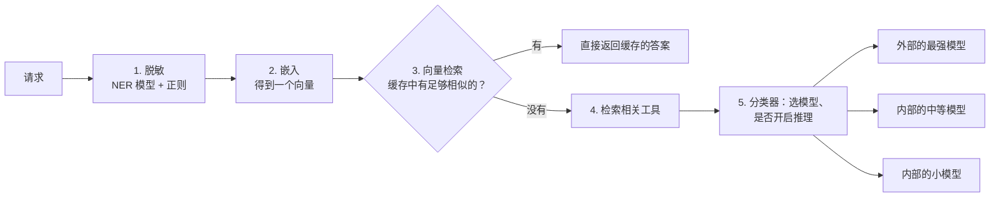

# 5.3 语义缓存与语义路由

> 对应原书第 10 章 *Semantic Caching*。语义缓存的误命中问题和实验是书外内容。

到目前为止讨论的缓存，都是在**token 层面**做精确匹配：前缀缓存（1.4 节）要求 token 完全相同，路由（4.6 节）按前缀把请求分给实例。原书第 10 章介绍了一个更高层的思路：在请求进入推理引擎之前，先理解它的**语义**，据此决定是否需要调用模型、调用哪个模型、要不要开启推理、给模型哪些工具。

原书图 10-1 区分了两种路由：一种是在同一个模型的多个副本之间分配请求（副本级，4.6 节），另一种是在不同的模型端点之间选择（端点级）。语义路由属于后者。

## 1. 语义路由能做什么

原书列出了几种用途：

- **语义缓存**。"西雅图飞夏威夷要多久"和"告诉我从西雅图到夏威夷飞行需要几个小时"是同一个问题。第二次再调用 LLM，尤其是外部的 LLM，既花钱又慢。语义缓存识别出两者相似，直接返回第一次的答案。
- **选择模型和是否推理**。不是每个问题都需要最大的模型，或者需要开启推理。一个轻量的编码器模型（原书举的例子是 ModernBERT）可以快速判断问题的复杂度，决定调用哪个模型。原书提到，越来越多的公司发现，针对任务微调的 8B 到 32B 的小模型，效果可以与通用的大模型相当甚至更好，延迟也更容易控制。
- **筛选工具**。Agent 场景下，可用的工具可能有几百个，全部放进提示词既浪费 token，又增加模型误用工具的风险。路由器根据请求挑出相关的少数几个工具（通常通过 MCP 注册的工具描述做向量检索），只把它们交给模型。
- **统一的安全与合规检查点**。

## 2. 一个语义路由器的流程

原书图 10-2 给出了一个例子，请求依次经过：



1. **脱敏**。用户的输入常常包含姓名、地址、联系方式、卡号、健康信息。在写日志、建缓存、做路由之前，先把这些信息替换成占位符，比如把"John Doe"换成 `<NAME_1>`。通常用一个针对隐私实体微调过的小型编码器做命名实体识别，再辅以正则表达式。
2. **嵌入**。用嵌入模型把提示词变成一个向量（比如 768 维）。意思相近的提示词，向量也相近：原书的例子是"forget my login"与"reset password"的向量很接近，而与"create me a draft article"相差很远。
3. **语义缓存**。在向量库中检索以前的提示词和答案，如果找到足够接近的，直接返回。
4. **筛选工具**：同样用向量检索。
5. **选择模型**：以嵌入向量作为输入，用一个小分类器决定调用哪个模型、是否开启推理。

vLLM 社区的 Semantic Router 项目就是这种思路的一个开源实现。

## 3. 相似不等于答案相同

语义缓存有一个根本的难题，原书没有展开：**两个问题语义相似，并不意味着答案可以互换**。

"北京飞上海要多久"和"北京飞广州要多久"，在向量空间里非常接近，答案却不同。"怎么重置登录密码"和"怎么重置支付密码"，字面几乎一样，对应的是两个完全不同的流程。"今天北京天气怎么样"根本就不应该被缓存。

`code/stage5/semantic_cache.py` 用一个极简的实现演示了这个问题。为了不依赖任何模型，它用汉字二元组的 TF-IDF 向量代替嵌入向量：

```bash
python code/stage5/semantic_cache.py --threshold 0.6
```

```text
0.31  从北京飞到上海需要多长时间    → 最像「北京飞上海要多久」  未命中，本可以复用
0.43  北京飞广州要多久              → 最像「北京飞上海要多久」  未命中，正确
0.76  北京飞上海要多久？经济舱      → 最像「北京飞上海要多久」  命中，答案正确
0.74  Python 怎么写入 JSON 文件    → 最像「Python 怎么读取 JSON 文件」  命中，但答案错误
0.82  明天北京天气怎么样            → 最像「今天北京天气怎么样」  命中，但答案错误
0.81  换货的运费谁出                → 最像「退货的运费谁出」  命中，但答案错误
...
正确命中 2，错误命中 3，错过 3
```

字面相似度的问题很明显：换了说法的同一个问题（"从北京飞到上海需要多长时间"）相似度只有 0.31，只差一个字、答案却不同的问题（"写入"与"读取"、"换货"与"退货"）相似度超过 0.7。阈值调高调低，只是在错误命中和错过之间移动。

真正的嵌入模型理解语义，能正确识别大部分改写，第一类错误会少很多。但第二类错误依然存在：嵌入模型本来就被训练成让"北京飞上海"和"北京飞广州"相近，因为它们确实在谈论相似的事。下面的组件用模拟的相似度分布演示了阈值的取舍：

<div class="llm-widget" data-widget="semantic-threshold"></div>

错误命中对用户来说是直接的事实错误，而且很难被发现：用户得到了一个语气自信、格式正确、只是对象错了的答案。所以实际中的做法通常是：

- **阈值设得很高**，宁可少省一些，也不要答错；
- **只对特定类型的请求启用**：答案稳定、不依赖时间和细节的问题，比如产品的使用说明、常见问题；
- **缓存键中加入关键实体**：先抽取地名、产品名、日期等实体，实体不同就不命中；
- **按用户或租户隔离**：一个用户的答案可能包含他的个人信息，不能返回给另一个用户；
- **设置过期时间**，处理答案会随时间变化的问题；
- **多轮对话不缓存**，或者把上下文也纳入相似度的计算，因为同一句"那它呢？"在不同的对话里意思完全不同。

## 4. 与其他缓存的关系

| 缓存 | 匹配方式 | 省下什么 | 风险 |
|---|---|---|---|
| 前缀缓存（1.4 节） | token 前缀完全相同 | 前缀部分的 prefill | 几乎没有，结果完全相同；多租户时有时间侧信道（4.6 节） |
| 请求级缓存 | 整个请求完全相同 | 整次调用 | 很少命中：同一个问题有无数种问法（原书第 6 章） |
| 语义缓存 | 向量相似度超过阈值 | 整次调用 | 误命中，返回错误的答案 |

前缀缓存是精确的、对用户透明的，应该总是开启；语义缓存是近似的，会改变系统的行为，需要按业务谨慎使用。

## 5. 实验

- **CPU**：在 `semantic_cache.py` 中加入你自己业务里的几组问题，包括同义改写和"只差一个关键词"的问题，观察不同阈值下的结果。
- **CPU**：实现"缓存键中加入关键实体"的改进：用一个简单的城市名列表从问题中抽取城市，城市不同就不命中。错误命中减少了多少？
- **有嵌入模型时**：把 `vec` 换成一个真实的中文嵌入模型（如 BGE 系列）的输出，重新运行。哪些错误消失了，哪些还在？

## 自测

<div class="llm-widget" data-widget="quiz" data-questions='[{"q": "语义缓存与前缀缓存最本质的区别是：", "options": ["语义缓存更快", "前缀缓存要求 token 完全相同，结果与不缓存完全一致；语义缓存按相似度近似匹配，可能返回本不该复用的答案", "前缀缓存只能在 CPU 上运行", "语义缓存只缓存 KV"], "answer": 1, "explain": "前缀缓存对用户透明，应该总是开启；语义缓存会改变系统的行为，需要按业务谨慎使用。"}, {"q": "嵌入模型很好时，下面哪类错误仍然难以避免？", "options": ["同义改写没有被识别", "语义相近但答案不同的问题被误命中，比如只差一个城市名", "完全无关的问题被命中", "向量维度不够"], "answer": 1, "explain": "嵌入模型本来就被训练成让谈论相似事情的句子相近。常见的缓解办法是提高阈值、在缓存键中加入关键实体、只对答案稳定的问题启用。"}, {"q": "原书的语义路由器在做嵌入和缓存检索之前，先做哪一步？为什么？", "options": ["分词，为了加快检索", "脱敏：替换姓名、联系方式等个人信息，保证之后的日志、缓存和路由决策不会暴露隐私", "翻译成英文", "调用最大的模型"], "answer": 1, "explain": "通常用一个针对隐私实体微调的小型 NER 模型，配合正则表达式。缓存中存的内容可能被别的用户命中，脱敏尤其重要。"}]'></div>

## 延伸阅读

- 原书第 10 章图 10-1、10-2。
- [vLLM Semantic Router](https://github.com/vllm-project/semantic-router)。
- Warner et al., [Smarter, Better, Faster, Longer: A Modern Bidirectional Encoder for Fast, Memory Efficient, and Long Context Finetuning and Inference](https://arxiv.org/abs/2412.13663)（ModernBERT），2024。
