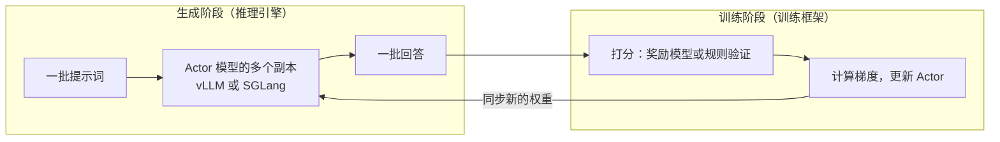

# 5.6 强化学习中的推理服务

> 对应原书第 10 章 *Model Serving in Reinforcement Learning*。GRPO、权重同步、长尾与异步、训推不一致是书外内容。

推理服务原本是为在线请求设计的，但它现在也成了大模型训练中最耗时的一环。在强化学习阶段，模型要反复生成大量的回答，再根据回答的好坏更新自己。原书引用 OpenRLHF 的估计：RLHF 训练约 80% 的时间花在生成样本上。这一节讨论推理服务在 RL 训练中扮演的角色，以及由此带来的特殊问题。

## 1. RL 训练的循环

原书图 10-11 把一次 RL 迭代分成两个阶段：

- **生成**：提示词送给 actor 模型，也就是正在被优化的那个模型，在 RL 的术语里是"当前策略"。actor 部署成多个副本，用高吞吐的推理引擎批量生成回答。
- **训练**：给每个回答打分，计算梯度，更新 actor 的参数。
- **同步**：新的参数定期同步回推理引擎的各个副本。

原书描述的是 RLHF：用一个奖励模型打分，用参考模型（训练开始时的模型副本）帮助计算策略的更新。更准确地说，参考模型的作用是计算一个 KL 惩罚，防止新策略偏离初始模型太远。近两年更常见的是面向推理能力的 RL：数学、代码等任务的答案可以被规则或程序**验证**，不需要奖励模型；GRPO 等算法对同一个提示词生成一组回答，用组内的相对好坏作为优势估计，省掉了 PPO 中的价值模型。但无论哪种算法，生成阶段的结构都是一样的。

## 2. 为什么生成这么慢

RL 的生成与在线服务有几个不同：

- **每个提示词要生成多个回答**，GRPO 中通常是 8 到 64 个。它们共享同一个提示词，前缀缓存（1.4 节）在这里非常有效。
- **回答非常长**。推理模型的一个回答常常有上万个 token。生成是 decode 主导的负载。
- **长度分布有很长的尾巴**。大部分回答几百到几千 token，少数推理特别长。
- **每一步都要等**。训练需要一整批回答，同步的做法要等这一批的最后一个回答生成完。

后两点合在一起，造成了严重的浪费：

批次刚开始时，所有回答都在生成，batch 很大，GPU 利用率高；随着短的回答陆续完成，同时在跑的回答越来越少，到最后只剩几个超长的回答，batch 很小，GPU 大部分算力闲置，而整个训练都在等它们。

## 3. 应对长尾

- **部分采样（partial rollout）**：给每次生成设一个 token 上限，没写完的回答保存下来，下一轮从中断处继续生成，而不是让整批等它。Kimi k1.5 的技术报告介绍了这种做法。
- **异步 RL**：生成和训练不再严格交替，推理引擎持续生成，训练端用已经完成的回答更新参数。AReaL 等框架采用了完全异步的设计。代价是：一部分回答是由旧版本的参数生成的，训练变成了"离策略"的，需要用重要性采样等方法修正，并且限制参数版本之间的差距。
- **长度相关的调度**：把预计较长的提示词提前开始生成，或者放到单独的实例上。

## 4. 权重同步与显存共享

每次训练更新后，推理引擎要换上新的参数。有两种部署方式：

| 方式 | 做法 | 优点 | 缺点 |
|---|---|---|---|
| 共置 | 推理引擎和训练框架在同一批 GPU 上，轮流使用 | GPU 不闲置；权重在本机内拷贝，同步快 | 两者轮流占用显存，要频繁地释放和恢复 |
| 分离 | 推理和训练用不同的 GPU | 两边可以并行，适合异步 | 权重要通过网络广播；一边忙时另一边可能闲着 |

共置时，推理引擎在训练阶段必须让出显存。vLLM 的**睡眠模式**（4.5 节）就是为此设计的：训练前让推理引擎"睡眠"，把权重暂存到 CPU 内存、丢弃 KV Cache；训练完成后唤醒，再把新的参数直接加载进来，省掉重启进程、编译和录制 CUDA Graph 的时间。verl、OpenRLHF、slime 等 RL 框架都以 vLLM 或 SGLang 作为生成引擎，并用到了这类接口。

## 5. 训推不一致与确定性

原书特别强调了确定性的重要：在 RLHF 中，即使是很小的不确定性，也会在副本之间、多次运行之间造成奖励不一致、训练不稳定、结果无法复现。原书引用了 Thinking Machines 的文章《Defeating Nondeterminism in LLM Inference》：batch 的形状不同，会让同一个请求的计算结果出现微小的差异，这些差异在成千上万次迭代中累积。因此用于 RL 的推理引擎不仅要快，还要支持**批不变**（batch-invariant）的确定性推理。6.7 节会详细讨论它的原理。

RL 中还有一个相关的问题：**推理引擎和训练框架算出的概率不一样**。生成时，推理引擎用它的 kernel（FP8、融合算子、不同的累加顺序）采样并给出每个 token 的对数概率；训练时，训练框架用自己的实现重新计算这些概率。两者理论上相同，实际上有偏差。这意味着样本实际上来自一个与训练时略有不同的策略，严格地说是离策略的。常见的处理方法是用两边概率的比值做截断的重要性采样修正，或者让推理引擎尽量与训练框架的数值一致。

## 6. 对推理服务的启示

RL 中的生成对推理引擎提出了一组与在线服务不同的要求：

| 在线服务 | RL 生成 |
|---|---|
| 关心每个请求的 TTFT、ITL | 关心一整批完成的总时间，长尾决定一切 |
| 请求之间相互独立 | 同一个提示词的多个回答共享前缀 |
| 模型的参数固定 | 参数每隔几分钟就要更新 |
| 能容忍极小的数值差异 | 需要确定性，并且与训练框架的数值一致 |
| 独占 GPU | 常常与训练共享 GPU |

## 7. 实验

- **组件**：把"长尾程度"调到 2.0，比较同步和部分异步两种方式的有效利用率。再把每批回答数从 64 调到 256，利用率怎样变化？为什么回答数多时长尾的影响相对小一些？
- **CPU**：用项目 3 的 `spec_demo.py` 和小模型，对同一个提示词以温度 1.0 生成 16 个回答，统计长度的分布。
- **GPU**：用 vLLM 的 Python 接口对同一个提示词生成 64 个回答（`SamplingParams(n=64)`），观察前缀缓存的命中情况和这一批的完成时间分布；再测试 `llm.sleep()` 和 `llm.wake_up()` 各需要多久。

## 自测

## 延伸阅读

- Hu et al., [OpenRLHF: An Easy-to-use, Scalable and High-performance RLHF Framework](https://arxiv.org/abs/2405.11143), 2024。
- Shao et al., [DeepSeekMath: Pushing the Limits of Mathematical Reasoning in Open Language Models](https://arxiv.org/abs/2402.03300), 2024。GRPO 的出处。
- Kimi Team, [Kimi k1.5: Scaling Reinforcement Learning with LLMs](https://arxiv.org/abs/2501.12599), 2025。部分采样。
- Fu et al., [AReaL: A Large-Scale Asynchronous Reinforcement Learning System for Language Reasoning](https://arxiv.org/abs/2505.24298), 2025。
- He and Thinking Machines Lab, [Defeating Nondeterminism in LLM Inference](https://thinkingmachines.ai/blog/defeating-nondeterminism-in-llm-inference/), 2025。原书引用的文章。
