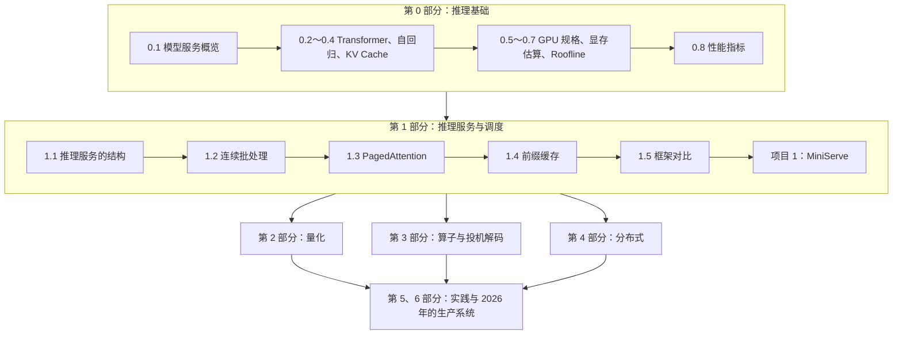

# 路线与使用说明

这一页说明课程的结构、各部分之间的联系，以及每一节的读法。

## 1. 两条主线

LLM 推理优化的技术很多，但几乎都围绕两个问题：

- **显存不够用。** 权重和不断增长的 KV Cache 占满了显存，限制了能同时服务的请求数。对应的手段是量化、分页管理、前缀缓存、KV Cache 的压缩与分层存储。
- **硬件没用满。** prefill 受算力限制，decode 受显存带宽限制，单个请求的 decode 只能用到不到 1% 的算力。对应的手段是批处理、减少读取的字节数、减少计算量、把两类阶段分开调度。

第 0 部分建立分析这两个问题的工具，第 1 部分实现一个推理引擎，之后各部分分别深入不同的方向：

第 0 部分的几个结论会反复用到。学完之后，后面的大部分技术都可以用一两句话解释清楚：

- 权重量化为什么能让 decode 变快？decode 受带宽限制（0.7 节），权重从 16 位压到 4 位，每一步要读的字节数降到四分之一。
- 连续批处理为什么能大幅提高吞吐？多个请求共享同一次权重读取，线性层的算术强度从 1 提高到批大小（0.7 节、1.2 节）。
- PagedAttention 为什么能提高吞吐？它没有让计算变快，而是减少了 KV Cache 的浪费（0.6 节），同样的显存能放下更多请求，批就更大（1.3 节）。
- 为什么要把 prefill 和 decode 分开部署？两者的瓶颈不同（0.4 节、0.7 节），放在同一张卡上会互相影响 TTFT 和 ITL（0.8 节、4.3 节）。

## 2. 与原书的对应

各节开头都注明了对应的原书章节。大致的对应关系：

| 本教程 | 原书 |
|---|---|
| 0.1 | 第 1 章 |
| 0.2～0.4 | 第 2 章 |
| 0.5～0.7 | 第 5 章 |
| 0.8 | 第 4 章的性能度量部分 |
| 1.1 | 第 3 章 |
| 1.2～1.4 | 第 6 章的批处理与前缀缓存部分 |
| 1.3、1.5 | 第 8 章 |
| 第 2 部分 | 第 6 章的模型压缩部分 |
| 第 3 部分 | 第 6 章的注意力与算子部分，第 7 章的投机解码 |
| 第 4 部分 | 第 3 章的多模型服务，第 4 章的企业架构，第 7 章的多卡与 KV Cache |
| 第 5 部分 | 第 9、10 章 |
| 第 6 部分 | 书外内容 |

原书第 0～1 部分对应的内容顺序是：先讲 Transformer 和 KV Cache（第 2 章），再讲硬件与瓶颈（第 5 章）。这里也按这个顺序安排，因为显存估算和 Roofline 分析都要用到 KV Cache 和 prefill、decode 的概念。

## 3. 每一节的读法

第 0、1 部分的每一节大致按这样的顺序展开：

1. **从一个具体现象开始**，说明这一节要解决的问题。
2. **讲清机制**，先用最小的例子，再给出公式或代码。
3. **交互组件**，可以调参数或逐步执行，用来检验刚才的理解。
4. **实验**，运行配套的脚本或命令，核对书中的数字。多数实验在 CPU 上就能完成，需要 GPU 的会注明。
5. **自测**，三到四道选择题。答完再点页底的"标记本节已完成"。

读到公式时，建议自己动手算一遍，再看文中的结果。推导中容易出错的地方，文中都单独指出了。原书中有误的数字也在相应位置注明。

## 4. 时间安排

下面是一个参考的节奏，按每周 8 小时左右估计：

| 部分 | 建议用时 | 学完时应该能做到 |
|---|---|---|
| 第 0 部分 | 1～2 周 | 不看资料，算出任意模型在任意显卡上的 KV Cache 容量和 decode 延迟下限 |
| 第 1 部分与项目 1 | 2～3 周 | MiniServe 的测试全部通过，能解释它和 vLLM 的性能差距 |
| 第 2 部分与项目 2 | 2 周 | 画出不同量化方案的精度与吞吐曲线 |
| 第 3 部分与项目 3 | 3 周 | 用 Triton 写出融合算子，实现投机解码的循环 |
| 第 4 部分与项目 4 | 3 周 | 实现缓存感知的路由，比较 TP、PP 与 PD 分离 |
| 第 5、6 部分 | 3 周 | 完成一份端到端的优化报告 |

## 5. 没有 GPU 怎么学

- **只有 CPU**：所有交互组件，第 0 部分的估算脚本，项目 1 的全部开发和正确性测试（使用随机权重的小模型）。
- **一张 24 GB 的卡**：第 0、1 部分的全部 GPU 实验（Qwen3-0.6B，或量化后的 8B），项目 1 和项目 2 的性能实验。云平台按小时租用即可。
- **多张卡**：只有第 4 部分需要，按需租用几个小时。

具体的配置和安装步骤见[实验环境](guide/lab-setup.md)。
