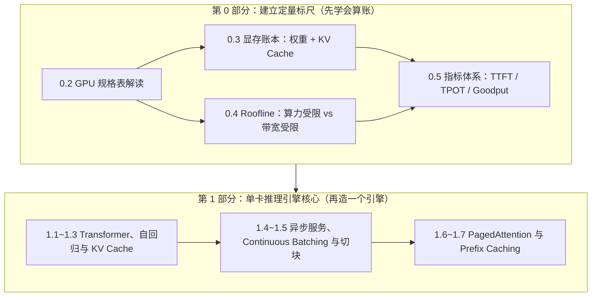

# 路线与使用说明

欢迎来到 **Hands-On LLM Serving & Optimization 交互式实战教程**。本页将帮助你规划学习节奏、理解各模块之间的逻辑纽带，并掌握最高效的自学方法。

---

## 1. 为什么我们要按这个顺序学？

很多初学者一上来就去搜“vLLM 参数怎么调”或“FlashAttention 源码怎么看”，结果往往陷入碎片化的细节里。其实，**大模型推理优化的所有技术都围绕着两条主线展开**：

1. **空间主线（显存墙）**：模型权重和动态增长的 KV Cache 把显存塞满了，怎么省空间、消碎片、跨层复用？
2. **时间主线（带宽墙与算力墙）**：Prefill 阶段算不过来（Compute-bound），Decode 阶段显存搬不过来（Memory-bound），怎么减少搬运、提高每次搬运的利用率？

因此，**第 0 部分是整门课的“度量衡”**。学完第 0 部分后，后面学到的每一种高级技术，你都能立刻用一句话点破它的本质：
- **为什么权重量化（第 2 部分）在 Decode 阶段提速明显？** 因为 Decode 受显存带宽限制（`0.4`），把权重从 16 位压到 4 位，每步需要搬运的字节数直接降为 1/4。
- **为什么 Continuous Batching（`1.5`）能把吞吐提高十几倍？** 因为让多个请求共享同一次权重读取，把算术强度从 $1$ 提高到了 $b$（`0.4`）。
- **为什么 PagedAttention（`1.6`）能提升吞吐？** 它本身并没有让矩阵乘变快，而是消除了 60% 以上的 KV 显存碎片（`0.3`），让同一张卡能塞进成倍的并发 Batch $b$。
- **为什么会有 Prefill-Decode 分离（`4.3`）？** 因为 Prefill 是算力受限、Decode 是带宽受限（`0.4`），混在同一张卡上跑会互相拖累 TTFT 和 ITL（`0.5`）。

---

## 2. 建议学习周期与投入

你可以根据自己的时间安排，按以下节奏推进：

| 阶段 | 建议周期 | 每周投入 | 阶段通关标志 |
|---|---|---|---|
| **第 0 部分：基础与估算** | 第 1 周 | 6–8 小时 | 能够不看资料手算任意模型的 KV Cache 容量与 Decode 延迟下限 |
| **第 1 部分：推理引擎核心** | 第 2–4 周 | 8–10 小时 | 在 CPU/GPU 上跑通自己实现的 **项目 1：MiniServe** 全部单元测试 |
| **第 2 部分：压缩与量化** | 第 5–6 周 | 8–10 小时 | 完成 **项目 2：Quant Arena**，产出精度-吞吐帕累托曲线 |
| **第 3 部分：加速算法与算子** | 第 7–9 周 | 8–10 小时 | 完成 **项目 3：Kernel Forge**，手写 Triton 算子与投机采样循环 |
| **第 4 部分：分布式推理** | 第 10–12 周 | 8–10 小时 | 完成 **项目 4：Cluster Commander**，实现 KV 感知路由 |
| **第 5 部分：实践与前沿** | 第 13 周 | 6–8 小时 | 掌握端到端 8 步性能诊断与多模态/Agent 场景调优 |
| **第 6 部分：2026 生产实践** | 第 14–16 周 | 8–10 小时 | 完成毕业项目（端到端优化报告 或 DeepInfer 核心机制移植） |

---

## 3. 每节的结构

第 0、1 部分的每一节按同样的顺序编写：

1. **问题**：一个具体的工程现象，说明这一节要解决什么。
2. **模型**：用最小的例子讲清机制，先不展开公式。
3. **组件**：页面内可以调参数的组件，用来检验上一步的直觉。
4. **推导与代码**：完整的公式推导或代码讲解，标出容易算错的地方。
5. **实验与自测**：运行配套脚本核对数字，最后做 3 道自测题。

---

## 4. 没有 GPU 怎么学

不用担心硬件门槛。我们把每一节的实践拆成了三个梯度：

- **零 GPU 梯度（任何笔记本均可）**：
  - 所有章节的**交互组件**直接在浏览器运行。
  - 第 0 部分的显存估算脚本（`code/stage0/estimate_memory.py`）和 **项目 1 MiniServe 的全部代码开发与正确性测试** 均可在纯 CPU 上毫秒级跑通（使用 `make_tiny_model.py` 生成的微型模型）。
- **入门单卡梯度（1× 24GB，如 RTX 3090 / 4090 / A10，或云平台按小时租用）**：
  - 可完整运行 Qwen3-0.6B / Qwen3-8B 的 vLLM 实验、Roofline 扫描、MiniServe GPU 压测以及第 2、3 部分的全部实验。
- **多卡进阶梯度（2× GPU 及以上）**：
  - 仅第 4 部分（分布式 TP/PP/DP 与 PD 分离）需要 2 张以上 GPU，按需在云平台租用几小时即可完成。
