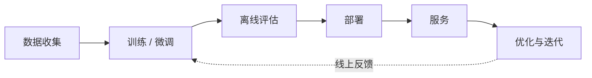

# 0.1 模型服务概览

> 对应书中第 1 章 Introduction to Model Serving and Optimization

## 学习目标

- 说清楚模型服务（model serving）在机器学习生命周期中的位置，以及它和训练在目标、约束上的区别。
- 区分四种常见的服务形态：端侧、单模型服务、多模型服务、服务平台，并说出各自适用的场景。
- 解释为什么 LLM 的服务几乎必须做优化，以及优化的落脚点是延迟、吞吐和单位成本。

## 1. 从工程视角看"模型"

工程上通常把模型当成一个可执行的程序，而不是一份静态数据。它由三部分组成：

| 组成 | 内容 | LLM 中的对应物 |
|---|---|---|
| 模型数据 | 权重、偏置、配置 | `*.safetensors`、`config.json`、`generation_config.json` |
| 模型结构 | 层的类型、数量与连接方式 | `modeling_qwen3.py` 这类结构定义 |
| 执行代码 | 初始化结构、加载权重、运行推理 | `model.generate()`，或 vLLM / SGLang 的执行器 |

书中建议把结构和权重分开存放，便于在结构有小改动时做部分加载（`load_state_dict(strict=False)`）。对 LLM 来说，执行代码这一层正是推理框架发挥作用的地方：同一份权重，用 HF Transformers 和用 vLLM 跑，吞吐可以差一个数量级。

## 2. 生命周期与服务的位置



模型训练完成并通过评估后，要经过部署进入服务阶段，接受真实流量。服务阶段关注的问题和训练完全不同：

| 方面 | 训练 | 服务 |
|---|---|---|
| 目标 | 最小化损失，学习参数 | 对新输入高效地产生预测 |
| 计算 | 前向 + 反向 + 参数更新 | 只有前向 |
| 批处理 | 大批量，追求样本吞吐 | 请求随机到达，批大小动态变化 |
| 关注指标 | 收敛速度、最终精度 | 延迟、吞吐、可用性、单位成本 |

所以训练框架不适合直接拿来做服务。书中给的例子是 vLLM 论文的结果：在 A10G 上跑 LLaMA-7B、在 A100-40GB 上跑 LLaMA-13B，vLLM 的吞吐比 HF Transformers 高 8.5–15 倍，比 HF TGI 高 3.3–3.5 倍。差距几乎全部来自执行层的调度与显存管理，后面第 1 部分会逐一拆开。

## 3. 服务关注的七件事

书中列出的服务关注点：部署、可扩展性与可用性、延迟、监控、版本管理、安全、单位成本（cost-to-serve）。其中**单位成本是最终的判据**：其他指标达标后，比较的是每百万 token 花多少钱。

## 4. 四种服务形态

### 4.1 端侧服务

模型直接跑在手机、机器人、摄像头等设备上。好处是省云端费用、无网络延迟、数据不出设备、可做个性化；代价是算力、内存、功耗都受限，更新困难，硬件碎片化。常见运行时有 LiteRT、ONNX Runtime、Core ML。第 5 部分的端侧推理一节会再讨论。

### 4.2 单模型服务

每个模型（及每个版本）部署为独立的服务，前面是 API 层，后面是若干推理容器。容器内部分三块：API Server、模型管理（下载、加载）、推理后端（vLLM、TensorRT-LLM 等）。

这是最常用的形态，书中作者也把它作为默认选择：没有资源争用、每个模型独立扩缩、日志和故障相互隔离。缺点是模型数量多时运维成本和闲置资源都很高。

**路由策略。** 简单轮询（round-robin）不考虑请求的处理时长差异。LLM 请求的长度差异极大，5000 token 的输入和 100 token 的输入占用的资源不在一个量级。常见的替代方案：

| 策略 | 依据 |
|---|---|
| 加权轮询 | 实例的容量权重 |
| 最少连接 | 当前活跃连接数 |
| 最短响应时间 | 近期响应时间 |
| 动态负载均衡 | GPU / 显存利用率、队列长度等指标 |

LLM 场景还有一种重要的策略是**缓存感知路由**：把共享前缀的请求发到已缓存该前缀的实例上，第 4 部分会专门讨论。

**扩展方式。** 横向扩展（scale out）是增加副本数；纵向扩展（scale up）是换更强的 GPU 或把一个模型切到多张卡上。书中的建议是优先单机多卡，尽量避免跨机，因为跨机通信带宽比机内低一个数量级以上（见 0.2）。

### 4.3 多模型服务

多个模型共享一个服务容器的 GPU 与内存，按需加载、按 LRU 卸载。适合模型多、单个模型流量低的场景，例如允许用户上传自定义模型的平台。路由层需要维护"模型 → 实例"的映射和每个模型的副本数，选择在哪个实例上加载新副本本质上是装箱问题。

不适合的情况：模型太大无法共享一张卡；单个模型流量高、对延迟敏感；模型间安全策略不同。NVIDIA Triton Inference Server 是这一形态的常用后端，第 4 部分的多模型服务一节会展开。

### 4.4 服务平台

当多个业务、多种模型同时运行时，需要在单模型、多模型服务之上再加一层：按资源组隔离不同业务的配额，用图执行引擎（如 Ray）编排多步推理流程。Agent 类应用本质上就是这种多步流程。

## 5. 为什么 LLM 的服务必须优化

一个"能跑"的 LLM 服务在真实流量下通常会暴露三个问题：负载上来后延迟快速上升；吞吐停在远低于硬件能力的水平；成本随用量线性甚至超线性增长。

书中举了两个配置调整带来的数量级差异：

- 用 vLLM 替代 HF Transformers（上文论文数据）。
- 作者在 vLLM 上部署 DeepSeek-R1 时，只改了两项配置（启用 FP8 MLA kernel、增大批大小），吞吐从 38 tok/s 提升到 600 tok/s。

这说明**推理框架里的每个参数都可能是一个优化点**。本笔记后面的内容，就是弄清楚这些参数背后的机制，从而能根据负载做出判断，而不是逐个试。

## 动手实验

在单卡上用 vLLM 启动一个小模型，熟悉服务的基本形态与启动日志：

```bash
vllm serve Qwen/Qwen3-0.6B --max-model-len 4096 --gpu-memory-utilization 0.9
```

启动日志里重点看三行，后面几节会用到：

| 日志内容 | 含义 | 相关章节 |
|---|---|---|
| `Model loading took ... GiB` | 权重占用的显存 | 0.3 |
| `GPU KV cache size: N tokens` | 可用于 KV Cache 的 token 容量 | 0.3、1.6 |
| `Maximum concurrency for X tokens per request: Y` | 每个请求都用满 X 个 token 时能同时容纳的请求数 | 0.3 |

然后发送一个请求：

```bash
curl http://localhost:8000/v1/chat/completions \
  -H "Content-Type: application/json" \
  -d '{"model":"Qwen/Qwen3-0.6B","messages":[{"role":"user","content":"用一句话解释 KV Cache"}],"max_tokens":64}'
```

记录：权重大小、KV Cache 容量（token 数），以及一次请求的端到端耗时。

## 自测题

1. 为什么不直接用训练框架做推理服务？至少说出两点。
2. 单模型服务和多模型服务各适合什么场景？一个平台上有 1000 个低频的微调模型，该选哪种？
3. 为什么轮询负载均衡对 LLM 不友好？

<details>
<summary>参考答案</summary>

1. 训练框架为大批量、反向传播和参数更新设计，而服务只做前向，请求随机到达、长度差异大，需要动态批处理、KV Cache 管理和细粒度调度；训练框架也不提供服务所需的流式输出、队列、抢占等能力。
2. 单模型服务适合流量大、对延迟敏感、需要隔离的模型；多模型服务适合模型多且单个流量低的场景。1000 个低频模型适合多模型服务（如果是同一基座的 LoRA，还可以考虑第 4 部分的 Multi-LoRA）。
3. LLM 请求的计算量与输入、输出长度强相关，差异可达几个数量级。轮询不看实例当前负载，容易把新请求压到正在处理长请求的实例上。

</details>

## 延伸阅读

- Kwon et al., *Efficient Memory Management for Large Language Model Serving with PagedAttention*, SOSP 2023（书中 vLLM 数据的来源）
- 书中第 3 章的单模型 / 多模型服务实现，对应本笔记 1.4 与 4.5
