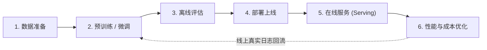
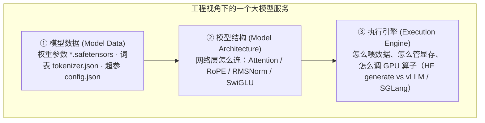

# 0.1 模型服务概览：从跑通 Demo 到生产级推理系统

## 学习目标

完成本节学习后，你将能够：
- **解释训练与推理服务（Serving）的本质差异**：说清楚为什么可以直接用 PyTorch 训练模型，却几乎不能直接用原生 `model.generate()` 上线抗并发流量。
- **拆解一个大模型服务的三大构成要素**：理解权重文件、模型结构与执行引擎如何解耦，以及为什么只换执行引擎就能提速 10 倍以上。
- **为不同业务场景选择合适的服务形态与路由策略**：区分端侧、单模型、多模型与服务平台，并解释为什么传统 Web 服务常用的简单轮询（Round-Robin）在大模型场景下会失灵。

---

## 1. 为什么跑通了 `model.generate()` 却上不了生产？

很多初学者第一次接触大模型时，都会写下类似下面这样的 5 行 Python 代码：

```python
from transformers import AutoModelForCausalLM, AutoTokenizer

tok = AutoTokenizer.from_pretrained("Qwen/Qwen3-8B")
model = AutoModelForCausalLM.from_pretrained("Qwen/Qwen3-8B", torch_dtype="bfloat16").cuda()
out = model.generate(**tok("请解释什么是 KV Cache", return_tensors="pt").to("cuda"), max_new_tokens=100)
print(tok.decode(out[0]))
```

在自己的终端里跑一下，3 秒钟就吐出了流利的回答，看起来一切都很美好。于是你用 FastAPI 把这段代码包成一个 HTTP 接口放到线上。结果刚有 10 个同事同时点开网页测试，灾难就发生了：

1. **排队雪崩**：第 1 个人的请求在算的时候，后面 9 个人全在干等，第 10 个人等了整整 30 秒才看到第一个字。
2. **显存爆炸（OOM）**：你想把 10 个人的请求拼成一个 Batch 一起算，结果有人传了一篇 8000 字的长文档，显卡瞬间报 `CUDA out of memory` 崩溃退出。
3. **昂贵的 GPU 在“摸鱼”**：你看了一眼监控，显卡每个月租金上万元，但在逐字生成回答时，GPU 算力利用率竟然连 **2%** 都不到。

**这就是“跑通一次推理（Inference）”与“构建模型服务（Model Serving）”之间的鸿沟。**

在机器学习的完整生命周期中，模型训练完成并通过离线评测后，才真正进入直面真实用户的**服务（Serving）**阶段：



训练阶段和在线服务阶段，虽然跑的是同一个神经网络，但它们的目标和约束几乎完全相反：

| 对比维度 | 模型训练（Training） | 在线推理服务（Model Serving） |
|---|---|---|
| **核心目标** | 最小化损失函数（Loss），更新模型参数 | 对随时到达的用户输入，又快又省地生成回答 |
| **计算过程** | 前向传播 + 反向传播 + 优化器更新（需要保存全部中间激活值） | **只有前向传播**（无需梯度，但需要维护跨步的 KV 缓存） |
| **输入形态** | 离线准备好的静态数据集，可以整齐地凑成固定大 Batch | 请求在任意时刻随机到达，有的输入 10 个词，有的输入 3 万词 |
| **交互体验** | 跑几个小时甚至几周都没关系，只看总吞吐 | **毫秒必争**：用户要求几百毫秒内看到第一个字（TTFT），随后平滑流式吐字 |
| **终极考核指标** | 模型收敛速度、评测集准确率 | **延迟 SLO 达标率、单卡并发吞吐、每百万 Token 成本（Cost-to-Serve）** |

正因为训练框架（如原生 PyTorch / Hugging Face Transformers）是为“离线整齐大批量 + 反向传播”设计的，直接拿它做在线服务就会水土不服。在相同硬件（如 A10G / A100）上运行 7B~13B 模型，专门针对推理服务设计的引擎（如 **vLLM**、**SGLang**），吞吐量通常是原生 Hugging Face Transformers 的 **8.5 到 15 倍**以上！

---

## 2. 核心心智模型：把“模型”拆成三层来看

为什么不改模型的任何一个参数，仅仅把 Hugging Face 换成 vLLM，速度就能快上十倍？

为了理解这一点，在工程上我们不能把“一个大模型”当成一块铁板，而应该把它拆解为**相互独立的三层**：



| 层次 | 包含什么 | 打个比方 | 在推理优化中变不变？ |
|---|---|---|---|
| **① 模型数据** | 训练好的权重数值（`*.safetensors`）、配置文件（`config.json`） | **菜谱上的配料分量** | 除非做量化压缩（第 2 部分），否则完全不变 |
| **② 模型结构** | 36 层 Transformer 怎么拼起来、用什么激活函数 | **做菜的工序步骤** | 数学公式等价，不能随便乱改（否则胡言乱语） |
| **③ 执行引擎** | 怎么把多个客人的点单拼成一锅炒、怎么管理冰箱空间（KV Cache）、用什么灶具（CUDA Kernel） | **后厨的调度与厨具系统** | **推理优化的主战场！** 10 倍提速几乎全部来自这一层 |

当你从 Hugging Face 下载 `Qwen/Qwen3-8B` 时，你下载的只是第 ① 层（权重数据）和第 ② 层（配置说明）。至于第 ③ 层（怎么执行它），完全取决于你选用什么推理引擎。在第 1 部分的实战项目 **MiniServe** 中，我们就将加载同一份官方权重，亲手编写属于自己的第 ② 层和第 ③ 层。

---

## 3. 交互式沙盒：四种服务形态与路由策略怎么选？

在把模型部署成服务时，并没有一种“放之四海皆准”的架构。生产环境中常见的服务形态可以分为四类：**端侧服务**、**单模型专用服务**、**多模型共享服务**、以及**多步编排服务平台**。

现在，请点击下方交互式沙盒中的不同业务场景，观察业务约束如何决定架构形态与负载均衡策略：

<div class="llm-widget" data-widget="serving-arch-selector"></div>

### 动手试一试 & 深入思考：为什么传统 Web 的轮询（Round-Robin）在 LLM 下会崩溃？

在传统的网页后端（比如查询用户信息接口）中，每个请求的处理时间差不多都是 5~10 毫秒，所以网关用最简单的**轮询（Round-Robin，第 1 个请求发给机器 A，第 2 个发给机器 B……）**就能很好地平摊负载。

但在大模型服务中，**请求之间的计算量差异高达几百倍**：
- 请求 1：`"你好"`（输入 2 个 token，回答 10 个 token，耗时 0.2 秒）
- 请求 2：`"请帮我逐段总结这篇 2 万字的财报并输出详细表格"`（输入 15,000 个 token，回答 2,000 个 token，耗时 40 秒，占用数 GB 显存）

如果使用简单轮询，很可能把 3 个超长财报请求凑巧全分给了机器 A，导致机器 A 显存爆满、后续请求全部卡死，而机器 B 处理完几个 `"你好"` 后就彻底闲置了。因此，大模型网关通常采用两类更聪明的策略：
1. **基于实时引擎指标的动态路由**：根据后端实例当前排队请求数、正在生成的 Token 总数以及 KV Cache 剩余空间来分发。
2. **前缀缓存感知路由（Prefix/KV-aware Routing）**：如果同一个用户正在进行第 5 轮对话，前 4 轮的历史已经缓存在机器 A 的显存里了，网关就会尽量把第 5 轮请求继续发给机器 A，直接省去重复计算前 4 轮的时间（我们将在 `1.7` 和 `4.6` 节深入实现它）。

---

## 4. 生产级大模型服务关注的“七件事”与一个终极判据

当你从个人玩具项目走向企业级生产系统时，你需要同时兼顾七个维度：

1. **部署与自动化（Deployment）**：能否把模型、驱动和推理引擎打包成标准容器，在几分钟内拉起新副本？
2. **可扩展性与高可用（Scalability & Availability）**：流量高峰时能否横向扩容（Scale Out，增加副本数）？单机装不下超大模型时能否纵向切分（Scale Up，多卡张量并行）？
   > **工程经验法则**：扩容时优先在**单台机器内部**用单卡或多卡装下模型副本，流量大了再复制多个独立的单机副本；不到万不得已（如 671B 超大 MoE 模型），尽量不要把同一个模型跨多台机器切分，因为跨机网线带宽比机内 NVLink 慢一个数量级以上（下一节 `0.2` 马上就会算这笔账）。
3. **低延迟（Latency）**：首字响应（TTFT）和吐字速度（TPOT）是否满足用户体验？
4. **可观测性（Monitoring）**：能否实时看到 GPU 显存池水位、请求排队长度和 P99 延迟？
5. **版本管理与灰度（Versioning）**：新微调的模型上线时，能否切 5% 的流量做 A/B 测试并随时秒级回滚？
6. **安全与多租户隔离（Security）**：如何防止恶意超长 Prompt 耗尽显存，或不同租户之间通过缓存泄露隐私？
7. **单位服务成本（Cost-to-Serve，终极判据）**：当上面所有指标（延迟、准确率、可用性）都达标后，**“每处理一百万个 Token 花了多少钱（$/Million Tokens）”** 就是衡量一套推理系统优劣的最终标尺。

本教程接下来的所有章节，本质上都在教你如何在这七件事之间做精确的定量计算与工程优化。

---

## 5. 动手实验：第一次读懂推理引擎的“体检报告”

如果你手头有 GPU 环境，可以用一行命令启动 vLLM，服务一个轻量的 `Qwen/Qwen3-0.6B` 模型：

```bash
vllm serve Qwen/Qwen3-0.6B --max-model-len 4096 --gpu-memory-utilization 0.9
```

初学者启动服务时往往直接略过满屏的日志，只看最后一行 `Uvicorn running on http://0.0.0.0:8000`。但对推理工程师来说，**启动日志里藏着最重要的三行“体检数据”**：

```text
INFO: Loading model weights took 1.15 GiB
INFO: GPU KV cache size: 218,432 tokens
INFO: Maximum concurrency for 4,096 tokens per request: 53.33x
```

这三行日志分别回答了三个核心问题：

| 启动日志关键行 | 它在告诉你什么 | 我们将在哪一节亲手推导出这个数字 |
|---|---|---|
| `Loading model weights took 1.15 GiB` | 模型静态权重吃掉了多少显存 | `0.3 显存估算` |
| `GPU KV cache size: 218,432 tokens` | 扣除权重和预留开销后，剩下的显存最多能同时记住多少个 Token 的上下文状态 | `0.3 显存估算` & `1.6 vLLM 架构` |
| `Maximum concurrency for 4,096 tokens...: 53.33x` | 如果每个用户都把 4096 长度用满，这张卡最多能同时服务 53 个并发请求而不触发抢占 | `0.3 显存估算` & `1.5 连续批处理` |

接着，打开另一个终端发送一条测试请求，验证服务工作正常：

```bash
curl http://localhost:8000/v1/chat/completions \
  -H "Content-Type: application/json" \
  -d '{
    "model": "Qwen/Qwen3-0.6B",
    "messages": [{"role": "user", "content": "用一句话解释什么是模型服务（Model Serving）"}],
    "max_tokens": 64
  }'
```

---

## 6. 闯关自测

点击下方选项检验你对本节核心概念的理解（选错也没关系，会有详细解析）：

<div class="llm-widget" data-widget="quiz" data-title="0.1 模型服务概览 · 闯关自测" data-questions='[
  {
    "q": "为什么我们不直接把训练框架（如原生 PyTorch / Hugging Face generate）放到生产环境做高并发在线服务？",
    "options": [
      "因为训练框架算出来的数学结果不如 vLLM 准确",
      "因为训练框架主要针对固定大批量与反向传播设计，缺乏动态连续批处理、分页 KV Cache 显存管理与细粒度流式调度能力",
      "因为训练框架不支持加载 .safetensors 格式的权重文件",
      "因为训练框架只能在 CPU 上运行前向传播"
    ],
    "answer": 1,
    "explain": "推理引擎（如 vLLM/SGLang）与原生 PyTorch 算出的数学结果是等价的，也都支持 safetensors 和 GPU。高达 10 倍的吞吐差距几乎全部来自执行引擎层的动态批处理调度（Continuous Batching）和分页显存管理（PagedAttention）。"
  },
  {
    "q": "某创业公司平台上托管了 1,000 个客户微调的小众行业模型，每个模型每天只有十几次调用。为了控制 GPU 成本，最适合采用哪种服务形态？",
    "options": [
      "单模型专用服务：给每个模型分配 1 张专属 GPU 常驻运行",
      "端侧服务：要求所有客户自己买显卡在本地运行",
      "多模型共享服务（Multi-Model Serving）或共享基座的 Multi-LoRA 服务，按需加载与复用 GPU",
      "把 1,000 个模型的权重平均值合并成一个模型"
    ],
    "answer": 2,
    "explain": "1000 个低频模型如果独占 GPU 会造成 99% 以上的空置浪费。采用多模型共享容器（配合 LRU 按需加载卸载）或基于同一基座模型的 Multi-LoRA 服务（第 4.7 节），可以用极少数 GPU 服务海量低频模型。"
  },
  {
    "q": "为什么传统的简单轮询（Round-Robin）负载均衡策略对大模型服务很不友好？",
    "options": [
      "因为大模型服务使用的是 UDP 协议而不是 HTTP 协议",
      "因为不同 LLM 请求的输入/输出长度差异极大（耗时可差百倍），且简单轮询无法利用实例已有的前缀 KV 缓存",
      "因为轮询策略每次转发需要消耗大量 GPU 算力",
      "因为轮询策略不支持返回 JSON 格式的数据"
    ],
    "answer": 1,
    "explain": "LLM 请求的开销与 Token 长度强相关。简单轮询既不看后端实例当前是在处理 10 字短请求还是 3 万字长请求，也会把同一个多轮对话打散到不同机器上，浪费了宝贵的 Prefix Cache。"
  }
]'></div>

---

## 延伸阅读与参考文献

- Kwon et al., [*Efficient Memory Management for Large Language Model Serving with PagedAttention*](https://arxiv.org/abs/2309.06180), SOSP 2023（vLLM 开山论文，量化对比了专用推理引擎与传统实现的吞吐差距）
- Chi Wang & Peiheng Hu, *Hands-On LLM Serving and Optimization*, O'Reilly, Chapter 1 (*Introduction to Model Serving and Optimization*)
