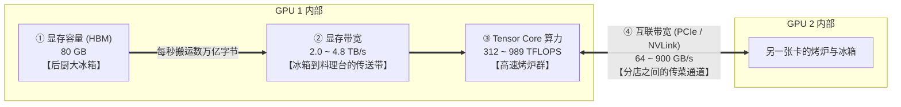
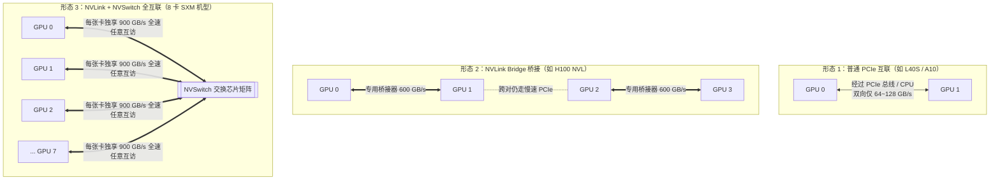

# 0.2 GPU 规格解读：算力、带宽与硬件参数表的隐藏陷阱

## 学习目标

完成本节学习后，你将能够：
- **从复杂的 GPU 规格表中精准抓出决定推理性能的四项核心指标**：算力（FLOPS）、显存容量（VRAM）、显存带宽（Memory Bandwidth）与卡间互联带宽（Interconnect）。
- **识破厂商规格表中的“稀疏算力（Sparsity）”陷阱**：明白为什么宣传册上写的 1979 TFLOPS 在实际大模型推理中只有 989 TFLOPS 可用。
- **理解多卡互联的层级差异**：说清楚 PCIe、NVLink Bridge、NVSwitch 和跨机 InfiniBand 的带宽差距，建立科学的 GPU 选型直觉。

---

## 1. 为什么算力更高的显卡，跑大模型有时反而更慢？

假设你正在为团队采购推理显卡，面前放着两份参数宣传单：
- **显卡甲（NVIDIA H100 SXM）**：BF16 峰值算力高达 **989 TFLOPS**（宣传册上甚至写着 1979 TFLOPS），显存 80 GB，带宽 3.35 TB/s。
- **显卡乙（NVIDIA H100 NVL）**：BF16 峰值算力降到了 **835 TFLOPS**，但显存有 94 GB，带宽提升到了 3.9 TB/s。

很多初学者第一反应是：“当然选算力高的 H100 SXM！算力高代表算得快！”
然而当你把一个 70B 的大模型部署上去做在线聊天服务时，却惊讶地发现：**算力低了 15% 的 H100 NVL，每个用户看到的吐字速度反而比 H100 SXM 快了约 16%，而且还能同时容纳更多并发用户！**

为什么会这样？因为大模型推理并不是一个单纯比拼“谁算得快”的游戏。如果不懂 GPU 规格表里各项指标背后的物理意义，选卡和调优就会频频踩坑。

---

## 2. 核心心智模型：把 GPU 想象成一家披萨后厨

一块现代数据中心 GPU（如 A100、H100）上有上万个计算核心和几十 GB 的高速显存。我们可以用**披萨店后厨**的比喻，把与大模型推理最相关的四项硬件指标彻底讲明白：



| 硬件指标 | 常见单位 | 后厨比喻 | 在大模型推理中决定什么？ |
|---|---|---|---|
| **① 显存容量（VRAM Capacity）** | `GB` | **冰箱有多大** | 能不能装下模型权重？装下权重后还剩多少空间存客人的点单历史（KV Cache）？直接决定**能不能跑起来**以及**最大并发数**（`0.3` 节详解）。 |
| **② 显存带宽（Memory Bandwidth）** | `TB/s` 或 `GB/s` | **从冰箱拿面团到烤炉的传送带速度** | 在逐字生成的 Decode 阶段，每吐出 1 个词都要把冰箱里的全部模型权重搬到烤炉过一遍。**传送带越快，单用户吐字（TPOT）越快**（`0.4` 节详解）。 |
| **③ 张量算力（Tensor Core FLOPS）** | `TFLOPS`（每秒万亿次浮点运算） | **烤炉烘烤的速度** | 当客人一次性发来几千字长文（Prefill 阶段）或几十人拼成一大锅同时算时，面团足够多，**烤炉功率决定了首字延迟（TTFT）的上限**。 |
| **④ 互联带宽（Interconnect Bandwidth）** | `GB/s` | **两个后厨之间传递半成品的通道宽度** | 当模型太大、1 个冰箱装不下，必须切分到 2~8 张卡上协同计算（张量并行 TP）时，**卡间通道越宽，多卡同步等待的时间越短**。 |

> **一句话直觉**：冰箱装不下就开不了张（看**显存容量**）；一次烤几千个小面团时怕烤炉慢（Prefill 看**算力**）；每次只烤 1 个面团却要把所有配料罐都搬出来一次时，烤炉再快也在等传送带（Decode 看**显存带宽**）！这就解释了开头的问题：聊天场景以 Decode 为主，带宽更高（3.9 vs 3.35 TB/s）、显存更大（94 vs 80 GB）的 H100 NVL 自然胜出。

---

## 3. 交互式沙盒：主流 GPU 规格对比与“稀疏算力陷阱”

在阅读官方规格白皮书时，有两个极其隐蔽的陷阱经常让工程师算错两倍性能：
1. **陷阱一：稀疏算力（Sparse）vs 稠密算力（Dense）**。从 Ampere（A100）和 Hopper（H100）架构开始，NVIDIA 引入了 `2:4 结构化稀疏` 硬件加速（假设每 4 个权重里恰好有 2 个是 0，算力翻倍）。厂商为了数字好看，宣传表里往往印的是**稀疏算力**（比如 H100 BF16 标为 `1979 TFLOPS`）。但我们实际部署的 Qwen、Llama、DeepSeek 等开源大模型，权重矩阵都是**稠密（Dense，非零）**的！真实可用的稠密算力只有宣传值的一半（`989 TFLOPS`）。
2. **陷阱二：不同精度下的硬件支持度**。同一张卡在 FP8（8位浮点）下的算力通常是 BF16（16位浮点）的 **2 倍**，但前提是这张卡有原生的 FP8 Tensor Core（如 H100、H200、L40S、RTX 4090）。像 A100 / A800 这类 Ampere 架构显卡**没有原生 FP8 计算单元**，在它们上面存 FP8 权重只能省显存，计算时还得转回 BF16。

请在下方交互沙盒中切换不同显卡、精度和“稀疏算力开关”，直观感受这些差异：

<div class="llm-widget" data-widget="gpu-specs-explorer"></div>

### 动手试一试
1. 在沙盒中把主显卡选为 **H100 SXM**，点击右侧的 **「算力口径切换」** 按钮，观察 989 TFLOPS 与 1979 TFLOPS 的区别。**记住一条铁律：做大模型推理估算时，永远只查 Dense（稠密）算力！**
2. 将对比显卡选为 **L40S**，切换计算精度到 **FP8**，然后对比 **A100 80GB** 与 **L40S 48GB**：你会发现 L40S 的算力（362 TFLOPS BF16 / 733 TFLOPS FP8）比 A100 还猛，但它的显存带宽（0.864 TB/s）还不到 A100（2.04 TB/s）的一半！思考一下：L40S 更适合长输入 Prefill 还是高并发长输出 Decode？

---

## 4. 深入拆解：主流 GPU 规格对照表与多卡互联拓扑

为了方便你在后续章节随时查阅，我们将常见数据中心 GPU 的**真实稠密（Dense）规格**整理如下：

| GPU 型号 | 架构代号 | 显存容量与类型 | 显存带宽 | BF16 稠密算力 | 原生 FP8 稠密算力 | 卡间机内互联 |
|---|---|---|---|---|---|---|
| **H200 SXM** | Hopper (SM90) | 141 GB HBM3e | **4.80 TB/s** | 989 TFLOPS | 1979 TFLOPS | NVLink + NVSwitch (900 GB/s) |
| **H100 SXM** | Hopper (SM90) | 80 GB HBM3 | 3.35 TB/s | 989 TFLOPS | 1979 TFLOPS | NVLink + NVSwitch (900 GB/s) |
| **H100 NVL** | Hopper (SM90) | 94 GB HBM3 | 3.90 TB/s | 835 TFLOPS | 1671 TFLOPS | 双卡 NVLink 桥接 (600 GB/s) |
| **A100 80GB SXM** | Ampere (SM80) | 80 GB HBM2e | 2.04 TB/s | 312 TFLOPS | 不支持 | NVLink + NVSwitch (600 GB/s) |
| **A800 80GB SXM** | Ampere (SM80) | 80 GB HBM2e | 2.04 TB/s | 312 TFLOPS | 不支持 | NVLink + NVSwitch (**400 GB/s**) |
| **L40S** | Ada (SM89) | 48 GB GDDR6 | 0.864 TB/s | 362 TFLOPS | 733 TFLOPS | 仅 PCIe Gen4 (64 GB/s) |
| **A10** | Ampere (SM86) | 24 GB GDDR6 | 0.60 TB/s | 125 TFLOPS | 不支持 | 仅 PCIe Gen4 (64 GB/s) |

> [!NOTE]
> **细节辨析：PCIe 版 vs SXM 版、A100 vs A800**
> - 同名显卡往往有 **PCIe 插卡版** 和 **SXM 模组版** 两种形态。例如 A100 80GB PCIe 版的显存带宽是 `1.935 TB/s`，而 SXM 版是 `2.039 TB/s`。
> - **A800** 是面向中国市场定制的 A100 变体：它的单卡算力（312 TFLOPS）、显存容量（80 GB）和显存带宽（2.04 TB/s）与 A100 **完全一致**，所以跑单卡模型时性能毫无差别；唯一的区别是 NVLink 互联带宽从 `600 GB/s` 降到了 `400 GB/s`，只有在多卡张量并行（TP）通信密集时才会体现出差异。

### 4.1 为什么多卡互联要分 PCIe、NVLink 和 NVSwitch？

当一个模型（例如 70B，BF16 权重约 140 GB）装不进单张 80 GB 显卡时，我们必须把它切分到多张卡上运行。这时，卡与卡之间的通信速度就成了新的瓶颈：



- **为什么需要 NVSwitch？** 假设每张 H100 SXM 卡对外总共有 18 根 NVLink 通道（总带宽 900 GB/s）。如果没有中间的交换芯片（NVSwitch），这 18 根线要平分给机箱里的另外 7 张卡，那么任意两张卡之间的点对点带宽就只剩 $900 / 7 \approx 128\text{ GB/s}$。加上 **NVSwitch** 后，就像给 8 张卡装了一台满速光纤交换机，任意两张卡通信都能跑满 **900 GB/s**。
- **机内 vs 跨机**：哪怕配置了顶级的 400G InfiniBand 网卡（支持 GPUDirect RDMA，不经过 CPU 直接读写显存），单卡跨机网络带宽也只有约 **50 GB/s**，不到机内 NVLink（900 GB/s）的十七分之一！这就是 `0.1` 节强调**“优先单机多卡，尽量避免跨机切分单个模型”**的物理根源。
- **超节点机柜（如 GB200 NVL72）**：为了打破单机 8 卡的限制，最新一代架构将 72 张 Blackwell GPU 通过铜缆背板连进同一个 NVLink 域，让 72 张卡像在同一个机箱里一样以 TB/s 级带宽通信，专门应对万亿参数 MoE 模型的分离式部署（第 6 部分详解）。

### 4.2 硬件演进的最大矛盾：“存储墙（Memory Wall）”

过去 20 年里，GPU 的峰值算力（FLOPS）增长了上万倍，但显存带宽和卡间互联带宽的增长却慢得多。**“算得飞快，但数据搬不过来”** 的剪刀差被称为**存储墙（Memory Wall）**。

理解了存储墙，你就理解了本教程后面 80% 软件优化的本质：**无论是算子融合（Triton）、FlashAttention（把数据留在超快的片上 SRAM 缓存里不写回显存）、权重量化（把 16 位压成 4 位减少搬运字节），还是连续批处理（搬一次权重喂给几十个请求），都是在帮硬件翻越这堵“存储墙”。**

---

## 5. 实战选型案例：给定模型怎么挑卡？

结合上面的指标，我们看三个真实的工程选型决策：

| 业务需求与模型 | 推荐 GPU 选型 | 背后的定量推导理由 |
|---|---|---|
| **微调后的 8B 模型（BF16 权重约 16 GB）**，内部工具使用，并发不高 | **1 × NVIDIA A10 (24 GB)** 或 **L4** | 24 GB 显存装下 16 GB 权重后还剩约 6~8 GB 给 KV Cache，够跑几个并发；A10 价格便宜、云厂商货源充足，性价比最高。 |
| **14B 稠密模型（BF16 权重约 28 GB）**，中等并发在线服务 | **1 × NVIDIA L40S (48 GB)** | 24 GB 卡装不下；如果用 2 张 A10 会引入 PCIe 跨卡通信开销。单张 48 GB 的 L40S 不仅能单卡装下并留出近 16 GB KV Cache，还支持原生 FP8 进一步把权重压到 14 GB。 |
| **DeepSeek-R1（671B MoE 大模型，FP8 权重约 670 GB）** | **8 × H200 (141 GB × 8 = 1,128 GB) + NVSwitch** | 8 张 80 GB 的 H100 总显存只有 640 GB，连 670 GB 的 FP8 权重都塞不下（除非跨两台机器）；而单台 8 卡 H200 拥有 1128 GB 显存，单机即可完整装下权重并留出 400+ GB 显存给高并发 KV Cache。 |

---

## 6. 动手实验：给你的 GPU 跑个“真实体检”

厂商规格表上写的是理论峰值，实际跑 PyTorch 代码能发挥出多少功力？

### 实验 1：一行命令查看本机 GPU 与互联拓扑
在有 NVIDIA GPU 的机器上运行：

```bash
# 查看显卡型号、总显存、核心频率与功耗上限
nvidia-smi --query-gpu=name,memory.total,clocks.max.sm,clocks.max.mem,power.limit --format=csv

# 查看多卡之间的物理连接方式（NV# 代表 NVLink，PIX/PHB/SYS 代表不同层级的 PCIe）
nvidia-smi topo -m
```

### 实验 2：用 20 行 PyTorch 实测真实算力与真实显存带宽
创建一个脚本运行以下代码，分别用大矩阵乘法测试 **BF16 稠密算力**，用 2 GiB 张量拷贝测试 **HBM 显存带宽**：

```python
import time
import torch

def bench(fn, iters=50):
    for _ in range(5):
        fn()  # 预热 GPU，消除首次编译与频率爬升影响
    torch.cuda.synchronize()
    t0 = time.perf_counter()
    for _ in range(iters):
        fn()
    torch.cuda.synchronize()
    return (time.perf_counter() - t0) / iters

dtype = torch.bfloat16
n = 8192
a = torch.randn(n, n, device="cuda", dtype=dtype)
b = torch.randn(n, n, device="cuda", dtype=dtype)
t_matmul = bench(lambda: a @ b)
# [n, n] @ [n, n] 的浮点运算次数为 2 * n^3
print(f"实测 BF16 矩阵乘算力 ({n}x{n}): {2 * (n ** 3) / t_matmul / 1e12:.1f} TFLOPS")

# 分配 2 GiB 显存测试读写带宽（copy_ 包含 1 次读取 + 1 次写入，共搬运 2 倍字节数）
x = torch.empty(1024 ** 3, device="cuda", dtype=dtype)  # 10^9 个 BF16 元素 = 2 GiB
y = torch.empty_like(x)
t_copy = bench(lambda: y.copy_(x))
bytes_moved = 2 * x.numel() * x.element_size()
print(f"实测 HBM 显存拷贝带宽: {bytes_moved / t_copy / 1e12:.2f} TB/s")
```

通常情况下，大矩阵乘法能达到理论稠密峰值的 **70%–85%**，显存拷贝带宽能达到理论值的 **80%–90%**（因为 GPU 供电功耗墙、时钟频率波动和缓存开销，永远不会是 100%）。

---

## 7. 闯关自测

<div class="llm-widget" data-widget="quiz" data-title="0.2 GPU 规格解读 · 闯关自测" data-questions='[
  {
    "q": "你在查阅 NVIDIA H100 SXM 的官方宣传页时，看到 BF16 Tensor Core 算力写着 1979 TFLOPS。如果你直接用 1979 TFLOPS 去估算 Qwen3-32B 的 Prefill 耗时，会发生什么？",
    "options": [
      "估算非常精准，误差在 5% 以内",
      "会把 Prefill 速度高估一倍（耗时低估一半），因为 1979 TFLOPS 是 2:4 结构化稀疏算力，稠密模型实际可用峰值约为 989 TFLOPS",
      "会把 Prefill 速度低估一半，因为 H100 实际可以跑出 4000 TFLOPS",
      "没有任何影响，因为 Prefill 耗时只和显存容量有关"
    ],
    "answer": 1,
    "explain": "1979 TFLOPS 带了星号（With 2:4 Sparsity）。主流大模型权重都是稠密矩阵，只能跑在 Dense Tensor Core 模式下，理论上限是 989 TFLOPS。"
  },
  {
    "q": "A800 80GB SXM 和 A100 80GB SXM 在跑【单卡】7B 模型推理和【8 卡张量并行（TP=8）】70B 模型推理时，性能表现有什么区别？",
    "options": [
      "单卡和 8 卡都是 A100 快一倍",
      "单卡推理性能完全相同；8 卡张量并行时 A800 略慢，因为 A800 的 NVLink 互联带宽从 600 GB/s 降到了 400 GB/s",
      "单卡推理 A800 更慢，因为 A800 显存带宽被砍半了",
      "两者在任何场景下都没有任何区别"
    ],
    "answer": 1,
    "explain": "A800 与 A100 的单卡算力（312 TFLOPS）、显存容量（80 GB）和显存带宽（2.04 TB/s）完全一致，因此单卡推理无差别；区别仅在于卡间 NVLink 带宽（400 vs 600 GB/s），这会影响多卡切分时的 All-Reduce 通信耗时。"
  },
  {
    "q": "为什么在一台 8 卡 SXM 服务器里，除了 NVLink 通道外，主板还必须配备 NVSwitch 芯片？",
    "options": [
      "为了给 GPU 提供额外的电源供电",
      "为了把 PCIe 接口转换成网线接口",
      "如果没有 NVSwitch 交换矩阵，每张卡的 NVLink 总带宽必须平分给其余 7 张卡；有了 NVSwitch，任意两张卡之间都能跑满单卡全部的 NVLink 带宽",
      "为了在断电时保存显存里的模型权重"
    ],
    "answer": 2,
    "explain": "NVSwitch 就像机箱内部的高速交换机，让 8 张 GPU 构成全互联无阻塞网络，任意一对或多对 GPU 同步数据时都能跑满 600 GB/s (A100) 或 900 GB/s (H100) 的全速带宽。"
  }
]'></div>

---

## 延伸阅读与参考文献

- Amir Gholami et al., [*AI and Memory Wall*](https://ieeexplore.ieee.org/document/10477550), IEEE Micro 2024（系统剖析了算力增长与显存/互联带宽增长脱节带来的“存储墙”挑战）
- Chi Wang & Peiheng Hu, *Hands-On LLM Serving and Optimization*, O'Reilly, Chapter 5 (*The Role of Accelerator Chips in LLM Serving*)
