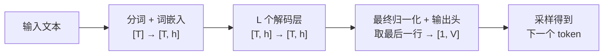
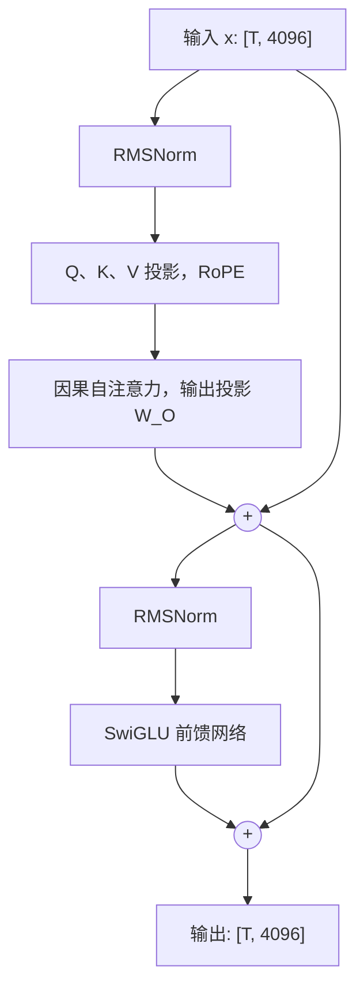

# 0.2 从推理的角度看 Transformer

> 对应原书第 2 章前半部分：Decoder-only 结构与注意力的计算。

介绍 Transformer 的文章，多半在讲注意力为什么能捕捉长距离依赖、残差连接怎样帮助训练。做推理时，模型的权重已经固定，关心的问题换成了另外几个：

- 一段输入经过模型时，每一步的张量是什么形状；
- 参数都集中在哪些矩阵上，生成一个 token 要读多少数据；
- 上下文变长时，哪一部分的计算量增长最快。

这一节以 Qwen3-8B 为例回答这几个问题。现在主流的开源模型，包括 Llama、Qwen、Mistral 和 DeepSeek 的稠密版本，都是 Decoder-only 结构，层内的组件也大同小异。弄清楚一个，其他的就只是超参数不同。

## 1. 整体结构

一个 Decoder-only 模型由三段组成：



用一个具体例子看张量形状。输入"中国的首都是"，假设分词后得到 $T = 4$ 个 token。Qwen3-8B 的隐藏维度 $h = 4096$，词表大小 $V = 151936$，共 $L = 36$ 层：

| 阶段 | 输入 | 计算 | 输出 |
|---|---|---|---|
| 分词 | 字符串 | 分词器在 CPU 上把文本切成 token ID | `[4]` |
| 词嵌入 | `[4]` | 在 `[151936, 4096]` 的嵌入表里按 ID 取出 4 行 | `[4, 4096]` |
| 36 个解码层 | `[4, 4096]` | 每层结构相同，输入输出形状不变 | `[4, 4096]` |
| 输出头 | `[4, 4096]` 的最后一行 | 乘以 `[4096, 151936]` 的矩阵，得到每个词的分数（logits） | `[1, 151936]` |

参数和计算几乎都在中间的解码层里。词嵌入只是查表，计算量可以忽略。

输出头只需要处理最后一行。预测第 5 个 token 只用得到第 4 个位置的隐藏状态，前 3 行算出来也没有用处。这一点在长输入时影响很大：对 4096 个 token 全部计算 logits，得到的 FP32 张量是 $4096 \times 151936 \times 4$ 字节，约 2.5 GB；只算最后一行，只有 600 KB。训练时需要所有位置的 logits 来计算损失，推理时不需要。项目 1 的 MiniServe 在 `engine.py` 里用 `sample_rows` 只取出需要采样的那些行。

## 2. 一个解码层里的计算

主流模型的解码层都采用 Pre-Norm 加残差连接的结构：先归一化，再计算，最后把结果加回输入。



层内有两个主要部分：自注意力负责在不同位置之间交换信息，前馈网络对每个位置单独做变换。

### 2.1 自注意力

如果只有前馈网络，每个位置都各算各的，模型看到"苹果"时无从知道前文是"我爱吃"还是"乔布斯创办了"。自注意力是层内唯一让不同位置互相读取信息的地方。它分四步。

**第一步，投影出 Q、K、V。** 输入 `[T, 4096]` 分别乘以三个矩阵：

- $W_Q$ 的形状是 `[4096, 4096]`，结果拆成 32 个头，得到 Q：`[T, 32, 128]`；
- $W_K$、$W_V$ 的形状都是 `[4096, 1024]`，结果拆成 8 个头，得到 K、V：`[T, 8, 128]`。

K、V 的头数比 Q 少，是因为 Qwen3 使用分组查询注意力（GQA）：每 4 个 Q 头共用一组 K、V。这样 K、V 的数据量只有原来的四分之一，0.6 节会看到，这直接决定了 KV Cache 占多少显存。早期模型（如 Llama-2-7B）每个 Q 头都有自己的 K、V，称为多头注意力（MHA）。3.1 节会比较这几种注意力变体。

Qwen3 还在拆头之后对每个头的 Q、K 各做一次 RMSNorm（QK-Norm），用来稳定训练，计算量很小。

**第二步，加入位置信息。** 注意力的计算本身不区分先后顺序。RoPE（旋转位置编码）把 Q、K 向量的分量两两配成一对，在平面上旋转一个与位置成正比的角度。这样，位置 $m$ 的 $q_m$ 与位置 $n$ 的 $k_n$ 做点积时，结果只与距离 $m - n$ 有关。RoPE 没有可学习的参数。

**第三步，计算因果注意力：**

$$
\text{Attention}(Q, K, V) = \text{softmax}\left(\frac{QK^\top}{\sqrt{d_h}} + M\right) V
$$

其中 $d_h = 128$ 是每个头的维度。掩码 $M$ 的对角线及以下为 0，对角线以上为 $-\infty$，保证第 $i$ 个位置只能看到它自己和之前的位置。

以三个 token"中国 / 首都 / 是"为例，softmax 之后的注意力权重形如：

$$
\begin{bmatrix} 1.0 & 0 & 0 \\ 0.4 & 0.6 & 0 \\ 0.2 & 0.5 & 0.3 \end{bmatrix}
$$

第一行只有第一列非零，第二行只用到前两列。也就是说，一个位置的计算结果只取决于它自己和它之前的 token，和后面的 token 无关。之后无论再生成多少个 token，前面位置在每一层算出的 K、V 都不会改变，所以可以缓存下来反复使用。0.4 节的 KV Cache 正是建立在这一点上。

**第四步，输出投影。** 把 32 个头的结果拼回 `[T, 4096]`，再乘以 $W_O$（`[4096, 4096]`）。

### 2.2 前馈网络

注意力之后，每个位置独立地经过前馈网络。现在的模型普遍使用 SwiGLU：

$$
\text{MLP}(x) = W_{\text{down}}\left(\text{SiLU}(x W_{\text{gate}}) \odot x W_{\text{up}}\right)
$$

$W_{\text{gate}}$ 和 $W_{\text{up}}$ 把 4096 维升到 12288 维，逐元素相乘后，再由 $W_{\text{down}}$ 降回 4096 维。

## 3. 参数在哪里

按 Qwen3-8B 的配置计算一层的参数：

| 部分 | 矩阵 | 参数量 |
|---|---|---|
| 注意力 | $W_Q$ 4096×4096，$W_K$、$W_V$ 各 4096×1024，$W_O$ 4096×4096 | 4194 万 |
| 前馈网络 | $W_{\text{gate}}$、$W_{\text{up}}$ 各 4096×12288，$W_{\text{down}}$ 12288×4096 | 1.51 亿 |
| 两个 RMSNorm、QK-Norm | 缩放向量 | 约 8 千，可以忽略 |

每层约 1.93 亿参数，前馈网络占 78%。再加上嵌入表和输出头（Qwen3-8B 的两者不共享权重，各 $151936 \times 4096 \approx 6.2$ 亿），全模型的参数为：

$$
36 \times 1.93 \text{ 亿} + 2 \times 6.2 \text{ 亿} \approx 82 \text{ 亿}
$$

以 BF16 存储，每个参数 2 字节，约 16.4 GB。

这个分布有两个直接的推论。

**生成阶段读的主要是前馈网络的权重。** 逐个生成 token 时，每一步都要把全部权重读一遍，其中约八成是前馈网络的三个矩阵。权重量化（第 2 部分）的收益主要来自把这些矩阵压小；MoE 模型把前馈网络拆成许多专家，每个 token 只激活其中几个，也是为了减少每一步要读的权重（4.2 节）。

**输出头不能忽略。** 词表大的模型，输出头可能占到总参数的 5%～10%，小模型里比例更高。Qwen3-0.6B 的嵌入表就有 1.56 亿参数，占全模型的四分之一，所以它让输出头和嵌入表共享同一份权重。

## 4. 计算量：线性层与注意力

矩阵乘 $[m, k] \times [k, n]$ 需要 $2mkn$ 次浮点运算（每个乘加算两次）。所以一个 token 经过一个权重矩阵，计算量是该矩阵参数量的 2 倍。由此得到一个常用的估算：**生成一个 token，线性层的计算量约为 $2 \times$ 参数量**。Qwen3-8B 不计嵌入表，约 $2 \times 76$ 亿 $\approx 15.2$ GFLOPs。

注意力打分不经过权重矩阵，计算量取决于上下文长度。生成第 $T$ 个位置时，每层要让 32 个 Q 头和前面 $T$ 个位置的 K 做点积，再对 V 加权求和：

$$
\text{FLOPs}_{\text{attn}} \approx 4 \times L \times n_q \times d_h \times T = 4 \times 36 \times 4096 \times T
$$

$T = 1024$ 时约 0.6 GFLOPs，只占一个 token 总计算量的 4%；$T = 32768$ 时约 19 GFLOPs，已经超过全部线性层。上下文越长，注意力越重要。这也是 FlashAttention（3.2 节）和稀疏注意力（6.6 节）要解决的问题。

下面的组件可以换模型、拖动上下文长度，看两部分计算量怎样变化。切换到 prefill 时，计算的是一次性处理整段输入的总量，注意力部分随长度平方增长。

<div class="llm-widget" data-widget="transformer-flops"></div>

注意这里比较的只是计算量。0.7 节会看到，生成阶段的耗时主要取决于要读多少字节，而不是要做多少次运算。

## 5. 实验：统计真实模型的参数

在 CPU 上就能运行。下面的脚本加载 Qwen3-0.6B，按模块统计参数量：

```python
import torch
from collections import Counter
from transformers import AutoModelForCausalLM

model = AutoModelForCausalLM.from_pretrained("Qwen/Qwen3-0.6B", torch_dtype=torch.bfloat16)
print(model.model.layers[0])          # 打印一个解码层的结构

groups = Counter()
seen = set()
for name, p in model.named_parameters():
    if p.data_ptr() in seen:          # 共享权重只算一次
        continue
    seen.add(p.data_ptr())
    if "self_attn" in name:
        groups["注意力"] += p.numel()
    elif "mlp" in name:
        groups["前馈网络"] += p.numel()
    elif "norm" in name:
        groups["RMSNorm"] += p.numel()
    else:
        groups["嵌入表 / 输出头"] += p.numel()

total = sum(groups.values())
print(f"总参数 {total / 1e6:.1f} M")
for k, v in groups.items():
    print(f"{k:12s} {v / 1e6:8.1f} M  {v / total:6.1%}")
```

可以对照第 3 节的分析：0.6B 模型的嵌入表占比明显更高，前馈网络的占比相应下降。

如果想看每一步怎样用 PyTorch 写出来，可以读项目 1 的 [`model.py`](https://github.com/zrpxx/hands-on-llm-serving-opt/blob/main/code/project1/solution/miniserve/model.py)。它不依赖 Transformers 的模型代码，用不到 200 行实现了 RMSNorm、RoPE、注意力、前馈网络和整个模型，输出与 Hugging Face 的实现一致。

## 自测

<div class="llm-widget" data-widget="quiz" data-questions='[{"q": "prefill 一段 4096 个 token 的输入时，为什么只把最后一个位置的隐藏状态送进输出头？", "options": ["输出头的矩阵太大，一次只能处理一行输入", "下一个 token 只取决于最后一个位置，其余行算出来也用不上", "前面位置的隐藏状态在最后一层已被覆盖，无法再使用", "为了让 prefill 和 decode 的输出形状一致，方便批处理"], "answer": 1, "explain": "生成只需要最后一行的 logits。对 4096 行全部计算会得到约 2.5 GB 的 FP32 张量，几乎全部浪费。前面位置的隐藏状态其实还在，训练时就需要所有位置的 logits 来计算损失。"}, {"q": "Qwen3-8B 的每个解码层里，参数最多的是哪一部分？", "options": ["Q、K、V、O 四个注意力投影", "前馈网络的 gate、up、down 三个矩阵", "两个 RMSNorm 和 QK-Norm", "RoPE 的旋转角度表"], "answer": 1, "explain": "每层注意力约 4194 万参数，前馈网络约 1.51 亿，占 78%。RMSNorm 只有几千个参数，RoPE 的角度按公式计算，没有可学习参数。"}, {"q": "如果模型使用双向注意力（例如 BERT），还能用 KV Cache 加速逐个 token 的生成吗？", "options": ["能，KV Cache 与注意力的方向无关", "能，只要每一步都重新计算一次 softmax", "不能，新 token 会改变前面位置在之后各层的 K、V", "不能，因为双向注意力里没有 V 投影"], "answer": 2, "explain": "双向注意力里，前面的位置也会关注新加入的 token，它们的隐藏状态因此改变，下一层的 K、V 也跟着变。KV Cache 的前提是过去的位置不受未来影响，这由因果掩码保证。"}, {"q": "Qwen3-8B 生成一个 token 时，线性层大约需要多少次浮点运算？", "options": ["约 8 GFLOPs", "约 15 GFLOPs", "约 33 GFLOPs", "约 16 TFLOPs"], "answer": 1, "explain": "一个 token 经过一个权重矩阵，计算量是参数量的 2 倍（每个乘加算两次）。不计只查表的嵌入层，约 76 亿参数，乘以 2 约 15 GFLOPs。"}]'></div>

## 延伸阅读

- 原书第 2 章 *Inside the Mind of a Transformer*、*Decoder-Only Transformer Architecture*、*Capture Token Context by Calculating Attention* 三节。
- Vaswani et al., [Attention Is All You Need](https://arxiv.org/abs/1706.03762), NeurIPS 2017。
- Su et al., [RoFormer: Enhanced Transformer with Rotary Position Embedding](https://arxiv.org/abs/2104.09864), 2021。RoPE 的原始论文。
- Ainslie et al., [GQA: Training Generalized Multi-Query Transformer Models from Multi-Head Checkpoints](https://arxiv.org/abs/2305.13245), EMNLP 2023。
- Shazeer, [GLU Variants Improve Transformer](https://arxiv.org/abs/2002.05202), 2020。SwiGLU 的出处。
