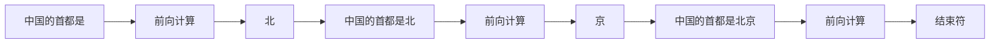

# 0.3 自回归生成

> 对应原书第 2 章 *The Autoregressive Nature of Transformers* 与 *Executing LLM Generation: A Step-by-Step Walkthrough* 两节。

上一节看的是一次前向计算。生成一段回答，要把这样的前向计算重复几百上千次，每次只得到一个 token。这一节手写这个循环，看清楚每一步做了什么，然后讨论两个服务中绕不开的细节：怎样从模型输出的分数里选出 token，以及怎样把 token 流式地变成文字。

## 1. 为什么只能一个一个地生成

输入的 prompt 是已知的，模型可以一次把它全部处理完。输出却不行：要预测第 $k$ 个 token，必须先知道前 $k-1$ 个是什么。第一个词还没确定是"北京"还是"上海"，第二个词就没法决定接"烤鸭"还是"外滩"。这种用自己的输出作为下一步输入的方式，叫**自回归**（autoregressive）。



LLM 服务的许多难处都来自这个循环：

- **一个请求要占用 GPU 很久。** 生成 500 个 token 就要做 500 次前向计算，持续几秒到几十秒。在这段时间里，它的中间状态（0.4 节的 KV Cache）一直占着显存。
- **输出多长事先不知道。** 模型可能在第 10 步就输出结束符，也可能写满 2000 个 token。服务在请求开始时无法知道它最终要占多少显存、运行多久，调度只能边走边看（1.2、1.3 节）。

## 2. 手写一个生成循环

`model.generate()` 把这个循环藏在了内部。下面把它写出来，只保留必要的部分：

```python
import time, torch
from transformers import AutoModelForCausalLM, AutoTokenizer

name = "Qwen/Qwen3-0.6B"
tok = AutoTokenizer.from_pretrained(name)
model = AutoModelForCausalLM.from_pretrained(name, torch_dtype=torch.bfloat16).cuda().eval()

input_ids = tok("Write a short introduction about Beijing.", return_tensors="pt").input_ids.cuda()
step_times = []

with torch.no_grad():
    for step in range(100):
        t0 = time.perf_counter()
        logits = model(input_ids, use_cache=False).logits   # [1, 当前长度, V]
        probs = torch.softmax(logits[:, -1, :], dim=-1)     # 只取最后一个位置：[1, V]
        next_id = torch.multinomial(probs, num_samples=1)   # 按概率抽一个 token：[1, 1]
        input_ids = torch.cat([input_ids, next_id], dim=1)  # 接到输入末尾
        torch.cuda.synchronize()
        step_times.append(time.perf_counter() - t0)
        if next_id.item() == tok.eos_token_id:
            break

print(tok.decode(input_ids[0], skip_special_tokens=True))
```

每一轮做四件事：把当前完整的序列送进模型；取最后一个位置的 logits，用 softmax 变成概率；按概率抽出一个 token；把它接到序列末尾。遇到结束符就停下。

`use_cache=False` 关掉了 Transformers 默认开启的 KV Cache，这里刻意用最朴素的方式运行。

### 为什么越往后越慢

把 `step_times` 画出来，会看到每一步的耗时随步数增加。原因在第一行：每一轮都把**整个序列**重新送进模型。

假设 prompt 有 8 个 token。第 1 步处理 8 个 token；第 50 步处理 58 个，其中前 57 个上一步刚刚算过；第 100 步处理 108 个。如果 prompt 有 4000 个 token、要生成 1000 个，这 4000 个 token 会被重复计算 1000 遍。

上一节说过，每个位置的计算结果只取决于它自己和它之前的 token。前面的位置算过一次，结果就不会再变。下一节的 KV Cache 就是把这些结果存起来，每一步只计算新的那一个 token。

## 3. 从 logits 到 token

输出头给出的是词表中每个 token 的分数，称为 logits，形状为 `[1, V]`，取值可以是任意实数。从中选出一个 token 的方法有好几种，常用的四种如下。

**贪心解码。** 直接取分数最高的 token。结果完全确定，同样的输入每次输出相同。适合需要可复现结果的场景，比如评测和测试。缺点是容易陷入重复。在 OpenAI 兼容接口里，`temperature = 0` 表示贪心解码。

**温度。** 在 softmax 之前把所有分数除以温度 $\tau$：

$$
p_i = \frac{\exp(z_i / \tau)}{\sum_j \exp(z_j / \tau)}
$$

$\tau < 1$ 会拉大分数之间的差距，高分的 token 概率更高，输出更保守；$\tau > 1$ 会缩小差距，低分的 token 也有机会被选中，输出更多样，也更容易出错。$\tau$ 趋近于 0 时就退化成贪心解码。

**Top-k。** 只保留概率最高的 $k$ 个 token，其余的概率置零，再重新归一化。它能排除词表中大量概率极低的 token，避免偶尔抽到明显不合适的词。

**Top-p（核采样）。** 把 token 按概率从高到低排列并累加，累计概率达到 $p$ 时截断，后面的全部丢弃。和 top-k 相比，它保留的候选数会随分布自动变化：模型很确定时（"中国的首都是"之后，"北"可能占九成以上），只剩一两个候选；开放式续写时，候选可能有几十个。

这几种方法可以叠加使用，常见的顺序是：先除以温度，再做 top-k 和 top-p 截断，最后按剩下的概率抽样。

下面的组件里有一组假设的 logits，可以拖动滑块观察分布的变化，或者按当前设置连续抽样几次。

<div class="llm-widget" data-widget="sampling-lab"></div>

可以试试：把温度拖到 0，所有概率都集中到第一个候选上；把温度调到 1.5 左右，原本排在最后的候选也分到了一些概率，这时再把 top-p 从 1.0 降到 0.8，看它们怎样被截掉。

采样只作用于最后的 `[B, V]` 张量，每一行互不影响。所以同一批里的请求可以用各自不同的采样参数：有的贪心，有的用温度和 top-p。项目 1 的 `_sample` 函数就是按行处理的。

## 4. 什么时候停止

服务里一个请求在以下任一情况发生时结束：

1. **生成了结束符。** 注意现在的模型常常有不止一个结束符。比如 Qwen3 的对话模型会用 `<|im_end|>` 结束一轮回答，基座模型则用 `<|endoftext|>`。完整的列表要从 `generation_config.json` 的 `eos_token_id` 读取，只用 `tokenizer.eos_token_id` 可能会漏掉。
2. **达到 `max_tokens`。** 请求指定的输出长度上限。
3. **达到模型的最大长度。** 输入加上已生成的 token 数达到 `max_model_len`。
4. **命中停止字符串。** 比如 Agent 场景中常用 `"\nObservation:"` 作为停止标记。这需要在解码出的文本上做匹配，因为一个字符串可能横跨多个 token。

压测时通常会设置 `ignore_eos=True`，忽略结束符，让每个请求都生成满 `max_tokens` 个 token。否则不同框架、不同参数下的输出长度不同，吞吐无法直接比较（0.8 节）。

## 5. 流式输出与增量解码

在线服务一般边生成边返回，用户能看到文字逐渐出现。直觉的做法是每得到一个 token，就把它单独解码成文字发出去。这对中文和 emoji 会出问题。

主流分词器在字节层面做 BPE。一个汉字的 UTF-8 编码是 3 个字节，emoji 是 4 个字节；常用汉字通常是单个 token，较少见的字和大多数 emoji 则可能被拆成两三个 token，每个 token 只包含几个字节。单独解码这样的 token，得到的是不完整的字节序列，分词器会输出替换字符 U+FFFD（显示为 �）。

正确的做法是**增量解码**：保存到目前为止的全部 token，每次对整个序列解码，只把新增的文字发出去；如果新文字以替换字符结尾，说明最后一个字符还不完整，先不发送，等下一个 token 到了再说。项目 1 的 `IncrementalDetokenizer` 就是这样写的：

```python
class IncrementalDetokenizer:
    def __init__(self, tokenizer):
        self.tok = tokenizer
        self.ids = []
        self.text = ""

    def push(self, token_id):
        self.ids.append(token_id)
        text = self.tok.decode(self.ids, skip_special_tokens=True)
        if text.endswith("�"):       # 最后一个字符还没收全
            return ""
        delta, self.text = text[len(self.text):], text
        return delta
```

这个写法每一步都解码整个序列，输出越长越慢。vLLM 的实现只解码末尾的一小段：记录两个偏移量，每次从倒数几个 token 开始解码，和上次的结果比较，得出新增的部分。思路相同，只是避免了重复工作。

## 6. 实验：无缓存时每一步的耗时

把第 2 节代码的循环次数改成 200，并去掉结束符判断，让它跑满 200 步，然后打印几个位置的耗时：

```python
for i in [0, 49, 99, 199]:
    print(f"第 {i + 1:3d} 步：{step_times[i] * 1000:.2f} ms")
```

prompt 很短时，前几十步的耗时可能看不出明显变化，因为 GPU 处理几十个 token 和处理一个 token 差不多快（0.7 节解释原因）。可以把 prompt 换成一段一两千个 token 的长文本，增长就很明显了。记下这组数字，下一节打开 KV Cache 之后再做对比。

## 自测

<div class="llm-widget" data-widget="quiz" data-questions='[{"q": "不使用 KV Cache 时，prompt 长度为 &#36;s&#36;，正在生成第 &#36;k&#36; 个新 token。这一步线性层的计算量与什么成正比？", "options": ["与 &#36;k&#36; 成正比", "与 &#36;s + k&#36; 成正比", "与 &#36;s&#36; 成正比，与 &#36;k&#36; 无关", "是常数，与长度无关"], "answer": 1, "explain": "不缓存时每一步都把完整的序列重新送进模型，长度为 &#36;s + k&#36;，线性层的计算量与它成正比，注意力部分更是与 &#36;(s+k)^2&#36; 成正比。有了 KV Cache，每一步只处理一个新 token，线性层的计算量才变成常数。"}, {"q": "同一批里，请求 A 要求贪心解码，请求 B 要求 temperature = 0.8、top_p = 0.9。它们能在同一次批处理中完成采样吗？", "options": ["不能，采样参数不同的请求必须分到不同的批", "能，但 B 的 top_p 会被忽略", "能，采样按行作用在 logits 上，每行用自己的参数", "不能，贪心解码必须在模型前向内部完成"], "answer": 2, "explain": "采样发生在模型前向之后，作用于 [B, V] 的 logits，各行互不影响。贪心的行直接取 argmax，其余行按各自的温度和 top-p 处理。"}, {"q": "流式输出时，每得到一个 token 就单独解码并发送，处理中文和 emoji 时会出现什么问题？", "options": ["输出顺序会被打乱", "某些字符的字节被拆在多个 token 里，单独解码会得到替换字符", "每个汉字会被重复输出两次", "分词器会抛出异常，导致连接中断"], "answer": 1, "explain": "字节级 BPE 可能把一个字符的 UTF-8 字节拆进相邻的几个 token。正确做法是对累计的序列解码，只发送新增的完整字符；末尾是替换字符 U+FFFD 时先不发。分词器不会抛异常，只会输出替换字符。"}, {"q": "模型对下一个 token 非常确定，第一名的概率是 0.93。设置 top_p = 0.9 时，会保留几个候选？", "options": ["1 个", "2 个", "约占词表 90% 的 token", "取决于 top_k，与 top_p 无关"], "answer": 0, "explain": "按概率从高到低累加，第一个 token 的 0.93 已经超过 0.9，后面的全部截掉，只剩它一个。这就是 top-p 的特点：候选数随分布自动变化。"}]'></div>

## 延伸阅读

- 原书第 2 章 *The Autoregressive Nature of Transformers*、*Executing LLM Generation: A Step-by-Step Walkthrough*。
- Holtzman et al., [The Curious Case of Neural Text Degeneration](https://arxiv.org/abs/1904.09751), ICLR 2020。提出 top-p 采样，并分析了贪心解码的重复问题。
- vLLM 源码 `vllm/transformers_utils/detokenizer_utils.py`，增量解码的实现。
