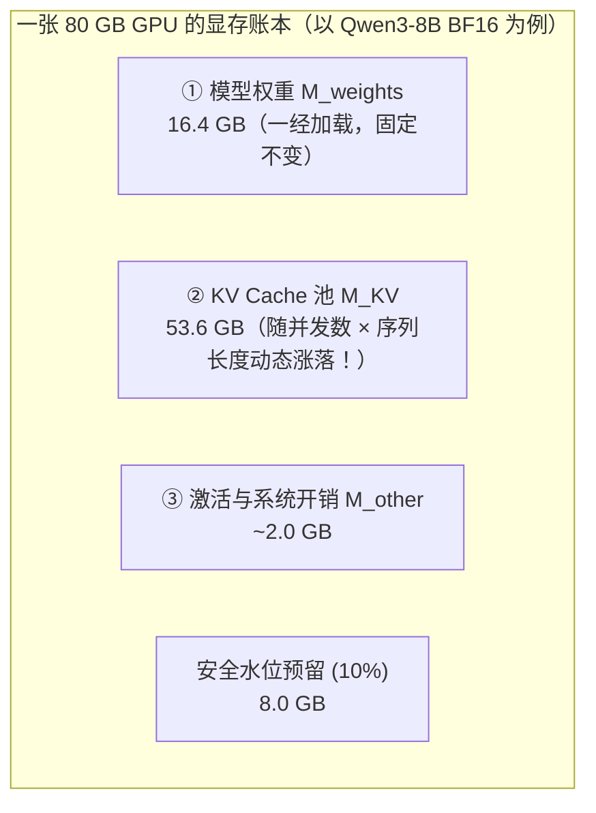

# 0.3 显存估算：模型权重与 KV Cache 账本

## 学习目标

完成本节学习后，你将能够：
- **不看任何公式表，从单个 Token 的张量形状出发手算出任意模型的权重显存与每 Token KV Cache 大小**。
- **彻底搞懂 MHA（多头注意力）与 GQA（分组查询注意力）对显存的影响**：明白为什么同样是 7B~8B 模型，Qwen3-8B 的 KV Cache 只有 Llama-2-7B 的约 1/4。
- **算出一张 GPU 在给定上下文长度下最多能抗多少并发请求**，并与 vLLM 启动日志逐项核对。

---

## 1. 为什么 14 GB 的 7B 模型放在 24 GB 显卡上，并发一高还是会 OOM？

很多刚接触部署的同学都踩过这样一个坑：
你下载了 `Llama-2-7B`，看了一眼硬盘上的权重文件，一共只有 **13.5 GB**。你心想：“我手里有一张 24 GB 显存的 RTX 4090 / A10，装下 13.5 GB 权重后还足足富余 10 GB，跑个 16 人并发聊天肯定绰绰有余吧！”

结果服务刚跑起来，当 16 个用户各自发来一篇 3000 词的长对话时，程序直接崩溃：`torch.cuda.OutOfMemoryError: CUDA out of memory`。

**那富余出来的 10 GB 显存被谁吃掉了？甚至为什么 16 个并发请求居然需要整整 32 GB 的额外显存，比模型权重本身（13.5 GB）还要大两倍多？**

这就是本节要带你算清楚的**大模型显存总账本**。

---

## 2. 核心心智模型：GPU 显存里住着哪三户人家？

首先，为什么我们必须把模型放在昂贵的 GPU 显存（HBM/GDDR）里，而不能放在便宜的电脑内存（CPU DRAM）甚至固态硬盘（SSD）里按需读取？

因为每生成 1 个词（Token），GPU 都要把模型的全部参数完完整整读一遍。看看三种存储介质的速度差距就明白了：

| 存储位置 | 典型读取带宽 | 读一遍 16 GB 权重需要多久 | 意味着每秒最多吐几个词 |
|---|---|---|---|
| **NVMe SSD 固态硬盘** | 5 ~ 14 GB/s | ~1,600 ms (1.6 秒) | 0.6 tok/s（慢如蜗牛） |
| **CPU 内存 (DDR5 DRAM)** | 50 ~ 200 GB/s | ~160 ms | 6 tok/s（勉强能看） |
| **GPU 显存 (HBM3 / HBM3e)** | **2,000 ~ 4,800 GB/s** | **~5 ms** | **200 tok/s（丝滑流式）** |

因此，在服务启动时，模型必须完成 `磁盘 → CPU 内存 → GPU 显存` 的加载并**常驻显存**。一张正在跑服务的 GPU，它的显存被严格划分成三块：

$$
M_{\text{GPU总使用}} = M_{\text{weights（静态权重）}} + M_{\text{KV（动态上下文缓存）}} + M_{\text{other（激活与框架预留）}}
$$



1. **① 静态权重（$M_{\text{weights}}$）**：就像书店里摆好的字典，模型加载完后大小就死死固定住了，不会随用户多少而变化。
2. **② 动态 KV Cache（$M_{\text{KV}}$）**：模型在逐字回答每个用户时，为了不重复计算前面已经读过的词，必须把每个词在每一层的中间特征向量（Key 和 Value）记在“草稿纸”上。**并发用户越多、聊得越长，草稿纸占用的空间就线性暴涨**——刚才让 24 GB 显卡崩溃的元凶就是它！
3. **③ 激活与系统开销（$M_{\text{other}}$）**：前向计算时的临时中间变量、CUDA Graph 录制图、多卡通信缓冲区等，通常占 **1.5 ~ 3 GB**。

---

## 3. 交互式沙盒：亲手拨动显存账本与并发上限

在进入数学推导之前，请先用下面的交互式计算器做两个小实验：
- **实验 A**：点击顶部的 **`Llama-2-7B (MHA)`** 预设，把显卡选为 **`24 GB (RTX 4090 / A10)`**，看看能同时服务几个 4096 长度的请求？（答案：只有约 **1.5 个**！一旦来 16 个请求必然 OOM。）
- **实验 B**：保持 `24 GB` 显卡不变，点击切换到 **`Qwen3-8B (GQA)`**，再把权重精度从 `BF16` 改为 `INT4`——观察绿色的 KV Cache 池和最大并发数发生了什么戏剧性的变化！

<div class="llm-widget" data-widget="kv-memory-calculator"></div>

---

## 4. 从零逐步推导：不背公式，自己把账算出来

很多教程一上来就扔给你一串字母公式，我们换一种方式——打开 `Qwen/Qwen3-8B` 的配置文件 `config.json`，带着真实数字一步一步把公式自己写出来：

```json
{
  "architectures": ["Qwen3ForCausalLM"],
  "hidden_size": 4096,
  "num_hidden_layers": 36,
  "num_attention_heads": 32,
  "num_key_value_heads": 8,
  "head_dim": 128,
  "torch_dtype": "bfloat16"
}
```

### 第一步：算静态权重显存 $M_{\text{weights}}$

模型参数量 $P$ 就是网络里所有权重浮点数的总个数。每个参数占多少字节（$b_w$），完全取决于你用什么精度存储它：

| 精度格式 | 位数 (bits) | 每参数字节数 $b_w$ ($1\text{ Byte} = 8\text{ bits}$) | 8B（实际 8.19B）模型权重大小 |
|---|---|---|---|
| **FP32（单精度浮点）** | 32-bit | $4\text{ Bytes}$ | $8.19 \times 10^9 \times 4 \approx 32.8\text{ GB}$ |
| **BF16 / FP16（半精度，默认）** | 16-bit | $2\text{ Bytes}$ | $8.19 \times 10^9 \times 2 \approx \mathbf{16.4\text{ GB}}$ |
| **FP8 / INT8（8位量化）** | 8-bit | $1\text{ Byte}$ | $8.19 \times 10^9 \times 1 \approx 8.2\text{ GB}$ |
| **INT4 / AWQ / GPTQ（4位量化）** | 4-bit | $0.5\text{ Byte}$（外加约 5% 缩放因子开销） | $8.19 \times 10^9 \times 0.5 \approx 4.3\text{ GB}$ |

所以静态权重公式非常直观：

$$
M_{\text{weights}} = P \times b_w
$$

> [!TIP]
> **为什么叫 8B 模型，实际却是 8.19B？** 模型名字里的 `7B`、`8B` 都是为了好记取的近似整数（比如 Llama-2-7B 实际是 `6.74B`，Qwen3-8B 实际是 `8.19B`）。做精确容量规划时，以实际参数量或 `.safetensors` 文件总大小为准。

---

### 第二步：从“1 个词经过 1 层网络”算起，推导每 Token 的 KV Cache 大小

现在我们来看最核心的问题：**每当模型多读入或生成 1 个 Token，显存里到底要多存多少字节的 KV Cache？**

我们一级一级往上乘，绝不跳步：

1. **1 个注意力头（Attention Head）里存什么？**
   在注意力机制中，每个 Token 经过线性投影后，在每个注意力头上都会产生一个 **Key 向量（$k$）** 和一个 **Value 向量（$v$）**（至于为什么不存 Query 向量 $q$，我们在 `1.3` 节会画图揭秘：因为历史词的 $q$ 用完就扔了，永远不会被后面的词再次用到）。
   - 查看上面的 `config.json`：每个头的向量长度 `head_dim` $d_h = 128$。
   - 如果没有写 `head_dim`，它就等于 `hidden_size / num_attention_heads`（例如 $4096 / 32 = 128$）。
   - 既有 $k$ 又有 $v$，所以 **1 个头** 需要存 $2 \times d_h = 2 \times 128 = 256$ 个数字。

2. **1 层 Transformer 里有多少个 KV 头（$n_{kv}$）？—— 这里藏着 MHA 与 GQA 的关键区别！**
   初学者最容易犯的错误，就是直接拿 `num_attention_heads`（32）去乘！让我们花 1 分钟看懂 **MHA（多头注意力）** 和 **GQA（分组查询注意力）** 的区别：

   ```mermaid
   flowchart TB
     subgraph MHA["早期模型（如 Llama-2-7B）：MHA 多头注意力"]
       direction TB
       Q1["32 个 Query 头 (n_q = 32)"] --- K1["一对一配有 32 个 Key/Value 头 (n_kv = 32)<br/>每个头都要单独存一份 KV！"]
     end
     subgraph GQA["现代模型（如 Llama-3 / Qwen3-8B）：GQA 分组查询注意力"]
       direction TB
       Q2["32 个 Query 头 (n_q = 32)<br/>每 4 个 Q 头分成一组"] ===>|"4 个 Q 头共享 1 组 KV"| K2["只有 8 个 Key/Value 头 (n_kv = 8)<br/>KV Cache 体积直接缩小为 1/4！"]
     end
   ```

   - 在早期的 **MHA** 模型（如 Llama-2-7B）中，32 个 Query 头配 32 个 KV 头（$n_{kv} = 32$）。
   - 后来人们发现，让每 4 个（甚至 8 个）Query 头**共享同一组 Key 和 Value 头**（即 **GQA**），模型回答质量几乎不降，但需要缓存的 KV 头数直接从 32 降到了 **8**（`num_key_value_heads`: $n_{kv} = 8$）！
   - 所以在 Qwen3-8B 的 **1 层** 里，1 个 Token 需要存的数字个数是：$2 \times n_{kv} \times d_h = 2 \times 8 \times 128 = 2,048$ 个数字。

3. **整个模型一共有多少层（$L$）？每个数字占多少字节（$b_{kv}$）？**
   - 模型一共有 `num_hidden_layers` $L = 36$ 层，每一层都有自己的注意力模块，都要存一份。
   - 在 BF16 精度下，每个数字占 $b_{kv} = 2$ 个字节（如果开启 FP8 KV Cache，则 $b_{kv} = 1$）。

把上面三步连乘起来，我们就自己推导出了**单个 Token 的 KV Cache 显存公式**：

$$
\text{KV}_{\text{token}} = 2 \times L \times n_{kv} \times d_h \times b_{kv}
$$

让我们立刻把 **Llama-2-7B（MHA）** 和 **Qwen3-8B（GQA）** 代进去对比一下：

| 模型 | 层数 $L$ | Q 头 / **KV 头 $n_{kv}$** | 头维度 $d_h$ | 精度字节 $b_{kv}$ | 单 Token KV 显存计算过程 | 结果 |
|---|---|---|---|---|---|---|
| **Llama-2-7B (MHA)** | 32 | 32 / **32** | 128 | 2 (BF16) | $2 \times 32 \times \mathbf{32} \times 128 \times 2 = 524,288\text{ B}$ | **512 KiB / token** |
| **Qwen3-8B (GQA)** | 36 | 32 / **8** | 128 | 2 (BF16) | $2 \times 36 \times \mathbf{8} \times 128 \times 2 = 147,456\text{ B}$ | **144 KiB / token** |

看到这个惊人的对比了吗？
- **Llama-2-7B**：每 1 个 Token 就要吃掉 `0.5 MB` 显存！如果 16 个并发用户每人聊到 4096 Token，光是 KV Cache 就要 $0.5\text{ MB} \times 4096 \times 16 = \mathbf{32\text{ GB}}$，比它 13.5 GB 的权重还大两倍多！
- **Qwen3-8B**：虽然总参数量还大一点（8.19B vs 6.74B），但因为用了 GQA（$n_{kv}=8$），每个 Token 只占 `144 KiB`，足足省了 **72%** 的 KV 显存！

---

### 第三步：倒推一张卡最多能放多少 Token 与多少并发请求

现在假设我们有一张 $M_{\text{GPU}} = 80\text{ GB}$ 的 A100 或 H100 显卡，用 vLLM 默认的显存利用率上限 $u = 0.9$（留 10% 防突发 OOM），扣除权重 $M_{\text{weights}} = 16.4\text{ GB}$ 和激活开销 $M_{\text{other}} \approx 2.0\text{ GB}$：

1. **留给 KV Cache 池的总预算**：
   $$
   M_{\text{KV预算}} = 80 \times 0.9 - 16.4 - 2.0 = 53.6\text{ GB}
   $$
2. **这张卡最多能同时缓存多少个 Token（$T_{\max}$）**：
   $$
   T_{\max} = \frac{M_{\text{KV预算}}}{\text{KV}_{\text{token}}} = \frac{53.6 \times 10^9\text{ Bytes}}{147,456\text{ Bytes/token}} \approx \mathbf{363,498\text{ tokens}}
   $$
3. **满长度下的最大并发请求数（$B_{\max}$）**：
   如果每个请求最多允许长到 $S_{\max} = 4096$ 个 Token（输入 Prompt + 生成回答），那么最坏情况下同时能容纳的并发请求数为：
   $$
   B_{\max} = \frac{T_{\max}}{S_{\max}} = \frac{363,498}{4096} \approx \mathbf{88.7\text{ 个并发请求}}
   $$
   （如果把最大上下文调成 `32,768`，满长度并发就降到了 $363,498 / 32768 \approx 11$ 个。）

---

## 5. 工程锦囊：当 KV Cache 不够用时，我们有哪些武器？

在后面的章节中，我们将逐一解锁扩大并发容量的六大武器，它们全都在操作上面这条公式里的某一项：

| 优化武器 | 它改变了公式里的哪一项？ | 对并发容量 $T_{\max}$ 的效果 | 对应后续章节 |
|---|---|---|---|
| **权重量化（BF16 → INT4）** | 把 $b_w$ 从 $2$ 降到 $0.5$，$M_{\text{weights}}$ 缩小为 1/4 | 省下的十几 GB 显存全部变成 KV 预算，小显存卡救星 | 第 2 部分 (`2.1`~`2.3`) |
| **KV Cache 量化（BF16 → FP8）** | 把 $b_{kv}$ 从 $2$ 降到 $1$，$\text{KV}_{\text{token}}$ 直接砍半 | **可缓存 Token 数 $T_{\max}$ 直接翻倍！** | `2.5 FP8 与 KV 量化` |
| **GQA / MQA / MLA 注意力架构** | 在模型架构层大幅减小 $n_{kv}$ 或压缩维度 | 单 Token KV 缩小 4~8 倍以上 | `3.1 注意力变体` |
| **分页管理（PagedAttention）** | 消除按最大长度 $S_{\max}$ 预留造成的 60%+ 空置浪费 | 让实际可跑的并发数从按 $S_{\max}$ 算变成按**实际平均长度**算 | `1.6 vLLM 与分页` |
| **前缀缓存（Prefix Caching）** | 多个请求共享的 System Prompt 只存 1 份 KV | 重复前缀部分零额外显存消耗 | `1.7 前缀缓存` |
| **张量并行（TP = $k$ 卡）** | 权重和 KV 头均摊切分到 $k$ 张卡上 | $k$ 张卡合起来的 KV 总池子扩大为单卡的 $k$ 倍以上 | `4.1 DP/TP/PP` |

> **实用选卡经验法则**：在采购或租用 GPU 时，**总显存最好至少是模型权重大小的 2 倍以上**（例如 16 GB 的权重配 40~80 GB 显存），这样才能留出至少一半显存给 KV Cache，发挥出高并发批处理的威力。

---

## 6. 动手实验：用 Python 脚本估算并与 vLLM 实测对账

### 实验 1：运行本仓库的显存估算器（纯 CPU 即可运行）
仓库中的 [`code/stage0/estimate_memory.py`](https://github.com/zrpxx/hands-on-llm-serving-opt/blob/main/code/stage0/estimate_memory.py) 把上面的三步推导写成了通用工具，直接读取任意模型的 `config.json`：

```bash
# 1. 估算 Qwen3-8B (GQA) 在 80GB 显卡上的表现
python code/stage0/estimate_memory.py code/stage0/configs/qwen3-8b.json --gpu-mem 80 --max-len 4096

# 2. 对比 Llama-2-7B (MHA) 在同样 80GB 显卡上的表现
python code/stage0/estimate_memory.py code/stage0/configs/llama-2-7b.json --gpu-mem 80 --max-len 4096
```

你会看到如下清晰的对账输出：
```text
参数量            8.19 B
权重（每卡）      16.4 GB   (2 B/参数, tp=1)
KV / token（每卡）144 KiB  (2 B/元素)
KV 预算（每卡）   53.6 GB = 80.0×0.9 - 权重 - 2.0 预留
可缓存 token 数   363,624
并发上限          88.8 个请求（每个 4096 token 用满时）
```

### 实验 2：与真实 vLLM 启动日志对账（GPU 环境）
在 GPU 上启动 vLLM 并过滤出那三行核心体检日志：

```bash
vllm serve Qwen/Qwen3-8B --max-model-len 4096 --gpu-memory-utilization 0.9 2>&1 \
  | grep -E "Model loading|KV cache size|Maximum concurrency"
```

接着尝试加上 `--kv-cache-dtype fp8`，再次运行上面的命令，亲眼验证日志里的 `GPU KV cache size` 是否如公式预测的那样直接翻了一倍！

---

## 7. 闯关自测

<div class="llm-widget" data-widget="quiz" data-title="0.3 显存估算 · 闯关自测" data-questions='[
  {
    "q": "Llama-3-8B 有 32 层（L=32），32 个 Query 头（n_q=32），8 个 KV 头（n_kv=8），每个头维度 d_h=128。在 BF16（2 字节）精度下，每生成 1 个 Token 新增的 KV Cache 是多少？如果误把 Query 头数 32 代入公式会算出多少？",
    "options": [
      "正确值是 128 KiB；误用 Q 头数会算出 512 KiB（高估 4 倍）",
      "正确值是 512 KiB；误用 Q 头数会算出 128 KiB",
      "正确值是 64 KiB；误用 Q 头数也是 64 KiB",
      "正确值是 144 KiB；误用 Q 头数会算出 288 KiB"
    ],
    "answer": 0,
    "explain": "代入公式：2(K和V) × 32层 × 8个KV头 × 128维 × 2字节 = 131,072 Bytes = 128 KiB。如果误把 n_q=32 代入，就会算出 512 KiB，把 KV 显存需求高估整整 4 倍！"
  },
  {
    "q": "你有一张 24 GB 的 RTX 4090 显卡，部署 BF16 精度的 Qwen3-8B（权重 16.4 GB，单 Token KV 为 144 KiB）。设激活预留开销为 2 GB，显存利用率上限 u=0.9。如果每个请求都用满 8,192 上下文长度，最多能同时容纳几个并发请求？",
    "options": [
      "约 25 个并发请求",
      "约 2.6 个并发请求（几乎只够单人使用，急需权重量化或 KV 量化）",
      "连 1 个请求都跑不起来，启动直接 OOM",
      "约 88 个并发请求"
    ],
    "answer": 1,
    "explain": "可用显存 = 24 × 0.9 = 21.6 GB；扣除权重 16.4 GB 和开销 2 GB 后，KV Cache 预算仅剩 3.2 GB。可缓存 Token 数 ≈ 3.2×10^9 / 147,456 ≈ 21,700 tokens，除以 8192 后仅能支持约 2.6 个满长并发请求。"
  },
  {
    "q": "为什么 vLLM 启动时报告的可用 KV Cache 空间，往往比你用「显卡总显存 - 模型权重大小」粗略心算出来的少好几个 GB？",
    "options": [
      "因为 vLLM 故意隐藏了一部分显存留作商业版功能",
      "因为硬盘上的权重解压到显存后会膨胀 50%",
      "因为默认 gpu_memory_utilization=0.9 先预留了 10% 显存，且启动时 vLLM 会做一次假数据的 Profiling 前向传播，扣除峰值中间激活张量、CUDA Graph 捕获图以及通信缓冲区占用的数 GB 显存",
      "因为操作系统的图形桌面占用了 10 GB 显存"
    ],
    "answer": 2,
    "explain": "显存账本里除了权重和 KV Cache，还有第三项 M_other（峰值激活值、CUDA Graph 静态图池、NCCL 通信 buffer）以及 (1 - u) 的安全水位预留。vLLM 在启动阶段会通过一次试运行实测出 M_other 并先行扣除。"
  }
]'></div>

---

## 延伸阅读与参考文献

- 本教程附录：[常用估算公式速查表](appendix/cheatsheet.md)
- Ainslie et al., [*GQA: Training Generalized Multi-Query Transformer Models from Multi-Head Checkpoints*](https://arxiv.org/abs/2305.13245), EMNLP 2023（GQA 分组查询注意力论文）
- Chi Wang & Peiheng Hu, *Hands-On LLM Serving and Optimization*, O'Reilly, Chapter 5 (*Bottlenecks in LLM Model Loading*)
