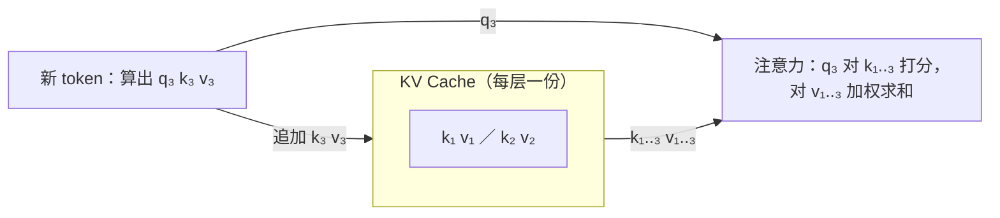
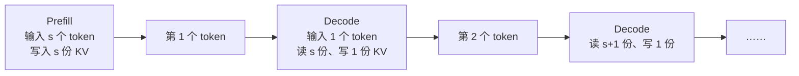

# 0.4 KV Cache、Prefill 与 Decode

> 对应原书第 2 章 *Enable the KV Cache to Boost Performance*、*The Prefill and Decode Phases*、*Run the LLM with a Serving Framework* 三节。

上一节的生成循环每一步都把整个序列重算一遍。这一节先找出哪些计算是重复的，引出 KV Cache；有了 KV Cache 之后，一个请求的执行会自然地分成 prefill 和 decode 两个阶段，它们的性能特征几乎相反。后面所有的优化手段，都可以按它作用于哪个阶段来归类。

## 1. 哪些计算是重复的

看序列从"AI 推理"两个 token 变成"AI 推理 快"三个 token 时，模型内部的变化：

- RMSNorm、Q/K/V 投影、前馈网络、输出投影，都是对每个位置单独计算的。"AI"和"推理"在这些地方的输入、输出和上一步完全一样。
- 自注意力是唯一让位置之间交换信息的地方。因为有因果掩码，"AI"只看自己，"推理"只看"AI"和自己，新来的"快"影响不到它们。

所以前两个位置在 36 层里的计算结果，和上一步完全相同。这一步真正需要算的只有"快"这一个位置。

## 2. 为什么只缓存 K 和 V

如果这一步只把"快"送进模型，它在每一层的注意力需要哪些数据？写出第 3 个位置的注意力输出：

$$
o_3 = \sum_{j=1}^{3} \text{softmax}_j\left(\frac{q_3 \cdot k_j}{\sqrt{d_h}}\right) v_j
$$

式子里用到了当前位置的 $q_3$，以及**所有**位置的 $k_1, k_2, k_3$ 和 $v_1, v_2, v_3$。没有用到 $q_1$ 和 $q_2$。

- 每个位置的 $q$ 只在计算这个位置自己的输出时用一次。前两个位置的输出早已算完，它们的 $q$ 不会再用到。
- 每个位置的 $k$、$v$ 则要被之后的每一个位置读取。

所以只需把每一层、每个位置的 $k$ 和 $v$ 存下来，这就是 **KV Cache**。每生成一个 token，计算它的 $q$、$k$、$v$，把 $k$、$v$ 追加到缓存末尾，再用 $q$ 和缓存中全部的 $k$、$v$ 计算注意力。



下面的组件逐步对比有无 KV Cache 时，每一步需要计算的位置。

<div class="llm-widget" data-widget="kv-cache-steps"></div>

## 3. 省了多少计算

设 prompt 长度为 $s$，生成 $n$ 个 token，模型参数量为 $P$。只看线性层（每个 token 约 $2P$ 次运算）：

| | 第 $k$ 步处理的 token 数 | 生成 $n$ 个 token 的总计算量 |
|---|---|---|
| 不用缓存 | $s + k$ | $\sum_{k=1}^{n} 2P(s+k) \approx 2P\left(sn + \dfrac{n^2}{2}\right)$ |
| 使用 KV Cache | 第一步 $s$，之后每步 1 | $2P(s + n)$ |

以 $s = 2000$、$n = 1000$ 为例：不用缓存相当于处理了约 250 万个 token，使用缓存只处理 3000 个，相差 800 多倍。

代价是显存。每个 token 在每一层都要存一份 $k$ 和 $v$。Qwen3-8B 每个 token 的 KV Cache 是 144 KiB，一个 32K 长度的请求要 4.5 GB。0.6 节会推导这个数字，并计算一张卡能同时容纳多少请求。

## 4. Prefill 与 Decode

有了 KV Cache，一个请求的执行分成两个阶段：

- **Prefill**：把整个 prompt 一次送进模型，计算出全部 $s$ 个位置的 K、V 写入缓存，同时得到第一个输出 token。每个请求只做一次。
- **Decode**：每一步只送入上一步生成的那个 token，读取全部缓存计算注意力，追加一份 K、V，得到下一个 token。生成 $n$ 个 token 要做 $n-1$ 步。



两个阶段跑的是同一个模型，性能特征却截然不同：

| | Prefill | Decode |
|---|---|---|
| 每次输入 | 整个 prompt，`[s]` | 1 个 token |
| 对 KV Cache | 一次写入 $s$ 份 | 读取全部已有的，追加 1 份 |
| 次数 | 每个请求 1 次 | 每个输出 token 1 次 |
| 计算形态 | 矩阵乘矩阵，计算量大 | 向量乘矩阵，计算量小，但要读全部权重和缓存 |
| 瓶颈 | 算力 | 显存带宽 |
| 决定的指标 | 首个 token 的延迟（TTFT） | 之后每个 token 的间隔（TPOT） |

"瓶颈"一行是这一节最重要的结论，0.7 节会用 Roofline 模型定量地说明它。直观地看：prefill 读一遍权重，可以用在几千个 token 上；decode 读同样多的权重，只算一个 token，GPU 的大部分时间花在等数据。

这张表也给后面的优化手段分了类：

- 针对 prefill：前缀缓存，跳过重复的 prompt（1.4 节）；FlashAttention，降低长输入的注意力开销（3.2 节）；FP8 计算（2.5 节）。
- 针对 decode：连续批处理，让多个请求共享一次权重读取（1.2 节）；权重量化与 KV Cache 量化，减少要读的字节（第 2 部分）；投机解码，一次验证多个 token（3.4 节）。
- 两者互相干扰时：chunked prefill（1.2 节）、prefill 与 decode 分离部署（4.3 节）。

不同业务的耗时分布也不一样。长输入、短输出的任务，比如文档摘要、RAG 问答、分类，时间主要花在 prefill；短输入、长输出的任务，比如对话、写作、带长思维链的推理，时间主要花在 decode。优化之前，先看清楚自己的负载属于哪一类。

## 5. 给上一节的循环加上 KV Cache

Transformers 的模型接受 `past_key_values` 参数，并在输出中返回更新后的缓存。在上一节的循环上改三处：

```python
import time, torch
from transformers import AutoModelForCausalLM, AutoTokenizer

name = "Qwen/Qwen3-0.6B"
tok = AutoTokenizer.from_pretrained(name)
model = AutoModelForCausalLM.from_pretrained(name, torch_dtype=torch.bfloat16).cuda().eval()

cur = tok("Write a short introduction about Beijing.", return_tensors="pt").input_ids.cuda()
generated = cur.clone()
past = None
step_times = []

with torch.no_grad():
    for step in range(100):
        t0 = time.perf_counter()
        out = model(input_ids=cur, past_key_values=past, use_cache=True)   # 1. 传入缓存
        past = out.past_key_values                                         # 2. 保存更新后的缓存
        probs = torch.softmax(out.logits[:, -1, :], dim=-1)
        next_id = torch.multinomial(probs, num_samples=1)
        generated = torch.cat([generated, next_id], dim=1)
        cur = next_id                                                      # 3. 下一步只送入新 token
        torch.cuda.synchronize()
        step_times.append(time.perf_counter() - t0)
        if next_id.item() == tok.eos_token_id:
            break

print(tok.decode(generated[0], skip_special_tokens=True))
```

第 0 步是 prefill，处理整个 prompt，耗时稍长；之后每一步的耗时基本不变，不再随长度增长。在 A100 上运行 Qwen3-0.6B，decode 每步大约在 10 ms 量级。对一个 0.6B 的模型来说这其实很慢，大部分时间花在 Python 逐层调用和启动 GPU kernel 上，而不是计算本身。这部分开销怎样消除，是 1.3 节和项目 1 讨论的内容。

## 6. KV Cache 带来的新问题

KV Cache 用显存换来了计算量的大幅下降，也带来了几个新问题。第 1 部分的内容基本就是围绕它们展开的：

1. **占用显存多。** 长上下文、高并发时，KV Cache 往往比权重还大，直接限制了一张卡能同时服务的请求数（0.6 节）。
2. **容易产生碎片。** 请求最终会生成多少个 token 事先不知道。如果按最大长度预留一块连续显存，大部分空间会闲置。分页管理解决这个问题（1.3 节）。
3. **相同前缀被重复计算。** 一百个请求带着同一段系统提示词，这段提示词的 KV Cache 没必要算一百遍、存一百份（1.4 节）。
4. **prefill 和 decode 互相干扰。** 一个长 prompt 的 prefill 和其他请求的 decode 放进同一步，会让那些请求的输出停顿一下（1.2 节）。

## 7. 实验：手写循环、Transformers 与 vLLM

原书在这一章的最后用 vLLM 运行同一个模型，和 Transformers 做了对比。可以自己做一个简化版本：同样 32 条 prompt，每条生成 256 个 token，比较三种方式的总耗时。

```python
from vllm import LLM, SamplingParams

prompts = [f"Write a short story about the number {i}." for i in range(32)]
params = SamplingParams(temperature=0.8, max_tokens=256, ignore_eos=True)

llm = LLM("Qwen/Qwen3-0.6B", max_model_len=2048)
outputs = llm.generate(prompts, params)   # 离线批量推理，32 条一起处理
```

另外两种方式分别是：用上一节带 KV Cache 的循环逐条生成；用 Transformers 的 `model.generate()` 一次传入 32 条（需要设置 `tokenizer.padding_side = "left"` 并开启 padding）。

记录三者的总耗时和每秒生成的 token 数。逐条生成最慢；`generate()` 批量处理快得多，但所有请求要等最长的那条结束；vLLM 通常还能再快数倍。第 1 部分会逐一解释这些差距来自哪里。

## 自测

<div class="llm-widget" data-widget="quiz" data-questions='[{"q": "KV Cache 为什么只缓存 K 和 V，不缓存 Q？", "options": ["Q 占用的显存太大，缓存不划算", "Q 每一步都会被 RoPE 重新旋转，缓存后会失效", "一个位置的 q 只在计算它自己的输出时用一次，之后不再需要", "Q 可以由 K 和 V 推导出来，不需要单独保存"], "answer": 2, "explain": "第 &#36;t&#36; 步只需要当前位置的 &#36;q_t&#36;，以及全部位置的 &#36;k&#36; 和 &#36;v&#36;。之前位置的 &#36;q&#36; 在它们各自那一步就用完了。Q 的大小和 K 相当（GQA 下还更大），RoPE 对每个位置的旋转角度是固定的，也不会失效。"}, {"q": "一个合同审查服务：每次输入 15000 个 token 的合同，模型只输出“合规”或“有风险”。KV Cache 对单个请求的耗时影响大吗？", "options": ["很大，KV Cache 能把 prefill 加速一个数量级", "很小，几乎没有 decode 步，时间基本都花在 prefill 上", "很大，15000 个 token 的注意力必须借助 KV Cache 才能计算", "没有影响，但写缓存会让 prefill 慢一倍"], "answer": 1, "explain": "KV Cache 省掉的是 decode 每一步对之前位置的重复计算。只输出一两个 token 时几乎没有 decode。这类负载应该关注 prefill 的效率，以及用前缀缓存复用相同的系统提示词。写入缓存的开销很小。"}, {"q": "某请求 TTFT 为 400 ms，之后每个 token 间隔 25 ms，共输出 201 个 token。想把总耗时缩短 30%，应该优化哪个阶段？", "options": ["prefill，因为它决定了 TTFT", "两个阶段各占一半，需要同时优化", "网络传输，流式输出的开销最大", "decode，它占了总耗时的九成以上"], "answer": 3, "explain": "总耗时约 400 + 25 × 200 = 5400 ms，prefill 只占 7%。即使把 prefill 降到 0 也达不到目标。应该降低每个 token 的间隔，比如量化、投机解码。"}, {"q": "关于 prefill 和 decode 的瓶颈，下面哪种说法正确？", "options": ["两者都受算力限制，只是计算量不同", "prefill 受算力限制，decode 受显存带宽限制", "prefill 受显存带宽限制，decode 受算力限制", "两者都受显存带宽限制，因为都要读全部权重"], "answer": 1, "explain": "prefill 读一遍权重，可以用于几千个 token 的计算；decode 读同样多的权重只算一个 token，GPU 主要在等数据。0.7 节会用 Roofline 模型定量说明。"}]'></div>

## 延伸阅读

- 原书第 2 章 *Enable the KV Cache to Boost Performance*、*The Prefill and Decode Phases*、*Performance Comparison: vLLM Versus Hugging Face Transformers*。
- Pope et al., [Efficiently Scaling Transformer Inference](https://arxiv.org/abs/2211.05102), MLSys 2023。系统地分析了 prefill 和 decode 的不同瓶颈，以及模型切分方式对两者的影响。
