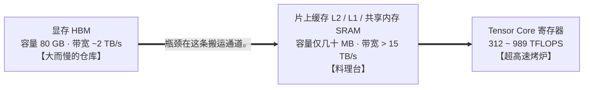

# 0.4 算术强度与 Roofline 分析

## 学习目标

完成本节学习后，你将能够：
- **从零推导出矩阵乘法的计算量（$2MNK$）与算术强度（Arithmetic Intensity）**，不再死记硬背公式。
- **读懂并亲手画出 Roofline（屋顶线）性能模型**：用硬件拐点 $I^*$ 判断一个操作到底卡在“算得慢（Compute-bound）”还是“搬得慢（Memory-bound）”。
- **定量解释大模型推理中最核心的规律**：为什么 Prefill 阶段受算力限制、Decode 阶段受显存带宽限制？为什么 Batch Size 增大能让 Decode 吞吐翻几十倍？
- **用一行除法算出任意模型在任意显卡上的 TTFT 与 TPOT 物理极限下限**。

---

## 1. 单用户聊天时，A100 的算力大多在空转

在 `0.1` 节我们提到过一个诡异的现象：当你用一张 A100 显卡（峰值算力高达 **312 TFLOPS**）独自和 `Qwen3-8B` 聊天时，每秒大约能蹦出 100 个词，体验很流畅。但如果你打开硬件底层监控，会发现 **Tensor Core 计算单元的利用率还不到 1%**。也就是说，你花大价钱买来的超级计算核心，99% 的时间都在发呆等数据。

更奇怪的是：
- 当你把并发用户数从 **1 人** 增加到 **32 人** 同时聊天时，每个人感觉吐字速度几乎没怎么变慢，但显卡每秒生成的总词数却从 100 暴涨到了 **2,500 以上**。
- 反过来，如果 1 个用户一次性发来一篇 4,000 字的长文档让模型阅读（Prefill 阶段），哪怕只有这 1 个人，A100 的算力利用率也能瞬间冲上 **70%–80%**。

**为什么“读长文（Prefill）”和“逐字吐回答（Decode）”跑的是完完全全同一套模型权重，硬件表现却一个在天上、一个在地下？**

要解开这个谜团，我们需要掌握系统性能分析中最强大的武器——**算术强度（Arithmetic Intensity）与 Roofline 模型**。

---

## 2. 算术强度与 Roofline 模型

### 2.1 数据在 GPU 里是怎么跑的？

在 `0.2` 节我们用披萨后厨打过比方：模型的权重常驻在显存（HBM，大冰箱）里，但计算单元（Tensor Core，烤炉）不能隔空直接算显存里的数。每次做矩阵乘法时，数据必须走完这样一条路：



因为料理台（片上 SRAM）只有几十 MB，根本放不下 16 GB 的模型权重，所以每做一层计算，都必须从 HBM 显存把权重搬过来。于是，任何一次计算任务都同时消耗两样东西：
1. **数据搬运量（Bytes）**：一共从 HBM 显存读写了多少字节的数据？
2. **浮点计算量（FLOPs）**：利用搬过来的这些数据，一共做了多少次浮点加减乘除运算？

把这两者一除，就得到了衡量一个算法“划不划算”的核心指标——**算术强度（Arithmetic Intensity，记作 $I$）**：

$$
I = \frac{\text{浮点计算量（FLOPs）}}{\text{显存数据搬运量（Bytes）}} \quad \text{（单位：FLOPs / Byte）}
$$

- **直觉理解**：$I$ 代表**“每辛苦从显存搬来 1 字节的数据，能在计算单元里压榨出多少次计算”**。
  - 如果 $I = 1$：搬来 1 字节数据，只算 1 次就扔了——纯粹在考搬运工的体力。
  - 如果 $I = 1000$：搬来 1 字节数据，在高速缓存里翻来覆去算了 1000 次——计算单元彻底忙起来了。

### 2.2 硬件的拐点（Ridge Point）

那么，$I$ 要达到多大，才能让计算单元不空转呢？这取决于硬件自己的“算力”和“带宽”之比，我们称之为**硬件拐点（Ridge Point，记作 $I^*$）**：

$$
I^{*} = \frac{\text{GPU 峰值稠密算力（FLOPS）}}{\text{GPU 显存带宽（Bytes/s）}}
$$

以 **A100 80GB SXM** 为例：峰值 BF16 稠密算力是 $312\text{ TFLOPS}$，显存带宽是 $2.04\text{ TB/s}$。两相一除：

$$
I^{*}_{\text{A100}} = \frac{312 \times 10^{12}\text{ FLOP/s}}{2.04 \times 10^{12}\text{ Byte/s}} \approx \mathbf{153\text{ FLOPs / Byte}}
$$

这个数字 **153** 极其重要。它的物理含义是：**在 A100 上，每从显存搬 1 字节数据，你必须至少做够 153 次浮点运算，烤炉（算力）和传送带（带宽）才能刚好同时跑满。**

| 你的算法算术强度 $I$ | 与硬件拐点 $I^*$ 比较 | 所处状态 | 实际能跑出的算力 | 优化方向 |
|---|---|---|---|---|
| **$I < I^*$**（例如 $I = 1$） | 小于拐点 | **访存受限（Memory-bound）**<br/>位于 Roofline 左半边**斜坡** | $\text{实际算力} = I \times \text{显存带宽}$<br/>（算力大量闲置，速度全看带宽） | 想办法减少搬运字节数（量化），或搬一次给多个人用（增大 Batch） |
| **$I > I^*$**（例如 $I = 1000$） | 大于拐点 | **计算受限（Compute-bound）**<br/>位于 Roofline 右半边**平顶** | $\text{实际算力} = \text{硬件峰值算力}$<br/>（带宽绰绰有余，算力 100% 满载） | 换算力更高的卡、开启 FP8 Tensor Core、或跳过重复计算（Prefix Cache） |

常见 GPU 的 BF16 硬件拐点 $I^*$ 一览：
- **A100 SXM**：$312 / 2.04 \approx \mathbf{153}$ FLOPs/B
- **H200 SXM**：$989 / 4.80 \approx \mathbf{206}$ FLOPs/B
- **H100 SXM**：$989 / 3.35 \approx \mathbf{295}$ FLOPs/B（注意：H100 算力涨了 3.2 倍，但带宽只涨了 1.6 倍，所以拐点右移到了 295，比 A100 更难喂饱。）
- **L40S**：$362 / 0.864 \approx \mathbf{419}$ FLOPs/B（算力高、带宽低，拐点极高，极易卡在带宽上）

---

## 3. 组件：Prefill 与 Decode 在 Roofline 上的位置

现在，请操作下方的交互式 Roofline 模拟器，亲眼看看 **Prefill（绿色圆点）** 和 **Decode（蓝色圆点）** 分别落在屋顶线的什么位置：

<div class="llm-widget" data-widget="roofline-explorer"></div>

### 动手试一试
1. **观察单用户 Decode（`b = 1`）**：把 `Decode 批大小 (b)` 滑块拖到最左边 `1`。看图上的蓝色圆点：$I \approx 1$，死死趴在左下角的坡底。在 A100 上可达算力只有 `2 TFLOPS`（利用率 **0.6%**），单步耗时 `8.0 ms`。
2. **慢慢拉大 Decode 批大小 `b`**：将 `b` 从 `1` 拖到 `16`、`64`、`256`。你会看到蓝色圆点沿着斜坡一路向右上爬升。当 `b` 超过 `160` 时，蓝色圆点终于爬上了 A100 的平顶（进入计算受限区）。
3. **切换到 H100 或 L40S**：在下拉框中把 GPU 换成 **H100** 或 **L40S**，看看需要多大的 Batch Size `b` 才能爬上平顶？

---

## 4. 推导：矩阵乘、Prefill 与 Decode 的算术强度

很多同学看到教材里的 $2MNK$ 和 $I = \frac{sh}{2s+h}$ 会觉得头晕。别急，我们用最简单的线性代数常识，花 3 分钟把它彻底推导出来。

### 第一步：矩阵乘法的计算量为什么是 2MNK

假设输入激活矩阵 $X$ 的形状是 $[M, K]$（代表有 $M$ 个 Token，每个 Token 是长度为 $K$ 的向量），权重矩阵 $W$ 的形状是 $[K, N]$，相乘得到输出矩阵 $Y$，形状为 $[M, N]$：

1. **算计算量（FLOPs）**：
   - 输出矩阵 $Y$ 一共有 $M \times N$ 个格子（元素）。
   - 要算出其中**任意 1 个格子**的值，需要拿 $X$ 的一行（$K$ 个数）和 $W$ 的一列（$K$ 个数）做点积：即做 **$K$ 次乘法** 和 **$K$ 次加法**，一共是 $2K$ 次浮点运算。
   - 所以算出全部 $M \times N$ 个格子，总计算量就是：
     $$
     \text{FLOPs} = 2 \times M \times N \times K
     $$

2. **算显存搬运量（Bytes，以 BF16 每个数占 2 字节为例）**：
   - 读入输入矩阵 $X$：$M \times K$ 个数 $\times 2\text{ Bytes} = 2MK$ 字节。
   - 读入权重矩阵 $W$：$K \times N$ 个数 $\times 2\text{ Bytes} = 2KN$ 字节。
   - 写出结果矩阵 $Y$：$M \times N$ 个数 $\times 2\text{ Bytes} = 2MN$ 字节。
   - 总搬运字节数：
     $$
     \text{Bytes} = 2(MK + KN + MN)
     $$

3. **一除得到通用矩阵乘算术强度（注意分子分母的 $2$ 刚好约掉。）**：
   $$
   I_{\text{matmul}} = \frac{2MNK}{2(MK + KN + MN)} = \frac{MNK}{MK + KN + MN}
   $$

---

### 第二步：把 Prefill 和 Decode 代入这个公式。

在 Transformer 的线性层里，权重的维度 $K$ 和 $N$ 都是模型的隐藏层维度 $h$（例如 Qwen3-8B 的 $h = 4096$）。唯一变化的是输入的行数 $M$（即这 1 步同时喂进去了多少个 Token）：

$$
I = \frac{M \cdot h \cdot h}{M h + h^2 + M h} = \frac{M h}{2M + h}
$$

现在分两种情况看这个简单的式子 $\frac{Mh}{2M+h}$（设 $h = 4096$）：

#### 情况 A：Prefill 阶段（一次输入整段 prompt，M = s）
当用户发来一段长度为 $s = 2048$ 的 Prompt 时，这一步一次性并行处理 $M = 2048$ 个 Token：
$$
I_{\text{prefill}} = \frac{2048 \times 4096}{2 \times 2048 + 4096} = \frac{2048 \times 4096}{8192} = \mathbf{1024\text{ FLOPs/Byte}}
$$
对比 A100 的拐点 $I^* = 153$：$1024 \gg 153$。哪怕只有 1 个用户的请求，只要 Prompt 长度超过两三百，Prefill 就稳稳落在 Roofline 的平顶区，**属于典型的计算受限（Compute-bound）**。

#### 情况 B：单请求 Decode 阶段（一次只生成 1 个新 token，M = 1）
到了逐字生成的 Decode 阶段，前面词的 KV 已经缓存了，每一步只送进去最新生成的 **$M = 1$** 个 Token：
$$
I_{\text{decode (b=1)}} = \frac{1 \times 4096}{2 \times 1 + 4096} \approx \mathbf{1\text{ FLOPs/Byte}}
$$
对比 A100 的拐点 $I^* = 153$：$1 \ll 153$。每搬 1 字节权重只算 1 次，算力利用率只有 $1 / 153 \approx 0.65\%$，**属于极度的显存带宽受限（Memory-bound）**。

> [!WARNING]
> **勘误提示**：在原书《Hands-On LLM Serving and Optimization》表 5-10 中，作者在计算该公式时不小心把分母里输出矩阵的大小 $s \times h$ 错写成了 $h \times h$，导致算出的数值偏小了一半（例如把 Decode 算成了 0.5）。按正确的输出形状 $[s, h]$ 计算，正确结果如上表所示。这并不改变核心结论：**Prefill 受算力限制，Decode 受显存带宽限制。**

---

### 第三步：为什么批处理（Batching）能拯救 Decode，但救不了长上下文 Attention？

如果我们把 $b$ 个不同用户的 Decode 请求攒成一批同时算，输入矩阵的行数就从 $1$ 变成了 $M = b$（当 $b \ll h$ 时，$2b + h \approx h$）：

$$
I_{\text{decode (线性层)}} = \frac{b \cdot h}{2b + h} \approx \mathbf{b}
$$

**这就是批处理的魔力**：权重矩阵 $W$ 还是只从显存读 1 遍，但这次顺便把 $b$ 个用户的 Token 全算完了。线性层的算术强度直接扩大了 $b$ 倍。

**但是，千万注意一个例外——自注意力（Attention）层不共享 KV Cache。**
- 在线性层里，所有用户共用同一份模型权重 $W$。
- 但在 Attention 层里，用户 A 要读用户 A 自己的历史 KV Cache，用户 B 要读用户 B 自己的历史 KV Cache，**彼此完全不能共享**。
- 对任意一个请求，拿当前 1 个 Token 的 Query 去和历史 $t$ 个 Token 的 KV Cache 算注意力，算术强度恒定约为 GQA 的分组倍数 $g = n_q / n_{kv}$（MHA 下为 $1$，Qwen3-8B 下为 $32/8 = 4$），**无论 Batch Size $b$ 设得多大，Attention 读 KV Cache 的算术强度永远停留在 1~4 左右，永远受显存带宽限制。**

---

## 5. 估算延迟下限

掌握了 Roofline，你在面试或做架构设计时，只需要拿餐巾纸写两行除法，就能算出任何模型在任何显卡上的性能天花板：

### 5.1 估算 Decode 每步延迟（TPOT 下限）
因为 Decode 受带宽限制，每生成 1 个词，GPU 至少要把**全部模型权重 + 当前批次所有请求的 KV Cache** 从显存读一遍：

$$
t_{\text{step}} \gtrsim \frac{M_{\text{weights}} + M_{\text{KV, batch}}}{\text{GPU 显存带宽}}
$$

以 **Qwen3-8B BF16（权重 16.4 GB，每 Token KV 144 KiB）在 A100（带宽 2.04 TB/s）** 上为例：
- **单用户（$b=1$，短上下文忽略 KV）**：
  $$t_{\text{step}} \ge \frac{16.4\text{ GB}}{2040\text{ GB/s}} \approx \mathbf{8.0\text{ ms/token}} \implies \text{单流吐字速度上限} = \frac{1000}{8.0} \approx \mathbf{124\text{ tok/s}}$$
- **16 并发（$b=16$，每人 2048 上下文，KV 共 $16 \times 2048 \times 144\text{ KiB} \approx 4.8\text{ GB}$）**：
  $$t_{\text{step}} \ge \frac{16.4 + 4.8\text{ GB}}{2040\text{ GB/s}} \approx \mathbf{10.4\text{ ms}} \implies \text{总吞吐上限} = \frac{16}{0.0104} \approx \mathbf{1,538\text{ tok/s}}$$
- **64 并发（$b=64$，每人 2048 上下文，KV 共 $19.3\text{ GB}$，已超过权重大小。）**：
  $$t_{\text{step}} \ge \frac{16.4 + 19.3\text{ GB}}{2040\text{ GB/s}} \approx \mathbf{17.5\text{ ms}} \implies \text{总吞吐上限} = \frac{64}{0.0175} \approx \mathbf{3,657\text{ tok/s}}$$

### 5.2 估算长 Prompt 的 Prefill 耗时（TTFT 下限）
Prefill 受算力限制，处理 $s$ 个输入 Token 的总浮点计算量约为 $2 \times P \times s$（每个参数对每个 Token 做一次乘加）：

$$
t_{\text{prefill}} \gtrsim \frac{2 \times P \times s}{\text{GPU 峰值稠密算力} \times \text{MFU}}
$$

（其中 $\text{MFU}$ 是实际算力利用率，推理中通常在 $50\% \sim 70\%$ 之间。）
对于 Qwen3-8B（$P = 8.19\times 10^9$），输入长度 $s = 2048$，在 A100（312 TFLOPS，取 60% MFU）上：
$$
t_{\text{prefill}} \approx \frac{2 \times 8.19 \times 10^9 \times 2048}{312 \times 10^{12} \times 0.6} \approx \mathbf{180\text{ ms}}
$$

---

## 6. 实验：测出 GPU 的 Roofline 拐点

本仓库提供了 [`code/stage0/roofline_sweep.py`](https://github.com/zrpxx/hands-on-llm-serving-opt/blob/main/code/stage0/roofline_sweep.py)，它会固定线性层权重大小 $[4096, 4096]$，让输入行数 $M$ 从 $1$ 一路翻倍扫描到 $8192$，实测每个 $M$ 下的 TFLOPS 并画出本机的真实 Roofline 曲线：

```bash
python code/stage0/roofline_sweep.py --hidden 4096 --peak-tflops 312 --peak-tbs 2.039 --plot roofline.png
```

跑完后观察终端表格或生成的 `roofline.png`，重点找两个点：
1. $M=1$ 时，实测等效带宽占硬件理论带宽的百分比是多少？
2. 实测 TFLOPS 达到峰值 80% 时的 $M$ 值，与理论拐点 $I^*$ 是否吻合？

---

## 7. 自测

<div class="llm-widget" data-widget="quiz" data-questions='[{"q": "为什么在 H100 SXM（989 TFLOPS，3.35 TB/s）上，让 decode 的线性层进入计算受限区比在 A100（312 TFLOPS，2.04 TB/s）上更难？", "options": ["H100 的显存更大，同样的批大小下 KV 占比更低", "H100 算力增长约 3.2 倍，带宽只增长约 1.6 倍，拐点从约 153 右移到约 295，需要更大的批", "H100 的 Tensor Core 不支持小矩阵乘，批太小时会退回 CUDA Core", "H100 默认开启稀疏计算，稠密矩阵乘反而更慢"], "answer": 1, "explain": "拐点 &#36;I^* = &#36; 峰值算力 / 带宽。decode 时线性层的算术强度约等于批大小，所以批要达到约 295 才能用满 H100 的算力。算力涨得比带宽快，是新一代硬件普遍的趋势（存储墙）。"}, {"q": "把权重从 BF16 量化成 W4A16（4 位权重、16 位激活），为什么单请求 decode 明显变快，而长 prompt 的大批量 prefill 几乎没有提升？", "options": ["4 位权重只能用于 decode，prefill 时会自动切回 BF16 权重", "decode 受带宽限制，读取的权重字节减到约 1/4；prefill 受算力限制，W4A16 计算前还要反量化回 16 位，计算量没有减少", "prefill 阶段的计算主要在注意力，量化只影响 MLP", "量化后 KV Cache 也变成 4 位，decode 读 KV 更快，prefill 不读 KV"], "answer": 1, "explain": "这是 Roofline 的直接应用：访存受限时减少字节有效，计算受限时要减少或加速计算。W4A16 只压缩权重，KV 仍是 16 位；要让计算本身变快需要 W8A8、FP8 这类激活也量化的方案。"}, {"q": "decode 的批大小从 64 增加到 256，输出吞吐一定提升约 4 倍吗？", "options": ["一定，线性层的算术强度与批大小成正比", "不一定：每个请求的 KV 读取量随批大小线性增长，KV 占主导后每步耗时也近似线性增长；线性层越过拐点后也不再“免费”", "一定会下降，因为批越大调度开销越高", "不一定，因为批大小超过 128 后 GPU 会自动拆成两步执行"], "answer": 1, "explain": "批处理只能摊薄权重的读取，每个请求自己的 KV 必须单独读，注意力部分的算术强度约等于 GQA 分组大小，与批大小无关。长上下文、大批量时，KV 读取会成为 decode 的主要开销。"}]'></div>

---

## 延伸阅读

- Samuel Williams, Andrew Waterman, and David Patterson, [*Roofline: An Insightful Visual Performance Model for Multicore Architectures*](https://dl.acm.org/doi/10.1145/1498765.1498785), Communications of the ACM, 2009（Roofline 模型原始论文）
- Chi Wang & Peiheng Hu, *Hands-On LLM Serving and Optimization*, O'Reilly, Chapter 5 (*Bottlenecks in LLM Model Execution*)
