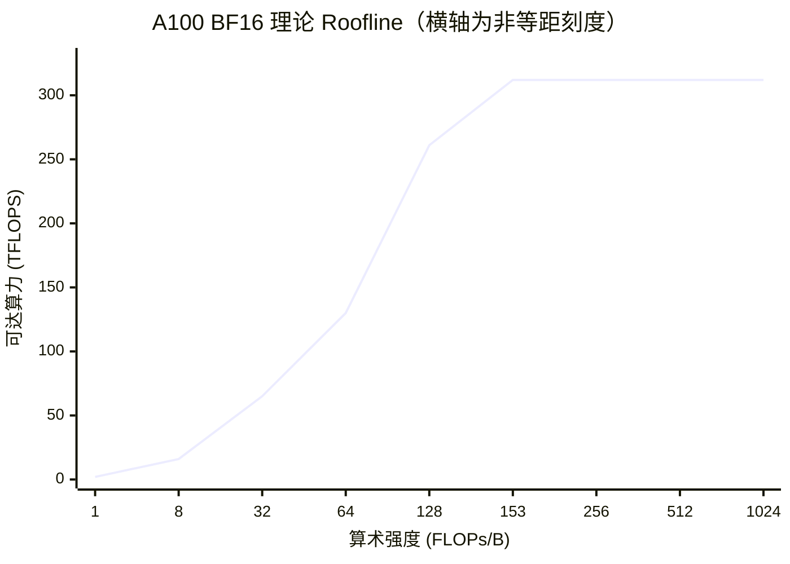

# 0.4 算术强度与 Roofline 分析

> 对应书中第 5 章 Bottlenecks in LLM Model Execution

## 学习目标

- 计算一次矩阵乘的算术强度，并用 Roofline 判断它受算力还是受带宽限制。
- 解释为什么 prefill 通常受算力限制、decode 受带宽限制，以及批处理如何改变这一点。
- 用"读一遍权重的时间"和"做一遍计算的时间"估算 decode 每步延迟与 prefill 耗时的下限。

## 1. 数据是怎么流动的

权重常驻在显存（HBM）里，但计算单元不能直接用它。每次计算时，数据要经过 HBM → L2 Cache → L1 / 共享内存 → 寄存器。片上存储（SRAM）快但小，HBM 大但慢。对大多数算子来说，**HBM 带宽决定了数据能以多快的速度送到计算单元**。

（FlashAttention 这类算子会刻意把数据留在 SRAM 中复用，绕开这一限制，见 3.2 节。）

## 2. 算术强度

$$
I = \frac{\text{计算量（FLOPs）}}{\text{数据搬运量（Bytes）}}
$$

硬件也有一个对应的比值，称为拐点（ridge point）：

$$
I^{*} = \frac{\text{峰值算力}}{\text{显存带宽}}
$$

| GPU | BF16 稠密算力 | 带宽 | $I^*$（FLOPs/B） |
|---|---|---|---|
| A100 / A800 80GB SXM | 312 TFLOPS | 2.04 TB/s | 153 |
| H100 SXM | 989 TFLOPS | 3.35 TB/s | 295 |
| H200 SXM | 989 TFLOPS | 4.8 TB/s | 206 |
| L40S | 362 TFLOPS | 0.864 TB/s | 419 |
| A10 | 125 TFLOPS | 0.6 TB/s | 208 |

- $I < I^*$：数据送得不够快，算力闲置，称为**访存受限**（memory-bound）。实际性能约为 $I \times \text{带宽}$。
- $I > I^*$：计算单元已满载，称为**计算受限**（compute-bound）。实际性能封顶于峰值算力。

这条"先斜后平"的折线就是 Roofline 模型：



## 3. 矩阵乘的算术强度

LLM 中绝大部分计算是矩阵乘。输入 $[M, K]$ 乘以权重 $[K, N]$，得到 $[M, N]$：

- 计算量：$2MNK$（每个输出元素 $K$ 次乘加）。
- 搬运量（BF16，2 字节）：$2(MK + KN + MN)$，即读两个输入、写一个输出。

$$
I_{\text{matmul}} = \frac{MNK}{MK + KN + MN}
$$

方阵 $M = N = K = n$ 时 $I = n/3$：

| $n$ | $I$ | 在 A100 上 | 在 L40S 上 |
|---|---|---|---|
| 64 | 21 | 访存受限 | 访存受限 |
| 512 | 171 | 计算受限 | 访存受限 |
| 4096 | 1365 | 计算受限 | 计算受限 |

矩阵越大，每读一个字节能做的计算越多。问题在于：LLM 推理中的矩阵够大吗？

## 4. Prefill 与 Decode

单个请求时，线性层的输入是 $[s, h]$，权重是 $[h, h]$（以 $h \times h$ 的投影为例）。

- **Prefill**：一次处理全部输入 token，$M = s$。
- **Decode**：每次只处理一个新 token，$M = 1$。

代入 $M = s,\ K = N = h$：

$$
I = \frac{s h^2}{sh + h^2 + sh} = \frac{s h}{2s + h}
$$

$h = 4096$ 时：

| 序列长度 $s$ | Prefill $I$ | Decode $I$ | A100 上的判断 |
|---|---|---|---|
| 64 | 62 | ≈ 1 | 两者都访存受限 |
| 512 | 410 | ≈ 1 | Prefill 计算受限，Decode 访存受限 |
| 4096 | 1365 | ≈ 1 | Prefill 计算受限，Decode 访存受限 |

> [!WARNING]
> 书中表 5-10 给出的数值是 31、240、1365 和 decode 的 0.5。对照公式可以发现，书中分母的第三项写成了 $h \times h$，但输出矩阵的形状是 $[s, h]$，应为 $s \times h$。按正确公式重算后是上表的 62、410、1365 和约 1。结论的方向不变：prefill 在序列足够长时受算力限制，decode 始终受带宽限制。

结论：**decode 阶段每读入一个字节的权重只做约 1 次浮点运算**，A100 的算力利用率不到 1%。这是 LLM 推理优化最核心的一个事实。

## 5. 批处理改变了什么

把 $b$ 个请求的 decode 合在一起算，线性层的输入变成 $[b, h]$，权重只需读一次：

$$
I \approx \frac{b h}{2b + h} \approx b \quad (b \ll h)
$$

| 批大小 $b$ | 线性层 $I$ |
|---|---|
| 1 | 1 |
| 32 | 31 |
| 128 | 120 |
| 512 | 410 |

在 A100 上，线性层要到 $b \approx 160$ 左右才进入计算受限区。这解释了为什么批处理是提升 decode 吞吐最有效的手段（1.5 节）：权重读一次，供 $b$ 个请求共用。

**但注意力部分不受益于批处理。** decode 时每个请求要读自己的那份 KV Cache，不同请求之间不共享。对一个上下文长度为 $t$ 的请求，计算 $QK^\top$ 和 $AV$ 的计算量约为 $4 n_q t d_h$，读取的 KV 为 $2 n_{kv} t d_h$ 个元素，算术强度约为

$$
I_{\text{attn}} \approx \frac{n_q}{n_{kv}} = g
$$

$g$ 是 GQA 的分组大小。MHA 下约为 1，Qwen3-8B（$g=4$）约为 4，无论批多大都远低于拐点。所以长上下文、大批量时，KV 读取会成为 decode 的主要开销。这是 GQA / MLA（3.1）、KV 量化（2.5）、FlashDecoding 一类优化的出发点。

## 6. 用 Roofline 估算延迟下限

### 6.1 Decode 每步延迟

decode 受带宽限制时，每一步至少要把权重和本批所有 KV 读一遍：

$$
t_{\text{step}} \gtrsim \frac{M_{\text{weights}} + M_{\text{KV, batch}}}{\text{带宽}}
$$

**例：Qwen3-8B BF16（16.4 GB），A100 / A800（2.04 TB/s）。**

| 场景 | 每步读取 | 访存时间 | 计算时间 | 每步下限 | 吞吐上限 |
|---|---|---|---|---|---|
| $b=1$，短上下文 | 16.4 GB | 8.0 ms | 0.05 ms | 8.0 ms | 124 tok/s |
| $b=16$，每个 2K 上下文 | 16.4 + 4.8 GB | 10.4 ms | 0.8 ms | 10.4 ms | 1,540 tok/s |
| $b=64$，每个 2K 上下文 | 16.4 + 19.3 GB | 17.5 ms | 3.4 ms | 17.5 ms | 3,660 tok/s |

（计算时间按 $2Pb$ / 312 TFLOPS 计；KV 每 token 144 KiB，见 0.3。）

几个观察：

- 单请求时，A100 上 Qwen3-8B 的生成速度上限约 124 token/s，和算力无关，只和带宽有关。
- 批大小从 1 增加到 64，每步延迟只增加约一倍，吞吐提升约 30 倍。
- $b=64$ 时 KV 的读取量已经超过权重，继续加大批或加长上下文，收益会递减。

### 6.2 Prefill 耗时

prefill 足够长时受算力限制：

$$
t_{\text{prefill}} \gtrsim \frac{2 P s}{\text{峰值算力} \times \text{MFU}}
$$

MFU（Model FLOPs Utilization）是实际达到的算力占峰值的比例，推理中通常为 40%–70%。

**例：Qwen3-8B，$s = 2048$，A100。** $2 \times 8.19\times10^9 \times 2048 \approx 3.4 \times 10^{13}$ FLOPs，满载 108 ms，按 60% MFU 约 180 ms。这基本就是该请求 TTFT 的下限。

（注意力的 $O(s^2)$ 部分在 2K 长度下只占约 4%，可以忽略；到 32K 以上就不能忽略了。）

## 7. 用这套分析指导优化

| 瓶颈 | 方向 | 例子 |
|---|---|---|
| 访存受限（decode、小批） | 减少要搬运的字节，或让每个字节被多次使用 | 批处理、权重量化、KV 量化、GQA/MLA、投机解码 |
| 计算受限（prefill、大批） | 减少计算量，或提高算力利用率 | FP8 计算、kernel 融合、前缀缓存（跳过重复 prefill） |
| 两者混在一起互相干扰 | 把两类负载分开调度 | Chunked Prefill（1.5）、PD 分离（4.3） |

书中的总结是：如果负载受算力限制，就想办法减少或加速计算；如果受带宽限制，就减少不必要的数据搬运。

## 动手实验

**实验：测出本机的 Roofline 拐点。** 用 [`code/stage0/roofline_sweep.py`](https://github.com/zrpxx/hands-on-llm-serving-opt/blob/main/code/stage0/roofline_sweep.py) 固定 $K = N = 4096$，从 $M = 1$ 扫到 8192：

```bash
python code/stage0/roofline_sweep.py --hidden 4096 --peak-tflops 312 --peak-tbs 2.039 --plot roofline.png
```

记录并回答：

| 观察项 | 结果 |
|---|---|
| $M = 1$ 时的实测 TFLOPS / 等效带宽 | |
| 实测 TFLOPS 达到峰值 80% 时的 $M$ | |
| 这个 $M$ 与理论拐点（A100 约 160）的差距，以及可能原因 | |

## 自测题

1. 在 H100 SXM 上，decode 的线性层大约在多大批量时进入计算受限区？和 A100 比，为什么更难？
2. 一个 70B 模型 FP8 部署在 H100 上（不考虑多卡），单请求 decode 的速度上限是多少？
3. 批大小从 64 增加到 256，吞吐一定会提升 4 倍吗？为什么？
4. 为什么权重 INT4 量化对单请求 decode 提速明显，对大批量 prefill 几乎没帮助？

<details>
<summary>参考答案</summary>

1. 约 $b \approx I^* \approx 295$ 时。H100 算力增长的倍数（约 3.2 倍）大于带宽增长的倍数（约 1.6 倍），拐点更靠右，需要更大的批才能用满算力。
2. 权重约 70 GB，$70 / 3350 \approx 21$ ms 一步，上限约 48 token/s（实际上 80 GB 卡放下 70 GB 权重后几乎没有 KV 空间，需要多卡）。
3. 不一定。线性层部分的访存量不变，但 KV 读取随批大小线性增长；当 KV 读取占主导时，每步延迟也近似线性增长，吞吐提升会远小于 4 倍。另外显存容量可能先成为限制。
4. 单请求 decode 受带宽限制，权重字节数减到 1/4，每步读取时间接近减到 1/4。大批量 prefill 受算力限制，W4A16 计算前要先反量化为 BF16，计算量不减反增。

</details>

## 延伸阅读

- Williams et al., *Roofline: An Insightful Visual Performance Model for Multicore Architectures*, CACM 2009
- 本笔记 1.5（批处理）、2.7（量化 kernel）、3.2（FlashAttention）都会回到这里的分析
