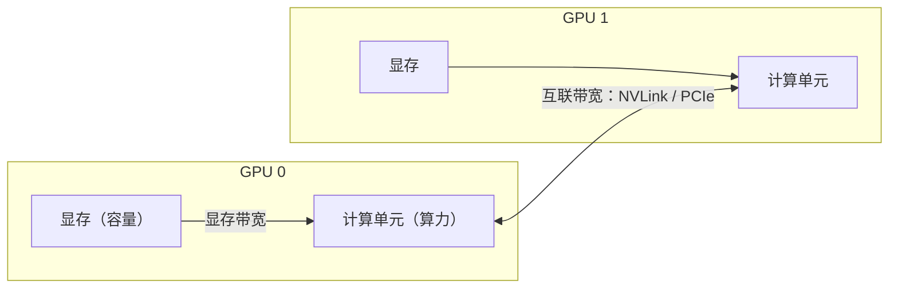
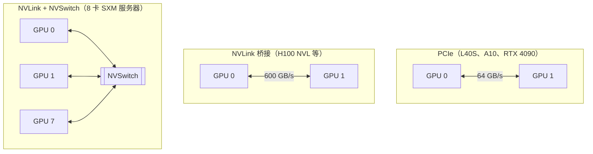

# 0.5 读懂 GPU 规格

> 对应原书第 5 章 *The Role of Accelerator Chips in LLM Serving* 与 *Other AI Accelerators and Trends* 两节。

前四节讲的是模型。从这一节开始看硬件：GPU 规格表上的数字分别意味着什么，哪些数字决定了推理的速度，以及读规格表时容易出错的几个地方。0.6、0.7 两节会用这里的数字估算显存和延迟。

## 1. 算力低的卡，生成反而更快

先看一个例子。H20 是 NVIDIA 面向中国市场推出的 Hopper 架构 GPU，和 H100 SXM 相比：

| | H100 SXM | H20 |
|---|---|---|
| BF16 稠密算力 | 989 TFLOPS | 148 TFLOPS |
| 显存 | 80 GB | 96 GB |
| 显存带宽 | 3.35 TB/s | 4.0 TB/s |

H20 的算力只有 H100 的 15%。但在单卡上部署一个 32B 的 BF16 模型，单个请求逐个生成 token 时，H20 每个 token 的间隔反而短一些。换成处理一篇长文档的 prefill，H20 则要慢好几倍。

原因在于，0.4 节提到的两个阶段受限于不同的资源：decode 主要受显存带宽限制，prefill 主要受算力限制。看规格表，首先要知道每个数字对应的是哪一类瓶颈。

## 2. 四个关键指标

和推理性能直接相关的指标有四个：

| 指标 | 单位 | 决定什么 |
|---|---|---|
| 显存容量 | GB | 能否放下模型权重；放下之后还剩多少给 KV Cache，也就决定了最大并发数（0.6 节） |
| 显存带宽 | TB/s | 每秒能从显存读多少数据。decode 每一步都要把全部权重读一遍，带宽决定了单个请求生成 token 的速度上限（0.7 节） |
| 算力 | TFLOPS | 每秒能做多少次浮点运算。prefill 和大批量 decode 时，计算量大，算力决定速度上限 |
| 互联带宽 | GB/s | 多张卡之间交换数据的速度。模型切分到多张卡上时（张量并行），每一层都要同步一次，互联越快等待越短 |



一个粗略但有用的判断方法：放不下就无法运行，看容量；输入长、批量大的阶段看算力；逐个生成 token 时看带宽；多卡部署时还要看互联。

## 3. 读规格表时容易出错的地方

### 3.1 稀疏算力和稠密算力

从 Ampere 架构开始，NVIDIA 的 Tensor Core 支持 2:4 结构化稀疏：如果权重矩阵里每 4 个数恰好有 2 个是 0，计算速度可以翻倍。Hopper 及之后的规格表通常把稀疏算力列在显眼位置，比如 H100 SXM 的 BF16 写着 1979 TFLOPS，脚注才说明这是稀疏情况下的数字。

开源模型的权重几乎都是稠密的，估算时应该用稠密算力，也就是标称值的一半：989 TFLOPS。

更麻烦的是，不同代际的规格表口径不一致。A100 的规格表把 312 TFLOPS（稠密）放在前面，稀疏的 624 放在括号里；H100 则反过来。把两张表直接对比，很容易高估 H100 一倍。

### 3.2 精度

同一张卡，FP8 的算力通常是 BF16 的两倍，INT8 也类似。但前提是硬件有对应精度的计算单元：

- Hopper（H100、H200、H20）、Ada（L40S、L4、RTX 4090）和 Blackwell 支持 FP8 计算；
- Ampere（A100、A800、A10、RTX 3090）不支持 FP8 计算。在这些卡上，FP8 格式的权重或 KV Cache 只能节省显存和带宽，计算前要先转换回 BF16。

第 2 部分讨论量化时，这一点决定了哪些方案在哪些卡上能真正提速。

### 3.3 同名产品的不同版本

同一型号常有 PCIe 插卡版和 SXM 模组版，规格不同。例如 A100 80GB 的 PCIe 版显存带宽是 1.935 TB/s，SXM 版是 2.039 TB/s，功耗和互联方式也不一样。原书第 5 章的表格把 1.935 TB/s 列在 A100 SXM 下，实际上是 PCIe 版的数字。

A800 是面向中国市场的 A100 版本。它的算力、显存容量和显存带宽都与 A100 相同，单卡推理的性能没有区别；唯一的差别是 NVLink 带宽从 600 GB/s 降到了 400 GB/s，只在多卡张量并行时有影响。

## 4. 常见 GPU 的规格

下表全部是**稠密**算力。SXM 版本的数据中心 GPU 都通过 NVSwitch 互联。

| GPU | 架构 | 显存 | 显存带宽 | BF16 | FP8 | 机内互联 |
|---|---|---|---|---|---|---|
| B200 | Blackwell | 180 GB HBM3e | 8.0 TB/s | 2250 TFLOPS | 4500 TFLOPS | NVLink 1.8 TB/s |
| H200 SXM | Hopper | 141 GB HBM3e | 4.8 TB/s | 989 | 1979 | NVLink 900 GB/s |
| H100 SXM | Hopper | 80 GB HBM3 | 3.35 TB/s | 989 | 1979 | NVLink 900 GB/s |
| H20 | Hopper | 96 GB HBM3 | 4.0 TB/s | 148 | 296 | NVLink 900 GB/s |
| A100 SXM | Ampere | 80 GB HBM2e | 2.04 TB/s | 312 | 不支持 | NVLink 600 GB/s |
| A800 SXM | Ampere | 80 GB HBM2e | 2.04 TB/s | 312 | 不支持 | NVLink 400 GB/s |
| L40S | Ada | 48 GB GDDR6 | 0.86 TB/s | 362 | 733 | PCIe 4.0，64 GB/s |
| A10 | Ampere | 24 GB GDDR6 | 0.60 TB/s | 125 | 不支持 | PCIe 4.0，64 GB/s |
| RTX 4090 | Ada | 24 GB GDDR6X | 1.0 TB/s | 165 | 330 | PCIe 4.0，64 GB/s |

互联带宽按双向合计。RTX 4090 的算力取的是 FP32 累加下的值：消费级显卡用 FP32 累加时只有半速，而 PyTorch 的 BF16 矩阵乘正是用 FP32 累加的。

下面的组件可以选两张卡和一个模型做对比。除了规格本身，它还给出两个推导出来的数字：单个请求 decode 时每个 token 至少要多久（权重字节数除以带宽），以及 prefill 2048 个 token 至少要多久（计算量除以算力）。0.7 节会解释这两个下限的由来。

<div class="llm-widget" data-widget="gpu-compare"></div>

可以试试：对比 H100 SXM 和 H20，看两个下限分别谁更短；再对比 A100 和 L40S，L40S 的算力略高于 A100，带宽却不到一半，它更适合长输入还是长输出的负载？

## 5. 多卡互联

一个 70B 模型的 BF16 权重约 140 GB，单张 80 GB 的卡放不下，只能切到多张卡上。这时卡与卡之间的通信速度就很关键。



**NVSwitch 的作用。** 一张 H100 SXM 的 NVLink 总带宽是 900 GB/s。如果 8 张卡两两直连，每张卡的带宽要分给另外 7 张，任意两张之间只剩约 128 GB/s。NVSwitch 是一个交换芯片，所有卡都连到它上面，任意两张卡之间都能用满 900 GB/s。

**机内和机间。** 跨机器通信要走网卡。一块 400 Gb/s 的 InfiniBand 网卡，单向带宽约 50 GB/s，只有机内 NVLink 的十八分之一。所以能在一台机器内放下的模型，尽量不要切到多台机器上（0.1 节）。

**超节点。** 为了突破单机 8 卡的限制，GB200 NVL72 用 NVLink 把 72 张 Blackwell GPU 连成一个整体，任意两张卡之间都有 1.8 TB/s 的带宽。这类系统主要用于部署超大的 MoE 模型（第 4、6 部分）。

## 6. 存储墙

Gholami 等人统计了过去二十年的服务器硬件：峰值算力大约每两年增长 3.0 倍，显存带宽每两年只增长 1.6 倍，互联带宽每两年 1.4 倍。计算越来越快，喂数据的速度跟不上，这种差距被称为**存储墙**（memory wall）。

从上面的表也能看出来：从 A100 到 H100，BF16 算力涨了 3.2 倍，带宽只涨了 1.6 倍；到 B200，算力又涨了 2.3 倍，带宽涨了 2.4 倍，比例才稍微追回一点。

本教程后面的很多优化，本质上都是在减少数据搬运：连续批处理让一次权重读取服务多个请求；量化减少要读的字节；FlashAttention 让中间结果留在片上缓存，不写回显存；算子融合减少中间张量的读写。

## 7. 其他加速器

NVIDIA 之外，还有不少用于推理的加速器：

- **Google TPU**：脉动阵列结构，只能在 Google Cloud 上使用。vLLM 和 SGLang 都有 TPU 后端。
- **AWS Trainium / Inferentia**：AWS 自研芯片，通过 Neuron SDK 使用。
- **AMD Instinct（MI300X、MI325X、MI355X）**：显存容量大，MI300X 有 192 GB，适合放大模型。软件栈是 ROCm，vLLM 和 SGLang 都支持。
- **华为昇腾（910B、910C 等）**：国内用得最多的非 NVIDIA 加速器，使用 CANN 软件栈，vLLM 通过 vllm-ascend 插件支持。DeepSeek 2026 年开源的推理引擎 DeepInfer 也支持昇腾 950（第 6 部分）。
- **以 SRAM 为主的芯片**（Groq、Cerebras）：把权重放在片上 SRAM 里，绕开显存带宽的限制，单请求生成速度极快，但片上容量有限，部署大模型需要很多芯片。

不管是哪种芯片，前面四个指标的分析方法都适用：先看容量够不够，再看带宽和算力，最后看互联。

## 8. 实验：测一测自己的 GPU

查看 GPU 型号、显存和多卡连接方式：

```bash
nvidia-smi --query-gpu=name,memory.total,clocks.max.sm,power.limit --format=csv
nvidia-smi topo -m      # NV# 表示 NVLink 直连，PIX/PHB/SYS 表示不同层级的 PCIe
```

用 PyTorch 测实际能达到的算力和显存带宽：

```python
import time, torch

def bench(fn, iters=50):
    for _ in range(5):
        fn()                                   # 预热
    torch.cuda.synchronize()
    t0 = time.perf_counter()
    for _ in range(iters):
        fn()
    torch.cuda.synchronize()
    return (time.perf_counter() - t0) / iters

n = 8192
a = torch.randn(n, n, device="cuda", dtype=torch.bfloat16)
b = torch.randn(n, n, device="cuda", dtype=torch.bfloat16)
t = bench(lambda: a @ b)
print(f"BF16 矩阵乘：{2 * n**3 / t / 1e12:.0f} TFLOPS")

x = torch.empty(1024**3, device="cuda", dtype=torch.bfloat16)   # 2 GiB
y = torch.empty_like(x)
t = bench(lambda: y.copy_(x))
print(f"显存带宽：{2 * x.numel() * 2 / t / 1e12:.2f} TB/s")      # 读一遍、写一遍
```

大矩阵乘通常能达到稠密峰值的 70%～85%，拷贝带宽能达到标称值的 80%～90%。和规格表对比一下，这两个比例会在 0.7 节用到：估算延迟下限时，用实测值比用标称值更接近实际。

## 自测

<div class="llm-widget" data-widget="quiz" data-questions='[{"q": "H100 SXM 的规格表上 BF16 写着 1979 TFLOPS。用这个数字估算稠密模型的 prefill 时间，会出现什么偏差？", "options": ["基本准确，这就是稠密矩阵乘的峰值", "低估约一半，1979 是 2:4 稀疏下的算力", "高估约一半，实际还能用 FP8 再快一倍", "低估约四倍，这个数字是按 FP8 标注的"], "answer": 1, "explain": "Hopper 的规格表把稀疏算力放在显眼位置，稠密峰值是 989 TFLOPS。开源模型的权重是稠密的，用 1979 会把耗时算短一半。A100 的规格表口径相反，把稠密值放在前面，对比时要特别小心。"}, {"q": "A800 80GB 和 A100 80GB（都是 SXM 版）相比，下面哪种说法正确？", "options": ["A800 的算力被限制为一半，单卡推理明显更慢", "A800 的显存带宽更低，decode 更慢", "单卡性能相同，只有多卡通信时 A800 更慢", "两者完全相同，只是名称不同"], "answer": 2, "explain": "A800 的算力、显存容量和显存带宽都与 A100 相同，区别只在 NVLink：400 GB/s 对 600 GB/s。单卡推理没有差别，多卡张量并行时每层的 all-reduce 会慢一些。"}, {"q": "在 A100 上把权重存成 FP8 格式，能带来什么？", "options": ["计算速度翻倍，显存占用减半", "计算速度翻倍，显存占用不变", "显存和读取的字节减半，但计算仍要转回 BF16", "没有任何效果，A100 无法加载 FP8 权重"], "answer": 2, "explain": "Ampere 没有 FP8 的计算单元，只能在计算前把 FP8 转换回 BF16。所以收益来自更少的显存占用和更少的读取量，这对受带宽限制的 decode 有帮助，对受算力限制的 prefill 没有帮助。"}, {"q": "8 卡 SXM 服务器上，NVSwitch 起什么作用？", "options": ["没有它，GPU 之间只能通过 PCIe 通信", "让任意两张卡之间都能用满各自的 NVLink 带宽", "提高每张卡的显存带宽", "负责机器之间的通信，机内不起作用"], "answer": 1, "explain": "每张 H100 SXM 的 NVLink 总带宽是 900 GB/s。如果两两直连，要分给另外 7 张卡，每对之间只有约 128 GB/s。NVSwitch 是交换芯片，所有卡都连到它，任意一对都能跑满。机间通信走 InfiniBand 等网卡。"}]'></div>

## 延伸阅读

- 原书第 5 章 *Reading GPU Specs*、*Comparing the Specs of Popular GPUs*、*Other AI Accelerators and Trends*。
- Gholami et al., [AI and Memory Wall](https://arxiv.org/abs/2403.14123), IEEE Micro 2024。存储墙的数据出自这里。
- NVIDIA 各型号的数据手册（datasheet）。查规格时注意看脚注里关于稀疏的说明。
