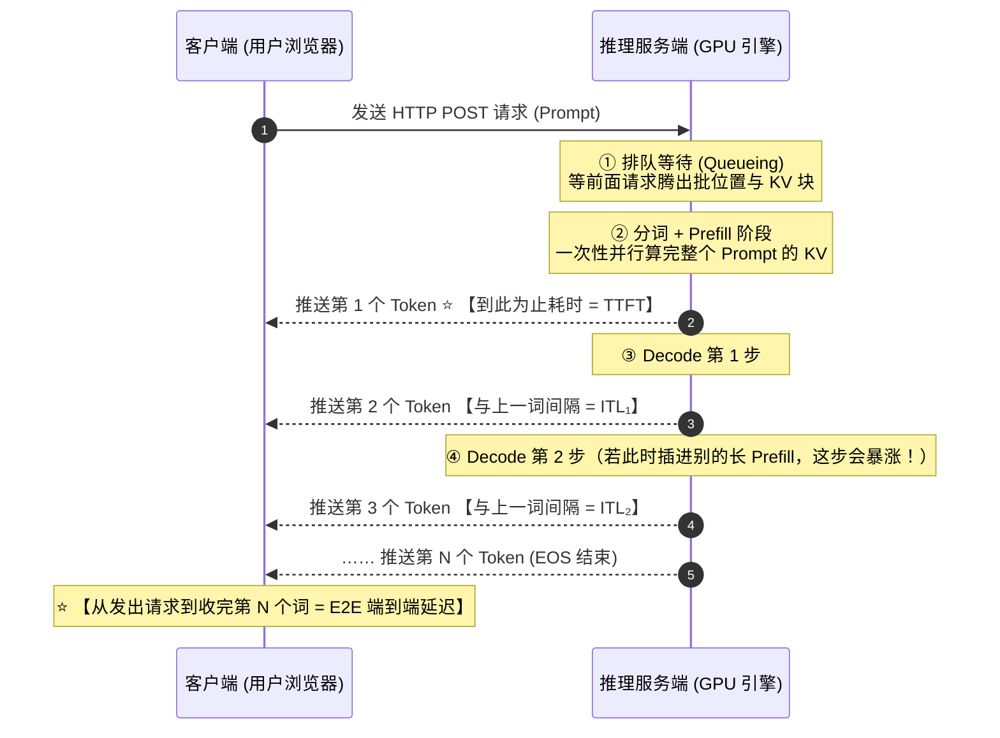

# 0.5 性能指标：TTFT、TPOT、吞吐与 Goodput

## 学习目标

完成本节学习后，你将能够：
- **精准区分大模型服务的四大延迟指标（TTFT、ITL、TPOT、E2E）与三类吞吐指标**，并把它们与 Prefill / Decode 阶段一一对应起来。
- **解释为什么“平均 TPOT 很正常，用户却抱怨一卡一卡的”**（理解 ITL P99 尾部尖峰的物理成因）。
- **掌握排队论中的 Little 定律与 Goodput（有效吞吐）概念**：明白为什么盲目追求最高原始吞吐会导致线上体验崩溃。
- **独立设计一次科学、防作弊的开环（Open-loop）基准压测**。

---

## 1. 为什么传统后端的“响应时间（Latency）”不够用了？

在传统 Web 服务或图像分类模型里，衡量快慢只需要一个指标：**端到端响应时间（End-to-End Latency，简称 E2E）**——比如客户端发出一张图片，50 毫秒后收到分类结果 `"猫"`。

但在大模型流式对话中，如果一个回答有 500 个词，全部生成完需要 **10 秒钟**。如果让用户盯着空白屏幕干等 10 秒再一次性弹出全部文字，用户早就关掉网页走了。

因此，现代大模型服务全部采用**流式输出（Streaming）**：每算出一个新 Token 就立刻推给前端显示。对用户来说，“快不快”被拆成了两个截然不同的体感阶段：
1. **“我按下回车后，等多久才看到第一个字蹦出来？”** —— 这叫 **TTFT（Time To First Token，首 Token 延迟）**。
2. **“第一个字出来之后，后面的字蹦得顺不顺畅，跟不跟得上我眼睛看的速度？”** —— 这叫 **ITL（Inter-Token Latency，Token 间延迟）** 和 **TPOT（Time Per Output Token，每输出 Token 平均耗时）**。

---

## 2. 核心心智模型：一张图看懂一个请求的完整时间线

让我们跟踪一个生成 $N$ 个 Token 的请求，从客户端发出到全部接收完毕的完整生命历程：



### 2.1 四大延迟指标精确定义与关系

假设一个请求一共生成了 $N$ 个输出 Token：

| 指标缩写 | 全称与计算公式 | 物理上由什么决定？ | 用户体感标准 |
|---|---|---|---|
| **TTFT** | **Time To First Token（首字延迟）**<br/>收到第 1 个 Token 的时刻 $-$ 发出请求的时刻 | **网络传输 + 排队等待时间 + Prefill 计算耗时** | 交互式聊天通常要求 **< 0.5 ~ 1.5 秒**；超过 3 秒用户明显感到焦虑 |
| **ITL** | **Inter-Token Latency（相邻两字间隔）**<br/>收到第 $k$ 个词的时刻 $-$ 收到第 $k-1$ 个词的时刻 | **每一步 Decode 的实际耗时**（共有 $N-1$ 个样本值） | 人类默读速度约每秒 5~10 个词，所以稳定在 **30 ~ 80 ms** 最舒适 |
| **TPOT** | **Time Per Output Token（单请求平均吐字耗时）**<br/>$$\text{TPOT} = \frac{\text{E2E} - \text{TTFT}}{N - 1}$$ | 同一个请求全部 $N-1$ 个 ITL 的**平均值** | 衡量单用户平均生成速度（$\frac{1}{\text{TPOT}}$ 即单用户 tok/s） |
| **E2E** | **End-to-End Latency（端到端总延迟）**<br/>$$\text{E2E} = \text{TTFT} + \text{TPOT} \times (N - 1)$$ | 整个请求从头到尾占用的总时长 | 对需要等完整结果才能执行下一步的 **Agent 工具调用 / 代码执行** 至关重要 |

### 2.2 重点辨析：既然有了 TPOT，为什么还要单独看 ITL 的 P99？

很多教材把 TPOT 和 ITL 当成一回事，但在生产排障中，**只看 TPOT 会掩盖严重的卡顿故障！**

举个具体例子：假设模型生成了 101 个 Token（共 100 个间隔）：
- 前 99 个词，每一步 Decode 只花 `10 ms`（极快）。
- 在生成第 50 个词的时候，系统里突然插进来另一个用户的超长文档 Prefill，把 GPU 霸占了 `2,010 ms`（卡顿了整整 2 秒）！
- 如果你只算这个请求的 **TPOT（平均值）**：
  $$\text{TPOT} = \frac{99 \times 10\text{ ms} + 1 \times 2010\text{ ms}}{100} = \mathbf{30\text{ ms}}$$
  你看监控报表：“哇，TPOT 只有 30 ms，完全达标！”但真实坐在屏幕前的用户却看到文字输出到一半突然**死机卡住了 2 秒钟**！
- 而如果你监控所有 Token 间隔的 **ITL P99（第 99 百分位数）或最大值**，那个 `2010 ms` 的尖峰就会立刻原形毕露。我们在 `1.5 节` 要学的 **Chunked Prefill（分块预填充）**，正是为了消灭这种 ITL 尖峰而发明的。

---

## 3. 吞吐指标、排队崩溃与 Goodput（有效吞吐）

站在服务器老板的角度，除了用户觉得快不快（延迟），最关心的就是一张卡每秒能干多少活（吞吐，Throughput）。

### 3.1 三种吞吐口径：千万别被“注水战报”忽悠了！

当你看到某篇博客宣传“我们的推理引擎吞吐高达 30,000 tok/s”时，一定要先问清楚它算的是哪一种吞吐：

| 吞吐指标 | 定义公式 | 常见“刷榜注水”套路与避坑指南 |
|---|---|---|
| **① 输出吞吐（Output Token Throughput，最核心）** | 每秒生成的新 Token 总数 | **最硬核的指标**，因为 Decode 最贵。但可以通过把并发 Batch 调到极大（牺牲延迟）来刷高。 |
| **② 总吞吐（Total Token Throughput）** | 每秒处理的（输入 Prompt + 输出）Token 总数 | 如果测试集全是 4000 字长输入、只输出 10 个字，总吞吐数字会比输出吞吐大 **400 倍**！切勿把两者混为一谈。 |
| **③ 请求吞吐（Request Throughput, RPS / QPS）** | 每秒完成的请求个数 | 完全取决于每个请求有多长。处理 50 字短请求的 QPS 自然比处理 2000 字长文高几十倍，跨数据集不可比。 |

### 3.2 延迟与吞吐的死对头关系，以及 Little 定律

在 `0.4` 节我们算过：把并发批大小 $b$ 从 1 加到 64，单步 Decode 时间从 `8 ms` 涨到了 `17.5 ms`（每个用户觉得慢了一倍），但总吞吐从 `124 tok/s` 暴涨到了 `3,657 tok/s`（老板开心了 30 倍）。

那么，能不能无限制地加大线上请求速率（QPS）呢？**绝对不能！** 这里有一条排队论的铁律——**Little 定律（Little's Law）**：

$$
L = \lambda \times W
$$

- $\lambda$：每秒新到达系统的请求数（Arrival Rate，即 QPS）。
- $W$：每个请求在系统里从进入到离开的平均停留总时间（即平均 E2E 延迟）。
- $L$：系统里**同时积压（正在跑 + 正在排队）的平均请求总数**。

假设你的显卡 KV Cache 最多只能同时装下 **40 个请求**（`0.3` 节）。
- 当 $\lambda = 5\text{ req/s}$，每个请求平均耗时 $W = 4\text{ s}$ 时，系统里平均只有 $L = 5 \times 4 = 20$ 个请求，全部能直接上卡运行，零排队。
- 当流量涨到 $\lambda = 12\text{ req/s}$ 时，由于批大小变大，单步变慢，算完一个请求要 $W = 5\text{ s}$，此时系统里同时有 $L = 12 \times 5 = 60$ 个请求！显存只能装 40 个，多出来的 20 个请求只能在门外排队干等，导致新请求的 **TTFT 瞬间从几百毫秒飙升到十几秒**！

### 3.3 终极衡量标尺：Goodput（满足 SLO 的有效吞吐）

既然盲目拉高吞吐会让一半用户的延迟超时（违背服务等级目标 **SLO，Service Level Objective**），学术界与工业界（如 DistServe 论文与 vLLM 官方基准）引入了 **Goodput（有效吞吐）**：

$$
\text{Goodput} = \frac{\text{在测试时间内，同时满足 TTFT 与 TPOT 所有 SLO 约束的请求总数}}{\text{测试总时长（秒）}}
$$

比如业务规定 SLO 红线为：`TTFT P99 ≤ 1000 ms` 且 `TPOT P99 ≤ 50 ms`。只有在这两条红线以内跑出来的最高吞吐，才是真正能上线赚钱的 **Goodput**！

---

## 4. 交互式沙盒：亲手把服务压到饱和，寻找最高 Goodput 黄金点

请拖动下方模拟器中的 **「线上请求到达率 (QPS)」** 滑块，从 `1 req/s` 慢慢拉到 `18 req/s`，观察原始吞吐（Raw TPS）、TTFT/TPOT 与有效吞吐（Goodput）是如何分道扬镳的：

<div class="llm-widget" data-widget="metrics-goodput-sim"></div>

### 动手试一试
1. 将 QPS 从 `1` 拖到 `8`：注意看「原始输出吞吐」和「有效吞吐 Goodput」都在同步健康增长。
2. 继续将 QPS 从 `9` 拖到 `16`：你会发现原始吞吐还在涨（最后停在硬件上限附近），但因为 TTFT P99 和 TPOT P99 击穿了 SLO 红线，**Goodput 反而断崖式暴跌到了 0**！
3. 调整右侧的 `TTFT SLO 上限` 和 `TPOT SLO 上限`，看看业务对延迟的容忍度如何改变单张显卡能承载的最大有效 QPS。

---

## 5. 如何做一次不自欺欺人的基准压测（Benchmarking）？

在后续的实战项目中，你需要频繁用压测来验证自己的优化有没有效。以下是工业界压测必须遵守的四条军规：

### 军规 1：看分位数（P50 / P90 / P99），绝不只看平均值（Mean）
平均值极易被掩盖。线上有 100 个用户时，**P99 延迟就是那最倒霉的第 1 个用户的真实体验**。SLO 永远定义在 P90 或 P99 上。

### 军规 2：区分“闭环压测（Closed-loop）”与“开环压测（Open-loop）”
- **闭环（固定并发数 `max-concurrency`）**：模拟固定 $N$ 个测试员，每个人必须等上一个回答全部收完，才立刻发下一个请求。如果服务端变慢了，客户端发请求的速度也会跟着自动变慢，**这会严重低估真实线上的排队雪崩！**
- **开环（固定到达率 `request-rate` + 泊松分布）**：不管服务端有没有算完，严格按照每秒 $\lambda$ 个请求的真实随机节奏（Poisson Process）往里灌流量。**评估在线服务容量时，必须使用开环压测！**

### 军规 3：切忌用“全等长输入输出”刷分
如果所有测试请求都是整整齐齐的“输入 512、输出 128”，所有请求会在同一毫秒开始、同一毫秒结束，完全测不出长短请求混跑时的调度空泡与抢占开销。真实压测应使用带有长度波动的分布（如 `range-ratio`）或真实对话数据集（如 ShareGPT）。

---

## 6. 动手实验：用 vLLM 扫描 QPS 并画出 Goodput 曲线

在 GPU 环境下，启动 `Qwen/Qwen3-8B` 服务，并用 `vllm bench serve` 扫描不同请求速率（`1 → 16 req/s`），同时传入 `--goodput` 约束：

```bash
# 终端 1：启动服务端
vllm serve Qwen/Qwen3-8B --max-model-len 8192

# 终端 2：开环扫描请求速率 rate = 1, 2, 4, 8, 12, 16
for rate in 1 2 4 8 12 16; do
  vllm bench serve --model Qwen/Qwen3-8B \
    --dataset-name random --random-input-len 1024 --random-output-len 256 \
    --num-prompts 300 --request-rate $rate \
    --percentile-metrics ttft,tpot,itl,e2el --metric-percentiles 50,99 \
    --goodput ttft:1000 tpot:50 \
    --save-result --result-filename rate_${rate}.json
done
```

对比生成的 JSON 结果，找出你的显卡在 `ttft:1000ms, tpot:50ms` 约束下的最大 Goodput 拐点！

---

## 7. 闯关自测

<div class="llm-widget" data-widget="quiz" data-title="0.5 性能指标 · 闯关自测" data-questions='[
  {
    "q": "某个流式请求发出后，经过 400 ms 收到了第 1 个 Token（TTFT = 400 ms），最终一共生成了 201 个输出 Token，端到端总耗时 E2E = 4.4 秒。请问该请求的 TPOT 是多少？",
    "options": [
      "22.0 ms/token",
      "20.0 ms/token",
      "19.9 ms/token",
      "400 ms/token"
    ],
    "answer": 1,
    "explain": "第 1 个 Token 的耗时已经算在 TTFT (0.4s) 里了，后续 Decode 阶段一共生成了 201 - 1 = 200 个 Token，耗时 4.4 - 0.4 = 4.0 秒 = 4000 ms。所以 TPOT = 4000 / 200 = 20.0 ms/token。"
  },
  {
    "q": "线上监控显示某服务的平均 TPOT 只有 28 ms（非常健康），但不少用户投诉“流式输出文字时经常突然卡顿一两秒”。你应该去查哪个监控指标？最可能的原因是什么？",
    "options": [
      "查 E2E 平均值；原因是网线接触不良",
      "查 ITL（Token 间延迟）的 P99 或最大值；最可能的原因是其他新到达请求的长 Prompt Prefill 插队进来与当前 Decode 混跑，阻塞了单步执行",
      "查磁盘剩余空间；原因是日志文件写满了",
      "查词表大小；原因是生僻字解码慢"
    ],
    "answer": 1,
    "explain": "TPOT 对单个请求的所有步求了平均，单次 1~2 秒的卡顿被除以几百个 Token 后稀释掉了。查看 ITL P99 能直接抓出单步毛刺，常见元凶是长 Prefill 阻塞 Decode（可通过 1.5 节的 Chunked Prefill 解决）或显存不足触发了抢占重算。"
  },
  {
    "q": "为什么在评估在线推理服务的最大承载能力时，推荐使用开环压测（固定到达率 QPS）而不是闭环压测（固定并发用户数）？",
    "options": [
      "因为开环压测写起来代码更短",
      "因为闭环压测中，一旦服务端变慢，客户端必须等上一个请求返回才发下一个，施压速率会自动降低，从而掩盖了真实线上流量持续涌入时的排队雪崩效应",
      "因为闭环压测不支持流式 SSE 接口",
      "因为开环压测不需要 GPU"
    ],
    "answer": 1,
    "explain": "真实线上的用户不会因为你的服务器正在忙就商量好停下手里的提问。开环压测按泊松过程独立发送请求，能真实暴露出超过容量拐点后的排队延迟暴涨。"
  }
]'></div>

---

## 延伸阅读与参考文献

- Yinmin Zhong et al., [*DistServe: Disaggregating Prefill and Decoding for Goodput-optimized Large Language Model Serving*](https://arxiv.org/abs/2401.09670), OSDI 2024（系统提出以 Goodput 作为大模型服务的核心优化标尺）
- Chi Wang & Peiheng Hu, *Hands-On LLM Serving and Optimization*, O'Reilly, Chapter 4 (*Measuring Performance in LLM Serving*)
