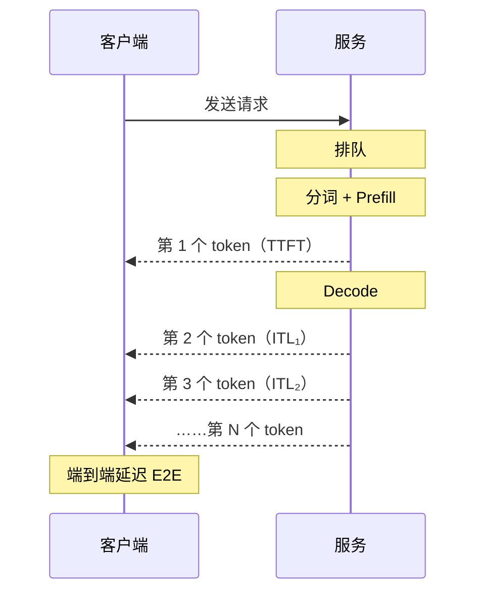
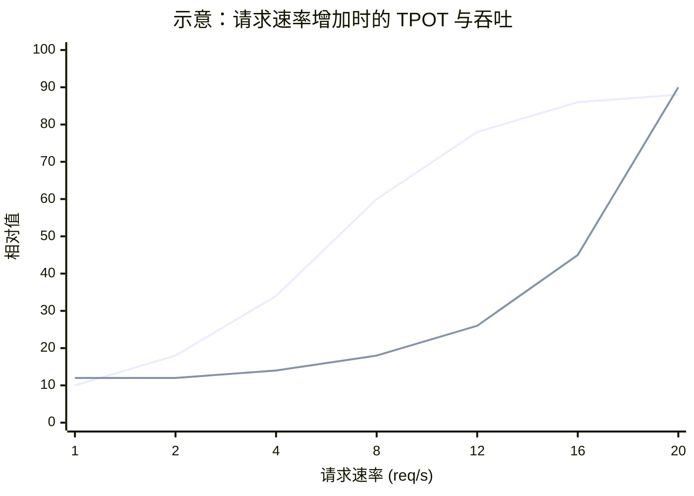

# 0.5 性能指标：TTFT、TPOT、吞吐与 Goodput

> 对应书中第 4 章 Measuring Performance in LLM Serving

## 学习目标

- 准确定义 TTFT、ITL、TPOT、端到端延迟、吞吐与 Goodput，并说明它们分别对应推理的哪个阶段。
- 理解延迟与吞吐的权衡，能读懂"吞吐–延迟"曲线。
- 设计一次公平、可复现的压测，避开书中列出的常见误区。

## 1. 一个请求的时间线



## 2. 延迟指标

| 指标 | 定义 | 主要由什么决定 |
|---|---|---|
| **TTFT**（Time To First Token） | 发出请求到收到第一个 token | 排队时间 + prefill 时间 |
| **ITL**（Inter-Token Latency） | 相邻两个输出 token 之间的间隔 | decode 每步耗时，以及被其他请求的 prefill 打断的情况 |
| **TPOT**（Time Per Output Token） | 单个请求除首 token 外的平均每 token 耗时，$\frac{\text{E2E} - \text{TTFT}}{N - 1}$ | 同上，按请求平均 |
| **E2E**（端到端延迟） | 发出请求到收到最后一个 token | $\text{TTFT} + \text{TPOT} \times (N-1)$ |

书中把 ITL 和 TPOT 当作同义词。在压测工具里两者通常分开统计：TPOT 是每个请求一个值，ITL 是每个 token 间隔一个值。两者均值接近，但 **ITL 的长尾能暴露 TPOT 平均值看不到的卡顿**。例如某个请求 decode 到一半，恰好有一个长 prompt 的 prefill 插进来，这一步的间隔会突然变长。1.5 节的 Chunked Prefill 就是为了解决这个问题。

分词和反分词的耗时通常很小，书中在公式里忽略了它们。

**不同场景关注不同指标：**

| 场景 | 主要指标 | 原因 |
|---|---|---|
| 流式聊天 | TTFT，其次 ITL | 用户等首字的耐心有限；输出长时 ITL 影响阅读体验 |
| Agent 中间步骤 | E2E | 下游要等完整输出 |
| 离线批处理 | 吞吐 | 没有人在等，只看成本 |
| 代码补全 | TTFT 与 E2E | 输出短，整体要快 |

## 3. 吞吐指标

| 指标 | 定义 | 注意 |
|---|---|---|
| 输出吞吐（output tok/s） | 每秒生成的输出 token 数 | 最常用；书中称为 TPS |
| 总吞吐（total tok/s） | 每秒处理的输入 + 输出 token 数 | 输入长的负载这个数会很大，不能和输出吞吐混比 |
| 请求吞吐（RPS / RPM） | 每秒完成的请求数 | 强依赖输入输出长度，不同负载间不可比 |

书中提醒，输出吞吐容易被"做大"：缩短输入、使用长度一致的请求、把批调到极大，都能让数字好看，但不代表真实负载下的表现。

## 4. 延迟与吞吐的权衡

在 0.4 节中看到，批越大吞吐越高，但每步延迟也越长。同一个系统在不同负载下会落在曲线的不同位置：



（上方曲线为吞吐，下方曲线为 TPOT。吞吐趋于饱和后，继续加压只会让排队和延迟迅速上升。）

**Little 定律** 把三者联系起来：

$$
\text{系统内的平均请求数} = \text{到达速率} \times \text{平均停留时间}
$$

例如请求速率 10 req/s、平均 E2E 6 s，系统中平均有 60 个请求同时在处理。如果显存只放得下 40 个（0.3 节），多出来的请求只能排队，TTFT 会急剧变长。

## 5. Goodput

单看吞吐会掩盖一个问题：吞吐最高的配置，可能有一半请求的延迟已经不可接受。**Goodput** 只统计满足 SLO 的请求：

$$
\text{Goodput} = \frac{\text{满足所有 SLO 的请求数}}{\text{测试时长}}
$$

SLO 通常同时约束 TTFT 和 TPOT，例如"TTFT P99 < 1 s 且 TPOT P99 < 50 ms"。DistServe（OSDI 2024）用 goodput 作为优化目标，并以此论证 Prefill-Decode 分离的价值（4.3 节）。项目 4 也用它作为主要指标。

另一种常见的展示方式是把"每用户速度"（$1/\text{TPOT}$，tok/s/user）作为横轴、"每卡吞吐"作为纵轴画帕累托曲线。DeepInfer、vLLM 等发布的基准都采用这种画法，它直观地展示了"同样的硬件，要多快的单用户体验，就得牺牲多少总吞吐"。

## 6. 分位数

延迟一定要看分布，不能只看平均值：

- **P50** 反映典型体验。
- **P90 / P99** 反映尾部体验。线上用户数多时，P99 意味着每 100 个请求就有一个这么慢。

SLO 一般定义在 P90 或 P99 上。

## 7. 压测方法

书中给出的实践要点，以及相应的做法：

| 要点 | 具体做法 |
|---|---|
| 先明确延迟与吞吐的取舍 | 交互场景先定 SLO，再在满足 SLO 的前提下最大化吞吐 |
| 按场景设定"足够好"的目标 | 聊天场景 TTFT 已到 1 s 以内，再压到 0.5 s 收益有限，不如转向成本 |
| 把 E2E 拆成 TTFT 和 ITL | 分别对应 prefill 和 decode，便于定位瓶颈 |
| 尽量模拟真实流量 | 输入输出长度用真实分布或真实日志采样；到达过程用泊松分布，并测试突发流量 |
| 保持实验一致 | 一次只改一个参数；固定数据集、随机种子、框架版本 |
| 监控硬件利用率 | 同时记录 GPU 利用率、显存、功耗，判断瓶颈在模型还是硬件 |
| 不刻意做大指标 | 不用全部等长的请求、不只报最优的一组参数 |
| 上线后持续监控与回归测试 | 新版本发布前跑固定的回归压测 |

**开环与闭环。** 两种施压方式结论可能完全不同：

- 闭环（固定并发数）：每个虚拟用户收到响应后才发下一个请求。系统变慢时施压自动减轻，容易低估排队延迟。
- 开环（固定到达速率）：按泊松过程发请求，不管前面的请求是否完成。更接近真实线上流量。

评估在线服务时优先用开环。

## 动手实验

用 vLLM 自带的压测工具，在一个固定的数据分布下扫描请求速率：

```bash
# 服务端
vllm serve Qwen/Qwen3-8B --max-model-len 8192

# 客户端：输入 1024、输出 256，请求速率从 1 扫到 16
for rate in 1 2 4 8 12 16; do
  vllm bench serve --model Qwen/Qwen3-8B \
    --dataset-name random --random-input-len 1024 --random-output-len 256 \
    --num-prompts 300 --request-rate $rate \
    --percentile-metrics ttft,tpot,itl,e2el --metric-percentiles 50,99 \
    --goodput ttft:1000 tpot:50 \
    --save-result --result-filename rate_${rate}.json
done
```

不同版本的 vLLM 参数名可能不同，以 `vllm bench serve --help` 为准。整理成下表，并画出"请求速率 → 吞吐 / TTFT P99 / TPOT P99 / Goodput"四条曲线：

| 请求速率 | 输出吞吐 | TTFT P50 / P99 | TPOT P50 / P99 | ITL P99 | Goodput |
|---|---|---|---|---|---|
| 1 | | | | | |
| 2 | | | | | |
| … | | | | | |

回答：吞吐在哪个速率附近饱和？Goodput 在哪个速率达到最大？两者是否相同？

## 自测题

1. 某请求 TTFT = 400 ms，输出 201 个 token，E2E = 4.4 s。TPOT 是多少？
2. 为什么同一个服务，报告"总吞吐 20,000 tok/s"和"输出吞吐 2,000 tok/s"可能都是对的？
3. 一个服务的 TPOT 平均值只有 30 ms，但用户反馈"输出时常卡一下"。应该看什么指标？可能的原因是什么？
4. 吞吐最高的配置是否就是线上应该用的配置？

<details>
<summary>参考答案</summary>

1. $(4.4 - 0.4) / (201 - 1) = 20$ ms。
2. 总吞吐包含输入 token。输入长 1024、输出长 128 时，两者大约相差 9 倍。必须说明是哪一种。
3. 看 ITL 的 P99 或最大值。常见原因是其他请求的长 prefill 与 decode 在同一步执行，造成单步延迟突增；也可能是 KV 不足导致抢占与重算。
4. 不一定。吞吐最高的点通常已经处在排队延迟快速上升的区间，应在满足 SLO 的配置中选 goodput 最高的。

</details>

## 延伸阅读

- Zhong et al., *DistServe: Disaggregating Prefill and Decoding for Goodput-optimized Large Language Model Serving*, OSDI 2024
- vLLM 文档中 `vllm bench serve` 的参数说明
