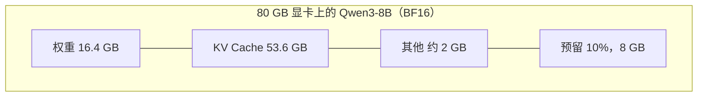

# 0.6 显存估算

> 对应原书第 5 章 *Bottlenecks in LLM Model Loading*：加载过程、模型大小与 KV Cache 大小的估算。

部署之前，先要回答两个问题：这张卡放不放得下模型；放下之后，还能同时服务多少个请求。这一节从 `config.json` 出发，推导权重和 KV Cache 的显存公式，算出一张卡的并发上限，再和 vLLM 的启动日志对照。

## 1. 一个常见的误判

Llama-2-7B 的权重文件一共 13.5 GB。一张 24 GB 的卡放下权重后，看起来还剩 10 GB，跑十几个并发应该不成问题。

实际上，16 个请求各自用到 4096 个 token 时，KV Cache 需要 32 GB，是权重的两倍多，服务早就 OOM 了。这个 32 GB 怎么来的，就是这一节要推导的内容。

## 2. 显存里放了什么

模型必须放在显存里运行，不能放在内存或硬盘上按需读取。原因是 decode 每生成一个 token，都要把全部权重读一遍。以 16 GB 的权重为例：

| 存储 | 典型带宽 | 读一遍 16 GB 需要 | 每秒最多生成 |
|---|---|---|---|
| NVMe SSD | 5～14 GB/s | 约 1.6 秒 | 不到 1 个 token |
| CPU 内存（DDR5） | 50～200 GB/s | 约 160 ms | 约 6 个 token |
| GPU 显存（HBM3） | 2000～4800 GB/s | 约 5 ms | 约 200 个 token |

所以服务启动时，权重要从硬盘读进内存，再拷贝到显存，并一直留在那里。这个加载过程本身也要时间：16 GB 的权重，从本地 NVMe 读大约需要几秒，从网络存储或首次从 Hugging Face 下载则要几分钟。扩容拉起新副本时，加载时间直接决定了新副本多快能接流量。safetensors 格式支持内存映射，避免了多余的拷贝，是目前的标准格式。

服务运行时，显存分成三部分：

$$
M_{\text{总}} = M_{\text{权重}} + M_{\text{KV Cache}} + M_{\text{其他}}
$$

- **权重**：加载后大小固定。
- **KV Cache**：随并发请求数和每个请求的长度变化，是三者中唯一会增长的部分，也是 OOM 的主要来源。
- **其他**：前向计算的中间激活、CUDA Graph、多卡通信的缓冲区等，通常 1.5～3 GB。



## 3. 权重的大小

权重大小等于参数量乘以每个参数的字节数：

$$
M_{\text{权重}} = P \times b_w
$$

| 精度 | 每个参数 | Qwen3-8B（82 亿参数） |
|---|---|---|
| FP32 | 4 字节 | 32.8 GB |
| BF16 / FP16 | 2 字节 | 16.4 GB |
| FP8 / INT8 | 1 字节 | 8.2 GB |
| INT4（GPTQ、AWQ 等） | 0.5 字节，另加 3%～5% 的缩放因子 | 约 4.3 GB |

模型名字里的"7B""8B"是取整后的叫法。Llama-2-7B 实际是 67.4 亿参数，Qwen3-8B 是 81.9 亿。估算时用实际参数量，或者直接把 safetensors 文件的大小加起来。参数量的计算方法见 0.2 节。

## 4. KV Cache 的大小

KV Cache 是这一节的重点。从一个 token、一层、一个头开始，逐级往上乘。下面是 Qwen3-8B 的 `config.json` 中相关的字段：

```json
{
  "hidden_size": 4096,
  "num_hidden_layers": 36,
  "num_attention_heads": 32,
  "num_key_value_heads": 8,
  "head_dim": 128,
  "torch_dtype": "bfloat16"
}
```

**一个头。** 每个 token 在每个注意力头上有一个 $k$ 和一个 $v$，各 $d_h$ 个数。`head_dim` 是 128，所以一个头要存 $2 \times 128 = 256$ 个数。如果 config 里没有 `head_dim`，它等于 `hidden_size / num_attention_heads`。

**一层。** 要乘的是 **KV 头数** `num_key_value_heads`，而不是 Q 头数 `num_attention_heads`。0.2 节介绍过 GQA：Qwen3-8B 的 32 个 Q 头共用 8 组 K、V，所以一层是 $2 \times 8 \times 128 = 2048$ 个数。用 32 去乘，会把结果高估 4 倍。原书第 5 章的公式写的是注意力头数，对 GQA 模型要换成 KV 头数。

**整个模型。** 每一层都有自己的 K、V，乘以层数 $L = 36$；BF16 每个数 2 字节。

合起来：

$$
\text{KV}_{\text{token}} = 2 \times L \times n_{kv} \times d_h \times b_{kv}
$$

两个模型对比：

| 模型 | 层数 | Q 头 / KV 头 | 计算 | 每 token |
|---|---|---|---|---|
| Llama-2-7B（MHA） | 32 | 32 / 32 | $2 \times 32 \times 32 \times 128 \times 2$ | 512 KiB |
| Qwen3-8B（GQA） | 36 | 32 / 8 | $2 \times 36 \times 8 \times 128 \times 2$ | 144 KiB |

Llama-2-7B 每个 token 要半兆字节。16 个请求、每个 4096 个 token，就是 $0.5 \text{ MiB} \times 4096 \times 16 = 32$ GiB，这就是第 1 节那 32 GB 的来历。Qwen3-8B 的参数更多，每个 token 的 KV Cache 却只有前者的 28%，差别全部来自 GQA。

## 5. 一张卡能服务多少请求

以 80 GB 的 A100 或 H100 部署 BF16 的 Qwen3-8B 为例。vLLM 默认只使用 90% 的显存（`gpu_memory_utilization = 0.9`），其他开销按 2 GB 估计。

**留给 KV Cache 的显存：**

$$
80 \times 0.9 - 16.4 - 2.0 = 53.6 \text{ GB}
$$

**能缓存的 token 总数：**

$$
\frac{53.6 \times 10^9}{147456} \approx 36.3 \text{ 万}
$$

**并发上限。** 如果每个请求最长 4096 个 token（输入加输出），最坏情况下能同时容纳 $363{,}000 / 4096 \approx 88$ 个请求；最大长度设为 32K 时，只剩 11 个。

这是每个请求都用满最大长度时的数字。实际请求的平均长度往往只有最大长度的几分之一，能同时运行的请求会多得多。但要让显存按实际长度而不是最大长度分配，需要 1.3 节的分页管理。

下面的组件把这三步写在一起，可以换模型、显卡和精度。

<div class="llm-widget" data-widget="memory-budget"></div>

可以试试：选 Llama-2-7B 和 24 GB 的卡，看 4096 长度能跑几个请求；再换成 Qwen3-8B，把权重精度改为 INT4，看 KV Cache 的空间变化了多少。

## 6. KV Cache 不够时怎么办

上面的公式里每一项都可以调整，后面的章节分别对应其中一项：

| 方法 | 改变了哪一项 | 效果 | 章节 |
|---|---|---|---|
| 权重量化 | $b_w$：2 → 0.5 | 权重缩小到四分之一，省下的显存都给 KV Cache | 第 2 部分 |
| KV Cache 量化 | $b_{kv}$：2 → 1 | 能缓存的 token 数翻倍 | 2.5 节 |
| 注意力结构 | 减小 $n_{kv}$，或像 MLA 那样压缩 K、V | 每个 token 的 KV 缩小数倍 | 3.1 节 |
| 分页管理 | 不再按最大长度预留 | 并发数按实际长度而不是最大长度计算 | 1.3 节 |
| 前缀缓存 | 相同前缀只存一份 | 共享的系统提示词不再重复占用显存 | 1.4 节 |
| 张量并行 | 权重和 KV 头分到 $k$ 张卡上 | 每张卡的权重和 KV 都变成 $1/k$ | 4.1 节 |

选卡时有个简单的经验：显存最好是权重大小的两倍以上，这样至少有一半的显存能留给 KV Cache，批处理才有空间发挥作用。

## 7. 实验：估算与实测对照

### 用脚本估算

仓库里的 [`estimate_memory.py`](https://github.com/zrpxx/hands-on-llm-serving-opt/blob/main/code/stage0/estimate_memory.py) 读取模型的 `config.json`，按上面的步骤计算，不需要 GPU：

```bash
python code/stage0/estimate_memory.py code/stage0/configs/qwen3-8b.json --gpu-mem 80 --max-len 4096
python code/stage0/estimate_memory.py code/stage0/configs/llama-2-7b.json --gpu-mem 80 --max-len 4096
```

Qwen3-8B 的输出：

```text
参数量            8.19 B
权重（每卡）      16.4 GB   (2 B/参数, tp=1)
KV / token（每卡）144 KiB  (2 B/元素)
KV 预算（每卡）   53.6 GB = 80.0×0.9 - 权重 - 2.0 预留
可缓存 token 数   363,624
并发上限          88.8 个请求（每个 4096 token 用满时）
```

### 和 vLLM 对照

在 GPU 上启动 vLLM，只看相关的日志：

```bash
vllm serve Qwen/Qwen3-8B --max-model-len 4096 --gpu-memory-utilization 0.9 2>&1 \
  | grep -E "Model loading|KV cache size|Maximum concurrency"
```

vLLM 的数字和估算会有出入，主要有两个原因：

- vLLM 不估计"其他"开销，而是在启动时用一批最大规模的假输入实际跑一次前向，测出激活的峰值，再扣掉；
- 日志里的 GB 实际上是 GiB（$2^{30}$ 字节），而一张标称 80 GB 的卡，可用显存约 79.6 GiB。

再加上 `--kv-cache-dtype fp8` 运行一次，看 `GPU KV cache size` 是否接近翻倍。

## 自测

<div class="llm-widget" data-widget="quiz" data-questions='[{"q": "Llama-3-8B 有 32 层、32 个 Q 头、8 个 KV 头，&#36;d_h = 128&#36;，用 BF16 存储。每个 token 的 KV Cache 是多少？", "options": ["64 KiB", "128 KiB", "256 KiB", "512 KiB"], "answer": 1, "explain": "&#36;2 \\times 32 \\times 8 \\times 128 \\times 2 = 131072&#36; 字节，即 128 KiB。开头的 2 是 K 和 V 各一份。误用 32 个 Q 头会得到 512 KiB；漏掉 K、V 的系数会得到 64 KiB。"}, {"q": "24 GB 的卡部署 BF16 的 Qwen3-8B（权重 16.4 GB，每 token KV 144 KiB），其他开销按 2 GB 计，<code>gpu_memory_utilization = 0.9</code>。每个请求都用满 8192 个 token 时，最多同时容纳几个请求？", "options": ["约 2 个", "约 4 个", "约 6 个", "权重都放不下"], "answer": 0, "explain": "KV 预算为 &#36;24 \\times 0.9 - 16.4 - 2 = 3.2&#36; GB，可缓存约 2.2 万个 token，除以 8192 约 2.6，只能放下 2 个。漏掉 0.9 的系数或者其他开销中的一项，会算出约 4 个；两项都漏掉会算出约 6 个。"}, {"q": "vLLM 启动日志里的 KV Cache 容量，为什么常常比“显存减去权重”少好几 GB？", "options": ["vLLM 会为每个请求按最大长度预先分配连续的空间", "权重加载后会在显存里额外保留一份 FP32 副本", "KV Cache 必须按 2 的幂次分配，零头无法使用", "默认只用 90% 的显存，还要扣除试运行测出的激活峰值等开销"], "answer": 3, "explain": "vLLM 在利用率上限之内，先扣掉权重，再用一次最大规模的试运行测出激活峰值并扣除，剩下的才切成 KV 块。分页管理恰恰是为了避免按最大长度预分配。"}, {"q": "把 KV Cache 从 BF16 改成 FP8，权重精度不变，下面哪项会大约翻倍？", "options": ["能缓存的 token 总数", "每个 token 的生成速度", "模型能支持的最大上下文长度", "权重占用的显存"], "answer": 0, "explain": "每个 token 的 KV 从 2 字节一个数变成 1 字节，同样的预算能放下两倍的 token。最大上下文长度是模型本身的属性；decode 速度会因读取的 KV 变少而有所提升，但不会翻倍，因为权重的读取量没变。"}]'></div>

## 延伸阅读

- 原书第 5 章 *The Model Loading Process*、*Estimating Model Size*、*Estimating KV Cache Size*。
- 附录：[常用估算公式](appendix/cheatsheet.md)。
- Ainslie et al., [GQA: Training Generalized Multi-Query Transformer Models from Multi-Head Checkpoints](https://arxiv.org/abs/2305.13245), EMNLP 2023。
