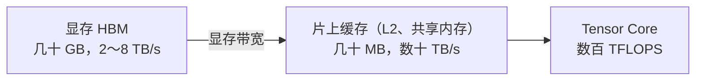

# 0.7 算术强度与 Roofline

> 对应原书第 5 章 *Bottlenecks in LLM Model Execution*。

0.4 节说 prefill 受算力限制、decode 受显存带宽限制，0.5 节也用这个结论比较了不同的 GPU。这一节把它说清楚：用算术强度刻画一个计算"每读一个字节做多少运算"，用 Roofline 模型判断它会被哪种资源卡住，最后得到两个简单的估算公式，算出 decode 和 prefill 的延迟下限。

## 1. 同一个模型，GPU 的利用率差几十倍

在一张 A100 上用 vLLM 部署 Qwen3-8B，可以观察到这样几个现象：

- 只有一个用户时，每秒能生成 100 个左右的 token，但 Tensor Core 的利用率不到 1%。
- 并发用户增加到 32 个，每个人的生成速度只慢了一点，整张卡每秒生成的 token 却多了二十多倍。
- 一个用户发来一篇几千 token 的长文，prefill 阶段的算力利用率能达到一半以上。

跑的是同一组权重，算力利用率却差了几十倍。要解释这些现象，需要先看数据在 GPU 里是怎样流动的。

## 2. 算术强度与 Roofline

### 2.1 计算需要两样东西

权重存放在显存（HBM）里，计算单元不能直接对显存中的数据做运算。数据要先读到片上的缓存和寄存器里：



片上缓存只有几十 MB，放不下 16 GB 的权重，所以每一层计算都要从显存把权重读进来。一次计算因此同时消耗两种资源：从显存读写的字节数，以及浮点运算的次数。两者的比值叫**算术强度**（arithmetic intensity）：

$$
I = \frac{\text{浮点运算次数（FLOPs）}}{\text{读写显存的字节数（Bytes）}}
$$

它表示每从显存读一个字节，能用来做多少次运算。$I = 1$ 意味着每读一个字节只算一次，计算单元大部分时间在等数据；$I = 1000$ 则意味着读进来的数据被反复使用，计算单元一直有活干。

### 2.2 硬件的拐点

一个计算要让 GPU 的算力和带宽同时用满，算术强度需要达到多少？取决于硬件本身的算力与带宽之比，称为**拐点**（ridge point）：

$$
I^* = \frac{\text{峰值算力}}{\text{显存带宽}}
$$

A100 SXM 的 BF16 稠密算力是 312 TFLOPS，带宽 2.04 TB/s：

$$
I^*_{\text{A100}} = \frac{312 \times 10^{12}}{2.04 \times 10^{12}} \approx 153 \text{ FLOPs/Byte}
$$

意思是，在 A100 上，每读一个字节至少要做 153 次运算，算力才不会闲着。

把算术强度作横轴、能达到的算力作纵轴，就得到 **Roofline** 图：

- $I < I^*$ 时，速度受带宽限制，能达到的算力是 $I \times \text{带宽}$，在图上是一条斜线。这叫**访存受限**（memory-bound）。提速要靠减少读写的字节数，或者让读进来的数据被更多计算共享。
- $I > I^*$ 时，带宽绰绰有余，能达到的算力就是峰值，在图上是一条水平线。这叫**计算受限**（compute-bound）。提速要靠更快的计算单元（比如 FP8），或者减少计算量。

常见 GPU 的拐点（BF16 稠密）：

| GPU | 算力 / 带宽 | 拐点 |
|---|---|---|
| A100 SXM | 312 / 2.04 | 153 |
| H200 SXM | 989 / 4.8 | 206 |
| H100 SXM | 989 / 3.35 | 295 |
| L40S | 362 / 0.864 | 419 |
| H20 | 148 / 4.0 | 37 |

从 A100 到 H100，算力涨了 3.2 倍，带宽只涨了 1.6 倍，拐点从 153 移到了 295。也就是说，在 H100 上要用满算力，计算本身要"更密集"才行。H20 正好相反，拐点只有 37，很容易就进入计算受限区。

## 3. Prefill 和 Decode 的算术强度

### 3.1 矩阵乘的算术强度

输入 $X$ 形状为 $[M, K]$，权重 $W$ 形状为 $[K, N]$，输出 $Y$ 形状为 $[M, N]$。

**计算量。** 输出有 $M \times N$ 个元素，每个元素是 $X$ 的一行和 $W$ 的一列做点积，需要 $K$ 次乘法和 $K$ 次加法：

$$
\text{FLOPs} = 2MNK
$$

**读写量。** 以 BF16 为例，每个数 2 字节。读 $X$、读 $W$、写 $Y$：

$$
\text{Bytes} = 2(MK + KN + MN)
$$

两者相除：

$$
I = \frac{MNK}{MK + KN + MN}
$$

### 3.2 代入线性层

模型线性层的权重是 $h \times h$ 量级（这里取 $K = N = h$ 简化），$M$ 是这一步送进去的 token 数：

$$
I = \frac{M h^2}{Mh + h^2 + Mh} = \frac{Mh}{2M + h}
$$

取 Qwen3-8B 的 $h = 4096$。

**Prefill。** 一次处理整个 prompt，$M = s$。$s = 2048$ 时：

$$
I = \frac{2048 \times 4096}{2 \times 2048 + 4096} = 1024
$$

远大于 A100 的拐点 153。prompt 只要有几百个 token，prefill 就处在计算受限区。

**单个请求的 decode。** 每步只有一个新 token，$M = 1$：

$$
I = \frac{4096}{2 + 4096} \approx 1
$$

每读一个字节只做一次运算，算力最多用到 $1/153$，约 0.65%。这就是第 1 节"利用率不到 1%"的来源。

> [!WARNING]
> 原书表 5-10 在算这个公式时，把分母中输出矩阵的大小 $M \times h$ 写成了 $h \times h$，得到的数值都偏小，decode 一项算成了 0.5。按正确的公式，$s$ = 64、512、4096 时算术强度分别约为 62、410、1365，decode 约为 1。结论不变。

### 3.3 批处理为什么能救 decode

把 $b$ 个请求的 decode 合成一批，一步送进去 $b$ 个 token，$M = b$。$b$ 远小于 $h$ 时：

$$
I = \frac{bh}{2b + h} \approx b
$$

权重还是只读一遍，却完成了 $b$ 个 token 的计算，算术强度提高到原来的 $b$ 倍。这就是第 1 节里，并发从 1 增加到 32，每个人的速度几乎不变、总吞吐却增长了二十多倍的原因：读权重的时间被 32 个请求分摊了。

在 A100 上，$b$ 要达到 150 左右，线性层才进入计算受限区；H100 上则要接近 300。

### 3.4 注意力不能靠批处理分摊

批处理只对线性层有效。线性层里，所有请求共用同一份权重；注意力层里，每个请求读的是自己的 KV Cache，没有任何共享。

对一个请求，当前 token 的 $q$ 和缓存里 $T$ 个位置的 $k$、$v$ 计算注意力，读了 $T$ 个位置的 K、V，计算量也与 $T$ 成正比，算术强度约等于 GQA 的分组数 $n_q / n_{kv}$：MHA 是 1，Qwen3-8B 是 4。不管批多大，这一部分始终处在访存受限区。

所以长上下文、大批量时，decode 每一步的时间越来越多地花在读 KV Cache 上，而不是读权重。这也是 KV Cache 量化（2.5 节）和 MLA 等注意力结构（3.1 节）重要的原因。

下面的组件画出了一张 GPU 的 Roofline，以及三类计算的位置。拖动批大小和输入长度，观察它们怎样移动。

<div class="llm-widget" data-widget="roofline"></div>

可以试试：把批大小从 1 拖到 256，看 decode 的线性层沿着斜线往上走，在哪里碰到平顶；换成 H100，再看需要多大的批。注意力那个点则始终不动。

## 4. 估算延迟下限

有了 Roofline，就可以用两个除法估算延迟的下限。

### 4.1 Decode 的每步时间

decode 受带宽限制。每一步至少要把全部权重读一遍，再加上这一批所有请求的 KV Cache：

$$
t_{\text{step}} \gtrsim \frac{M_{\text{权重}} + M_{\text{KV, 这一批}}}{\text{显存带宽}}
$$

以 A100 上的 Qwen3-8B（BF16，权重 16.4 GB，每 token KV 144 KiB）为例：

| 批大小 | 每个请求的上下文 | 这一批的 KV | 每步下限 | 总吞吐上限 |
|---|---|---|---|---|
| 1 | 很短，忽略 | 约 0 | 16.4 / 2040 ≈ 8.0 ms | 约 124 token/s |
| 16 | 2048 | 4.8 GB | 21.2 / 2040 ≈ 10.4 ms | 约 1540 token/s |
| 64 | 2048 | 19.3 GB | 35.7 / 2040 ≈ 17.5 ms | 约 3660 token/s |

批从 1 增加到 16，每步时间只多了 30%，吞吐却增长了 12 倍；到了 64，KV Cache 已经比权重还大，每步时间明显变长，吞吐的增长放缓了。

### 4.2 Prefill 的时间

prefill 受算力限制。处理 $s$ 个 token 的计算量约为 $2Ps$（每个 token 每个参数一次乘加）：

$$
t_{\text{prefill}} \gtrsim \frac{2 P s}{\text{峰值算力} \times \text{MFU}}
$$

MFU（model FLOPs utilization）是实际达到的算力占峰值的比例，推理时一般在 50%～70%。Qwen3-8B、$s = 2048$、A100、MFU 取 60%：

$$
t_{\text{prefill}} \approx \frac{2 \times 8.19 \times 10^9 \times 2048}{312 \times 10^{12} \times 0.6} \approx 180 \text{ ms}
$$

这两个公式没有考虑注意力的计算、kernel 启动等开销，算出来的是下限，实际值会更大一些。但它们足以回答很多实际问题：这张卡上单个请求最快能多快；换一张卡大概会快多少；量化之后 decode 能快多少。对应地，带宽利用率也有一个类似的指标 MBU（model bandwidth utilization），实测的每步时间如果只达到下限的一半，说明还有很多开销没有消除。

## 5. 实验：测出 GPU 的拐点

[`roofline_sweep.py`](https://github.com/zrpxx/hands-on-llm-serving-opt/blob/main/code/stage0/roofline_sweep.py) 固定一个 $4096 \times 4096$ 的权重，让输入行数 $M$ 从 1 翻倍到 8192，测量每个 $M$ 下实际达到的算力：

```bash
python code/stage0/roofline_sweep.py --hidden 4096 --peak-tflops 312 --peak-tbs 2.039 --plot roofline.png
```

`--peak-tflops` 和 `--peak-tbs` 改成自己显卡的规格。运行后看两件事：

1. $M = 1$ 时，实测的等效带宽是理论带宽的百分之多少？
2. 实测算力达到峰值的 80% 时，$M$ 是多少？和理论拐点相比如何？

实测的拐点通常比理论值靠右一些，因为小矩阵很难把所有计算单元都用起来。

## 自测

<div class="llm-widget" data-widget="quiz" data-questions='[{"q": "为什么在 H100 SXM 上，让 decode 的线性层进入计算受限区比在 A100 上更难？", "options": ["H100 的显存更大，KV Cache 占比更低", "H100 算力涨得比带宽快，拐点从约 153 右移到约 295", "H100 的 Tensor Core 不支持小矩阵乘", "H100 默认开启稀疏计算，稠密矩阵乘更慢"], "answer": 1, "explain": "拐点等于峰值算力除以带宽。decode 时线性层的算术强度约等于批大小，所以在 H100 上批要接近 300 才能用满算力。算力增长快于带宽，是新一代硬件的普遍趋势。"}, {"q": "把权重量化成 W4A16（4 位权重、16 位激活）后，单个请求的 decode 明显变快，长输入的 prefill 却几乎没有变化。原因是：", "options": ["4 位权重只在 decode 时使用，prefill 会切回 BF16", "prefill 的计算主要在注意力，量化只影响前馈网络", "decode 受带宽限制，读的字节少了；prefill 受算力限制，计算量没变", "量化后 KV Cache 也变成了 4 位，只有 decode 会读 KV"], "answer": 2, "explain": "访存受限时减少字节有效，计算受限时要减少或加速计算。W4A16 在计算前要把权重反量化回 16 位，计算量和速度都没变。要让 prefill 变快，需要 W8A8、FP8 这类连激活一起量化的方案。"}, {"q": "长上下文下，decode 的批大小从 64 增加到 256，吞吐会提升约 4 倍吗？", "options": ["会，线性层的算术强度与批大小成正比", "不会，每个请求的 KV Cache 要单独读，每步时间会随批大小明显增长", "会下降，批越大调度的开销越高", "不会，GPU 会把超过 128 的批自动拆成两步"], "answer": 1, "explain": "批处理只能分摊权重的读取。注意力读的是各请求自己的 KV Cache，算术强度约等于 GQA 分组数，与批大小无关。上下文长、批大时，KV 的读取量会超过权重，成为每步时间的主要部分。"}, {"q": "A100（带宽 2.04 TB/s）上运行 BF16 的 Qwen3-8B（权重 16.4 GB），单个请求、短上下文，每秒最多能生成多少个 token？", "options": ["约 30 个", "约 60 个", "约 125 个", "约 1900 个"], "answer": 2, "explain": "每步至少读一遍权重：16.4 / 2040 ≈ 8 ms，即每秒约 124 个。约 1900 是用算力估算的结果（312 TFLOPS / 16.4 GFLOPs），忽略了 decode 受带宽限制这一事实。"}]'></div>

## 延伸阅读

- 原书第 5 章 *Boundaries of GPU Compute and Memory Bandwidth*、*Arithmetic Intensity in Matrix Multiplications*、*Applying Arithmetic Intensity Analysis to the LLM Prefill and Decode Phases*。
- Williams, Waterman & Patterson, [Roofline: An Insightful Visual Performance Model for Multicore Architectures](https://dl.acm.org/doi/10.1145/1498765.1498785), Communications of the ACM, 2009。
- Chen, [Transformer Inference Arithmetic](https://kipp.ly/transformer-inference-arithmetic/), 2022。用同样的方法估算推理延迟的一篇长文。
