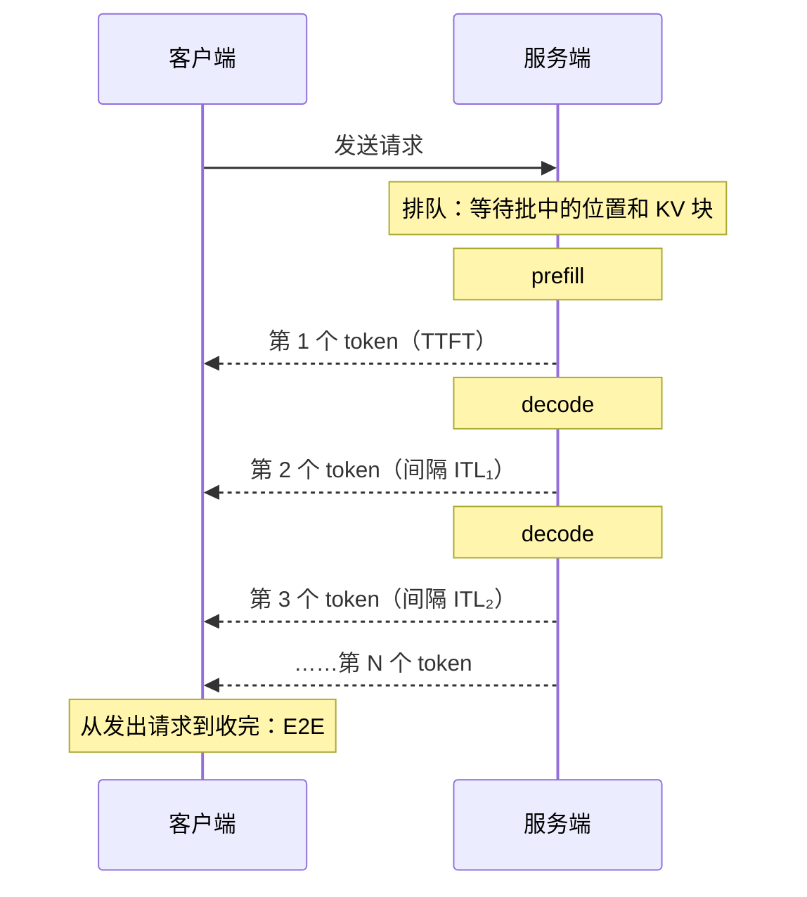

# 0.8 性能指标

> 对应原书第 4 章 *Measuring Performance in LLM Serving*。

优化之前，先要定义"快"。对 LLM 服务来说，一个响应时间不够用：用户关心多久能看到第一个字，也关心之后的文字出得顺不顺；运营方关心一张卡每秒能处理多少请求。这一节定义这些指标，说明它们和 prefill、decode 的对应关系，然后讨论吞吐和延迟之间的取舍，以及怎样做一次可信的压测。

## 1. 为什么一个响应时间不够

图像分类这类服务，衡量快慢只需要一个数：从发出请求到收到结果用了多久。

LLM 生成一段 500 个 token 的回答可能要十几秒，让用户对着空白页面等这么久是不可接受的。所以 LLM 服务几乎都采用流式输出，每生成一个 token 就立刻发给客户端。这样，用户感受到的"快"分成了两部分：

- 按下回车之后，多久能看到第一个字；
- 文字开始出现之后，出得是否连贯，有没有停顿。

前者主要由排队和 prefill 决定，后者主要由 decode 决定。

## 2. 延迟指标

跟踪一个输出 $N$ 个 token 的请求：



| 指标 | 定义 | 主要取决于 |
|---|---|---|
| TTFT（time to first token） | 从发出请求到收到第一个 token | 网络、排队、prefill |
| ITL（inter-token latency） | 相邻两个 token 之间的间隔，一个请求有 $N-1$ 个 | 每一步 decode 的耗时 |
| TPOT（time per output token） | 一个请求的平均间隔：$\dfrac{\text{E2E} - \text{TTFT}}{N - 1}$ | 同上，取平均 |
| E2E（end-to-end latency） | 从发出请求到收完最后一个 token：$\text{TTFT} + \text{TPOT} \times (N-1)$ | 全部 |

一些常用的参考值：对话类产品一般要求 TTFT 在 1 秒以内；人阅读的速度大约每秒 5～10 个汉字，所以 TPOT 在 50 ms 以内，文字的出现速度就比阅读快了。对于 Agent 调用、代码生成这类要等完整结果才能进行下一步的场景，E2E 更重要。

### 平均 TPOT 正常，用户却说卡

TPOT 是平均值，会掩盖个别的长停顿。

举个例子：一个请求输出 101 个 token，有 100 个间隔。其中 99 个间隔都是 10 ms，但在第 50 个 token 时，另一个请求的长 prompt 恰好进入了同一步 prefill，这一步花了 2010 ms。这个请求的 TPOT 是：

$$
\frac{99 \times 10 + 2010}{100} = 30 \text{ ms}
$$

从 TPOT 看完全正常，用户却看到输出中途停了两秒。看 ITL 的 P99 或最大值，这个停顿就一目了然。1.2 节的 chunked prefill 就是为了消除这种停顿。

## 3. 吞吐指标

看到"某引擎吞吐达到每秒 3 万 token"这样的说法，要先问清楚是哪一种吞吐：

| 指标 | 定义 | 注意 |
|---|---|---|
| 输出吞吐 | 每秒生成的输出 token 数 | 最常用。decode 是最贵的部分，这个指标反映得最直接 |
| 总吞吐 | 每秒处理的输入加输出 token 数 | 输入长、输出短的负载里，它可能是输出吞吐的几十上百倍，两者不能混用 |
| 请求吞吐 | 每秒完成的请求数（RPS） | 完全取决于请求的长短，不同数据集之间没法比较 |

## 4. 吞吐和延迟的取舍

0.7 节算过：A100 上的 Qwen3-8B，批大小从 1 增加到 64，每步时间从 8 ms 增加到 17.5 ms，每个用户的速度慢了一倍多，总吞吐却从每秒 124 个 token 增加到 3660 个。批越大，吞吐越高，单个请求越慢。

那能不能不断增加请求速率，直到吞吐达到上限？不行。原因可以用排队论里的 **Little 定律**说明：

$$
L = \lambda \times W
$$

其中 $\lambda$ 是每秒到达的请求数，$W$ 是每个请求在系统中停留的平均时间，$L$ 是系统中同时存在的请求数（正在运行的加上排队的）。

假设 KV Cache 最多能同时容纳 40 个请求：

- $\lambda = 5$ 个/秒，每个请求平均 4 秒完成，系统里平均有 $L = 20$ 个请求，都能直接运行，不需要排队。
- $\lambda = 12$ 个/秒，批变大了，每个请求要 5 秒，$L = 60$。显存只能容纳 40 个，多出的 20 个只能排队，新请求的 TTFT 会从几百毫秒涨到十几秒。

而且这种恶化不是线性的：越接近容量上限，排队时间增长得越快。

## 5. Goodput

单纯追求吞吐，会让大量请求的延迟超出可接受的范围。所以更有意义的指标是 **goodput**：只统计满足服务等级目标（SLO）的那部分吞吐。

比如规定 TTFT 不超过 1 秒、TPOT 不超过 50 ms，那么 goodput 就是每秒完成的、两项都达标的请求数。vLLM 的压测工具就是这样计算的（`--goodput` 参数）。DistServe 论文用的是另一种等价的说法：在 90% 以上的请求满足 SLO 的前提下，系统能承受的最大请求速率。

下面的组件模拟了一张 A100 上的 Qwen3-8B，请求按泊松过程到达，每个请求输入 512～1536 个 token、输出 128～384 个，引擎使用连续批处理和 chunked prefill（第 1 部分）。横轴是请求到达速率，每个点都跑了 400 个请求。

<div class="llm-widget" data-widget="goodput-sim"></div>

可以试试：从低到高拖动到达速率，看完成速率在哪里不再增长，goodput 又在哪里开始下降；再收紧或放宽两项 SLO，看承载能力怎样变化。

## 6. 怎样做一次可信的压测

后面每个优化是否有效，都要靠压测验证。下面几条是最容易出错的地方。

**看分位数，不只看平均值。** SLO 一般定义在 P90 或 P99 上。100 个用户里，P99 对应的是体验最差的那一个。平均值很容易被大量正常请求掩盖。

**评估容量时用开环压测。** 闭环压测固定并发数：每个虚拟用户收完回答才发下一个请求。服务变慢时，请求自然发得更慢，压力自动减轻，排队问题就被掩盖了。开环压测按固定速率（通常是泊松过程）发请求，不管服务端处理得完处理不完，这更接近真实流量。vLLM 压测工具的 `--request-rate` 是开环，`--max-concurrency` 是闭环。

**输入输出长度要有变化。** 所有请求都是"输入 512、输出 128"时，它们同时开始、同时结束，测不出长短请求混在一起时的调度问题。可以用随机长度，或者 ShareGPT 这样的真实对话数据。

**对齐对比的条件。** 比较两个框架或两种配置时，模型版本、量化方式、最大长度、是否开启前缀缓存等都要一致，并且设置 `ignore_eos`，让输出长度相同（0.3 节）。

## 7. 实验：扫描请求速率，画出 goodput 曲线

在 GPU 上启动 Qwen3-8B 服务，然后用 `vllm bench serve` 依次以不同的速率压测：

```bash
# 终端 1
vllm serve Qwen/Qwen3-8B --max-model-len 8192

# 终端 2
for rate in 1 2 4 8 12 16; do
  vllm bench serve --model Qwen/Qwen3-8B \
    --dataset-name random --random-input-len 1024 --random-output-len 256 \
    --num-prompts 300 --request-rate $rate \
    --percentile-metrics ttft,tpot,itl,e2el --metric-percentiles 50,99 \
    --goodput ttft:1000 tpot:50 \
    --save-result --result-filename rate_${rate}.json
done
```

从每个 JSON 文件里取出 `request_throughput`、`request_goodput` 和各项延迟的 P99，画成和上面组件类似的曲线。找到 goodput 开始下降的那个速率，它就是这张卡在这组 SLO 下的承载能力。

## 自测

<div class="llm-widget" data-widget="quiz" data-questions='[{"q": "一个流式请求 TTFT 为 400 ms，共输出 201 个 token，端到端耗时 4.4 秒。TPOT 是多少？", "options": ["19.9 ms", "20 ms", "21.9 ms", "22 ms"], "answer": 1, "explain": "&#36;\\text{TPOT} = (4400 - 400) / 200 = 20&#36; ms。除以 201 会得到 19.9 ms；不减去 TTFT 会得到约 21.9 ms。"}, {"q": "监控上平均 TPOT 只有 28 ms，用户却反馈输出“时不时卡一下”。应该先看哪个指标？", "options": ["TTFT 的 P99", "ITL 的 P99 或最大值", "每秒完成的请求数", "GPU 的平均利用率"], "answer": 1, "explain": "TPOT 是一个请求内的平均间隔，个别的长停顿会被平均掉；ITL 是逐个间隔，尾部直接反映停顿。TTFT 只影响开头。常见原因是其他请求的长 prefill 和当前请求的 decode 落在了同一步，可以用 chunked prefill 缓解。"}, {"q": "评估在线服务的承载能力，为什么应该用开环压测（固定到达速率），而不是闭环压测（固定并发数）？", "options": ["开环压测能发出更多请求，测出的吞吐更高", "闭环压测无法统计 TTFT", "闭环压测在服务变慢时会自动减少请求，掩盖排队问题", "开环压测不需要设置输入输出长度"], "answer": 2, "explain": "闭环压测里，每个虚拟用户要等回答收完才发下一个请求，服务越慢，请求发得越慢。真实用户不会因为服务变慢而少发请求，开环压测更接近实际。"}, {"q": "请求到达速率已经超过了系统的处理能力，继续提高到达速率，下面哪种现象最可能出现？", "options": ["完成速率继续线性增长，延迟不变", "完成速率停在上限附近，TTFT 持续变长，goodput 下降", "完成速率和 goodput 都继续增长", "TTFT 不变，只有 TPOT 变长"], "answer": 1, "explain": "超过处理能力后，多出来的请求只能排队，队列越来越长，TTFT 随之增长；完成速率被处理能力封顶。越来越多的请求超出 SLO，goodput 反而下降。"}]'></div>

## 延伸阅读

- 原书第 4 章 *Latency Metrics*、*Throughput Metrics*、*Best Practices for Performance Measurement*。
- Zhong et al., [DistServe: Disaggregating Prefill and Decoding for Goodput-optimized Large Language Model Serving](https://arxiv.org/abs/2401.09670), OSDI 2024。提出以 goodput 作为优化目标。
- vLLM 文档中 `vllm bench serve` 的说明，包括各项指标的精确定义。
