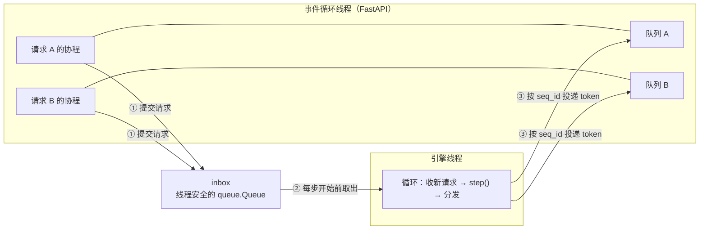
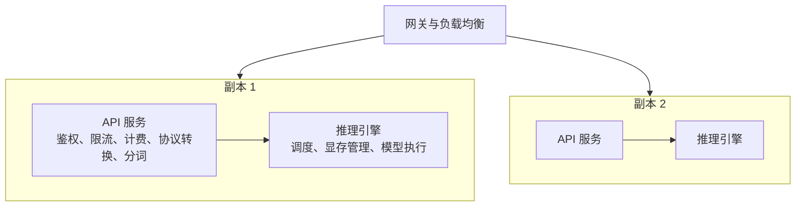

# 1.1 从零写一个推理服务

> 对应原书第 3 章 *Build an Online LLM Serving Service from Scratch* 与 *A General Design for Single-Model LLM Serving* 两节。

第 0 部分把模型怎样生成 token、硬件怎样决定速度讲清楚了。从这一节开始，把模型变成一个多人同时使用的在线服务。

做法是从最简单的版本开始，遇到问题再改。最后得到的结构，正是 vLLM、SGLang 这些推理引擎共同采用的结构，也是项目 1 MiniServe 的骨架：HTTP 层只负责收发，一个后台循环负责批处理和模型计算，两者通过队列连接。

## 1. 第一版：在接口里直接调用模型

```python
@app.post("/generate")
def generate(req: Request):
    return {"text": run_model(req.prompt)}     # run_model 内部是 0.4 节的生成循环
```

一个人用的时候没有问题，多人同时使用就不行了：

- 请求一个接一个地处理，每次批大小都是 1。0.7 节算过，这时 GPU 的算力只用到不到 1%。
- 后来的请求要等前面的请求全部生成完。
- 生成完才返回，用户要盯着空白页面等十几秒。

## 2. 第二版：凑批

要提高 GPU 利用率，就要把多个请求放进同一批。原书第 3 章的第二版这样做：所有请求先进入一个队列；后台线程从队列里取请求，凑够一批（比如 8 个）或者等待超过一定时间（比如 20 ms）就开始处理；整批生成完成后，把结果分别返回给各自的请求。

```python
def batch_worker():
    while True:
        batch = [request_queue.get()]                    # 至少等到一个请求
        deadline = time.time() + MAX_WAIT
        while len(batch) < MAX_BATCH and time.time() < deadline:
            try:
                batch.append(request_queue.get(timeout=deadline - time.time()))
            except queue.Empty:
                break
        outputs = model.generate(pad([r.prompt for r in batch]))   # 整批一起生成
        for r, out in zip(batch, outputs):
            r.future.set_result(out)
```

吞吐上去了，但又出现了新问题：

- **整批要等最长的请求。** 一批里有人要 20 个 token，有人要 2000 个，所有人都要等 2000 步结束，先写完的序列只能空转，占着批里的位置。
- **新请求要等整批结束。** 一批开始后，新来的请求只能等下一批。
- **还是不能流式输出。**

第一个问题由连续批处理解决，下一节详细讨论。这一节先解决第三个问题，同时把结构调整成连续批处理需要的样子。

## 3. 第三版：引擎循环与每个请求一个队列

关键的改变是：后台循环每次只让所有正在运行的请求**前进一步**，生成一个 token，然后立即把这些 token 分别发回各自的请求。



**① 接收请求。** HTTP 处理函数不碰 GPU。它为请求生成一个 `seq_id`，创建一个 `asyncio.Queue`，把"新请求"命令连同这个队列放进 `inbox`，然后在 `await queue.get()` 上等待。

**② 引擎前进一步。** 引擎线程在一个循环里运行。每一轮先把 `inbox` 里积累的命令全部取出：新请求交给调度器，取消命令让调度器释放对应的资源。然后调用一次 `engine.step()`：调度器决定这一步哪些请求参加，模型做一次前向计算，每个参加的请求得到一个新 token。

**③ 分发结果。** 引擎按 `seq_id` 找到每个 token 所属的队列，把 token 放进去。等在这个队列上的协程被唤醒，把 token 通过 SSE（server-sent events）发给客户端，然后继续等下一个。

这样，GPU 上是一个合在一起的批，每个客户端看到的却是自己独立的输出流。而因为循环每一步都会重新取 `inbox`，新请求最多等一步就能加入，这正是连续批处理的基础。

下面的组件逐步展示三个请求在这套结构中的流动，其中请求 C 中途断开了连接。

<div class="llm-widget" data-widget="engine-loop-steps"></div>

## 4. 实现中的三个问题

项目 1 的 `server.py` 实现了这套结构。写的时候有三个地方容易出错。

### 4.1 跨线程投递 token

`asyncio.Queue` 不是线程安全的，它属于事件循环所在的线程。如果引擎线程直接调用 `q.put_nowait(token)`，一是可能破坏队列的内部状态，二是事件循环不会被唤醒，`await q.get()` 的协程可能一直等下去。

正确的做法是用 `loop.call_soon_threadsafe` 把这个调用交给事件循环线程执行，它会顺便唤醒事件循环：

```python
def _dispatch(self, out: StepOutput):
    entry = self.streams.get(out.seq.seq_id)          # seq_id -> (asyncio.Queue, loop)
    if entry is None or out.new_token_id is None:     # 请求已取消，或这一步只算了一段 prefill
        return
    q, loop = entry
    loop.call_soon_threadsafe(q.put_nowait, (out.new_token_id, out.finished, out.seq.finish_reason))
    if out.finished:
        self.streams.pop(out.seq.seq_id, None)
```

`new_token_id` 为空的情况，对应的是 chunked prefill（1.2 节）：一个长 prompt 分几步算完，只有最后一步才产生 token。

### 4.2 空闲时不要空转

如果引擎线程写成一个简单的 `while True`，没有请求时它会不停地检查，占满一个 CPU 核心。正确的做法是：引擎有活干的时候，非阻塞地取一下 `inbox`，然后继续 `step()`；完全空闲的时候，阻塞在 `inbox.get()` 上，线程挂起，直到有新命令进来。

```python
def _loop(self):
    while True:
        block = not self.engine.has_unfinished()    # 空闲时第一次 get 阻塞等待
        try:
            while True:
                cmd = self.inbox.get(block=block)   # 把积累的命令全部取出
                block = False
                self._handle(cmd)
        except queue.Empty:
            pass
        for out in self.engine.step():
            self._dispatch(out)
```

### 4.3 客户端断开后释放资源

用户让模型写一篇长文，看了几十个字就关掉了页面。如果服务端不处理，引擎会继续为这个请求生成到 `max_tokens`，一直占着批里的位置和 KV Cache。

连接断开时，FastAPI 会取消正在执行的生成器，生成器里的 `await` 会抛出取消异常。在 `finally` 里向引擎发一条取消命令即可。正常结束的请求也会走到 `finally`，对已经结束的请求再取消一次，没有任何副作用，所以不需要区分情况：

```python
async def generate(self, prompt_ids, params, seq_id):
    q = asyncio.Queue()
    self.inbox.put(("add", seq_id, prompt_ids, params, q, asyncio.get_running_loop()))
    try:
        while True:
            item = await q.get()
            if isinstance(item, Exception):
                raise item
            yield item                          # (token_id, finished, finish_reason)
            if item[1]:
                return
    finally:
        self.inbox.put(("abort", seq_id))
```

## 5. 为什么按序列管理状态

上面的代码里，引擎管理的单位是**序列**（sequence），而不是 HTTP 请求。大多数时候一个请求就是一个序列，但并不总是这样：OpenAI 接口的 `n` 参数可以让一个请求生成多个候选回答；`/v1/completions` 的 `prompt` 可以是一个列表。这些序列的长度、完成时间和占用的 KV Cache 都各不相同，调度、分配显存、释放显存都必须以序列为单位。

项目 1 的 `Sequence` 类记录了一个序列的全部状态：已有的 token、已经计算过的 token 数、占用的 KV 块、采样参数、当前状态（等待、运行、结束）。调度器只和 `Sequence` 打交道，不知道 HTTP 的存在。

## 6. 单模型服务的一般结构

放大到生产环境，一个单模型服务通常分成三层：



API 服务和推理引擎之间，以及服务和调用方之间，都用 OpenAI 兼容的 HTTP 接口。好处是推理引擎可以随时更换：今天用 vLLM，明天某个负载下 SGLang 更快，只要接口不变，上层的业务代码不需要改动。

在单个副本内部，vLLM 把这一节的结构做得更彻底：API 服务、引擎核心（调度器）、GPU worker 分别运行在不同的**进程**里，通过 ZeroMQ 通信。这样分词、反分词和 HTTP 处理不会和调度抢 Python 的 GIL，CPU 侧的开销可以和 GPU 计算重叠起来（1.3 节、6.8 节）。MiniServe 为了简单，只用了两个线程。

## 7. 离线批量推理

不是所有任务都需要在线服务。给一百万条商品描述生成摘要、为评测集跑一遍模型、给训练数据打标签，这些任务不关心单个请求的延迟，只关心总耗时。

这类任务直接用引擎的离线接口即可，把所有 prompt 一次交给引擎，由它的调度器决定怎样分批：

```python
from vllm import LLM, SamplingParams

llm = LLM("Qwen/Qwen3-8B")
outputs = llm.generate(prompts, SamplingParams(temperature=0, max_tokens=256))
```

离线场景可以把批开到很大，用满 KV Cache，吞吐通常比在线服务高很多。云厂商的批量推理接口（如 OpenAI 的 Batch API）价格往往是在线接口的一半，原因就在这里。

## 8. 实验：在 CPU 上运行 MiniServe

在本地，不需要 GPU，就可以把 MiniServe 跑起来，看两个并发请求怎样在同一个引擎里交替生成。

```bash
cd code/project1
# 生成一个随机权重的 Qwen3 小模型：4 层，hidden 128，只有几 MB
python tools/make_tiny_model.py --out /tmp/tiny --layers 4 --hidden 128

# 启动参考实现
PYTHONPATH=solution python -m miniserve.server --model /tmp/tiny --device cpu --num-gpu-blocks 1024 --port 8000
```

在另一个终端同时发两个流式请求，给它们的输出加上标签：

```bash
for i in 1 2; do
  curl -sN http://localhost:8000/v1/completions \
    -H 'Content-Type: application/json' \
    -d '{"prompt":"hello world","max_tokens":12,"stream":true,"ignore_eos":true}' \
    | sed "s/^/[请求 $i] /" &
done
wait

curl -s http://localhost:8000/metrics
```

两个请求的输出会交替出现。随机权重的模型输出的是无意义的文字，这里只关心它们是否同时在生成。`/metrics` 返回引擎的状态：正在运行和排队的序列数、空闲的 KV 块数、累计的抢占次数等。

## 自测

<div class="llm-widget" data-widget="quiz" data-questions='[{"q": "第二版的凑批服务吞吐提高了，但为什么批里输出短的请求也要等很久？", "options": ["凑批要等满 MAX_WAIT 才开始计算", "整批要等最长的序列生成完才一起返回", "批里的请求要排队依次计算", "padding 让短请求的计算量变得和长请求一样大"], "answer": 1, "explain": "静态的批一旦开始，就要等最长的序列结束才能返回结果和接收新请求。已经写完的序列只能占着位置空转。连续批处理让序列在每一步都可以加入或离开，解决了这个问题。"}, {"q": "引擎线程生成了一个 token，为什么要用 <code>loop.call_soon_threadsafe(q.put_nowait, item)</code> 投递，而不是直接调用 <code>q.put_nowait(item)</code>？", "options": ["直接调用会阻塞引擎线程，直到客户端读走这个 token", "<code>put_nowait</code> 只能在协程里调用", "<code>asyncio.Queue</code> 不是线程安全的，直接调用也不会唤醒事件循环", "直接调用会让 token 的顺序颠倒"], "answer": 2, "explain": "asyncio 的对象只能在所属事件循环的线程里操作。<code>call_soon_threadsafe</code> 把调用交给事件循环线程执行，并唤醒它。<code>put_nowait</code> 本身是普通方法，不阻塞，也能在普通函数里调用，只是不能跨线程。"}, {"q": "用户在输出到一半时关掉了页面。如果服务端没有向引擎发送取消命令，会发生什么？", "options": ["FastAPI 会自动通知引擎，没有影响", "序列继续生成到 max_tokens，一直占着批中的位置和 KV Cache", "引擎线程写入已关闭的连接时崩溃", "序列立即被抢占，但统计中记为失败"], "answer": 1, "explain": "连接断开只会让协程里的 await 被取消，引擎线程并不知道。引擎通过队列投递结果，不直接写连接，所以不会崩溃，但会白白算完剩下的 token。"}, {"q": "调度器为什么以序列（Sequence）而不是 HTTP 请求为单位管理状态？", "options": ["HTTP 请求对象无法跨线程传递", "一个请求可能包含多个序列，它们的长度、结束时间和 KV 块各不相同", "FastAPI 不允许在处理函数之外访问请求对象", "这样多个序列可以共用一个 block_table"], "answer": 1, "explain": "比如 n > 1 时一个请求要生成多个候选，它们可能一个先结束、一个还在生成，KV 块也要分别释放。HTTP 请求只是外层的连接。前缀相同的块可以共享，但每个序列仍有自己的 block_table。"}]'></div>

## 延伸阅读

- 原书第 3 章 *Build an Online LLM Serving Service from Scratch*、*A General Design for Single-Model LLM Serving*。
- [项目 1：MiniServe](stage1/boss-miniserve.md)，这一节的结构在项目中的完整实现。
- Python 文档 [Developing with asyncio](https://docs.python.org/3/library/asyncio-dev.html) 中关于线程安全的说明。
- vLLM 博客 [vLLM V1: A Major Upgrade to vLLM's Core Architecture](https://blog.vllm.ai/2025/01/27/v1-alpha-release.html)，介绍了 API 服务、引擎核心和 worker 的多进程结构。
