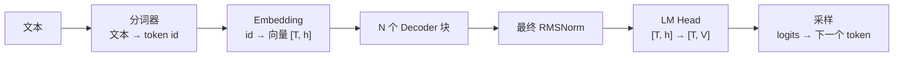
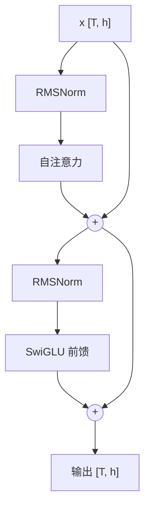

# 1.1 Decoder-only Transformer 与注意力

> 对应书中第 2 章 Inside the Mind of a Transformer

## 学习目标

- 说出一个 Decoder-only 模型从输入文本到输出 token 的完整路径，以及每一步张量的形状。
- 读懂 `config.json` 和 Hugging Face 的模块结构，能指出参数主要集中在哪里。
- 从服务的角度理解注意力：它的计算量和显存开销如何随上下文长度增长。

## 1. 三个组成部分



| 部分 | 作用 | 服务时要关心的 |
|---|---|---|
| 分词器与 Embedding | 文本切成 token，映射成向量 | 分词在 CPU 上做，长 prompt 时也有开销；词表大小 $V$ 影响 Embedding 和 LM Head 的大小 |
| Decoder 块 | 注意力（在 token 之间交换信息）+ 前馈网络（逐 token 变换） | 绝大部分计算和参数都在这里 |
| LM Head | 把最后一个位置的隐藏状态映射成整个词表上的 logits | 生成时只需要算最后一个 token 的 logits |

书中提到，生成时通常只用最后一个 token 的隐藏状态来预测下一个 token。推理框架会利用这一点：prefill 时只对每个请求的最后一个位置做 LM Head，而不是对全部 $T$ 个位置。MiniServe 的 `engine.py` 中的 `sample_rows` 就是这个作用。

## 2. 读模型配置

部署前先看 `config.json`。以 Qwen3-8B 为例：

| 字段 | 值 | 含义 |
|---|---|---|
| `hidden_size` $h$ | 4096 | 隐藏维度 |
| `num_hidden_layers` $L$ | 36 | Decoder 块数 |
| `num_attention_heads` $n_q$ | 32 | Q 头数 |
| `num_key_value_heads` $n_{kv}$ | 8 | KV 头数（GQA，每 4 个 Q 头共享一组 KV） |
| `head_dim` $d_h$ | 128 | 每个头的维度 |
| `intermediate_size` | 12288 | 前馈网络中间维度 |
| `vocab_size` $V$ | 151936 | 词表大小 |

书中用的是 Qwen2.5-0.5B（$h=896$，24 层，14 个 Q 头，词表 151936，共 4.94 亿参数），可以用同样的方法打印。

## 3. 一个 Decoder 块内部

现代模型（Llama、Qwen2/3、Mistral）的 Decoder 块结构基本一致，采用 Pre-Norm：



**自注意力**，形状以 Qwen3-8B 为例：

| 步骤 | 运算 | 输出形状 |
|---|---|---|
| 投影 | $Q = xW_Q,\ K = xW_K,\ V = xW_V$ | $Q$: [T, 32, 128]；$K, V$: [T, 8, 128] |
| 归一化（Qwen3 特有） | 对 $Q$、$K$ 的每个头做 RMSNorm | 不变 |
| 位置编码 | RoPE：按位置旋转 $Q$、$K$ | 不变 |
| 打分与加权 | $\text{softmax}\!\left(\frac{QK^\top}{\sqrt{d_h}} + M\right)V$，$M$ 为因果掩码 | [T, 32, 128] |
| 输出投影 | $W_O$ | [T, 4096] |

**前馈网络（SwiGLU）**：

$$
\text{MLP}(x) = W_{\text{down}}\big(\text{SiLU}(xW_{\text{gate}}) \odot xW_{\text{up}}\big)
$$

三个矩阵分别是 [4096, 12288]、[4096, 12288]、[12288, 4096]。

**参数分布。** 每层注意力约 4190 万参数，前馈约 1.51 亿，前馈占约 78%。36 层合计约 69.5 亿，加上 Embedding 和 LM Head 各 6.2 亿，总计约 81.9 亿。

这个比例说明，**decode 阶段读权重的开销大部分来自前馈网络**。MoE 模型正是把前馈网络换成多个专家、每个 token 只激活其中几个，以此减少每个 token 要读的权重（4.2 节）。

## 4. 注意力：服务视角

书中有意不深入数学推导，而是强调服务工程师需要知道的三点。

**第一，注意力让每个 token 能"看到"之前的所有 token。** 例如在 "Write a short introduction about the US capital city" 中，处理到 "capital" 时，模型会关注 "US"，从而确定这里指首都而不是资本。书中用 BertViz 可视化了 Qwen2.5 第 10 层的注意力权重来展示这一点。

**第二，因果掩码保证只看过去。** 位置 $i$ 只能关注位置 $\le i$ 的 token。这正是 KV Cache 能成立的前提（1.3 节）：过去 token 的 $K$、$V$ 不会因为后面出现了新 token 而改变。

**第三，注意力的开销随上下文增长。**

- 计算量：prefill 时 $QK^\top$ 和加权求和的计算量正比于 $s^2$。decode 时每个新 token 要和全部 $t$ 个历史 token 计算，正比于 $t$。
- 显存：需要缓存的 $K$、$V$ 正比于上下文长度（0.3 节）。

以 Qwen3-8B 为例，每个 token 的线性层计算量约 $2P \approx 16.4$ GFLOPs，而每个 decode token 的注意力打分计算量约为 $4 \, n_q \, d_h \, t \, L$：

| 上下文长度 $t$ | 注意力 GFLOPs / token | 占线性层的比例 |
|---|---|---|
| 1K | 0.6 | 4% |
| 8K | 4.8 | 29% |
| 32K | 19.3 | 118% |

短上下文时注意力的计算量可以忽略，长上下文时它会成为主要部分。这是 FlashAttention（3.2）、稀疏注意力（6.6）等方法的出发点。

## 5. 位置编码与归一化（补充）

这两部分书中没有展开，但读模型代码时会遇到：

- **RMSNorm**：$\text{RMSNorm}(x) = \frac{x}{\sqrt{\text{mean}(x^2) + \epsilon}} \odot g$。比 LayerNorm 少了减均值和偏置，计算更省。实现时通常先转成 FP32 计算再转回，避免低精度下溢出。
- **RoPE**：把 $Q$、$K$ 的每对维度按位置 $p$ 旋转角度 $p\,\theta_i$，$\theta_i = \text{base}^{-2i/d_h}$。两个位置的点积只依赖相对距离。`rope_theta`（Qwen3 为 $10^6$）决定了频率范围，长上下文扩展（YaRN 等）就是在调整这些频率。

## 6. 从服务角度总结

| 结构特点 | 对服务的影响 |
|---|---|
| 自回归：一次生成一个 token | decode 访存受限，需要批处理（1.5） |
| 因果注意力 | 过去的 K、V 可以缓存（1.3） |
| 注意力与上下文长度相关 | KV 显存与长上下文开销（0.3、3.x、4.4） |
| 前馈占参数大头 | 权重量化收益集中在前馈；MoE 用稀疏激活降低每 token 读取量 |
| GQA 的 KV 头少于 Q 头 | KV Cache 缩小数倍（0.3、3.1） |

## 动手实验

**实验 1：打印结构并统计参数分布。**

```python
import torch
from collections import Counter
from transformers import AutoModelForCausalLM

model = AutoModelForCausalLM.from_pretrained("Qwen/Qwen3-0.6B", dtype=torch.bfloat16)
print(model.config)
print(model.model.layers[0])

groups = Counter()
for name, p in model.named_parameters():
    key = ("attn" if "self_attn" in name else "mlp" if "mlp" in name else
           "norm" if "norm" in name else "embed/lm_head")
    groups[key] += p.numel()
total = sum(groups.values())
for k, v in groups.items():
    print(f"{k:14s} {v / 1e6:8.1f} M  {v / total:6.1%}")
```

用 0.3 节的估算脚本算同一个模型的参数量，与实际结果对比。注意 Qwen3-0.6B 的 `tie_word_embeddings` 为 `true`，LM Head 与 Embedding 共享权重。

**实验 2：对照 MiniServe 的实现。** 阅读 [`code/project1/solution/miniserve/model.py`](https://github.com/zrpxx/hands-on-llm-serving-opt/blob/main/code/project1/solution/miniserve/model.py)，找到 RMSNorm、RoPE、GQA、SwiGLU 分别对应的代码。这份实现与 Hugging Face 的输出逐位对齐（见项目 1 的测试）。

## 自测题

1. 为什么 LM Head 在生成时只需要对最后一个位置计算？对 prefill 有什么意义？
2. Qwen3-8B 的 GQA 分组大小是多少？它对 KV Cache 和计算量分别有什么影响？
3. 一个 8B 稠密模型在 32K 上下文下 decode，单 token 的计算量大约是短上下文时的几倍？
4. 为什么说"过去 token 的 K、V 不会改变"是 KV Cache 成立的前提？如果模型使用双向注意力会怎样？

<details>
<summary>参考答案</summary>

1. 下一个 token 只依赖最后一个位置的隐藏状态。prefill 一个 4K 的 prompt 时，只算 1 行而不是 4096 行 LM Head，词表 15 万时可以省下可观的计算和显存（[4096, 151936] 的 FP32 logits 约 2.5 GB）。
2. $32 / 8 = 4$。KV Cache 缩小到 MHA 的 1/4；注意力打分的计算量不变（Q 头数没变），但 decode 时读取的 KV 字节数减少，算术强度提高到约 4（0.4 节）。
3. 按上表，32K 时注意力约 19.3 GFLOPs，加上线性层 16.4 GFLOPs，合计约 35.7，是短上下文时的 2.2 倍左右。
4. 因果掩码使位置 $i$ 的表示只依赖位置 $\le i$ 的输入，新 token 加入后，前面每一层的 K、V 都不变，可以直接复用。双向注意力（如 BERT）中，新 token 会影响所有位置的表示，缓存失效，每次都要整体重算。

</details>

## 延伸阅读

- Vaswani et al., *Attention Is All You Need*, 2017
- Jay Alammar, *The Illustrated Transformer*（书中推荐）
- Su et al., *RoFormer: Enhanced Transformer with Rotary Position Embedding*, 2021
