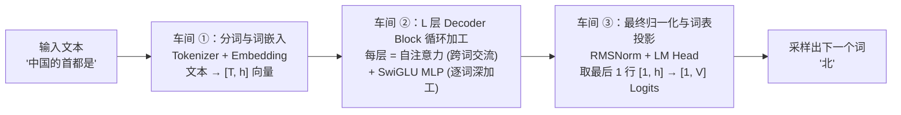
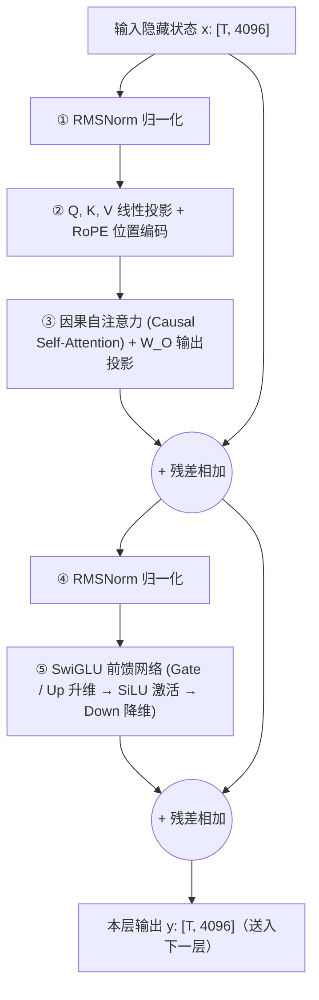

# 1.1 Decoder-only Transformer 与注意力

## 学习目标

完成本节学习后，你将能够：
- **追踪一段文字穿过 Decoder-only 模型的完整张量形状变化**：从 Token ID `[T]` 到 Embedding `[T, h]`，再到多头切分、因果注意力、SwiGLU 前馈网络，直到最后变成词表上的概率分布。
- **从推理性能的角度重新认识模型结构**：算清楚为什么前馈网络（MLP）占了近 80% 的权重参数（决定 Decode 带宽下限），而自注意力（Attention）在长上下文下计算量会反超线性层。
- **解释两个关键的推理优化不变量**：为什么生成时 LM Head 只需要算最后 1 行？为什么因果掩码（Causal Mask）是后面 KV Cache 能成立的根本前提？

---

## 1. 推理视角下的 Transformer

如果你读过介绍 Transformer 的算法文章，里面往往花大量篇幅讲“为什么自注意力能捕捉长距离语义”“残差连接为什么有助于梯度反传”。

但当我们作为**推理系统工程师**拿到一个训练好的模型（如 `Qwen3-8B` 或 `Llama-3-8B`）时，权重已经冻结了，也不需要算梯度。我们关心的是另外三个极其务实的问题：
1. **张量在每一层变成了什么形状（Shape）？** 哪里能并行算，哪里必须串行等？
2. **16.4 GB 的权重主要堆在哪个模块里？** 谁吃掉了最多的显存带宽？
3. **当用户输入的上下文从 500 字涨到 32,000 字时，哪一层的计算量和显存会突然爆炸？**

这一节我们就拿一把手术刀，把现代主流大模型（清一色采用 **Decoder-only 架构**）从头到尾剖开，建立清晰的工程解剖图。

---

## 2. 三段结构：嵌入、解码层、输出头

虽然大模型动辄几十亿参数，但从头到尾其实只由**三个大车间**串联而成：



我们先用一个具体的微型例子，看看数据在三个车间里到底长什么样。假设输入句子 `"中国的首都是"` 被分词器切成了 **$T = 4$** 个 Token ID：`[101, 205, 308, 412]`，模型的隐藏层维度 `hidden_size` 是 **$h = 4096$**，词表大小是 **$V = 151,936$**：

| 车间 | 输入是什么 | 做了什么运算 | 输出张量形状 | 推理服务中的关键优化点 |
|---|---|---|---|---|
| **① 分词与 Embedding** | 字符串 $\to$ 整数数组 `[4]` | 在形状为 `[151936, 4096]` 的大表里查出第 101、205、308、412 行 | `[4, 4096]` | 分词在 **CPU** 上跑，长文本高并发时不要让分词阻塞 GPU 主线程；查表本身极快 |
| **② $L$ 层 Decoder Block** | `[4, 4096]` | 连续穿过 $L=36$ 层结构完全相同的网络块，每层形状进出不变 | `[4, 4096]` | **90% 以上的参数和计算量都在这里**，是量化、算子融合与 KV Cache 的主战场 |
| **③ LM Head 词表投影** | `[4, 4096]` | 乘以词表矩阵 `[4096, 151936]`，给词表里每个词打分（Logits） | 朴素：`[4, 151936]`<br/>**优化后：`[1, 151936]`** | **重大优化**：预测第 5 个词只需要第 4 个词（最后一个位置）的隐藏向量。前 3 行算出来也是直接扔掉 |

> [!TIP]
> **为什么“LM Head 只算最后 1 行”能省下几个 GB 的显存？**
> 假设用户发来一篇 $T = 4096$ 的长文做 Prefill。如果傻乎乎地对全部 4096 行都乘以词表矩阵 `[4096, 151936]`，输出的 FP32 Logits 张量形状是 `[4096, 151936]`，光这一个张量就要占 $4096 \times 151936 \times 4\text{ Bytes} \approx \mathbf{2.49\text{ GB}}$ 显存。而只切片取出最后 1 行 `[1, 4096]` 去乘 LM Head，输出只有 `600 KB`，显存和计算量瞬间省了 **4096 倍**。在我们项目 1 MiniServe 的 `engine.py` 中，`sample_rows` 变量干的就是这件事。

---

## 3. 组件：张量形状与注意力开销

点击下方交互器中的 5 个步骤按钮，查看每个子模块精确的输入/输出张量形状；然后拖动 **「当前上下文序列长度 ($T$)」** 滑块，观察随着上下文变长，单步计算量的重心是如何从线性层转移到 Attention 层的：

<div class="llm-widget" data-widget="transformer-tensor-inspector"></div>

### 动手试一试
1. 依次点击 **① 到 ⑤** 五个模块标签，重点看 **② QKV 线性投影**：为什么输入是 `[T, 4096]`，切完头之后 `Q` 是 `[T, 32, 128]`，而 `K` 和 `V` 却是 `[T, 8, 128]`？
2. 将上方的序列长度滑块 $T$ 放在 **`1024`**：看底部的计算量进度条，此时 Attention 只占单步计算量的 **3.5%**，几乎可以忽略不计。
3. 把滑块 $T$ 一路拖到最右边的 **`32768`（32K 长上下文）**：你会发现橙色的 Attention 计算量飙升到了 **19.3 GFLOPs**，竟然反超了整个模型 80 亿参数的线性层总和（16.4 GFLOPs）。

---

## 4. 一个解码层内部的计算

现代主流开源大模型（Llama 2/3、Qwen 2/3、Mistral、DeepSeek 稠密版）的单层结构几乎已经完全标准化，统一采用 **Pre-Norm（先归一化再计算）+ 残差连接（Residual Connection）** 的设计：



下面我们以 `Qwen3-8B` 的真实配置参数为例，把每一小步拆开算一笔细账：

### 4.1 自注意力模块（Self-Attention）：让词与词之间交换信息

如果只有线性层和前馈网络，句子里的每个词都是各算各的，模型看到 `"苹果"` 时根本不知道前面写的是 `"我爱吃"` 还是 `"乔布斯创办了"`。**自注意力层是整个 Transformer 中唯一让不同位置的 Token 互相交流信息的地方。**

它分为四个子步骤（设输入形状为 `[T, 4096]`）：

1. **QKV 投影与分头（GQA）**：
   - 用矩阵 $W_Q$（形状 `[4096, 4096]`）算出查询 $Q$，并重塑（Reshape）为 32 个头：`[T, 32, 128]`（因为 $32 \times 128 = 4096$）。
   - 用矩阵 $W_K, W_V$（形状均为 `[4096, 1024]`）算出键 $K$ 和值 $V$，重塑为 8 个头：`[T, 8, 128]`（因为 $8 \times 128 = 1024$）。
   - *注：Qwen3 还在分头后对每个头的 $Q$ 和 $K$ 额外加了一层轻量级的 QK-RMSNorm 以提升训练稳定性。*
2. **RoPE 旋转位置编码（Rotary Position Embedding）**：
   - 注意力本身没有先后顺序的概念。RoPE 将每个位置 $p$ 的 $Q$ 和 $K$ 向量里的数字两两配对，在二维平面上旋转一个与位置成正比的角度 $p \cdot \theta_i$。
   - 这样做有个极妙的数学性质：第 $m$ 个词的 $q_m$ 与第 $n$ 个词的 $k_n$ 做点积时，结果只取决于它们的**相对距离 $(m - n)$**。
3. **因果掩码注意力打分（Causal Scaled Dot-Product Attention）**：
   $$
   \text{Attention}(Q, K, V) = \text{softmax}\!\left(\frac{QK^\top}{\sqrt{d_h}} + M_{\text{causal}}\right) V
   $$
   - 这里最关键的是**因果掩码矩阵 $M_{\text{causal}}$**（右上角全为 $-\infty$，左下角全为 $0$）：它强制规定**第 $i$ 个位置只能看到位置 $\le i$ 的过去词，绝不能偷看位置 $> i$ 的未来词**。
   - 假设输入是 3 个词 `["中国", "首都", "是"]`，经过 $\text{softmax}$ 后的注意力权重矩阵长这样：
     $$\begin{bmatrix} 1.0 & 0 & 0 \\ 0.4 & 0.6 & 0 \\ 0.2 & 0.5 & 0.3 \end{bmatrix}$$
   - **请盯住这三行看 5 秒钟**：你会发现第 1 行（`"中国"`）和第 2 行（`"首都"`）的計算，完全不涉及第 3 列（因为第 3 列被掩码成了 $0$）。这意味着**哪怕后面又新生成了第 4 个词、第 5 个词，前面老词算出来的 $K$、$V$ 以及注意力结果永远不会发生任何改变**。这就是 `1.3` 节 KV Cache 能够成立的基石。
4. **输出投影 $W_O$**：把 32 个头拼回 `[T, 4096]`，再乘以 $W_O$（`[4096, 4096]`）融合各头信息。

### 4.2 SwiGLU 前馈网络：约 78% 的参数

经过注意力层交换完上下文信息后，每个 Token 独立进入前馈网络（MLP）做非线性特征变换。现代大模型普遍采用 **SwiGLU** 结构，包含三个大矩阵：

$$
\text{MLP}(x) = W_{\text{down}}\Big(\text{SiLU}(x W_{\text{gate}}) \odot (x W_{\text{up}})\Big)
$$

在 `Qwen3-8B` 中，中间维度 `intermediate_size` 是 `12,288`（刚好是隐藏维度 `4096` 的 3 倍）。我们来算算 **1 层** 里 Attention 和 MLP 各占多少参数：
- **单层 Attention 参数量**：
  $$W_Q(4096 \times 4096) + W_K(4096 \times 1024) + W_V(4096 \times 1024) + W_O(4096 \times 4096) \approx \mathbf{4,194\text{ 万参数}}$$
- **单层 SwiGLU MLP 参数量**：
  $$W_{\text{gate}}(4096 \times 12288) + W_{\text{up}}(4096 \times 12288) + W_{\text{down}}(12288 \times 4096) \approx \mathbf{1.51\text{ 亿参数}}$$

**结论一目了然**：在每一层里，**MLP 的参数量占了约 78%，而 Attention 只占约 22%**。
这给我们带来了两个极其重要的推理工程启示：
1. **在短上下文 Decode 阶段**，GPU 90% 的时间花在从显存搬运权重上，而其中近 80% 搬的都是 MLP 的三个大矩阵。所以第 2 部分的**权重量化**最主要的收益就是把这三大块矩阵体积压小；第 4 部分的 **MoE（混合专家模型）** 也是把这肥胖的 MLP 拆成几十个小专家，每次只挑 2~8 个专家读入显存，从而大幅降低单 Token 的显存带宽消耗。
2. **在超长上下文阶段（如 32K~128K）**，MLP 的计算量对每个 Token 来说是固定的，但 Attention 需要和全部历史 $T$ 个词交互，开销随 $T$ 线性（Decode）甚至平方（Prefill）暴涨，最终反客为主成为最大瓶颈（对应第 3 部分的 FlashAttention 与第 6 部分的稀疏注意力）。

---

## 5. 实验：统计真实模型的参数分布

### 实验 1：打印并统计 `Qwen3-0.6B` 各组件参数占比
运行以下脚本，亲眼看看真实模型里 Attention、MLP 和词表各自占了多少比例的参数：

```python
import torch
from collections import Counter
from transformers import AutoModelForCausalLM

model = AutoModelForCausalLM.from_pretrained("Qwen/Qwen3-0.6B", torch_dtype=torch.bfloat16)
print("=== 单层 Decoder Block 结构 ===")
print(model.model.layers[0])

groups = Counter()
for name, p in model.named_parameters():
    if "self_attn" in name:
        key = "1. Attention (自注意力)"
    elif "mlp" in name:
        key = "2. SwiGLU MLP (前馈网络)"
    elif "norm" in name:
        key = "3. RMSNorm (归一化层)"
    else:
        key = "4. Embedding / LM Head (词表)"
    groups[key] += p.numel()

total = sum(groups.values())
print(f"\n=== 总参数量: {total / 1e6:.1f} M ===")
for k, v in sorted(groups.items()):
    print(f"{k:28s}: {v / 1e6:8.2f} M  ({v / total:5.1%})")
```

### 实验 2：对照阅读本仓库 MiniServe 的纯 PyTorch 模型实现
打开本仓库的 [`code/project1/solution/miniserve/model.py`](https://github.com/zrpxx/hands-on-llm-serving-opt/blob/main/code/project1/solution/miniserve/model.py)（不到 240 行代码），你会发现我们没有调用任何黑盒库，而是用最干净的 PyTorch 写出了 `RMSNorm`、`RotaryEmbedding`、`Attention`、`MLP` 和 `CausalLM`，并且它的输出与 Hugging Face 官方实现**逐位完全一致**。

---

## 6. 自测

<div class="llm-widget" data-widget="quiz" data-questions='[{"q": "prefill 一个 4096 token 的 prompt 时，推理引擎为什么只把最后一个位置的隐藏状态送进 LM Head？", "options": ["LM Head 的权重只能处理一行输入", "下一个 token 只依赖最后一个位置的隐藏状态；只算一行能省下几乎全部 LM Head 计算和数 GB 的 logits 显存", "前面位置的隐藏状态在最后一层已经被覆盖，无法再使用", "这样做是为了让 prefill 和 decode 的输出形状一致，与性能无关"], "answer": 1, "explain": "词表约 15 万时，[4096, 151936] 的 FP32 logits 约 2.5 GB。生成只需要最后一行。前面位置的隐藏状态其实还在，只是不需要；训练时才需要所有位置的 logits 来算损失。"}, {"q": "Qwen3-8B 每层中参数量占比最大（约 78%）的是哪一部分？", "options": ["自注意力的 Q、K、V、O 四个投影", "SwiGLU 前馈网络的 gate、up、down 三个矩阵", "RMSNorm 的缩放参数", "RoPE 的位置编码表"], "answer": 1, "explain": "每层注意力约 4190 万参数，前馈约 1.51 亿。所以短上下文 decode 时读取的权重大部分属于前馈网络，MoE 正是把前馈换成稀疏激活的专家来减少每个 token 读取的权重。RoPE 没有可学习参数。"}, {"q": "如果模型使用双向注意力（如 BERT）而不是因果注意力，还能用 KV Cache 加速逐 token 生成吗？", "options": ["能，KV Cache 与注意力方向无关", "不能：新 token 加入后，前面所有位置都会关注到它，它们各层的表示以及下一层的 K、V 都会改变，缓存失效", "能，但只能缓存第一层的 K、V", "不能，因为双向注意力没有 V 投影"], "answer": 1, "explain": "KV Cache 成立的前提是过去 token 的表示不受未来 token 影响，这由因果掩码保证。第一层的 K、V 只依赖输入嵌入，确实不变，但从第二层起就会变，所以只缓存第一层没有实际意义。"}]'></div>

---

## 延伸阅读

- Vaswani et al., [*Attention Is All You Need*](https://arxiv.org/abs/1706.03762), NeurIPS 2017
- Jianlin Su et al., [*RoFormer: Enhanced Transformer with Rotary Position Embedding*](https://arxiv.org/abs/2104.09864), 2021（RoPE 旋转位置编码原始论文）
- Chi Wang & Peiheng Hu, *Hands-On LLM Serving and Optimization*, O'Reilly, Chapter 2 (*Inside the Mind of a Transformer*)
