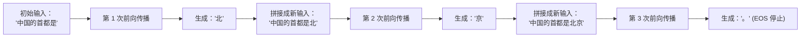
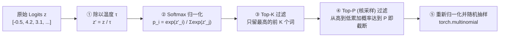

# 1.2 自回归生成：生成循环与解码采样

## 学习目标

完成本节学习后，你将能够：
- **抛开黑盒 `model.generate()`，用 15 行原生 PyTorch 代码手写出完整的逐词生成循环**。
- **解释为什么在最朴素的自回归循环中，生成越往后越慢**（理解无缓存时的重复计算陷阱）。
- **彻底掌握从 Logits 分数到具体 Token 的四种解码策略**：贪心（Greedy）、温度缩放（Temperature）、Top-K 与 Top-P（核采样）的数学原理与工程实现。
- **解决流式输出中的“中文乱码 ``”问题**：理解多字节 UTF-8 字符的增量反分词（Incremental Detokenization）机制。

---

## 1. 为什么只能逐个 token 生成

很多刚接触大模型的同学会问：“既然输入一段 100 字的 Prompt，GPU 可以一次性并行算完；那为什么输出一段 100 字的回答时，模型不能一次性同时蹦出这 100 个字，非要像打字机一样一个字一个字往外蹦呢？”

答案在于生成式大模型的数学本质——**自回归（Autoregression）**：
模型在预测第 $k$ 个词时，**必须把前 $k-1$ 个已经生成的词作为已知输入条件**。如果第 1 个词还没定下来是 `"北京"` 还是 `"上海"`，模型就根本无法确定第 2 个词该接 `"烤鸭"` 还是 `"外滩"`。



这个“**预测 1 个新词 $\to$ 拼回输入末尾 $\to$ 再预测下 1 个词**”的循环，就是大模型推理服务一切特殊性的总源头：
1. **单次请求寿命极长**：生成一个 500 词的回答，就要在 GPU 上循环跑 **500 次**完整的前向传播，持续好几秒甚至几分钟。
2. **输出长度事先未知**：在循环开始前，没有任何人（包括模型自己）知道它会在第 10 步还是第 2000 步吐出结束符 `EOS`。因此系统根本无法在请求开始前精准预知它要占多少显存、跑多久。

---

## 2. 手写一个生成循环

在调用 Hugging Face 的 `model.generate()` 时，上面那个循环被藏在了几千行源码背后。现在我们把它剥离出来，用最直白的 15 行代码亲手写一遍：

```python
import time, torch
from transformers import AutoModelForCausalLM, AutoTokenizer

name = "Qwen/Qwen3-0.6B"
tok = AutoTokenizer.from_pretrained(name)
model = AutoModelForCausalLM.from_pretrained(name, torch_dtype=torch.bfloat16).cuda().eval()

# 1. 分词：把字符串变成形状为 [1, T] 的整数张量
input_ids = tok("Write a short introduction about Beijing.", return_tensors="pt").input_ids.cuda()
step_times = []

for step in range(100):
    t0 = time.perf_counter()
    with torch.no_grad():
        # (A) 把当前完整的序列送进模型，得到输出 logits，形状为 [1, 当前长度, 词表大小]
        logits = model(input_ids).logits
    # (B) 只取最后一个位置（-1）的分数，形状为 [1, 词表大小]，用 softmax 转为概率分布
    probs = torch.softmax(logits[:, -1, :], dim=-1)
    # (C) 按概率随机采样出 1 个新 Token ID，形状为 [1, 1]
    next_id = torch.multinomial(probs, num_samples=1)
    # (D) 把新生成的 Token ID 拼接到输入序列末尾，长度 +1
    input_ids = torch.cat([input_ids, next_id], dim=1)

    torch.cuda.synchronize()
    step_times.append(time.perf_counter() - t0)
    # (E) 如果采样到了结束符 EOS，立刻终止循环
    if next_id.item() == tok.eos_token_id:
        break

print(tok.decode(input_ids[0], skip_special_tokens=True))
```

### 为什么上面这段代码会“越跑越慢”？

如果你把上面代码里每一步的耗时 `step_times` 画成折线图，你会看到一条**随步数不断往上爬的斜线**：
- 第 1 步：只送入初始的 8 个词。
- 第 50 步：把 `8 + 50 = 58` 个词**从第 1 个词开始全部重新算了一遍**。
- 第 100 步：把 `8 + 100 = 108` 个词又从头到尾重新算了一遍。

如果初始 Prompt 有 4,000 个词，要生成 1,000 个词，这段朴素代码就会把那 4,000 个词翻来覆去重算 **1,000 遍**。这就是为什么我们在下一节（`1.3`）必须引入 **KV Cache** 来消灭这种荒谬的重复劳动。

---

## 3. 从 logits 到 token：四种解码策略

在上面代码的第 `(B)` 和 `(C)` 步中，模型最后一层 LM Head 算出来的是词表里 151,936 个词各自的原始打分——称为 **Logits**（形状为 `[1, V]`，数值范围在 $-\infty$ 到 $+\infty$ 之间）。

怎么从这 15 万个分数里挑出最终的那 1 个词？不同的业务场景需要不同的**采样策略（Sampling Strategy）**：



| 策略参数 | 数学操作与含义 | 调参直觉与适用场景 |
|---|---|---|
| **贪心解码（Greedy，`temperature = 0`）** | 不做随机抽样，直接取分数最高的词：$\arg\max_i z_i$ | **100% 确定性输出**。适合数学解题、代码生成、自动化评测与单元测试（保证每次跑结果完全一致）。缺点是容易陷入死循环车轱辘话。 |
| **温度缩放（`temperature` $\tau > 0$）** | 在 Softmax 前把分数除以 $\tau$：$p_i \propto \exp(z_i / \tau)$ | - **$0 < \tau < 1$（降温，如 `0.2`）**：拉大贫富差距，高分词概率更高，回答更严谨保守。<br/>- **$\tau > 1$（升温，如 `1.2`）**：抹平分差，低分冷门词也有机会被选中，更有创意但也更容易胡言乱语。 |
| **Top-K 采样（`top_k` = $k$）** | 只保留概率排名前 $k$ 的候选词，第 $k+1$ 名及以后的词概率全部强制清零 | 砍掉词表里那十几个万分之一的离谱长尾词，防止偶尔蹦出完全狗屁不通的错别字。 |
| **Top-P 核采样（Nucleus，`top_p` = $p$）** | 将候选词按概率从大到小排序并累加，一旦累计概率超过阈值 $p$（如 `0.9`），就把后面的词全部砍掉 | **比 Top-K 更聪明**：当模型非常确定时（如 `"中国的首都是"`，`"北京"` 占了 95%），候选池自动收缩为 1 个词；当模型面临开放式续写时，候选池自动放宽到几十个词。 |

---

## 4. 组件：Temperature、Top-K 与 Top-P

在下面的实验室里，动手拖动三个滑块，观察词表候选词的概率分布是如何被“降温锐化”、“升温拉平”以及被 Top-K / Top-P 截断淘汰的：

<div class="llm-widget" data-widget="sampling-autoregressive-lab"></div>

### 动手试一试
1. 将 **温度 $\tau$** 拖到最左边 `0`：观察所有概率瞬间 100% 集中在排名第一的 `"北京"` 上（这就是贪心解码）。
2. 将 **温度 $\tau$** 调高到 `1.8`：观察原本排在末尾的 `"火锅"` 也分到了几个百分点的概率；此时把 **Top-P** 从 `1.00` 往左拖到 `0.80`，看看 `"火锅"` 和 `"美丽"` 是如何被核采样安全截断的。

---

## 5. 停止条件与流式增量解码

把采样循环做成真正的线上服务时，还有两个初学者极易踩坑的细节：

### 5.1 什么时候停下来？（4 种停止条件）
1. **遇到结束符（EOS Token）**：模型自己觉得话说完了。*避坑提示：现代模型（如 Qwen3、Llama-3）往往有多个结束符（例如 `<|endoftext|>` 和 `<|im_end|>`），必须从 `generation_config.json` 读取完整的 `eos_token_id` 列表。*
2. **达到用户指定的 `max_tokens`**：生成的词数达到了预算上限。
3. **达到模型最大上下文 `max_model_len`**：`输入长度 + 已生成长度` 触顶。
4. **命中停止字符串（Stop Strings，如 `"\nObservation:"`）**：在 ReAct Agent 场景中常用，需要在反分词后的文本末尾实时匹配。
   > **压测小技巧**：在做性能压测时，如果模型提前吐出 EOS 结束，不同框架生成的长度就不一样，没法公平对比吞吐。因此压测工具都会传 `ignore_eos=True`，强制模型忽略 EOS、严格跑满 `max_tokens` 步。

### 5.2 为什么流式输出中文或 Emoji 时，不能“每出一个 Token 就直接 `decode`”？

在 BPE（Byte-Pair Encoding）分词器中，一个生僻汉字或一个 Emoji 表情（UTF-8 编码占 3~4 个字节）往往会被拆成 **2 个甚至 3 个不同的 Token ID**。
- 如果你在第 $t$ 步刚拿到半个汉字的 Token ID，就立刻调用 `tokenizer.decode([token_id])` 推给前端，因为字节不完整，Python 会输出一个刺眼的乱码替换符 **``（U+FFFD）**。
- **正确的增量反分词做法**（参见本仓库 MiniServe 的 `IncrementalDetokenizer`）：维护已生成的完整 Token 列表，每次解码后若发现末尾字符是替换字符 `'\ufffd'`，就先扣留不发，等下一步剩下的半个字节 Token 到了、拼成完整汉字后再一起发给用户。

---

## 6. 实验：无缓存生成的耗时增长

运行本节第 2 部分的 15 行代码（将循环次数设为 200，`eos_token_id` 判断暂时注释掉以跑满 200 步），然后打印第 1 步、第 50 步、第 100 步、第 200 步的单步耗时：

```python
print(f"Step   1 耗时: {step_times[0]*1000:.2f} ms")
print(f"Step  50 耗时: {step_times[49]*1000:.2f} ms")
print(f"Step 100 耗时: {step_times[99]*1000:.2f} ms")
print(f"Step 200 耗时: {step_times[199]*1000:.2f} ms")
```

记下这组数字，马上在下一节（`1.3`）开启 KV Cache 后做同台对比。

---

## 7. 自测

<div class="llm-widget" data-widget="quiz" data-questions='[{"q": "不使用 KV Cache 时，prompt 长度为 &#36;s&#36;，正在生成第 &#36;k&#36; 个新 token。这一步线性层的计算量与什么成正比？", "options": ["与 &#36;k&#36; 成正比", "与 &#36;s + k&#36; 成正比", "与 &#36;s&#36; 成正比，与 &#36;k&#36; 无关", "是常数，与长度无关"], "answer": 1, "explain": "不缓存时每一步都把完整序列重新送进模型，输入长度为 &#36;s + k&#36;，线性层计算量正比于它，注意力部分更是正比于 &#36;(s+k)^2&#36;。有了 KV Cache，每一步的线性层计算量才变成常数（只算 1 个新 token）。"}, {"q": "同一批里，请求 A 要求贪心解码，请求 B 要求 temperature = 0.8、top_p = 0.9。能否在一次批处理中完成两者的采样？", "options": ["不能，采样参数不同的请求必须分到不同的批", "能：采样只作用于 [B, V] 的 logits，按行使用各自的温度和 top-p，贪心的行直接取 argmax", "能，但 B 的 top_p 会被忽略", "不能，贪心解码必须在模型前向内部完成"], "answer": 1, "explain": "采样发生在模型前向之后，各行相互独立，所以批内可以混合任意采样参数。项目 1 MiniServe 的 <code>_sample</code> 就是这样实现的。"}, {"q": "流式输出时，每生成一个 token 就单独 <code>decode([new_id])</code> 发给前端，处理中文时可能出现什么问题？", "options": ["输出顺序会被打乱", "出现替换字符（乱码）：一个汉字的 UTF-8 字节可能分布在多个 token 中，单独解码半个字符是无效的", "每个汉字会被重复输出两次", "tokenizer 会抛出异常，导致连接中断"], "answer": 1, "explain": "正确做法是对累计的 token 序列解码，只发送新增的完整字符；如果末尾是替换字符 U+FFFD，就先不发，等下一个 token 到达后再输出。tokenizer 默认不会抛异常，而是输出替换字符。"}]'></div>

---

## 延伸阅读

- Ari Holtzman et al., [*The Curious Case of Neural Text Degeneration*](https://arxiv.org/abs/1904.09751), ICLR 2020（提出 Top-P 核采样，解决贪心解码重复退化与高温采样胡言乱语的经典论文）
- Chi Wang & Peiheng Hu, *Hands-On LLM Serving and Optimization*, O'Reilly, Chapter 2 (*The Autoregressive Nature of Transformers*)
