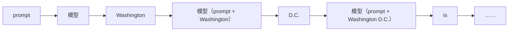

# 1.2 自回归生成的执行过程

> 对应书中第 2 章 The Autoregressive Nature of Transformers、Model Prediction, Line by Line

## 学习目标

- 不借助 `generate()`，手写一个逐 token 生成的循环，并解释每一步做了什么。
- 理解常见的解码策略（贪心、温度、top-k、top-p）以及停止条件。
- 观察不使用 KV Cache 时每个 token 的耗时如何随长度增长，并解释原因。

## 1. 自回归

模型一次只预测一个 token。预测出来的 token 拼接到输入末尾，作为下一步的输入，直到满足停止条件：



这是 LLM 服务的大部分特殊性的来源：

- 一个请求要执行几十到几千次前向，持续数秒到数分钟。
- 输出长度事先未知，无法提前分配好资源。
- 每一步只产生一个 token，单请求时 GPU 大部分时间在读权重（0.4 节）。

## 2. 手写生成循环

书中的例 2-1 把 `pipeline` 拆开，展示了最朴素的实现：

```python
import time, torch
from transformers import AutoModelForCausalLM, AutoTokenizer

name = "Qwen/Qwen2.5-0.5B"
tok = AutoTokenizer.from_pretrained(name)
model = AutoModelForCausalLM.from_pretrained(name, dtype=torch.float16).cuda().eval()

idx = tok("Write a short introduction about the US capital city.", return_tensors="pt").input_ids.cuda()
times = []
for _ in range(100):
    t0 = time.perf_counter()
    with torch.no_grad():
        logits = model(idx).logits          # (A)(B) 每一步都把完整序列送进模型
    probs = torch.softmax(logits[:, -1, :], dim=-1)   # (C) 只取最后一个位置
    nxt = torch.multinomial(probs, num_samples=1)
    idx = torch.cat([idx, nxt], dim=1)      # (D) 拼接到输入末尾
    torch.cuda.synchronize()
    times.append(time.perf_counter() - t0)
    if nxt.item() == tok.eos_token_id:      # (E) 遇到结束符停止
        break
print(tok.decode(idx[0], skip_special_tokens=True))
```

书中在这个例子上生成 100 个 token 用了 9.12 s，平均每个 token 约 0.09 s。更重要的是每个 token 的耗时分布：除第一个 token 外，**耗时随生成长度逐步上升**。原因是每一步都把完整序列重新计算一遍，序列越长，这一步的计算越多。

> [!NOTE]
> 这个例子里每一步都重新计算了所有历史 token 的 K、V，但它们其实不会变（1.1 节第 4 部分）。1.3 节用 KV Cache 消除这部分重复计算。

## 3. 从 logits 到 token：解码策略

LM Head 输出的是词表上每个 token 的分数（logits）。把它变成一个具体的 token 有几种方式：

| 策略 | 做法 | 特点 |
|---|---|---|
| 贪心 | 取 logits 最大的 token | 确定性；适合需要可复现的场景，测试与评测常用 |
| 温度采样 | $p_i \propto \exp(z_i / \tau)$ 后随机采样 | $\tau < 1$ 更集中，$\tau > 1$ 更分散；$\tau \to 0$ 退化为贪心 |
| Top-k | 只在概率最高的 $k$ 个 token 中采样 | 截断长尾 |
| Top-p（核采样） | 只在累计概率达到 $p$ 的最小集合中采样 | 候选集大小随分布自适应 |
| 重复惩罚 | 降低已出现 token 的分数 | 减少重复 |

从服务角度看，这些操作都只作用于 [batch, V] 的 logits，开销很小；但它们是**逐请求不同**的参数，批处理时需要按行分别处理。MiniServe 的 `_sample` 方法演示了如何对一个批中不同温度、不同 top-p 的请求一次完成采样。

## 4. 停止条件

| 条件 | 说明 |
|---|---|
| 生成结束符（EOS） | 模型自己决定结束。注意有些模型有多个结束符，要从 `generation_config.json` 读取 |
| 达到 `max_tokens` | 用户指定的输出上限 |
| 达到模型最大长度 | 输入 + 输出不能超过 `max_model_len` |
| 停止字符串 | 例如遇到 `"\n\n"` 停止。需要在反分词后的文本上判断 |

压测时常用 `ignore_eos` 忽略结束符，使每个请求都生成到 `max_tokens`，从而固定输出长度、便于比较。

## 5. 分词与反分词

- token 不等于词。书中提到英文平均每个 token 约 0.75 个单词；中文的比例取决于词表。
- 流式输出时，一个汉字或 emoji 可能被拆成多个 token，单独解码会得到不完整的字节。正确做法是对累计的 token 序列解码、只输出新增的完整字符。MiniServe 的 `IncrementalDetokenizer` 是一个最简单的实现。

## 6. 用推理框架做同样的事

书中用 vLLM 跑同一个模型和 prompt，生成 128 个 token 用时 1.12 s，HF `pipeline` 用时 19.58 s，单请求就有约 17 倍的差距。差距来自 KV Cache、预先分配好的 KV 空间、CUDA Graph、融合算子等，后面几节会逐一拆开。

```python
from vllm import LLM, SamplingParams
llm = LLM(model="Qwen/Qwen2.5-0.5B", dtype="float16")
out = llm.generate(["Write a short introduction about the US capital city."],
                   SamplingParams(temperature=0.8, top_p=0.95, max_tokens=128))
print(out[0].outputs[0].text)
```

> [!WARNING]
> 书中给出的"进阶配置"示例里有几项参数在当前 vLLM 中不存在或已改名，例如 `max_num_sequences`（实际为 `max_num_seqs`）、`max_sequence_length`、`enable_cuda_graph`（CUDA Graph 默认开启，用 `enforce_eager=True` 关闭）。以所装版本的 `vllm serve --help` 或 `EngineArgs` 为准。

## 动手实验

运行第 2 节的代码，记录每个 token 的耗时，画出"token 序号 → 耗时"的折线图：

| 观察项 | 结果 |
|---|---|
| 第 1 个 token 耗时 | |
| 第 10 / 50 / 100 个 token 耗时 | |
| 耗时随长度增长的形状（线性 / 更快） | |
| 改用 `temperature=0`（贪心）后输出是否每次相同 | |

再把 prompt 换成 2000 token 左右的长文本，重复一次，比较曲线的斜率。

## 自测题

1. 在第 2 节的循环里，第 $k$ 步的前向计算量与哪些量有关？为什么耗时随 $k$ 增长？
2. 贪心解码和 `temperature=0` 的采样有区别吗？框架通常怎么实现？
3. 一个批里有的请求要 top-p=0.9、有的要贪心，采样能否一次完成？
4. 流式输出中文时，如果每个 token 单独 `decode`，可能出现什么问题？

<details>
<summary>参考答案</summary>

1. 第 $k$ 步输入长度是 $s + k$，线性层计算量正比于 $s + k$，注意力计算量正比于 $(s + k)^2$。所以耗时至少线性增长，长序列时更快。
2. 数学上等价。框架一般把 $\tau = 0$ 单独处理为 argmax，避免除以 0。
3. 可以。对整个 [B, V] 的 logits 按行应用各自的温度与 top-p 截断，再对每行采样；需要贪心的行用 argmax 的结果替换。
4. 一个汉字的 UTF-8 编码可能分布在两个 token 中，单独解码会得到替换字符 `�`（显示为乱码），需要等后续 token 到达后再输出。

</details>

## 延伸阅读

- Holtzman et al., *The Curious Case of Neural Text Degeneration*, ICLR 2020（top-p 采样）
- 书中配套 notebook：`ch2_Workthrough_LLM_execution.ipynb`
