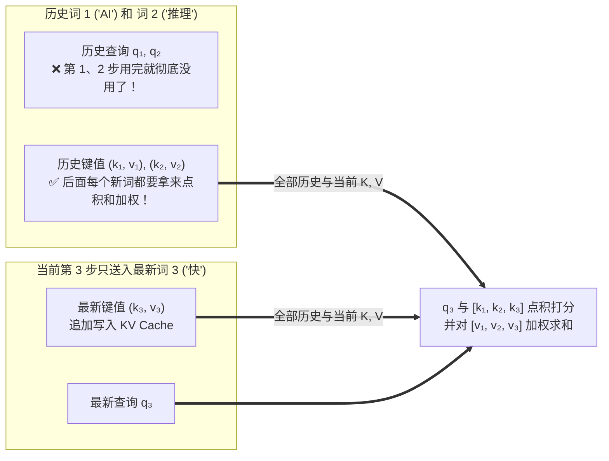

# 1.3 KV Cache 与 Prefill / Decode：用空间换时间的艺术

## 学习目标

完成本节学习后，你将能够：
- **从注意力矩阵的每一行出发，彻底讲清楚为什么只需要缓存 K 和 V，而绝对不需要缓存 Q**。
- **算清开启 KV Cache 前后的计算复杂度账本**：明白它是如何把生成 $n$ 个词的总计算量从 $O(n^2)$ 降到 $O(n)$ 的。
- **准确区分 Prefill（预填充）与 Decode（解码）两个阶段的工程特征**，并能根据业务是“长输入短输出”还是“短输入长输出”开出正确的优化药方。
- **使用 Hugging Face 的 `past_key_values` 改造 1.2 节的手写循环**，实测数倍提速。

---

## 1. 我们在 1.2 节到底浪费了什么？

在上一节（`1.2`）中，我们用 15 行代码跑通了自回归生成循环，但发现了一个致命缺陷：**生成第 100 个词时，我们要把前 99 个词连同第 100 个词一起塞进模型，从头算一遍。**

让我们用放大镜看看，当序列从 2 个词 `["AI", "推理"]` 增长到 3 个词 `["AI", "推理", "快"]` 时，模型内部到底有哪些计算是完全重复的：

1. **在 RMSNorm、QKV 线性投影和 MLP 层**：这些层全都是**逐个 Token 独立计算（Token-wise）**的！`"AI"` 和 `"推理"` 算出来的隐藏向量、Query、Key、Value，在第 2 步和第 3 步里**连小数点后第 10 位都一模一样**。
2. **在唯一的跨词交互层——因果自注意力（Causal Self-Attention）**：
   我们在 `1.1` 节学过，因为有因果掩码（Causal Mask），位置 1 的 `"AI"` 只能看自己，位置 2 的 `"推理"` 只能看 `"AI"` 和 `"推理"`。哪怕第 3 步后面新来了第 3 个词 `"快"`，前两个词算出来的注意力输出也**纹丝不动**！

换句话说，在第 3 步里，前两个词在全部 36 层网络里的所有计算，**100% 都是在做无用功**！我们真正需要算的，只有最新进来的第 3 个词 `"快"`！

---

## 2. 核心心智模型：为什么只缓存 K 和 V，不缓存 Q？

既然我们决定在第 3 步只把最新词 `"快"`（记为位置 3，长度 $M=1$）送进模型，那么当 `"快"` 走到每一层的自注意力模块时，它需要什么数据才能算出自己在第 3 行的注意力结果呢？

让我们写出第 3 个词计算注意力的精确公式：

$$
\text{Attention}_3 = \sum_{j=1}^{3} \text{softmax}_j\!\left(\frac{\mathbf{q_3} \cdot \mathbf{k_j}^\top}{\sqrt{d_h}}\right) \mathbf{v_j}
$$

请仔细看这个式子里用到了谁，没用到谁：



- **为什么不需要缓存历史的 $q_1, q_2$？**
  因为 $q_1, q_2$ 代表的是第 1 个词和第 2 个词作为“提问者”去查询别人的向量，这一步早在前面就已经算完并吐出词了。现在轮到第 3 个词 `"快"` 当“提问者”，只需要用它自己的 **$\mathbf{q_3}$** 去向所有人提问！
- **为什么必须缓存所有历史词的 $(k_1, v_1), (k_2, v_2)$？**
  因为新词 `"快"` 需要知道前面所有词讲了什么，所以它的 $\mathbf{q_3}$ 必须和前面每一个词的 Key（$k_1, k_2, k_3$）做点积打分，再把前面每一个词的 Value（$v_1, v_2, v_3$）按权重加起来！

**这就是 KV Cache 的全部秘密**：
每算完一步，我们把新生成的词在每一层算出的 $k$ 和 $v$ 向量追加保存在显存的“草稿本（KV Cache）”里；下一步只需要向模型输入 **最新生成的 1 个 Token**，算出它的 $q_{\text{new}}, k_{\text{new}}, v_{\text{new}}$，把 $k_{\text{new}}, v_{\text{new}}$ 贴到草稿本末尾，然后用 $q_{\text{new}}$ 翻阅整本草稿本即可！

---

## 3. 交互式沙盒：一步步播放无缓存 vs 开启 KV Cache 的矩阵复用

点击下方动画器右上角的 **「下一步生成 ▶」** 按钮，直观对比在生成 3 个新词的过程中，左边（无 KV Cache）和右边（开启 KV Cache）每一层到底算了多少行数据：

<div class="llm-widget" data-widget="kv-cache-animator"></div>

### 算一笔定量账：KV Cache 到底省了多少计算量？

设输入 Prompt 长度为 $s$，需要连续生成 $n$ 个新 Token，模型参数量为 $P$：

| 方案 | 生成第 $k$ 个词时送入模型的 Token 数 | 第 $k$ 步线性层计算量 | 生成全部 $n$ 个词的总线性层计算量 |
|---|---|---|---|
| **❌ 无 KV Cache** | $s + k$ 个（从头重算） | $2P(s + k)$ | $$\sum_{k=1}^{n} 2P(s+k) \approx 2P\left(s \cdot n + \frac{n^2}{2}\right) \quad \mathbf{O(n^2)}$$ |
| **✅ 开启 KV Cache** | **永远只有 1 个！** | **$2P \times 1$** | $$2P \cdot s \text{ (Prefill)} + \sum_{k=1}^{n} 2P \cdot 1 = \mathbf{2P(s + n)} \quad \mathbf{O(n)}$$ |

举个具体数字：如果 $s = 2000$，生成 $n = 1000$ 个词：
- **无 KV Cache**：一共要算 $2000 \times 1000 + 1000^2 / 2 = \mathbf{2,500,000}$（250 万）个 Token 的线性层前向！
- **有 KV Cache**：一共只需要算 $2000 + 1000 = \mathbf{3,000}$ 个 Token 的线性层前向！**计算量整整减少了 833 倍！**

---

## 4. Prefill 与 Decode：一对性格截然相反的双胞胎

一旦开启了 KV Cache，任何一个请求的执行过程就自然而然地劈成了两个性质完全不同的阶段——**Prefill（预填充阶段）** 与 **Decode（解码阶段）**：

```mermaid
gantt
  title 单个请求开启 KV Cache 后的两阶段执行时间线
  dateFormat X
  axisFormat %s
  section 1. Prefill 阶段
  并行处理全部 s 个 Prompt 词，填满初始 KV Cache，吐出第 1 个词 :a1, 0, 4s
  section 2. Decode 阶段
  第 1 步 (只喂入第 1 个生成词，追加 1 行 KV，吐出第 2 个词) :a2, after a1, 1s
  第 2 步 (只喂入第 2 个生成词，追加 1 行 KV，吐出第 3 个词) :a3, after a2, 1s
  第 3 步 …… 直到遇到 EOS 结束 :a4, after a3, 3s
```



把这一节和第 0 部分的 `0.3 显存估算`、`0.4 Roofline`、`0.5 性能指标` 串起来，你就得到了整门推理优化课最重要的一张总表：

| 对比维度 | 第一阶段：Prefill（预填充） | 第二阶段：Decode（自回归解码） |
|---|---|---|
| **送入模型的输入形状** | `[1, s]`（一次性并行送入全部 $s$ 个 Prompt Token） | `[1, 1]`（每次只送入上一步刚生成的 **1 个** 新 Token） |
| **对 KV Cache 做什么** | 一次性算出全部 $s$ 个词的 K、V，**批量写入**显存缓存 | 算出当前 1 个新词的 K、V 追加写入，并**把前面全部缓存读出来**算注意力 |
| **执行次数** | 每个请求**只执行 1 次** | 生成 $N$ 个词就要**循环执行 $N-1$ 次** |
| **算术强度与硬件瓶颈（`0.4`）** | $I \approx s$（大矩阵乘大矩阵）$\to$ **计算受限（Compute-bound）** | 单流 $I \approx 1$（向量乘大矩阵）$\to$ **显存带宽受限（Memory-bound）** |
| **直接决定哪个指标（`0.5`）** | **TTFT（首 Token 延迟）** | **TPOT / ITL（吐字速度与流畅度）** |
| **对应的核心优化手段** | 前缀缓存跳过重复计算（`1.7`）、FP8 算力加速（`2.5`）、FlashAttention（`3.2`） | 连续批处理提高 $b$（`1.5`）、权重量化省带宽（第 2 部分）、投机解码一次猜多词（`3.4`） |

### 工程实战指南：先看你的业务属于哪一类！
- **Prefill 主导型业务**（长输入、短输出，如：上传 50 页 PDF 做总结、RAG 知识库检索问答、代码库理解）：90% 的时间花在 Prefill 上，重点优化 **Prefix Caching（前缀缓存）** 和 **算力利用率**。
- **Decode 主导型业务**（短输入、超长输出，如：日常对话聊天、写长篇小说、DeepSeek-R1 / Qwen3 思维链长推理）：95% 的时间花在几千步 Decode 循环上，重点优化 **Continuous Batching**、**权重量化/KV 量化** 与 **投机采样**。

---

## 5. 代码改造：只需改 3 行，给 1.2 节的手写循环加上 KV Cache

在 Hugging Face Transformers 中，模型前向传播支持传入 `use_cache=True` 和 `past_key_values`。我们只需要对 `1.2` 节的代码做 **3 处微小改动**，就能立刻激活 KV Cache：

```python
import time, torch
from transformers import AutoModelForCausalLM, AutoTokenizer

name = "Qwen/Qwen3-0.6B"
tok = AutoTokenizer.from_pretrained(name)
model = AutoModelForCausalLM.from_pretrained(name, torch_dtype=torch.bfloat16).cuda().eval()

# 初始输入：完整的 Prompt（将在 step=0 时做 Prefill）
curr_input = tok("Write a short introduction about Beijing.", return_tensors="pt").input_ids.cuda()
generated_ids = curr_input.clone()
past_kv = None  # 用来保存每一层的 (K, V) 缓存元组
step_times = []

for step in range(100):
    t0 = time.perf_counter()
    with torch.no_grad():
        # 【改动 1】传入 past_key_values，并开启 use_cache=True
        out = model(input_ids=curr_input, past_key_values=past_kv, use_cache=True)

    # 【改动 2】拿到模型追加更新后的最新 KV Cache，供下一步复用
    past_kv = out.past_key_values

    probs = torch.softmax(out.logits[:, -1, :], dim=-1)
    next_id = torch.multinomial(probs, num_samples=1)
    generated_ids = torch.cat([generated_ids, next_id], dim=1)

    # 【改动 3】下一步只把最新生成的这 1 个 Token（形状 [1, 1]）送进模型！
    curr_input = next_id

    torch.cuda.synchronize()
    step_times.append(time.perf_counter() - t0)
    if next_id.item() == tok.eos_token_id:
        break

print(tok.decode(generated_ids[0], skip_special_tokens=True))
```

### 对比实验结果：从“越来越慢”变成“水平直线”！

当你运行这段加了 KV Cache 的代码并打印 `step_times` 时，你会观察到一个截然不同的耗时分布：
- **第 0 步（Prefill）**：耗时略长（比如 `25 ms`），因为一次性处理了整段 Prompt。
- **第 1 步到第 100 步（Decode）**：每一步耗时都稳定在 **`6 ms` 左右，画出来是一条平坦的水平线**，不再随生成长度陡增！

---

## 6. 埋下伏笔：KV Cache 解决了计算浪费，却捅了哪四个马蜂窝？

天下没有免费的午餐。KV Cache 用**显存空间**换取了**计算时间**，但也顺手把推理系统推进了四个全新的深坑——这正是接下来 `1.4 ~ 1.7` 节以及第 4 部分要逐个解决的核心课题：

1. **显存容量爆炸（`0.3` 节已算过）**：KV Cache 动辄吃掉几十 GB 显存，限制了最大并发数。
2. **显存碎片危机（`1.6 PagedAttention`）**：由于事先不知道每个请求会生成多少个词，如果按最大长度（如 32K）提前圈一块连续显存，60%–80% 的空间都在空置浪费！
3. **跨请求重复计算（`1.7 Prefix Caching`）**：100 个用户都在用同一段 2000 字的 System Prompt 提问，难道这 2000 字的 KV Cache 要在显存里算 100 遍、存 100 份吗？
4. **Prefill 与 Decode 互相打架（`1.5 Chunked Prefill` & `4.3 PD 分离`）**：算力受限的 Prefill 和带宽受限的 Decode 混在一张卡上跑，怎么防止长 Prefill 卡死正在流式输出的 Decode？

---

## 7. 闯关自测

<div class="llm-widget" data-widget="quiz" data-title="1.3 KV Cache 与 Prefill / Decode · 闯关自测" data-questions='[
  {
    "q": "在开启 KV Cache 的自回归生成中，为什么我们只把历史 Token 在每一层的 Key (K) 和 Value (V) 缓存在显存里，而不缓存历史 Token 的 Query (Q)？",
    "options": [
      "因为 Q 向量全是整数，不占显存",
      "因为在 Decode 第 t 步时，只需要拿当前最新 Token 的查询向量 q_t 去和所有历史及当前的 [k_1..k_t]、[v_1..v_t] 计算注意力；历史 Token 的 q_1..q_{t-1} 早在它们各自生成的步骤中就已经用完并寿终正寝了",
      "因为 Q 向量等于 K 向量加上 V 向量，可以随时算出来",
      "因为 GPU 显存只支持存放两个张量"
    ],
    "answer": 1,
    "explain": "因果注意力中，每一步只有最新位置的 Token 扮演“提问者（Query）”，去查询包括自己在内的所有位置（Keys & Values）。已经过去的位置不会再次提问，因此它们的 Q 用完即弃。"
  },
  {
    "q": "某业务场景是“智能合同审查”：用户每次上传一份 15,000 Token 的长合同，让模型只输出一个词（“合规”或“有风险”）。在这个场景下，KV Cache 对降低单次请求的耗时帮助大吗？最该优化哪个阶段？",
    "options": [
      "帮助极大，能提速 100 倍以上",
      "帮助极小！因为只输出 1~2 个 Token，几乎没有 Decode 循环步数；99% 的耗时都在 15,000 Token 的 Prefill 阶段，应该重点优化算力利用率和公共模板的 Prefix Caching",
      "会导致模型无法输出中文",
      "应该把 Batch Size 调到 1024 来降低单次请求延迟"
    ],
    "answer": 1,
    "explain": "KV Cache 省下的是 Decode 阶段每一步重复算历史 Token 的时间。如果只生成 1 个词，一共只有 1 次 Prefill，根本没有后续 Decode 步，KV Cache 省不下计算时间。"
  },
  {
    "q": "已知某次流式对话请求的 TTFT = 400 ms，TPOT = 25 ms/token，一共生成了 201 个输出 Token。请问 Prefill 阶段和 Decode 阶段大约各占端到端总时间（E2E）的百分之多少？如果想把 E2E 总耗时缩短 30%，必须从哪个阶段下手？",
    "options": [
      "Prefill 占 80%，Decode 占 20%；必须优化 Prefill",
      "E2E 总耗时 = 400 + 25 × 200 = 5400 ms；其中 Prefill (400ms) 仅占 7.4%，Decode (5000ms) 占了 92.6%！哪怕把 Prefill 优化到 0 ms 也省不出 30%，必须从 Decode 阶段（如量化、投机采样）下手",
      "两者各占 50%",
      "无法计算"
    ],
    "answer": 1,
    "explain": "做性能调优前一定要先用阿姆达尔定律（Amdahl Law）算占比：Decode 占了 92.6% 的总时长，是绝对的大头，优化 Decode 才能带来显著的 E2E 收益。"
  }
]'></div>

---

## 延伸阅读与参考文献

- Reiner Pope et al., [*Efficiently Scaling Transformer Inference*](https://arxiv.org/abs/2211.05102), MLSys 2023（系统剖析了 Prefill 与 Decode 两阶段的不同硬件瓶颈与扩展规律）
- Chi Wang & Peiheng Hu, *Hands-On LLM Serving and Optimization*, O'Reilly, Chapter 2 (*Enable the KV Cache to Boost Performance*)
