# 1.3 KV Cache 与 Prefill / Decode

> 对应书中第 2 章 Enable the KV Cache to Boost Performance、The Prefill and Decode Phases

## 学习目标

- 解释为什么只缓存 K 和 V、不缓存 Q，以及 KV Cache 把每步计算量从多少降到了多少。
- 区分 prefill 与 decode 两个阶段的计算特征，并说出它们分别决定哪个延迟指标。
- 用 Hugging Face 的 `past_key_values` 手动实现带缓存的生成，测出提速比例。

## 1. 重复计算在哪里

1.2 节的循环中，第 $k$ 步要把长度为 $s + k$ 的完整序列送进模型。但因果注意力下，前面 $s + k - 1$ 个 token 在每一层的 $K$、$V$ 与上一步完全相同（1.1 节）。真正新的只有最后一个 token。

注意力中，新 token 需要：

- 自己的 $q$：只用于本步，算完就不再需要。
- 所有历史 token 的 $K$、$V$：每一步都要用。

所以只需要缓存 $K$ 和 $V$。每一步只把新 token 送进模型，算出它的 $q, k, v$，把 $k, v$ 追加到缓存中，再用 $q$ 和缓存中的全部 $K, V$ 计算注意力。

## 2. 计算量对比

设 prompt 长度为 $s$，已生成 $k$ 个 token，参数量为 $P$：

| | 第 $k$ 步线性层计算 | 第 $k$ 步注意力计算 | 生成 $n$ 个 token 的总线性层计算 |
|---|---|---|---|
| 无缓存 | $2P(s + k)$ | $\propto (s + k)^2$ | $\approx 2P\,(sn + n^2/2)$ |
| 有缓存 | $2P$ | $\propto s + k$ | $\approx 2P\,(s + n)$ |

用显存（缓存）换计算。代价是 KV Cache 的显存随上下文线性增长（0.3 节），这是之后几乎所有显存管理问题的来源。

## 3. 用 Hugging Face 实现

书中的例 2-2 的核心改动只有三处：

```python
past = None
inp = tok(prompt, return_tensors="pt").input_ids.cuda()
for _ in range(100):
    with torch.no_grad():
        out = model(input_ids=inp, past_key_values=past, use_cache=True)   # (1) 传入缓存
    past = out.past_key_values                                           # (2) 更新缓存
    nxt = torch.multinomial(torch.softmax(out.logits[:, -1, :], -1), 1)
    inp = nxt                                                            # (3) 下一步只送入新 token
    if nxt.item() == tok.eos_token_id:
        break
```

书中的结果：同样生成 100 个 token，无缓存 9.12 s，有缓存 3.14 s。更关键的是耗时分布的形状变了：

- 无缓存时，每个 token 的耗时随长度上升。
- 有缓存时，第一个 token 明显较慢，之后的 token 耗时短而平稳。

> [!NOTE]
> 这个例子的模型只有 0.5B，序列也短，GPU 上大部分时间花在 Python 和 kernel 启动开销上，所以只提速约 3 倍。模型越大、序列越长，差距越大。

## 4. Prefill 与 Decode

有了 KV Cache，一个请求的执行自然分成两段：

```mermaid
gantt
  dateFormat X
  axisFormat %s
  section 请求
  Prefill（一次处理全部 prompt，生成第 1 个 token） :a1, 0, 6s
  Decode 1 :a2, after a1, 1s
  Decode 2 :a3, after a2, 1s
  Decode 3 :a4, after a3, 1s
  Decode … :a5, after a4, 3s
```



| | Prefill | Decode |
|---|---|---|
| 输入 | 全部 prompt token（$s$ 个） | 1 个新 token |
| 做什么 | 计算所有 prompt token 的 K、V 写入缓存；输出第一个 token | 读取缓存，输出下一个 token，追加一份 K、V |
| 次数 | 每个请求 1 次 | 每个输出 token 1 次 |
| 瓶颈（0.4 节） | 序列足够长时受算力限制 | 受显存带宽限制 |
| 对应指标（0.5 节） | TTFT | TPOT / ITL |

书中的建议是先判断负载以哪个阶段为主：

- **prefill 为主**：长输入、短输出，例如对几百页 PDF 做摘要、RAG、分类打分。优化方向是加快计算、复用前缀（1.7）。
- **decode 为主**：短输入、长输出，例如聊天、写作、推理模型的长思考。优化方向是批处理（1.5）、减少访存（量化、GQA）、投机解码（3.4）。

## 5. KV Cache 带来的新问题

KV Cache 解决了计算的浪费，但引入了服务系统的核心难题：

1. **容量**：KV 随上下文和并发线性增长，经常比权重还大（0.3 节）。
2. **分配**：输出长度事先未知。按最大长度预留会大量浪费，按需增长又会产生碎片。PagedAttention 用分页解决这个问题（1.6 节）。
3. **复用**：多轮对话、共享系统提示词的请求之间，前缀部分的 KV 是相同的，可以共享（1.7 节）。
4. **迁移**：PD 分离时，KV 要从 prefill 节点传到 decode 节点；KV 也可以卸载到 CPU 或 SSD（4.3、4.4 节）。

## 动手实验

**实验 1：复现书中的对比。** 在同一个 prompt 上分别运行 1.2 节的无缓存循环和本节的有缓存循环，各生成 200 个 token，记录每个 token 的耗时：

| | 总耗时 | 第 1 个 token | 第 2–200 个 token 平均 | 第 200 个 token |
|---|---|---|---|---|
| 无缓存 | | | | |
| 有缓存 | | | | |

**实验 2：TTFT 与 prompt 长度的关系。** 用 vLLM 启动 Qwen3-0.6B，分别发送长度为 128、512、2K、8K、32K 的 prompt，每次只生成 1 个 token，记录 TTFT。画出曲线，判断从哪个长度开始明显超线性增长（注意力的 $s^2$ 项开始显著）。

```bash
for n in 128 512 2048 8192 32768; do
  python code/project1/bench.py --base-url http://localhost:8000 --model Qwen/Qwen3-0.6B \
    --num-prompts 5 --input-len $n --output-len 1 --max-concurrency 1 --vocab-size 32000 | grep ttft
done
```

## 自测题

1. 为什么不缓存 Q？
2. 生成第 1 个 token 和第 2 个 token，前向的输入分别是什么？
3. 长 prompt、短输出的场景下，KV Cache 对总耗时的帮助大吗？
4. 已知 TTFT = 400 ms，TPOT = 25 ms，输出 200 个 token。prefill 和 decode 各占总时间多少？想把 E2E 降低 30%，优先优化哪一段？

<details>
<summary>参考答案</summary>

1. 每个 token 的 $q$ 只在它自己作为"提问者"时使用一次；之后的 token 只需要和历史 token 的 $k$、$v$ 交互，不需要历史的 $q$。
2. 第 1 个 token 来自 prefill，输入是完整 prompt；第 2 个 token 是第一次 decode，输入只有第 1 个输出 token，加上缓存。
3. 不大。输出只有几个 token 时，decode 步数少，省下的重复计算有限，总耗时主要是 prefill。此时更有效的是前缀缓存和加快 prefill 本身。
4. E2E ≈ 400 + 25 × 199 ≈ 5375 ms，prefill 约 7%，decode 约 93%。降低 30% 必须从 decode 入手，例如量化、投机解码，或降低批大小以缩短 TPOT。

</details>

## 延伸阅读

- Pope et al., *Efficiently Scaling Transformer Inference*, MLSys 2023（系统分析了 prefill / decode 的性能特征）
- Hugging Face 文档中关于 `Cache` 类（`DynamicCache`、`StaticCache`）的说明
