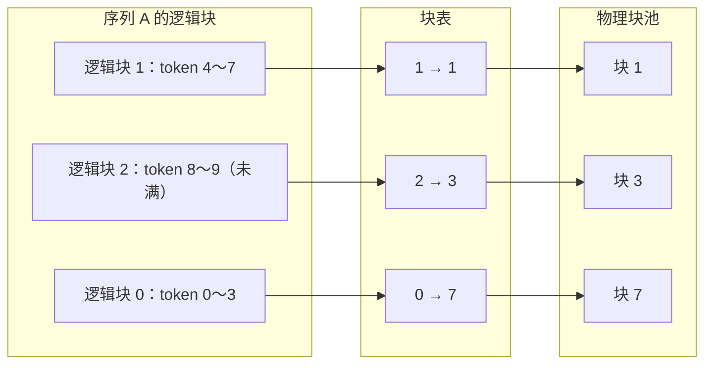
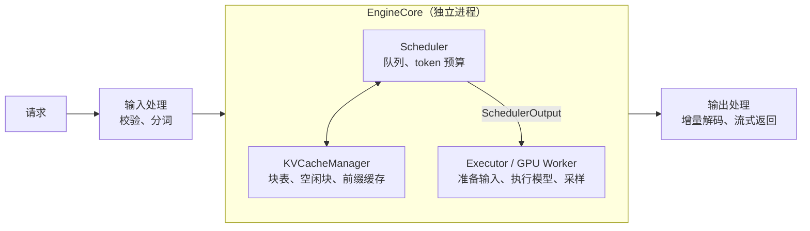

# 1.3 PagedAttention 与 vLLM 调度器

> 对应原书第 6 章 *Scalable Attention Mechanisms* 中关于 PagedAttention 的部分，以及第 8 章 *vLLM* 一节。

连续批处理让序列可以随时加入、随时离开，KV Cache 的管理也必须跟上：每个序列的长度在不断增长，最终长度事先不知道，结束时间也各不相同。这一节先看传统的连续分配方式浪费了多少显存，再介绍 vLLM 的分页管理方法 PagedAttention，最后读一读 vLLM V1 的调度器，它用一个很简单的规则统一了 prefill、chunked prefill、decode、前缀缓存和抢占。

## 1. 连续分配的浪费

PyTorch 的张量要求占用一段连续的显存。早期的推理系统因此为每个请求按最大长度预先分配一段连续的 KV Cache，比如每个请求都留出 2048 个位置。

这会造成三种浪费：

| 浪费 | 来源 |
|---|---|
| 预留 | 请求才生成到第 100 个 token，第 101～2048 个位置已经被占住，别的请求不能用 |
| 内部碎片 | 请求在第 50 个 token 就结束了，预留的其余位置从头到尾没有用过 |
| 外部碎片 | 大小不一的连续块反复分配、释放之后，显存里留下许多零散的空隙，加起来够用，但拼不出一段足够长的连续空间 |

vLLM 论文测量了当时的几个系统：KV Cache 显存中真正存放了有效数据的只有 20.4%～38.2%，六成以上被浪费。0.6 节算出一张卡能并发 88 个请求，前提是每个请求都用满最大长度；连续分配的问题恰好相反，它让每个请求无论实际多长，都占用最大长度的空间。

## 2. PagedAttention

vLLM 借用了操作系统虚拟内存分页的思路：KV Cache 不再要求连续存放。

- 把整个 KV Cache 显存池切成大小相同的**物理块**，每块存放固定数量的 token，比如 16 个（block size）。
- 每个序列的 KV 按顺序分成若干**逻辑块**：第 0～15 个 token 是逻辑块 0，第 16～31 个是逻辑块 1，以此类推。
- 每个序列有一张**块表**（block table），记录每个逻辑块对应哪个物理块。
- 序列增长到需要新的逻辑块时，才从空闲列表里取一个物理块。序列结束时，把它的物理块全部还回去。



（图中块大小取 4，便于画图。）

这样做之后：

1. **没有预留。** 只在需要时分配，序列多长就占多少块。
2. **内部碎片最多一块。** 浪费只发生在每个序列的最后一块里没填满的部分。块大小为 16 时，平均每个序列浪费 7.5 个位置。
3. **没有外部碎片。** 所有块大小相同，任何释放出来的块都能分给任何序列。
4. **可以共享。** 两个序列有相同的开头时，它们的块表可以指向同一个物理块。这是下一节前缀缓存的基础。

论文报告，这让 vLLM 的 KV Cache 浪费降到 4% 以下，同样的显存能放下更多的序列，吞吐比当时的系统高 2～4 倍。

代价是注意力的计算变复杂了：一个序列的 K、V 散落在不连续的物理块里，注意力 kernel 必须先查块表，再去对应的位置读取。这就是"PagedAttention"这个名字的由来，它首先是一个能按块表读取 KV 的注意力 kernel。现在 FlashAttention、FlashInfer 等主流注意力库都支持这种分页的 KV 布局。

### 2.1 槽位

实现时，常把块号和块内偏移合成一个**槽位**（slot）编号：

$$
\text{slot} = \text{block\_table}[\lfloor \text{pos} / B \rfloor] \times B + (\text{pos} \bmod B)
$$

其中 pos 是 token 在序列中的位置，$B$ 是块大小。

举个例子：$B = 4$，序列 A 的块表是 `[1, 4, 7]`，要写入位置 5 的 K、V。位置 5 属于逻辑块 $5 \div 4 = 1$（取整），对应物理块 4；块内偏移 $5 \bmod 4 = 1$。所以槽位是 $4 \times 4 + 1 = 17$。

如果把 KV Cache 存成一个 `[num_blocks × B, n_kv, d_h]` 的大张量，槽位就是第一维的下标，写入和读取都可以用一次高级索引完成。项目 1 的 MiniServe 就是这样存的，`_prepare_inputs()` 的主要工作之一就是为这一步的每个 token 算出槽位。

下面的组件逐步模拟一个只有 12 个物理块（块大小为 4）的池子。三个序列先后到达，不断增长，直到块不够用时发生抢占。

<div class="llm-widget" data-widget="paged-kv"></div>

## 3. 抢占

分页管理让并发数可以按实际长度计算，但也带来一个新问题：调度器接收一个请求时，并不知道它最终要多少块。可能运行到一半，空闲块就用完了。

这时调度器必须**抢占**（preempt）某个正在运行的序列，把它的块腾出来。vLLM 和 MiniServe 选择最晚加入的那个序列，因为它已经完成的计算最少，用户等待的时间也最短。

被抢占的序列怎么办？有两种做法：

- **重算**（recompute）：直接丢掉它的全部 KV Cache，把它放回等待队列的最前面。之后重新调度时，把 prompt 和已经生成的 token 合在一起当作一个新的 prompt，重新 prefill。vLLM V1 和 MiniServe 都用这种方式。
- **换出**（swap）：把它的 KV Cache 拷贝到 CPU 内存，之后再拷回来。vLLM 早期版本支持，V1 去掉了，因为在 PCIe 带宽下，重新 prefill 通常比来回拷贝更快。

无论哪种方式，被抢占的序列都会有一段时间没有输出，ITL 出现一个尖峰。抢占次数是监控中值得关注的指标：频繁抢占说明并发数设得太高，或者 KV Cache 太小。

## 4. vLLM V1 的结构

vLLM 在 2025 年初发布了重写过的 V1 引擎，现在是默认版本。它的主要组件如下：



API 服务和输入、输出处理运行在一个进程里，EngineCore 运行在另一个进程里，两者通过 ZeroMQ 通信（1.1 节）。

**显存测算。** 0.6 节提到，vLLM 启动时不估计激活要占多少显存，而是实际跑一次：加载权重后，构造一个 token 数达到 `max_num_batched_tokens` 的假输入，执行一次前向，记录显存峰值。然后用 $\text{总显存} \times$ `gpu_memory_utilization` $-$ 权重 $-$ 峰值激活，把剩下的空间全部切成 KV 块。MiniServe 的 `_profile_num_blocks` 做的是同样的事。

> [!NOTE]
> 原书第 8 章介绍模型加载时，说 `Qwen2.5-7B` 会匹配到 `Qwen3NextForCausalLM`，示例代码中还用了 `Qwen/Qwen3-7B-Instruct`。实际上，Qwen2.5 的 `config.json` 里 `architectures` 是 `Qwen2ForCausalLM`；Qwen3 的稠密模型只有 0.6B、1.7B、4B、8B、14B、32B 几种尺寸，没有 7B。读源码或做实验时，以模型仓库中的 `config.json` 为准。

## 5. 调度器：一个减法统一所有情况

直觉上，调度器应该有很多分支：这个请求在 prefill 还是 decode，prompt 是不是要切块，有没有命中前缀缓存。vLLM V1 的调度器却不区分这些。它只为每个序列维护两个数：

- `num_tokens`：这个序列目前已知的 token 总数，即 prompt 长度加上已经生成的 token 数；
- `num_computed_tokens`：其中已经算过、K 和 V 已经写进 KV Cache 的 token 数。

每一步，这个序列要处理的 token 数就是两者之差，再受剩余预算的限制：

$$
\text{num\_new} = \min(\text{budget},\ \text{num\_tokens} - \text{num\_computed\_tokens})
$$

这个式子覆盖了所有情况（预算均为 512）：

| 情况 | num_tokens | num_computed | 本步处理 | 之后 |
|---|---|---|---|---|
| 新请求，prompt 100 个 token | 100 | 0 | 100 | 已算 100，追上了总数，采样出第一个 token，总数变为 101 |
| 新请求，prompt 1000 个 token | 1000 | 0 | 512 | 已算 512，还没追上，不采样；下一步处理剩下的 488 个 |
| decode | 101 | 100 | 1 | 已算 101，采样，总数变为 102 |
| prompt 100 个，前缀缓存命中 80 个 | 100 | 80 | 20 | 只算后 20 个 |
| 被抢占后重新调度，已有 150 个 | 150 | 0 | 150 | 相当于把 150 个 token 当作 prompt 重新 prefill |

规则只有一条：一个序列的已算数追上总数时，用最后一个位置的 logits 采样，生成一个新 token。prefill 和 decode 的区别，只是这一步要处理的 token 数不同。

### 5.1 每一步的顺序

每次调度分两个阶段：

1. **先处理正在运行的序列。** 按加入的先后顺序，为每个序列计算本步要处理的 token 数，检查需不需要新的块。如果空闲块不够，就从运行队列的末尾开始抢占，直到够用为止。
2. **再接收新请求。** 如果这一步没有发生抢占，并且预算和序列数都还有剩余，就从等待队列的头部依次接收新请求。

先运行后等待的顺序很重要。运行中的序列已经占着 KV Cache，用户正在看它的输出。如果先接收新请求，块可能被新请求占去，接着就要抢占老序列，已经做过的计算被浪费，用户还会看到输出停顿。发生了抢占的那一步不再接收新请求，也是同样的道理：抢占说明显存已经紧张了。

MiniServe 的 [`scheduler.py`](https://github.com/zrpxx/hands-on-llm-serving-opt/blob/main/code/project1/solution/miniserve/scheduler.py) 不到 160 行，结构与 vLLM V1 的 `vllm/v1/core/sched/scheduler.py` 相同：`_schedule_running` 对应第一阶段，`_admit` 对应第二阶段，`_preempt` 实现重算式抢占。

## 6. 实验

### 6.1 用 trace 工具观察调度

项目 1 提供了一个工具，逐步打印调度器的决策和每个序列的状态。不给 `--model` 时只运行调度器，不需要模型和 GPU：

```bash
cd code/project1
python tools/trace.py --impl solution --prompts 6,5,9 --arrive 1,1,3 \
    --max-tokens 10 --blocks 8 --block-size 4 --budget 16
```

三个序列的 prompt 长度分别是 6、5、9，C 在第 3 步到达；一共只有 8 个块，每块 4 个 token。输出的每一行是一个序列在这一步的状态：阶段（prefill、切块的 prefill 或 decode）、本步处理的 token 数、`num_computed_tokens` 的变化、总长度和块表。第 5 步可以看到 C 被抢占，它的块被 B 拿走；之后 C 一直在等待，直到有足够的块才重新 prefill。

### 6.2 在 vLLM 上制造抢占

在 GPU 上启动 vLLM 时把 `--gpu-memory-utilization` 调低，只留很少的 KV 块，然后用较高的并发发送一批长输出的请求。在另一个终端查看指标：

```bash
curl -s http://localhost:8000/metrics | grep -E "num_preemptions|cache_usage|num_requests_(running|waiting)"
```

抢占次数开始增长时，对照压测结果中 TPOT 和 ITL 的 P99，看它们是否同时变差。

## 自测

<div class="llm-widget" data-widget="quiz" data-questions='[{"q": "块大小 &#36;B = 4&#36;，序列的块表是 <code>[6, 3, 8]</code>。位置 9 的 K、V 应该写入哪个槽位？", "options": ["9", "13", "32", "33"], "answer": 3, "explain": "位置 9 在逻辑块 &#36;\\lfloor 9/4 \\rfloor = 2&#36;，块表[2] = 8，块内偏移 &#36;9 \\bmod 4 = 1&#36;，槽位 &#36;8 \\times 4 + 1 = 33&#36;。13 是误用了块表[1]；32 漏掉了块内偏移；9 是把位置直接当成了槽位。"}, {"q": "把块大小设得很小（例如 1）或很大（例如 512），分别有什么问题？", "options": ["很小时浪费显存，很大时降低 KV 的数值精度", "很小时块表很长、访存零散；很大时最后一块平均浪费一半，碎片又出现了", "两者都没有影响，块大小只决定统计的粒度", "很小时不能用 GQA，很大时不能用 chunked prefill"], "answer": 1, "explain": "块大小是寻址开销和内部碎片之间的折中。块越小，kernel 要查的表越长，每次读取的数据越零碎；块越大，每个序列最后一块的平均浪费越多，前缀缓存的共享粒度也越粗。16 是常见的默认值。"}, {"q": "prompt 有 600 个 token，每步预算 256，开启 chunked prefill。第一步结束后，这个序列的状态是什么？", "options": ["已算 600，并采样出第一个 token", "已算 256，并用第 256 个位置的 logits 采样一个 token", "已算 0，prompt 超过预算，要等预算够时一次算完", "已算 256，这一步不采样"], "answer": 3, "explain": "只有已算的 token 数追上总数时，最后一个位置的 logits 才是下一个 token 的分布。按 256、256、88 分三步，第三步结束时才采样出第一个输出 token。"}, {"q": "调度器每一步为什么先处理正在运行的序列，再接收等待中的新请求？", "options": ["等待中的请求还没有分词，不能立即调度", "这样能保证每一步的 token 数恰好等于预算", "运行中的序列已占着 KV Cache、用户正在看输出，先接新请求可能逼出抢占", "新请求的 prefill 必须排在 decode 之后，否则掩码会出错"], "answer": 2, "explain": "如果新请求先占走了块，运行中的序列可能因为块不够而被抢占，已做的计算被浪费，用户也会看到输出停顿。prefill 和 decode 放在同一批里时顺序与正确性无关，元数据会区分它们。"}]'></div>

## 延伸阅读

- 原书第 6 章 *Scalable Attention Mechanisms*，第 8 章 *vLLM*（*Architecture*、*Generation-Request Execution Workflow*、*Scheduler Deep Dive*）。
- Kwon et al., [Efficient Memory Management for Large Language Model Serving with PagedAttention](https://arxiv.org/abs/2309.06180), SOSP 2023。
- Gordić, [Inside vLLM: Anatomy of a High-Throughput LLM Inference System](https://www.aleksagordic.com/blog/vllm), 2025。逐个组件解读 vLLM V1 的源码。
