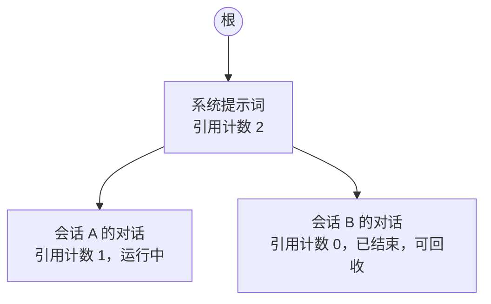
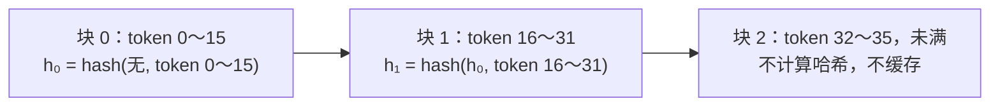

# 1.4 前缀缓存

> 对应原书第 6 章 *Prefix Caching*：RadixAttention、使用场景、最佳实践与扩展。

0.4 节的 KV Cache 只在一个请求内部复用计算结果。很多请求之间其实也有大段相同的输入：同样的系统提示词，同一个会话里之前几轮的对话，同一份被反复提问的文档。这些部分的 KV Cache 如果能留下来给后续请求使用，就能省掉大量 prefill。这就是**前缀缓存**（prefix caching）。

这一节说明为什么只有前缀能复用，介绍 SGLang 和 vLLM 的两种实现，然后讨论怎样组织 prompt 才能提高命中率，以及前缀缓存在多副本和多租户场景下的问题。

## 1. 缓存整个请求为什么没有用

传统 Web 服务常把"完整请求 → 响应"存进 Redis。LLM 服务很少这样做：两个请求哪怕只差一个标点，也不会命中；而且只要 `temperature > 0`，同一个请求每次的回答本来就应该不同。

但如果看请求的开头，相同的部分却很多：

- **共享的系统提示词。** 同一个应用的所有请求，开头都是同一段几千 token 的说明、规则和工具定义。
- **多轮对话。** 第 10 轮请求包含前 9 轮的完整对话，而前 9 轮在上一轮已经算过。
- **文档问答。** 用户上传一份长文档，接连问了好几个问题，每个请求都带着这份文档。

0.2 节说过，在因果注意力下，一个位置的 K、V 只取决于它自己和它之前的 token。所以两个请求开头的 $k$ 个 token 完全相同时，这 $k$ 个位置在每一层的 K、V 也完全相同。请求结束后，把这些 KV 块留在显存里，下一个开头相同的请求就可以直接使用。

## 2. 为什么只能复用前缀

看三个 prompt：

1. `Hi, what is the weather like today?`
2. `Hi, what is the weather like now?`
3. `What is the weather like today?`

prompt 2 可以复用 prompt 1 中 `Hi, what is the weather like` 这一段的 KV Cache。prompt 3 后面的整句话都和 prompt 1 相同，却一个 token 也不能复用。原因有两个：

- **上文不同。** prompt 1 中的 `weather` 在注意力里看到了开头的 `Hi,`，prompt 3 中的没有看到。从第二层开始，它们的隐藏状态就不同了，K、V 自然也不同。
- **位置不同。** prompt 1 中的 `What` 在位置 2，prompt 3 中的在位置 0。RoPE 按位置旋转 K，即使是第一层，K 也不一样。

所以前缀缓存必须从第 0 个 token 开始逐个匹配。一旦在位置 $i$ 出现不同，从 $i$ 往后的部分都不能复用，即使后面的文本完全一样。

## 3. 两种实现

引擎要在很短的时间内判断：新请求的开头，和显存里已有的哪些 KV 块相同。主流有两种做法。

### 3.1 SGLang：基数树

SGLang 提出了 RadixAttention。它在 CPU 内存中维护一棵基数树（radix tree，把只有一个子节点的路径压缩成一条边的前缀树）。树的每条边是一段 token 序列，对应显存中这段 token 的 KV。



- **查找**：新请求从根开始，沿树往下逐个比较 token，走到哪里就复用到哪里。
- **插入**：请求运行过程中，新算出的 token 作为新的边挂到树上。
- **回收**：请求结束后不立即删除它的节点，只是把引用计数减到 0。显存不够时，从引用计数为 0 的叶子节点开始，按最近最少使用（LRU）的顺序回收。

基数树的匹配粒度可以细到单个 token，适合前缀结构复杂的场景，比如一棵对话树上有很多分支，或者 Agent 反复以同一段上下文发起多个调用。

### 3.2 vLLM：块哈希

vLLM 没有建树，而是直接在 1.3 节的物理块上做文章：为每个**填满的块**计算一个哈希，用一张全局的哈希表记录"哈希 → 物理块"。

块的哈希要把前一个块的哈希也算进去：

$$
h_i = \text{hash}(h_{i-1},\ \text{块 } i \text{ 中的 token})
$$



把前一块的哈希串进来，是为了满足第 2 节的要求：两个块的哈希相同，不仅说明这一块的 token 相同，也说明它前面所有块的 token 都相同。

新请求到来时，按顺序计算它每个完整块的哈希，在表中查找，直到第一次查不到为止。查到的块直接放进新请求的块表，引用计数加一，这些位置的 `num_computed_tokens` 也随之增加，调度器会自动跳过它们（见 1.3 节调度器表格的第四行）。块的引用计数降为 0 后并不立即释放，而是进入一个按 LRU 排序的空闲队列，被分配给别人之前都还能被命中。

哈希里除了 token，还会混入影响 KV 内容的其他信息，比如 LoRA 适配器的编号、多模态输入的哈希，以及下文的 `cache_salt`。

| | SGLang | vLLM |
|---|---|---|
| 数据结构 | 基数树 | 哈希表 |
| 匹配粒度 | 可以是单个 token | 一个完整的块（默认 16 个 token），不满一块的部分不缓存 |
| 与分页管理的关系 | 树节点指向 KV 页 | 直接复用分页管理的块和引用计数，没有额外的树结构 |

下面的组件按 vLLM 的方式，把每个字符当作一个 token，块大小取 4。修改两个请求的内容，看第二个请求能命中哪些块。

<div class="llm-widget" data-widget="prefix-match"></div>

## 4. 怎样写 prompt 才能命中

vLLM V1 和 SGLang 都默认开启前缀缓存，开销很小。能不能真正受益，主要取决于 prompt 怎样组织。

**把不变的内容放前面，变化的内容放后面。** 从前往后依次是：

1. 所有请求共用的系统提示词、工具定义；
2. 同一文档的多次提问中不变的文档内容；
3. 当前会话的历史对话；
4. 本轮的用户问题，以及当前时间等动态信息。

一个常见的错误是在系统提示词的第一行写上精确到秒的当前时间。这样每个请求的第 0 个块都不同，后面几千 token 的系统提示词全部无法命中。如果需要时间，只写日期，或者把时间放到最后的用户消息里。

**多轮对话要保持历史不变。** 有些应用在每一轮都会改写或压缩之前的对话，这会让前缀从被改动的地方开始失效。如果必须压缩，尽量只在超过长度限制时才做，而且一次压缩到位。

## 5. 多副本和多租户

**多副本需要缓存感知的路由。** 部署 8 个副本，前面用轮询分发请求。同一个会话的第 1 轮落在副本 1，KV Cache 留在副本 1 的显存里；第 2 轮被分到副本 2，那里没有这份缓存。会话越长，命中率越接近 1/8。所以多副本部署时，网关要按会话 ID 或者 prompt 前缀把请求导向同一个副本，同时兼顾负载均衡（0.1 节、4.6 节）。

**多租户有计时侧信道的风险。** 不同客户共享同一个推理实例时，攻击者可以构造一个猜测的前缀，比如"某公司的收购目标是 A 公司"，发出请求并测量 TTFT。如果明显比平时短，说明命中了缓存，也就说明别的租户刚刚发送过这段内容。防御的办法是不在租户之间共享缓存：vLLM 支持在请求中传入 `cache_salt`，它会被混进第一个块的哈希，不同盐值的请求不可能命中彼此的块。

## 6. 显存之外的缓存

显存容量有限，被淘汰的前缀块下次再用时只能重算。对于文档问答、Agent 这类前缀很长、复用间隔又可能很长的负载，可以把 KV 块存到更大、更便宜的存储里：CPU 内存、本地 SSD，甚至跨机器的分布式存储。需要时再读回 GPU，只要读回的时间比重新 prefill 短，就是划算的。LMCache、Mooncake 等系统就是做这件事的，4.4 节会详细讨论。

## 7. 实验：前缀缓存对 TTFT 的影响

`bench.py` 可以用 `--shared-prefix-len` 生成带公共前缀的请求。用它对比 vLLM 开启和关闭前缀缓存时的 TTFT：

```bash
# 默认开启前缀缓存
vllm serve Qwen/Qwen3-8B --max-model-len 8192

# 200 个请求：2048 个 token 的公共前缀，加上 128 个 token 各不相同的部分
python code/project1/bench.py --base-url http://localhost:8000 --model Qwen/Qwen3-8B \
  --num-prompts 200 --shared-prefix-len 2048 --input-len 128 --output-len 128 \
  --request-rate 4 --vocab-size 32000

# 加上 --no-enable-prefix-caching 重启 vLLM，再跑一次，对比 TTFT 的 P50 和 P99
```

每个请求要 prefill 的 token 从约 2176 个降到约 128 个，TTFT 应该有明显下降。还可以在开启缓存时查看 `/metrics` 中前缀缓存命中率相关的指标（名称中带 `prefix_cache`），确认命中情况。

## 自测

<div class="llm-widget" data-widget="quiz" data-questions='[{"q": "多轮对话进行到第 10 轮（累计约 4000 个 token），用户修改了第 1 轮提问中间的一个词，重新生成。前缀缓存还能命中多少？", "options": ["几乎全部，只有被修改的那个块需要重算", "只有修改位置之前的完整块，比如系统提示词", "第 2～10 轮的内容，因为它们的文本没有变", "完全不能命中，任何修改都会清空会话的缓存"], "answer": 1, "explain": "块的哈希包含前一块的哈希，因为同样的文本在不同的上文下，K、V 是不同的。所以只能复用最长的公共前缀，修改位置之后的内容即使文本相同也无法复用。"}, {"q": "vLLM 为什么只对填满的块计算哈希并放进缓存表？", "options": ["未满的块不能存放在 GPU 显存里", "未满的块的 K、V 精度较低", "未满的块还会继续写入新的 token，内容尚未固定", "哈希函数只接受固定长度的输入"], "answer": 2, "explain": "写满的块不会再变化，可以安全地被其他序列只读共享。最后一个未满的块还属于当前序列，会继续写入。代价是不足一块的公共前缀无法复用。"}, {"q": "多个租户共享同一个推理实例，并开启了全局前缀缓存。主要的安全风险是什么？", "options": ["其他租户可以直接读取缓存中的 K、V 并还原原文", "命中缓存会让不同租户得到相同的回答", "模型权重会泄露给其他租户", "攻击者可以根据 TTFT 的长短推断别人是否发送过某段内容"], "answer": 3, "explain": "命中与否会反映在首 token 的延迟上，形成计时侧信道。防御方法是不在租户之间共享缓存，比如 vLLM 的 <code>cache_salt</code> 会把租户标识混进第一个块的哈希。"}, {"q": "部署了 8 个副本，前面用轮询分发请求。长对话的前缀缓存命中率会怎样？", "options": ["不受影响，每个副本都有完整的缓存", "会话越长，命中率越接近 1/8", "命中率翻 8 倍，因为总缓存容量变大了", "完全为 0，副本之间会互相清除缓存"], "answer": 1, "explain": "缓存在各副本自己的显存里。同一会话的后续请求如果被分到别的副本，就找不到之前的 KV。需要按会话或前缀把请求导向同一个副本。"}]'></div>

## 延伸阅读

- 原书第 6 章 *Prefix Caching*（*RadixAttention*、*Use Cases*、*Best Practices*、*Scaling Prefix Cache*）。
- Zheng et al., [SGLang: Efficient Execution of Structured Language Model Programs](https://arxiv.org/abs/2312.07104), NeurIPS 2024。提出 RadixAttention。
- vLLM 文档 *Automatic Prefix Caching* 一节，说明了块哈希的设计。
