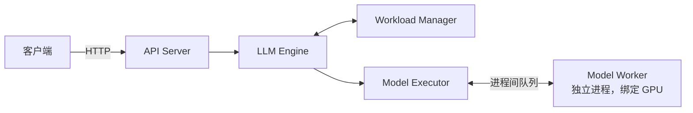
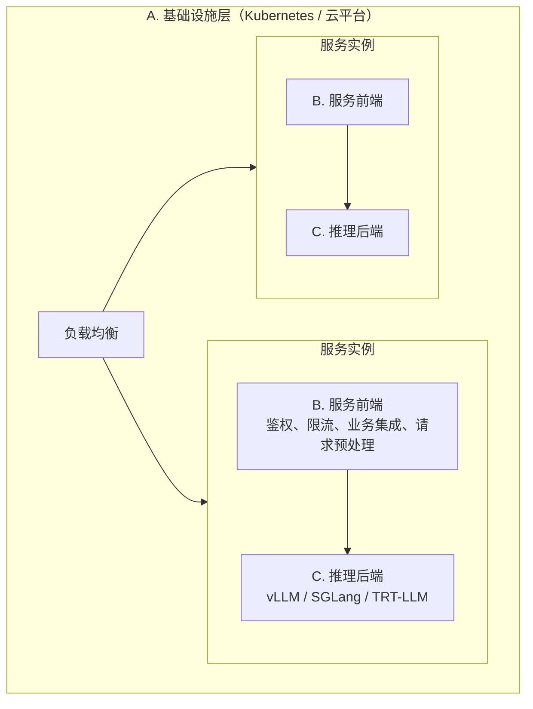

# 1.4 从零实现在线服务：批处理与流式输出

> 对应书中第 3 章 Build an Online LLM Serving Service from Scratch、A General Design for Single-Model LLM Serving

## 学习目标

- 说出一个单模型 LLM 服务内部的六个组件及其职责，理解为什么模型要放在独立进程中执行。
- 理解"按 prompt 跟踪执行状态"这一设计如何让 API 层与模型执行解耦。
- 实现批处理与流式输出共存：后台循环逐步生成，每个请求通过自己的事件队列接收 token。

## 1. 组件划分

书中构建的示例服务有六个组件：

| 组件 | 职责 | 在 MiniServe 中的对应 |
|---|---|---|
| API Server | HTTP 接口，请求与响应 | `server.py` 中的 FastAPI 路由 |
| LLM Engine | 总调度，串起整个流程 | `engine.py` 的 `LLMEngine` 与 `server.py` 的 `AsyncEngine` |
| Workload Manager | 请求排队，决定下一批处理谁 | `scheduler.py` 的 `Scheduler` |
| Model Executor | 管理模型进程，跨进程调用 | MiniServe 简化为单进程，未单独实现 |
| Model Worker | 在独立进程中加载并执行模型 | `model.py` 与 `LLMEngine.step()` |
| Model Manager | 加载与缓存模型 | `CausalLM.from_pretrained` |



**为什么要把模型放在独立进程里？** GPU 很贵，不应该因为 CPU 在做分词、反分词、HTTP 处理而空等。把模型执行放进单独的进程（绑定一张 GPU），主进程专注于并发请求管理，两边可以并行。vLLM 也采用了类似的多进程结构（1.6 节）：API Server、EngineCore、各个 GPU Worker 分别在不同进程中。

## 2. 三个版本的演进

### 2.1 单请求

最简单的版本：API 收到一个 prompt，交给 Worker 调用 `model.generate()`，等待完整结果后返回。功能正确，但一次只能处理一个 prompt，GPU 利用率很低（0.4 节）。

### 2.2 批处理

API 改为接受一组 prompt。关键设计是**为每个 prompt 建一个 `Sequence` 对象**并分配 ID，由 Workload Manager 统一管理：

1. API 收到请求，拆出每个 prompt。
2. Workload Manager 为每个 prompt 创建 `Sequence`，放入队列。
3. LLM Engine 从 Workload Manager 取下一批（书中用 FIFO，批大小上限 4）。
4. Worker 一次前向处理整批。
5. LLM Engine 按 ID 把结果映射回各自的原始请求。

```python
class WorkloadManager:
    def get_next_batch(self) -> List[Sequence]:
        while len(self.active_sequences) < self.batch_size and not self.incoming_queue.empty():
            self.active_sequences.append(self.incoming_queue.get())
        return self.active_sequences
```

书中强调这种"逐 prompt 跟踪"是 LLM 服务的通用做法：**它把用户的 Web 请求与实际的模型执行解耦**，后端可以自由地重组 prompt，实施动态批处理、优先级等策略。

### 2.3 流式输出 + 批处理

前一版要等整批全部完成才返回。流式版本的目标是：后端仍然按批计算，但每生成一个 token 就立刻推给对应的用户。书中的表 3-1 展示了这个过程：

| 时刻 | 事件 | 后端批 | 推送 |
|---|---|---|---|
| T0 | A 的请求到达 | [P1] | P1: "a" |
| T1 | B 的请求到达 | [P1, P2] | P1: "student"；P2: "see" |
| T2 | C 的请求到达 | [P1, P2, P3] | P1: [结束]；P2: "a"；P3: "eat" |
| T3 | A 完成，D 加入 | [P2, P3, P4] | …… |

注意这里已经是**逐步调度**：每一步都可以有请求加入、有请求离开。这正是 1.5 节要讲的 Continuous Batching 的雏形。

实现上的变化：

| 变化 | 做法 |
|---|---|
| API 改为异步 | 返回 SSE（Server-Sent Events）流，`text/event-stream` |
| Worker 每次只生成 1 个 token | 不再调用 `generate()`，而是单步前向 |
| 每个 prompt 有一个事件队列 | 请求处理协程在自己的 `asyncio.Queue` 上等待 |
| 后台批处理循环 | 一个独立线程循环执行"取批 → 前向 → 分发 token" |

跨线程投递是一个容易出错的细节：后台线程不能直接调用 `asyncio.Queue.put`，要通过事件循环转交。书中用 `asyncio.run_coroutine_threadsafe(queue.put(...), loop)`，MiniServe 用 `loop.call_soon_threadsafe(queue.put_nowait, ...)`，两者等价。

```python
# 请求协程：注册自己的队列，然后等待
async def event_generator(self, loop, prompt):
    queue = asyncio.Queue()
    self.workload_manager.add_streaming_request(prompt, queue, loop)
    while True:
        data = await queue.get()
        if data is None:
            break
        yield f"data: {data}\n\n"
```

**客户端断开时要通知引擎。** 否则请求会继续占用批位置和 KV Cache 直到生成完毕。vLLM 用 `engine.abort(request_id)`；MiniServe 在生成器的 `finally` 中发送 abort 命令。

## 3. 换成推理框架

书中最后用 vLLM 替换了自写的执行部分，LLM Engine 只剩十来行：

```python
from vllm import LLM, SamplingParams

class LLMEngine:
    def __init__(self):
        self.llm = LLM(model="facebook/opt-125m")

    def generate(self, prompts):
        params = SamplingParams(temperature=0.7, top_p=0.95, max_tokens=20)
        return [o.outputs[0].text for o in self.llm.generate(prompts, params)]
```

推理框架有两种用法：

- **作为库嵌入**（`LLM` 类或 `AsyncLLM`）：与自己的服务紧密集成，便于定制。
- **作为独立服务**（`vllm serve`）：直接提供 OpenAI 兼容接口，生产中更常见。

## 4. 通用设计：三层分离

书中把单模型服务的需求归为三类，分别交给不同的层：



| 层 | 负责 | 通常用什么 |
|---|---|---|
| A. 基础设施 | 扩缩容、故障恢复、资源分配、监控接口 | Kubernetes、云平台 |
| B. 服务前端 | 鉴权、与业务系统集成、模型配置、请求校验、限流与日志 | 自研 |
| C. 推理后端 | 模型执行与性能 | 推理框架 |

这样划分的好处是把**变化快**的部分（模型结构、推理优化）和**稳定**的部分（基础设施、业务逻辑）隔离开。书中特别指出，LLM 服务的需求随模型结构变化很快（例如 MHA 与 MQA 的 KV 行为不同），需要这种隔离。

## 动手实验

**实验：运行 MiniServe，观察流式与批处理共存。**

```bash
cd code/project1
python tools/make_tiny_model.py --out /tmp/tiny --layers 4 --hidden 128
PYTHONPATH=solution python -m miniserve.server --model /tmp/tiny --device cpu --num-gpu-blocks 1024 --port 8000
```

在另一个终端同时发起两个流式请求，观察 token 交替到达：

```bash
for i in 1 2; do
  curl -sN localhost:8000/v1/completions -H 'Content-Type: application/json' \
    -d '{"prompt":"hello","max_tokens":20,"stream":true,"ignore_eos":true}' | sed "s/^/[$i] /" &
done; wait
curl -s localhost:8000/metrics
```

然后阅读 `server.py` 中的 `AsyncEngine`，回答：

| 问题 | 你的回答 |
|---|---|
| 后台线程在没有请求时是否占用 CPU？怎么做到的？ | |
| 一个 token 从 `engine.step()` 产生到客户端收到，经过了哪些对象？ | |
| 客户端中途断开，引擎是在哪一行得知并释放 KV 块的？ | |

## 自测题

1. 为什么要为每个 prompt 而不是每个 HTTP 请求建立跟踪对象？
2. 书中 2.2 版本的批处理，和 2.3 版本的流式批处理，在调度粒度上有什么根本区别？
3. 后台线程直接调用 `asyncio.Queue.put_nowait()` 会有什么问题？
4. 什么情况下应该把推理框架作为库嵌入，而不是作为独立服务？

<details>
<summary>参考答案</summary>

1. 一个 HTTP 请求可能包含多个 prompt，不同请求的 prompt 需要混合编批，而且它们完成的时间各不相同。以 prompt 为单位，后端才能自由地重组、排序、抢占。
2. 2.2 版本以"批"为单位：一批全部完成后才取下一批。2.3 版本以"步"为单位：每生成一个 token 都重新决定批的组成，请求可以随时加入和离开。
3. `asyncio.Queue` 不是线程安全的，跨线程直接操作可能破坏内部状态，也不会唤醒正在 `await` 的协程。需要通过 `loop.call_soon_threadsafe` 让事件循环线程来执行。
4. 需要深度定制调度、采样或与已有服务紧密集成时（例如在一个进程里串联多个模型、自定义批处理逻辑、离线批量推理）；或者想避免额外的网络与序列化开销时。

</details>

## 延伸阅读

- 书中第 3 章配套代码仓库
- 本笔记项目 1：[MiniServe](stage1/boss-miniserve.md)
