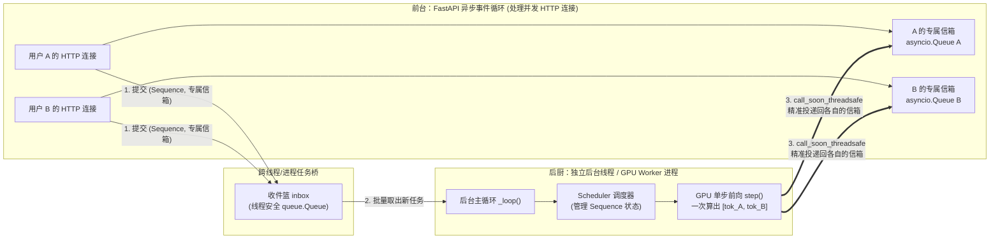
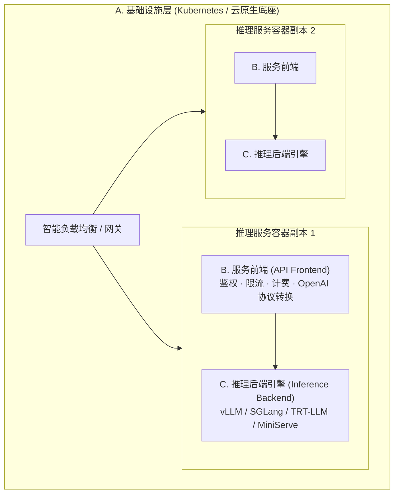

# 1.4 从零实现在线服务：流式输出与后台批处理

## 学习目标

完成本节学习后，你将能够：
- **画出一个单模型在线推理服务内部的六大核心组件**，并解释为什么要把“HTTP 接口处理”与“GPU 模型执行”拆成不同的线程或进程。
- **理解“按 Sequence（序列）追踪状态”的设计精髓**：明白 API 层如何与底层 GPU 批处理彻底解耦。
- **掌握“既要后台合批算得快，又要前端逐字流式收得早”的工程实现模式**：搞懂 `inbox` 队列、后台推理循环与每个请求专属的 `asyncio.Queue` 是如何通过 `loop.call_soon_threadsafe` 协同工作的。

---

## 1. 为什么不能在 FastAPI 路由函数里直接调 `model.forward()`？

假设你已经写好了带 KV Cache 的生成函数，现在想用 FastAPI 把它变成一个多人可用的 Web 服务。初学者最容易写出的第一版代码（V1）长这样：

```python
# 反面教材 V1：在 HTTP 路由里直接串行跑模型
@app.post("/generate")
def generate(prompt: str):
    return {"text": run_model_generate(prompt)}
```

这版代码只要放到线上，立刻会暴露三个致命问题：
1. **单人霸占，全员干等**：用户 A 的请求进来后，GPU 每次只算 `batch_size = 1`（算力利用率不到 1%），而同时进来的用户 B、C、D 只能干等用户 A 的几百个词全部算完。
2. **怎么合批（Batching）？** 用户 A 在 `12:00:00.100` 发来 HTTP 请求，用户 B 在 `12:00:00.120` 发来另一个独立的 HTTP 请求。它们处于两个完全独立的 HTTP 连接（协程）里，怎么把这两个不同连接里的 Prompt 捏到一起，放进同一个 GPU 张量里算呢？
3. **合批之后怎么流式（Streaming）返回？** 就算把 A 和 B 拼成了一个 Batch，GPU 每算完一步会同时吐出两个新词：`[token_A, token_B]`。怎么把 `token_A` 准确塞回给用户 A 的 HTTP 流，把 `token_B` 塞回给用户 B 的 HTTP 流，而不会发串台？

这一节，我们就一步步解开这个经典的系统工程谜题——这也是你在**项目 1 MiniServe 里程碑 1-4** 中要亲手写出来的核心架构。

---

## 2. 分离 API 层与推理引擎

要解决“独立 HTTP 连接”与“统一 GPU 合批”之间的矛盾，所有的现代推理引擎（vLLM、SGLang、TensorRT-LLM 以及我们的 MiniServe）都采用了同一个核心架构模式——**前后台解耦 + 按序列（Sequence）建立专属信箱**：



让我们顺着上面的数字 `1 → 2 → 3` 走一遍，看看这套机制有多巧妙：

1. **前台接待员（API Server 协程）只管接单和等信**：
   - 当用户 A 发来请求时，前台协程**绝不自己去调 GPU**。
   - 它做三件极快的小事：① 把用户 A 的请求包装成一个带有唯一身份证号 `seq_id` 的 **`Sequence` 对象**；② 在内存里创建一个专属于用户 A 的异步队列 **`queue_A = asyncio.Queue()`**；③ 把 `(seq_A, queue_A)` 丢进公共收件篮 `inbox` 里，然后自己就挂起在 `await queue_A.get()` 上静静等信。
2. **后厨大师傅（后台 Engine 循环）按“步（Step）”合批炒菜**：
   - 后台有一个独立的死循环线程（在生产级 vLLM 中甚至是独立的 `EngineCore` 与 `GPUWorker` 进程，彻底避开 Python GIL 锁和分词阻塞）。
   - 每一轮循环开始时，大师傅把 `inbox` 里所有新来的 `Sequence` 全收进来交给调度器（Scheduler）。
   - 紧接着，大师傅调用 **`engine.step()`**：注意。这里**不是**把请求从头算到尾，而是让当前在跑的所有请求（比如 A 和 B）**往前迈 1 步（只生成 1 个新 Token）**。
3. **分拣员按 `seq_id` 把刚出锅的 Token 投递回专属信箱**：
   - 这一步 `engine.step()` 算完后，产出了 `[(seq_A, "北"), (seq_B, "Hello")]`。
   - 后台线程查一下登记簿，把 `"北"` 投递进 `queue_A`，把 `"Hello"` 投递进 `queue_B`。
   - 前台正在 `await queue_A.get()` 的协程 A 瞬间被唤醒，通过 **SSE（Server-Sent Events）** 把 `"北"` 推给用户 A 的浏览器，然后立刻继续 `await` 下一个词。

---

## 3. 组件：请求在协程与引擎线程之间的流动

点击下方状态机中的 4 个阶段，观察并发请求是如何在“独立 HTTP 流”与“合并的 GPU Batch”之间无缝转换的：

<div class="llm-widget" data-widget="async-streaming-flow"></div>

---

## 4. 逐步实现：三个常见问题

在编写上面这套前后台协作代码时（对应 `code/project1/starter/miniserve/server.py`），初学者几乎 100% 会踩到下面两个大坑。我们直接拿代码对比讲清楚：

### 问题 1：从后台线程直接调用 `asyncio.Queue.put_nowait()`
- **为什么会错？** Python 的 `asyncio.Queue` **不是线程安全的（Not thread-safe）**。它属于主线程的 FastAPI 事件循环（`loop`）。如果后台的 GPU 推理线程直接去调 `queue_A.put_nowait(token)`，不仅可能破坏队列内部状态，而且主线程里正在 `await queue_A.get()` 的协程根本不知道有新数据进来，会永远卡死在那里。
- **正确写法**：后台线程必须通过主事件循环的线程安全通道 **`loop.call_soon_threadsafe`**，拜托主线程自己把数据放进队列：

```python
# 正确的跨线程投递姿势（来自 MiniServe solution/miniserve/server.py）
class AsyncEngine:
    def _dispatch(self, out: StepOutput):
        entry = self.streams.get(out.seq.seq_id)        # streams: seq_id -> (asyncio.Queue, loop)
        if entry is None or out.new_token_id is None:   # 请求已中止，或本步只是切块 prefill、没有新 token
            return
        q, loop = entry
        # 让事件循环所在的线程安全地执行 q.put_nowait(...) 并唤醒等待的协程
        loop.call_soon_threadsafe(q.put_nowait, (out.new_token_id, out.finished, out.seq.finish_reason))
        if out.finished:
            self.streams.pop(out.seq.seq_id, None)
```

### 问题 2：没有请求时后台线程空转
- **为什么会错？** 如果后台线程写一个简单的死循环，当深夜没有任何用户发请求时，`engine.has_unfinished()` 为 `False`，线程就会以每秒几百万次的速度空转，把一颗 CPU 核心死死占满 100%，还白白耗电发热。
- **正确写法**：
  - 当引擎手头有正在跑的请求（`engine.has_unfinished()` 为 `True`）时，用非阻塞的 `inbox.get_nowait()` 顺手收一下新请求，然后马不停蹄跑下一步 `engine.step()`。
  - 当引擎完全空闲（`engine.has_unfinished()` 为 `False`）时，调用**阻塞式的 `inbox.get()`**——此时操作系统会把后台线程挂起休眠（CPU 占用为 **0%**），直到有新请求丢进 `inbox` 的那一微秒才瞬间唤醒。

```python
# 空闲零 CPU 占用、忙时全速合批的后台主循环（来自 MiniServe solution/miniserve/server.py）
def _loop(self):
    while True:
        # 引擎空闲时，第一次 get 阻塞休眠（CPU 占用为 0）；有活时不阻塞
        block = not self.engine.has_unfinished()
        try:
            while True:
                cmd = self.inbox.get(block=block)     # 把 inbox 里积攒的新请求 / 中止命令一次性收完
                block = False
                self._handle(cmd)
        except queue.Empty:
            pass
        # 往前推进 1 步推理，并把产出的 token 分发给各自的 asyncio.Queue
        for out in self.engine.step():
            self._dispatch(out)
```

### 问题 3：客户端断开后序列仍在生成
假设用户让模型写一篇 5000 字长文，结果刚看了 50 个字觉得不满意，直接点停止或关掉了网页。
如果前台协程直接退出而**不通知后台引擎**，后台引擎就会继续为这个早就没人要的“僵尸请求”白白算完剩下的 4950 步，并死死占着几十个 KV Cache 块。
- **正确做法**：在 SSE 生成器的 `try ... finally` 块中，一旦协程结束而请求尚未自然完成，立刻往 `inbox` 发送一条 `("abort", seq_id)` 指令，通知调度器当场回收它的全部物理 KV 块：

```python
# MiniServe 的做法（solution/miniserve/server.py 中的 AsyncEngine.generate）：
# 无论正常结束、客户端断开还是出错，finally 都会往 inbox 发一条 abort。
# 已经结束的请求再 abort 一次没有副作用；未结束的请求会被调度器立即回收全部 KV 块。
async def generate(self, prompt_ids, params, seq_id):
    q = asyncio.Queue()
    self.inbox.put(("add", seq_id, prompt_ids, params, q, asyncio.get_running_loop()))
    try:
        while True:
            item = await q.get()
            if isinstance(item, Exception):
                raise item
            yield item                    # (token_id, finished, finish_reason)
            if item[1]:
                return
    finally:
        self.inbox.put(("abort", seq_id))
```

---

## 5. 单模型服务的三层架构

当我们把视野从单个进程放大到生产集群时，一个成熟的单模型推理服务通常会拆分为职责边界极其清晰的三层：



为什么要把 **B. 服务前端** 和 **C. 推理后端引擎** 解耦（并通过标准的 OpenAI `/v1/chat/completions` 接口通信）？
因为大模型领域的底层推理引擎迭代极快：今天 vLLM 出了新特性，明天 SGLang 在某个 Agent 负载下快了 30%，后天出了 DeepInfer。只要上层业务和网关只依赖标准的 OpenAI HTTP/SSE 协议，你就可以在**不改一行前端业务代码**的前提下，随时无缝切换或灰度升级底层的推理引擎。

---

## 6. 实验：在 CPU 上运行 MiniServe

现在，让我们在本地（无需 GPU，纯 CPU 即可秒级启动）把 MiniServe 跑起来，亲眼看看**两个并发的 `curl` 请求是如何在同一个后台引擎里被合并计算，并各自同时收到流式 Token 的**。

```bash
cd code/project1
# 1. 生成一个随机权重的微型 Qwen3 模型（4 层，hidden=128，仅几 MB）
python tools/make_tiny_model.py --out /tmp/tiny --layers 4 --hidden 128

# 2. 启动参考实现的 MiniServe 服务
PYTHONPATH=solution python -m miniserve.server --model /tmp/tiny --device cpu --num-gpu-blocks 1024 --port 8000
```

打开另一个终端窗口，用 `&` 同时在后台发起两个流式请求，并用 `sed` 给它们的输出贴上 `[请求1]` 和 `[请求2]` 的标签：

```bash
for i in 1 2; do
  curl -sN http://localhost:8000/v1/completions \
    -H 'Content-Type: application/json' \
    -d '{"prompt":"hello world","max_tokens":12,"stream":true,"ignore_eos":true}' \
    | sed "s/^/[请求 $i] /" &
done
wait

# 查看引擎统计指标
curl -s http://localhost:8000/metrics
```

你会看到终端里 `[请求 1]` 和 `[请求 2]` 的 SSE 数据包**交替同时涌出**。

---

## 7. 自测

<div class="llm-widget" data-widget="quiz" data-questions='[{"q": "调度器为什么以序列（Sequence）而不是 HTTP 请求为单位跟踪状态？", "options": ["HTTP 请求对象不能被 Python 序列化，无法放进队列", "一个请求可能带多个 prompt 或 n &gt; 1 个候选，各自的长度、完成时间和 KV 块都独立；调度、分配和释放都需要按序列进行", "FastAPI 不允许在请求处理函数之外访问请求对象", "按序列跟踪可以让同一个请求的多个候选共享同一个 block_table"], "answer": 1, "explain": "同一个 HTTP 请求里的多个序列可能一个先结束、一个还在生成，KV 块也要各自释放。请求只是外层的连接与响应对象。共享前缀块是前缀缓存的事，并不意味着共用一个 block_table。"}, {"q": "后台推理线程生成了一个 token，为什么要通过 <code>loop.call_soon_threadsafe(q.put_nowait, item)</code> 投递，而不是直接调用 <code>q.put_nowait(item)</code>？", "options": ["直接调用会阻塞推理线程，直到前端读走这个 token", "<code>asyncio.Queue</code> 不是线程安全的，而且直接调用不会唤醒事件循环，正在 <code>await q.get()</code> 的协程可能一直不被调度", "<code>put_nowait</code> 只能在协程内部调用，在普通函数中会抛出异常", "直接调用会让 token 按相反的顺序到达前端"], "answer": 1, "explain": "asyncio 的对象只能在所属事件循环的线程中操作。<code>call_soon_threadsafe</code> 把回调交给事件循环线程执行，并写入唤醒管道。<code>put_nowait</code> 本身是普通方法，不会阻塞，也可以在非协程中调用，只是不能跨线程调用。"}, {"q": "用户在流式输出到一半时关闭了网页，如果服务端没有在 <code>finally</code> 中调用 abort，会发生什么？", "options": ["FastAPI 会自动取消引擎中的序列，没有影响", "序列继续留在 running 队列里生成到 max_tokens，占用批中的位置和 KV 块，挤占其他请求的资源", "引擎线程会因为写入已关闭的连接而崩溃", "序列被立即抢占，KV 块释放，但统计中会计为失败请求"], "answer": 1, "explain": "连接断开只会让处理函数中的 <code>await</code> 收到取消，引擎线程并不知道。必须显式通知引擎中止序列并释放块。引擎通过队列投递结果，不直接写连接，所以也不会崩溃。"}]'></div>

---

## 延伸阅读

- 本教程实战项目 1：[MiniServe 完整实现指南](stage1/boss-miniserve.md)
- Chi Wang & Peiheng Hu, *Hands-On LLM Serving and Optimization*, O'Reilly, Chapter 3 (*Build an Online LLM Serving Service from Scratch*)
