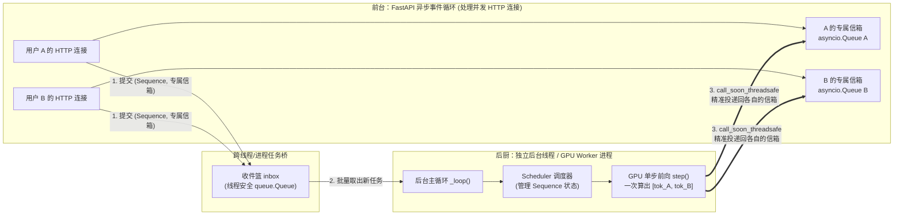
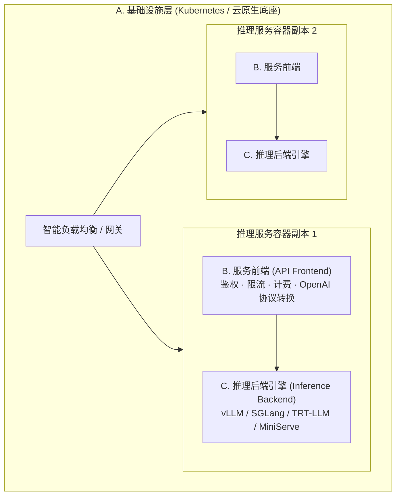

# 1.4 从零实现在线服务：异步流式输出与后台批处理循环

## 学习目标

完成本节学习后，你将能够：
- **画出一个单模型在线推理服务内部的六大核心组件**，并解释为什么要把“HTTP 接口处理”与“GPU 模型执行”拆成不同的线程或进程。
- **理解“按 Sequence（序列）追踪状态”的设计精髓**：明白 API 层如何与底层 GPU 批处理彻底解耦。
- **掌握“既要后台合批算得快，又要前端逐字流式收得早”的工程实现模式**：搞懂 `inbox` 队列、后台推理循环与每个请求专属的 `asyncio.Queue` 是如何通过 `loop.call_soon_threadsafe` 协同工作的。

---

## 1. 为什么不能在 FastAPI 路由函数里直接调 `model.forward()`？

假设你已经写好了带 KV Cache 的生成函数，现在想用 FastAPI 把它变成一个多人可用的 Web 服务。初学者最容易写出的第一版代码（V1）长这样：

```python
# ❌ 反面教材 V1：在 HTTP 路由里直接串行跑模型
@app.post("/generate")
def generate(prompt: str):
    return {"text": run_model_generate(prompt)}
```

这版代码只要放到线上，立刻会暴露三个致命问题：
1. **单人霸占，全员干等**：用户 A 的请求进来后，GPU 每次只算 `batch_size = 1`（算力利用率不到 1%），而同时进来的用户 B、C、D 只能干等用户 A 的几百个词全部算完。
2. **怎么合批（Batching）？** 用户 A 在 `12:00:00.100` 发来 HTTP 请求，用户 B 在 `12:00:00.120` 发来另一个独立的 HTTP 请求。它们处于两个完全独立的 HTTP 连接（协程）里，怎么把这两个不同连接里的 Prompt 捏到一起，放进同一个 GPU 张量里算呢？
3. **合批之后怎么流式（Streaming）返回？** 就算把 A 和 B 拼成了一个 Batch，GPU 每算完一步会同时吐出两个新词：`[token_A, token_B]`。怎么把 `token_A` 准确塞回给用户 A 的 HTTP 流，把 `token_B` 塞回给用户 B 的 HTTP 流，而不会发串台？

这一节，我们就一步步解开这个经典的系统工程谜题——这也是你在**项目 1 MiniServe 里程碑 1-4** 中要亲手写出来的核心架构！

---

## 2. 核心心智模型：把“前台接待员”和“后厨大师傅”彻底分开

要解决“独立 HTTP 连接”与“统一 GPU 合批”之间的矛盾，所有的现代推理引擎（vLLM、SGLang、TensorRT-LLM 以及我们的 MiniServe）都采用了同一个核心架构模式——**前后台解耦 + 按序列（Sequence）建立专属信箱**：



让我们顺着上面的数字 `1 → 2 → 3` 走一遍，看看这套机制有多巧妙：

1. **前台接待员（API Server 协程）只管接单和等信**：
   - 当用户 A 发来请求时，前台协程**绝不自己去调 GPU**。
   - 它做三件极快的小事：① 把用户 A 的请求包装成一个带有唯一身份证号 `seq_id` 的 **`Sequence` 对象**；② 在内存里创建一个专属于用户 A 的异步队列 **`queue_A = asyncio.Queue()`**；③ 把 `(seq_A, queue_A)` 丢进公共收件篮 `inbox` 里，然后自己就挂起在 `await queue_A.get()` 上静静等信。
2. **后厨大师傅（后台 Engine 循环）按“步（Step）”合批炒菜**：
   - 后台有一个独立的死循环线程（在生产级 vLLM 中甚至是独立的 `EngineCore` 与 `GPUWorker` 进程，彻底避开 Python GIL 锁和分词阻塞）。
   - 每一轮循环开始时，大师傅把 `inbox` 里所有新来的 `Sequence` 全收进来交给调度器（Scheduler）。
   - 紧接着，大师傅调用 **`engine.step()`**：注意！这里**不是**把请求从头算到尾，而是让当前在跑的所有请求（比如 A 和 B）**往前迈 1 步（只生成 1 个新 Token）**！
3. **分拣员按 `seq_id` 把刚出锅的 Token 投递回专属信箱**：
   - 这一步 `engine.step()` 算完后，产出了 `[(seq_A, "北"), (seq_B, "Hello")]`。
   - 后台线程查一下登记簿，把 `"北"` 投递进 `queue_A`，把 `"Hello"` 投递进 `queue_B`。
   - 前台正在 `await queue_A.get()` 的协程 A 瞬间被唤醒，通过 **SSE（Server-Sent Events）** 把 `"北"` 推给用户 A 的浏览器，然后立刻继续 `await` 下一个词！

---

## 3. 交互式沙盒：一步步观察 API 协程与后台引擎的数据包流动

点击下方状态机中的 4 个阶段，观察并发请求是如何在“独立 HTTP 流”与“合并的 GPU Batch”之间无缝转换的：

<div class="llm-widget" data-widget="async-streaming-flow"></div>

---

## 4. 从零演进代码：跨越两个最容易踩的并发大坑

在编写上面这套前后台协作代码时（对应 `code/project1/starter/miniserve/server.py`），初学者几乎 100% 会踩到下面两个大坑。我们直接拿代码对比讲清楚：

### 大坑 1：后台线程直接调 `asyncio.Queue.put_nowait()` 导致死锁或崩溃！
- **为什么会错？** Python 的 `asyncio.Queue` **不是线程安全的（Not thread-safe）**！它属于主线程的 FastAPI 事件循环（`loop`）。如果后台的 GPU 推理线程直接去调 `queue_A.put_nowait(token)`，不仅可能破坏队列内部状态，而且主线程里正在 `await queue_A.get()` 的协程根本不知道有新数据进来，会永远卡死在那里！
- **正确写法**：后台线程必须通过主事件循环的线程安全通道 **`loop.call_soon_threadsafe`**，拜托主线程自己把数据放进队列：

```python
# ✅ 正确的跨线程投递姿势（来自 MiniServe server.py）
class AsyncEngine:
    def _dispatch(self, out: StepOutput) -> None:
        entry = self.streams.get(out.seq_id)
        if entry is None:
            return
        loop, q = entry
        # 让事件循环所在的线程安全地执行 q.put_nowait(out) 并唤醒等待的协程！
        loop.call_soon_threadsafe(q.put_nowait, out)
        if out.finished:
            self.streams.pop(out.seq_id, None)
```

### 大坑 2：后台线程在没有请求时写 `while True:` 空转，把 CPU 跑满 100%！
- **为什么会错？** 如果后台线程写一个简单的死循环，当深夜没有任何用户发请求时，`engine.has_work()` 为 `False`，线程就会以每秒几百万次的速度空转，把一颗 CPU 核心死死占满 100%，还白白耗电发热。
- **正确写法**：
  - 当引擎手头有正在跑的请求（`engine.has_work() == True`）时，用非阻塞的 `inbox.get_nowait()` 顺手收一下新请求，然后马不停蹄跑下一步 `engine.step()`。
  - 当引擎完全空闲（`engine.has_work() == False`）时，调用**阻塞式的 `inbox.get()`**——此时操作系统会把后台线程挂起休眠（CPU 占用为 **0%**），直到有新请求丢进 `inbox` 的那一微秒才瞬间唤醒！

```python
# ✅ 空闲零 CPU 占用、忙时全速合批的后台主循环
def _loop(self) -> None:
    while self.running:
        if not self.engine.has_work():
            # 引擎空闲：阻塞休眠等待第一个请求到来，CPU 占用 0%
            item = self.inbox.get()
            if item is None:
                break
            self._handle_command(item)

        # 把当前时刻 inbox 里积攒的所有新请求/取消指令一次性全收进来，最大化合批！
        while True:
            try:
                item = self.inbox.get_nowait()
            except queue.Empty:
                break
            if item is None:
                return
            self._handle_command(item)

        # 往前推进 1 步 GPU 推理，并将产出的 Token 分发给各自的 asyncio.Queue
        for out in self.engine.step():
            self._dispatch(out)
```

### 大坑 3：用户看了一半直接关掉浏览器网页，服务端还在傻算！
假设用户让模型写一篇 5000 字长文，结果刚看了 50 个字觉得不满意，直接点停止或关掉了网页。
如果前台协程直接退出而**不通知后台引擎**，后台引擎就会继续为这个早就没人要的“僵尸请求”白白算完剩下的 4950 步，并死死占着几十个 KV Cache 块！
- **正确做法**：在 SSE 生成器的 `try ... finally` 块中，一旦协程结束而请求尚未自然完成，立刻往 `inbox` 发送一条 `("abort", seq_id)` 指令，通知调度器当场回收它的全部物理 KV 块：

```python
async def sse_stream():
    try:
        while True:
            out: StepOutput = await q.get()
            yield f"data: {json.dumps({'text': detok.step(out.token_id)})}\n\n"
            if out.finished:
                yield "data: [DONE]\n\n"
                break
    finally:
        # 无论正常结束还是客户端中途断开连接，只要未完成就通知引擎立即释放 KV 块！
        if not finished:
            async_engine.abort(seq_id)
```

---

## 5. 生产级单模型服务的三层标准架构

当我们把视野从单个进程放大到生产集群时，一个成熟的单模型推理服务通常会拆分为职责边界极其清晰的三层：



为什么要把 **B. 服务前端** 和 **C. 推理后端引擎** 解耦（并通过标准的 OpenAI `/v1/chat/completions` 接口通信）？
因为大模型领域的底层推理引擎迭代极快：今天 vLLM 出了新特性，明天 SGLang 在某个 Agent 负载下快了 30%，后天出了 DeepInfer。只要上层业务和网关只依赖标准的 OpenAI HTTP/SSE 协议，你就可以在**不改一行前端业务代码**的前提下，随时无缝切换或灰度升级底层的推理引擎！

---

## 6. 动手实验：在纯 CPU 上跑通 MiniServe 流式合批服务

现在，让我们在本地（无需 GPU，纯 CPU 即可秒级启动）把 MiniServe 跑起来，亲眼看看**两个并发的 `curl` 请求是如何在同一个后台引擎里被合并计算，并各自同时收到流式 Token 的**！

```bash
cd code/project1
# 1. 生成一个随机权重的微型 Qwen3 模型（4 层，hidden=128，仅几 MB）
python tools/make_tiny_model.py --out /tmp/tiny --layers 4 --hidden 128

# 2. 启动参考实现的 MiniServe 服务
PYTHONPATH=solution python -m miniserve.server --model /tmp/tiny --device cpu --num-gpu-blocks 1024 --port 8000
```

打开另一个终端窗口，用 `&` 同时在后台发起两个流式请求，并用 `sed` 给它们的输出贴上 `[请求1]` 和 `[请求2]` 的标签：

```bash
for i in 1 2; do
  curl -sN http://localhost:8000/v1/completions \
    -H 'Content-Type: application/json' \
    -d '{"prompt":"hello world","max_tokens":12,"stream":true,"ignore_eos":true}' \
    | sed "s/^/[请求 $i] /" &
done
wait

# 查看引擎统计指标
curl -s http://localhost:8000/metrics
```

你会看到终端里 `[请求 1]` 和 `[请求 2]` 的 SSE 数据包**交替同时涌出**！

---

## 7. 闯关自测

<div class="llm-widget" data-widget="quiz" data-title="1.4 从零实现在线服务 · 闯关自测" data-questions='[
  {
    "q": "为什么在推理服务内部，调度器（Scheduler）要以每个独立的 Prompt（封装为 Sequence 对象）为单位来跟踪状态，而不是直接以每个 HTTP 请求为单位？",
    "options": [
      "因为 HTTP 协议不支持传输长文本",
      "因为一个 HTTP 请求可能包含多条 Prompt，且不同 HTTP 请求的 Prompt 到达时间、生成长度各不相同；只有抽象成独立的 Sequence 对象并配发唯一 seq_id，后端引擎才能跨连接自由地合批、抢占并在每步结束后把 Token 路由回正确的队列",
      "因为 Python 的 dict 不支持用字符串做 key",
      "为了增加代码行数"
    ],
    "answer": 1,
    "explain": "将 Sequence 与 HTTP 连接解耦是在线推理服务的核心设计：后台引擎只管对活跃的 Sequence 集合做高效合批计算，算出的结果按 seq_id 查表投递回对应的 asyncio.Queue。"
  },
  {
    "q": "在 FastAPI 异步服务中，后台的独立 GPU 推理线程算出了一个新的 Token 后，为什么不能直接调用 q.put_nowait(token)，而必须写 loop.call_soon_threadsafe(q.put_nowait, token)？",
    "options": [
      "因为 put_nowait 在 Python 3.11 中已经被废弃了",
      "因为 asyncio.Queue 不是线程安全的！从另一个操作系统线程直接修改它不仅会造成数据竞争，而且无法唤醒事件循环线程中正在 await q.get() 的协程",
      "因为 call_soon_threadsafe 可以自动给 Token 做 gzip 压缩",
      "两者其实没有任何区别"
    ],
    "answer": 1,
    "explain": "asyncio 的事件循环和队列都绑定在主线程上。跨线程向协程通信时，必须使用 loop.call_soon_threadsafe 或 asyncio.run_coroutine_threadsafe 让事件循环线程自己执行入队操作。"
  },
  {
    "q": "如果用户在流式生成长文到第 10 个词时突然关掉了浏览器网页（断开 HTTP 连接），而服务端没有在 finally 块中向引擎发送 abort(seq_id) 指令，会造成什么后果？",
    "options": [
      "没有任何后果，GPU 会自动感应到网线断开",
      "该僵尸请求会继续留在 running 队列里白白消耗几百步 GPU 算力，并死死占住分配给它的物理 KV Cache 块直到生成结束，严重拖慢其他正常用户的请求",
      "会导致整个 Linux 内核立刻重启",
      "会导致模型权重文件被删除"
    ],
    "answer": 1,
    "explain": "GPU 后台引擎并不知道前端 HTTP 套接字的状态。必须在 SSE 生成器的 finally 块中捕获协程退出，一旦未完成即发送 abort 指令，让调度器立即将该序列移除并释放其占用的全部物理 KV 块。"
  }
]'></div>

---

## 延伸阅读与参考文献

- 本教程实战项目 1：[MiniServe 完整实现指南](stage1/boss-miniserve.md)
- Chi Wang & Peiheng Hu, *Hands-On LLM Serving and Optimization*, O'Reilly, Chapter 3 (*Build an Online LLM Serving Service from Scratch*)
