# 1.5 Continuous Batching 与 Chunked Prefill

> 对应书中第 6 章 Request Batching and Scheduling-Level Optimizations

## 学习目标

- 用算术强度解释为什么批处理对 decode 有效、对长 prefill 帮助有限。
- 区分静态批处理、动态批处理、连续批处理，说明每一种解决了上一种的什么问题。
- 理解 `max_num_seqs` 与 `max_num_batched_tokens` 两个参数的作用，以及 chunked prefill 如何在 TTFT 和 ITL 之间做取舍。

## 1. 为什么需要批处理

decode 阶段每生成一个 token 都要把全部权重读一遍，算术强度约为 1（0.4 节）。把 $b$ 个请求的 decode 合成一批，权重仍然只读一次，却能产出 $b$ 个 token，线性层的算术强度提高到约 $b$。

prefill 本身就同时处理很多 token。书中的经验是，只要 prompt 不是太短（例如超过 1024 token），单个请求的 prefill 就能把 GPU 算力用满，再与其他请求合批的收益不大。

**结论：批处理主要是为 decode 服务的。**

## 2. 三种批处理

### 2.1 静态批处理

凑满固定数量的请求再一起处理。离线场景（请求事先都在手上）很合适，在线场景则不行：书中的例子是批大小为 10，前 9 个请求 1 秒内到齐，第 10 个 5 分钟后才来，前 9 个就要白等 5 分钟。

### 2.2 动态批处理

用两个参数在延迟和吞吐之间折中：

| 参数 | 含义 |
|---|---|
| 最大批大小 | 凑够这么多请求就立即发出 |
| 最大等待时间 | 等待超过这个时间，不管凑了多少都发出 |

书中用渡船打比方：船最多坐 10 人，最多等 5 分钟，两个条件谁先满足就开船。Triton Inference Server 等通用服务框架都支持这种方式，对传统模型很有效。

### 2.3 连续批处理（Continuous Batching）

LLM 有一个传统模型没有的问题：**同一批里的请求，输出长度可能相差几十倍**。动态批处理要等批内最长的请求完成才返回，短请求早早结束后，它们的位置一直空着：

```mermaid
gantt
  dateFormat X
  axisFormat %s
  section 动态批处理
  请求 1 :a1, 0, 3s
  空闲 :crit, i1, after a1, 7s
  请求 2 :a2, 0, 5s
  空闲 :crit, i2, after a2, 5s
  请求 3 :a3, 0, 10s
  请求 4（等待上一批结束） :a4, after a3, 4s
```



（渡船版本：船必须把住得最远的乘客送到家才能回来接下一批。）

连续批处理以**迭代**（一次前向，生成一个 token）为调度单位，而不是以请求为单位：每一步结束后，已完成的请求立即离开，排队中的请求立即补上。这一思想来自 Orca（OSDI 2022），也被称为 in-flight batching 或 iteration-level scheduling。

```mermaid
gantt
  dateFormat X
  axisFormat %s
  section 连续批处理
  请求 1 :b1, 0, 3s
  请求 4 :b4, after b1, 4s
  请求 6 :b6, after b4, 3s
  请求 2 :b2, 0, 5s
  请求 5 :b5, after b2, 4s
  请求 3 :b3, 0, 10s
```



（渡船版本：把一条 10 人船换成 10 条单人船，谁到了谁就走。）

连续批处理不再需要"最大等待时间"，但仍需要控制批的规模。

## 3. 两个关键参数

| 参数（vLLM） | 控制粒度 | 主要约束哪个阶段 |
|---|---|---|
| `--max-num-seqs` | 同时在运行的请求数 | decode：每个请求每步只贡献 1 个 token，并行度由请求数决定 |
| `--max-num-batched-tokens` | 一步前向中处理的 token 总数 | prefill：几个长 prompt 就能用满 |

只限制请求数是不够的：10 个各 20 token 的请求和 2 个各 10 万 token 的请求，工作量完全不同。两个参数同时生效，任一达到上限就不再加入新请求。

书中提醒 `max_num_batched_tokens` 不能设得太小，否则 prefill 时送入的 token 不够多，GPU 算力用不满。

```bash
vllm serve Qwen/Qwen2.5-7B-Instruct --max-num-batched-tokens 4096 --max-num-seqs 128
```

## 4. Prefill 与 Decode 混在一起时

上面的图把 prefill 和 decode 抽象成了一样的格子。实际上，在连续批处理中，请求到达时间不同，**总会遇到"有请求在 decode，又有新请求要 prefill"的情况**。

**方案一：prefill 与 decode 分开执行，优先 prefill。** prefill 决定 TTFT，所以通常优先。但新请求 prefill 的那一步，正在 decode 的请求只能干等。prompt 越长，等得越久，表现为 ITL 突然出现一个很大的尖峰。

**方案二：prefill 与 decode 放在同一步。** 改善有限：一次完整的长 prefill 远比一次 decode 慢，同一步里的 decode 请求还是要等它算完。

**方案三：Chunked Prefill。** 把长 prompt 切成多个小块，每一步只处理一块，与其他请求的 decode 合批：

```mermaid
gantt
  dateFormat X
  axisFormat %s
  section 不切块
  请求 1 decode :c1, 0, 1s
  请求 2 prefill（长），请求 1 等待 :crit, c2, after c1, 6s
  请求 1、2 decode :c3, after c2, 1s
  section 切块
  请求 1 decode + 请求 2 prefill 块 1 :d1, 0, 2s
  请求 1 decode + 请求 2 prefill 块 2 :d2, after d1, 2s
  请求 1 decode + 请求 2 prefill 块 3 :d3, after d2, 2s
  请求 1、2 decode :d4, after d3, 1s
```



| 指标 | Chunked Prefill 的影响 |
|---|---|
| ITL / TPOT | 改善：decode 不再被长 prefill 阻塞 |
| TTFT | 变差：一个 prompt 要分几步才能算完 |
| E2E | 基本不变或略差：切块带来额外开销 |
| 吞吐 | 通常提高：用 prefill 填满 decode 步的空闲算力 |

块的大小由 `max_num_batched_tokens` 决定（每步的 token 预算减去 decode 占用的部分）。块太大，起不到切分的作用；块太小，每步的 token 不够多，算力用不满。书中的建议是取中间值，按 SLO 调整。

> [!NOTE]
> vLLM V1 引擎中 chunked prefill 默认开启，而且调度器根本不区分 prefill 和 decode，只决定"这一步给每个请求算几个 token"（1.6 节）。书中提到的更进一步的方案是 Prefill-Decode 分离：把两类工作放到不同的 GPU 上，彻底避免干扰（4.3 节）。

## 5. 一个小实验的结果

用项目 1 的 MiniServe 在 CPU 上跑随机初始化的微型模型（4 层，hidden 128），64 个请求，输入 256 ± 90%、输出 64 ± 90%，泊松到达 30 req/s，SLO 为 TTFT ≤ 500 ms 且 TPOT ≤ 30 ms：

| 调度方式 | 输出吞吐 (tok/s) | TTFT P50 / P99 (ms) | ITL P99 / 最大 (ms) | Goodput (req/s) |
|---|---|---|---|---|
| 静态批处理 | 1185 | 759 / 1692 | 7.3 / 9.2 | 5.3 |
| 连续批处理，不切块 | 1418 | 264 / 742 | 27.4 / 62.7 | 15.6 |
| 连续批处理 + 切块（预算 2048） | 1481 | 150 / 644 | 22.7 / 24.1 | 16.9 |
| 连续批处理 + 切块（预算 128） | 1384 | 242 / 807 | 15.0 / 27.9 | 13.6 |

这只是 CPU 上的演示，绝对数值没有意义，但趋势与书中一致：

- 连续批处理让新请求不必等上一批结束，TTFT 大幅下降，Goodput 约为静态的 3 倍。
- 不切块时出现了 62.7 ms 的 ITL 尖峰（被别人的 prefill 阻塞）。
- 切块预算从 2048 降到 128，ITL 尾部下降，但 TTFT 上升、吞吐略降，这正是第 4 节的取舍。

在 GPU 上重新做这个实验是项目 1 的一部分。

## 动手实验

在 GPU 上用 vLLM 复现第 4、5 节的取舍：

```bash
# 分别用 --max-num-batched-tokens 512 / 2048 / 8192 启动
vllm serve Qwen/Qwen3-8B --max-model-len 16384 --max-num-batched-tokens 512

# 混合负载：长输入与短输入混合
python code/project1/bench.py --base-url http://localhost:8000 --model Qwen/Qwen3-8B \
  --num-prompts 300 --input-len 4096 --output-len 256 --range-ratio 0.9 \
  --request-rate 4 --vocab-size 32000 --save mnbt_512.json
```

| `max-num-batched-tokens` | 输出吞吐 | TTFT P50 / P99 | ITL P99 | Goodput |
|---|---|---|---|---|
| 512 | | | | |
| 2048 | | | | |
| 8192 | | | | |

再固定 `max-num-batched-tokens`，把 `--max-num-seqs` 从 8 调到 256，观察吞吐何时饱和，与 0.4 节估算的拐点比较。

## 自测题

1. 为什么说连续批处理不再需要"最大等待时间"这个参数？
2. 一个服务的请求大多是 50 token 输入、1000 token 输出。`max_num_seqs` 和 `max_num_batched_tokens` 中哪个更可能成为瓶颈？
3. Chunked prefill 对一个只有短 prompt 的负载有意义吗？
4. 用户抱怨"回答到一半会卡一下"，但平均 TPOT 正常。最可能的原因是什么？如何验证和缓解？

<details>
<summary>参考答案</summary>

1. 动态批处理需要等待，是因为一批发出去后要整批完成才能接纳下一批，所以要尽量凑满。连续批处理每一步都可以接纳新请求，新请求到达后最多等一步，不存在"凑批"的问题。
2. `max_num_seqs`。decode 为主，每个请求每步只贡献 1 个 token，128 个请求也才 128 个 token，远低于 token 预算；并发受请求数上限（以及 KV 容量）限制。
3. 意义不大。短 prompt 的 prefill 本身就很快，不会长时间阻塞 decode。
4. 其他请求的长 prompt prefill 与该请求的 decode 落在同一步，或者 prefill 优先导致 decode 暂停。通过 ITL 的 P99 / 最大值确认；缓解方法是开启 chunked prefill 并调小 token 预算，或在负载更重时考虑 PD 分离。

</details>

## 延伸阅读

- Yu et al., *Orca: A Distributed Serving System for Transformer-Based Generative Models*, OSDI 2022
- Agrawal et al., *Taming Throughput-Latency Tradeoff in LLM Inference with Sarathi-Serve*, OSDI 2024
- Anyscale 博客 *How continuous batching enables 23x throughput in LLM inference*（书中引用，2023）
