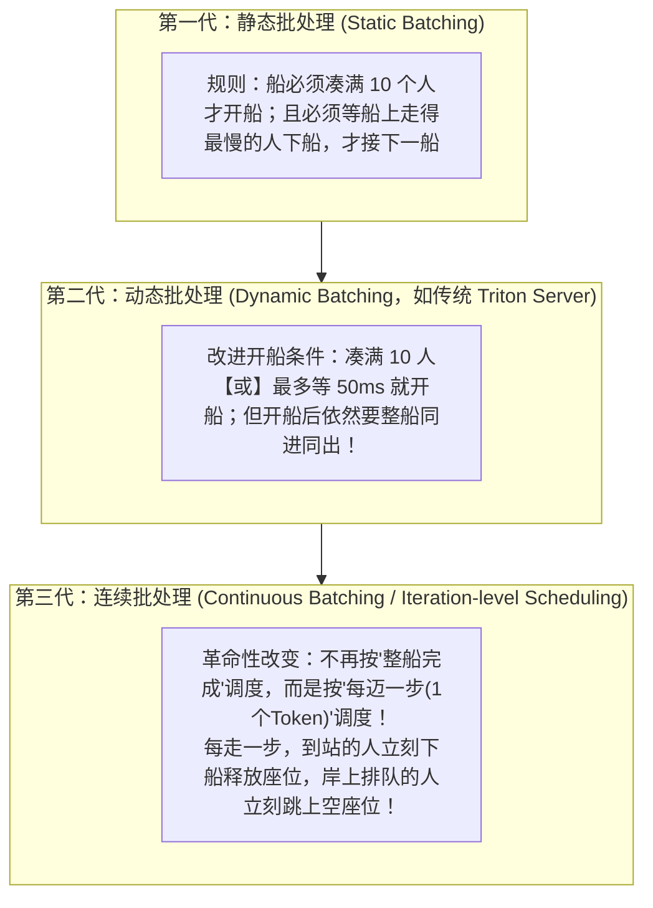

# 1.5 Continuous Batching 与 Chunked Prefill：消灭调度空泡与卡顿尖峰

## 学习目标

完成本节学习后，你将能够：
- **从静态批处理、动态批处理一路推演到连续批处理（Continuous Batching）**：用“渡船过河”的直觉讲清楚为什么传统批处理在大模型下会造成严重的 GPU 空转。
- **区分并联合调优两个最核心的调度参数**：`--max-num-seqs`（最大并发请求数）与 `--max-num-batched-tokens`（单步最大 Token 预算）。
- **彻底理解 Chunked Prefill（分块预填充）的设计权衡**：明白它是如何把长 Prompt 切碎填入 Decode 步的算力空隙里，从而消灭 ITL 卡顿尖峰的。

---

## 1. 为什么传统深度学习的批处理（Batching）在大模型下失灵了？

在 `0.4 Roofline` 节我们已经算过一笔铁账：单请求 Decode 的算术强度只有 $I \approx 1$，GPU 99% 的算力都在空转；只有把 $b$ 个用户的请求合批（Batching）在一起算，让所有人共用同一次权重读取，算术强度才能提升到 $I \approx b$，吞吐才能翻几十倍。

但在传统图像分类（如 ResNet）或推荐模型里做批处理很容易——因为每张图片都是固定的 `224x224` 大小，跑 1 次前向传播统统只要 `10 ms`，同一批进去的 10 张图一定在同一毫秒一起出来。

而到了生成式大模型里，**同一批进来的 4 个用户，生成的回答长度可能天差地别**：
- 用户 1 问：`"今天星期几？"` $\to$ 生成 **5 个词** 就吐出 `EOS` 结束了（耗时 0.1 秒）。
- 用户 2 问：`"写首绝句"` $\to$ 生成 **28 个词** 结束（耗时 0.5 秒）。
- 用户 3 问：`"请帮我写一篇 2000 字的年度述职报告"` $\to$ 要生成 **2000 个词**（耗时 30 秒）！

如果你用传统的批处理方式：**用户 1 和用户 2 虽然不到半秒钟就算完了，但它们的 GPU 槽位必须原地干等用户 3 的 2000 个字全部写完（足足等 29.5 秒！），才能把整批释放掉、去接门外排队的第 4 个用户！**

---

## 2. 核心心智模型：用“渡船过河”看懂三代批处理的演进

我们用码头开渡船的比喻，把三代批处理技术对比得明明白白：



| 批处理代际 | 调度粒度 | 解决了什么问题？ | 还有什么致命缺陷？ |
|---|---|---|---|
| **① 静态批处理** | 整批请求（Batch-level） | 离线跑固定数据集时能跑满 GPU | 在线流量低时，前 9 个人要无限期干等第 10 个人到来才能开跑 |
| **② 动态批处理** | 整批请求 + 超时窗口（如 `max_wait=10ms`） | 解决了“开船前无限干等”的问题 | **开船后依然要整批绑定到底**！短请求算完后槽位一直空转（形成巨大的红色空泡），新请求进不来 |
| **③ 连续批处理（Orca 提出）** | **单步迭代（Iteration-level，即每生成 1 个词）** | **彻底消灭尾部空泡，也不再需要 `max_wait` 等待窗口！** 短请求第 5 步一吐出 EOS，第 6 步新请求立刻顶替它的位置 | 当新加入的请求需要做超长 Prefill 时，会把船上正在 Decode 的老乘客全部卡停（需要下面的 **Chunked Prefill** 来救场） |

---

## 3. 交互式沙盒：切换三种批处理策略，观察空泡与卡顿尖峰

点击下方模拟器顶部的三个标签，依次对比 **① 静态批处理**、**② 连续批处理（不切块）** 和 **③ 连续批处理 + Chunked Prefill** 在 GPU 槽位时间轴上的真实表现：

<div class="llm-widget" data-widget="batching-timeline-sim"></div>

### 动手试一试
1. 先看 **① 静态批处理**：注意槽位 1 和槽位 2 后面大片的红色区域——那就是短请求结束后被迫陪跑长请求造成的 **GPU 空泡浪费**。
2. 切换到 **② 连续批处理 · 不切块**：红色空泡消失了！Req 1 一结束，Req 4 立刻补了进来。**但是请看指标卡片里的 `最大单步间隔 (ITL Max)`**：为什么突然从 `9.2 ms` 飙升到了 **`62.7 ms`**？因为 Req 4 进来时带着一段很长的 Prompt，它在做完整 Prefill 的那一步，把槽位 2 和槽位 3 正在流式吐字的 Req 2、Req 3 硬生生卡停了！
3. 切换到 **③ 连续批处理 + Chunked Prefill**：观察 Req 4 的橙色 Prefill 是如何被切成 `P块1`、`P块2`、`P块3` 三个小块，与 Req 2、Req 3 的 Decode 穿插并行执行的！

---

## 4. 深入拆解：双预算阈值与 Chunked Prefill 的精妙权衡

在现代推理引擎（如 vLLM、SGLang 以及我们的项目 1 MiniServe）中，连续批处理调度器靠**两把尺子**来决定每一步（Step）到底放多少工作量上卡：

### 4.1 两把控制尺子：`max_num_seqs` vs `max_num_batched_tokens`

为什么不能只设一个“最大 Batch Size”？
因为 **10 个正在 Decode 的请求（一共只送入 10 个 Token）** 和 **10 个刚进来要做 8K 长文 Prefill 的请求（一共送入 80,000 个 Token）**，对 GPU 算力和激活显存的压力相差 **8,000 倍**！因此调度器必须同时卡住两个上限：

| 参数名称（vLLM / MiniServe） | 物理含义 | 主要卡住哪个阶段？ | 设太小会怎样？设太大会怎样？ |
|---|---|---|---|
| **`--max-num-seqs`** | 同时处于运行状态（RUNNING）的**最大请求个数** | **Decode 阶段**（每个请求每步只出 1 个 Token，并发请求数直接决定 Decode 批大小 $b$） | 设太小：Decode 算术强度低，吞吐上不去；<br/>设太大：KV Cache 块不够分，频繁触发抢占（Preemption） |
| **`--max-num-batched-tokens`** | 一步 `engine.step()` 前向传播中，所有请求加起来的**最大 Token 总数预算** | **Prefill 阶段 & Chunked Prefill 切块大小** | 设太小（如 `< 256`）：每步喂给 GPU 的 Token 太少，Prefill 算力吃不满，TTFT 变慢；<br/>设太大（如 `> 16384`）：单步耗时过长，正在 Decode 的请求被阻塞，ITL P99 尖峰飙升 |

### 4.2 Chunked Prefill（分块预填充）到底是怎么算的？

假设你把单步 Token 预算设为 `max_num_batched_tokens = 512`。
现在系统里有 **12 个正在 Decode 的老请求**，同时门外新来了 **1 个长度为 1,500 Token 的长 Prompt 请求 R_new**。调度器在这一步是怎么分配预算的？


1. **第 1 步**：12 个老请求各算 1 个 Decode 词（消耗 12 预算），`R_new` 算它的第 `0 ~ 499` 个词并写入 KV Cache（消耗 500 预算），刚好凑满 512！这一步只花约 `15 ms`，12 个老请求丝滑拿到了新词，完全没感觉到卡顿！
2. **第 2 步**：12 个老请求继续各算 1 个词，`R_new` 接着算第 `500 ~ 999` 个词（它的 Q 会去和前 500 个词的 KV Cache 加上这 500 个词的 KV 算因果注意力）。
3. **第 3 步**：12 个老请求各算 1 个词，`R_new` 算完最后的第 `1000 ~ 1499` 个词，并终于吐出它的第 1 个生成词，正式转为 Decode 状态！

**这就是 Chunked Prefill（由 Sarathi-Serve 论文系统提出）的一石二鸟之计**：
- **对老请求（Decode）**：再也不会被别人的万字长文一把卡死几百毫秒，**ITL P99 毛刺被彻底削平**。
- **对 GPU 硬件**：原本 12 个请求的 Decode 算术强度只有 $12$（严重访存受限，算力空置 90%）；现在塞进了 500 个 Prefill Token 一起过线性层，**把原本白白浪费的空闲 Tensor Core 算力顺手白嫖利用了起来**，总吞吐反而更高！
- **唯一的微小代价**：`R_new` 自己的 TTFT 略微增加了一点点（因为分成了 3 步才算完 Prompt）。

---

## 5. 动手实验：用实测数据验证四种调度策略的差距

在项目 1 MiniServe 中，我们已经内置了这几种调度模式。即使在纯 CPU 上跑微型模型（64 个长短混合请求，泊松到达 30 req/s，SLO 要求 `TTFT ≤ 500ms, TPOT ≤ 30ms`），也能测出教科书般清晰的对比数据：

| 调度策略 | 输出吞吐 (tok/s) | TTFT P50 / P99 (ms) | 单步间隔 ITL P99 / Max (ms) | 有效吞吐 Goodput (req/s) | 核心现象解读 |
|---|---|---|---|---|---|
| **① 静态批处理** | 1,185 | 759 / 1,692 | 7.3 / 9.2 | **5.3** | 新请求在门外排长队等上一批结束，TTFT 爆炸，Goodput 垫底 |
| **② 连续批处理（不切块）** | 1,418 | 264 / 742 | 27.4 / **62.7** ⚠️ | 15.6 | 排队大幅缓解，Goodput 翻 3 倍；但长 Prefill 造成了 **62.7 ms** 的严重卡顿尖峰 |
| **③ 连续批处理 + 切块（预算 2048）** | **1,481** | **150 / 644** | 22.7 / **24.1** ✅ | **16.9** | **甜点配置**：卡顿尖峰从 62.7ms 削平到 24.1ms，且吞吐与 Goodput 均达到最高 |
| **④ 连续批处理 + 切块（预算过小 128）** | 1,384 | 242 / 807 | **15.0** / 27.9 | 13.6 | 切得太碎（每步最多 128 词），ITL 最稳，但长 Prompt 要切十几次才算完，拖慢了 TTFT |

如果你有 GPU，可以用 vLLM 调整 `--max-num-batched-tokens`（分别设为 `512`、`2048`、`8192`）跑一遍同样的长短混合压测，亲手找出你手里显卡的黄金预算值：

```bash
vllm serve Qwen/Qwen3-8B --max-model-len 16384 --max-num-batched-tokens 2048

python code/project1/bench.py --base-url http://localhost:8000 --model Qwen/Qwen3-8B \
  --num-prompts 300 --input-len 4096 --output-len 256 --range-ratio 0.9 \
  --request-rate 4 --vocab-size 32000
```

---

## 6. 闯关自测

<div class="llm-widget" data-widget="quiz" data-title="1.5 连续批处理与切块 · 闯关自测" data-questions='[
  {
    "q": "为什么传统的动态批处理（Dynamic Batching）必须配置一个“最大等待时间（max_wait_time，比如等 20ms 凑批）”，而连续批处理（Continuous Batching）根本不需要这个参数？",
    "options": [
      "因为连续批处理不支持超过 1 个并发请求",
      "因为传统动态批处理一旦开船（启动前向传播），必须等整批全部生成完才能接下一批，所以开船前不得不等几毫秒尽量凑满；而连续批处理每走 1 步（仅几毫秒）都会重新调度，任何时刻到达的新请求最多只需等当前这 1 步算完就能立刻插进批次里",
      "因为连续批处理把等待时间固定死为 10 秒了",
      "因为 GPU 不支持定时器中断"
    ],
    "answer": 1,
    "explain": "连续批处理的调度周期是单步迭代（Iteration-level，通常仅 10~30ms）。新请求到达后在下一步即可无缝加入 RUNNING 批次，完全不需要靠人为延迟发车来凑批。"
  },
  {
    "q": "某推理服务的线上请求特征是：输入 Prompt 都很短（平均 50 tokens），但生成的回答都很长（平均 1,500 tokens 的长思维链）。此时 --max-num-seqs（设为 64）和 --max-num-batched-tokens（设为 4096）哪一个会先成为限制并发的瓶颈？",
    "options": [
      "--max-num-batched-tokens 会先耗尽",
      "--max-num-seqs（以及 KV Cache 显存容量）会先达到上限；因为绝大部分时间所有请求都在 Decode，64 个请求每步一共才贡献 64 个 Token，远低于 4096 的 Token 预算",
      "两个参数都不会生效",
      "会导致模型停止输出"
    ],
    "answer": 1,
    "explain": "短输入、长输出意味着系统 95% 以上的时间处于 Decode 阶段，每个活跃请求在每步只占 1 个 Token 预算。64 个并发请求每步只消耗 64 个 Token 预算，因此并发度完全受 max_num_seqs 和显存容量约束。"
  },
  {
    "q": "在开启 Chunked Prefill 时，如果把 --max-num-batched-tokens 设得过小（比如设为 64），会对 TTFT 和 ITL 分别产生什么影响？",
    "options": [
      "TTFT 变快，ITL 变慢",
      "ITL 非常平稳（单步耗时极短），但长 Prompt 的 TTFT 会严重恶化，且总吞吐下降；因为一个 4096 词的 Prompt 被切成了 64 个碎块，分 64 步才算完，每步只有几十个 Token 根本喂不饱 GPU 算力",
      "TTFT 和 ITL 都会快 10 倍",
      "会导致显存立刻溢出"
    ],
    "answer": 1,
    "explain": "这就是 Chunked Prefill 的核心权衡：块切得越小，单步越快（利好正在 Decode 请求的 ITL），但长请求需要分更多步才能完成 Prefill（恶化新请求的 TTFT）且降低了算术强度。工程上通常取 1024 ~ 4096 之间的折中值。"
  }
]'></div>

---

## 延伸阅读与参考文献

- Gyeong-In Yu et al., [*Orca: A Distributed Serving System for Transformer-Based Generative Models*](https://www.usenix.org/conference/osdi22/presentation/yu), OSDI 2022（首次提出 Iteration-level Scheduling / Continuous Batching）
- Amey Agrawal et al., [*Taming Throughput-Latency Tradeoff in LLM Inference with Sarathi-Serve*](https://arxiv.org/abs/2403.02310), OSDI 2024（系统提出 Chunked Prefill 消除 Prefill-Decode 干扰）
- Chi Wang & Peiheng Hu, *Hands-On LLM Serving and Optimization*, O'Reilly, Chapter 6 (*Request Batching and Scheduling-Level Optimizations*)
