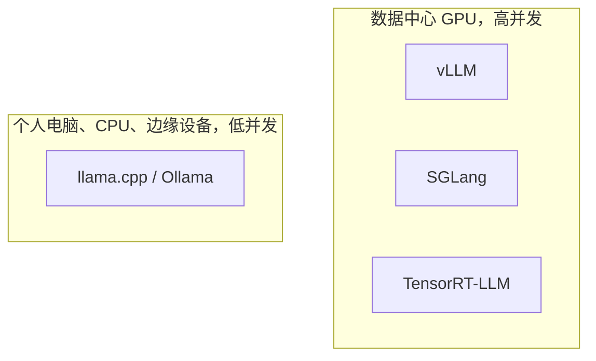

# 1.5 推理框架对比

> 对应原书第 8 章 *LLM Serving Frameworks*：为什么需要专用框架，vLLM、TensorRT-LLM、SGLang、llama.cpp，以及如何选择。

前四节讲的技术，连续批处理、分页 KV Cache、chunked prefill、前缀缓存，在主流推理框架里都已经实现。这一节先说明通用的模型服务框架为什么不够用，再比较几个主流的 LLM 推理框架，最后给出一个选型的流程。

## 1. 为什么需要专用的框架

TorchServe、TensorFlow Serving、Triton Inference Server 这类通用模型服务框架，把一次推理当作一次函数调用：输入一批数据，输出一批结果。对 LLM 来说，这个抽象不够用：

| LLM 服务的特点 | 通用框架的做法 | LLM 推理框架的做法 |
|---|---|---|
| 一次请求要做几百上千步前向（0.3 节） | 把整个请求当作一次调用 | 按步调度，每一步都可以有序列加入和离开（1.2 节） |
| KV Cache 随生成不断增长（0.4 节） | 按最大长度分配连续空间 | 分页管理（1.3 节） |
| 请求长短差异很大 | 整批同进同出 | 连续批处理和 chunked prefill（1.2 节） |
| 请求之间有大量相同的前缀 | 每次从头计算 | 前缀缓存（1.4 节） |
| decode 受显存带宽限制（0.7 节） | 通用算子 | 量化算子、FlashAttention、投机解码等（第 2、3 部分） |

Triton Inference Server 本身也在演进，现在可以把 vLLM 或 TensorRT-LLM 作为后端，自己只负责外围的模型管理和协议。

## 2. 四个主流框架



| | vLLM | SGLang | TensorRT-LLM | llama.cpp |
|---|---|---|---|---|
| 定位 | 通用的在线推理引擎 | 侧重复杂的多轮、Agent 与结构化输出场景 | 在 NVIDIA GPU 上追求极致性能 | 本地、CPU 与边缘设备上的低并发推理 |
| 实现 | Python 调度，CUDA 与 Triton 算子 | Python 调度，CUDA 与 Triton 算子 | 现在以 PyTorch 后端为主，早期版本要先编译成 TensorRT 引擎 | C/C++，几乎没有外部依赖 |
| 前缀缓存 | 块哈希 | 基数树（RadixAttention） | KV Cache 复用（按块） | 按会话保存和恢复 prompt 的缓存 |
| 突出的能力 | 模型支持最广，新模型常在发布当天支持；社区和插件最多 | 结构化输出的约束解码很快；对 DeepSeek 等 MoE 模型的大规模部署优化较多 | NVIDIA 新硬件特性（FP8、NVFP4、新的通信库）支持最早 | GGUF 格式的 2～8 位量化，CPU 与 GPU 混合运行 |
| 硬件 | NVIDIA、AMD、Google TPU、Intel，昇腾等通过插件 | NVIDIA、AMD、TPU、昇腾、CPU 等 | 只支持 NVIDIA GPU | 几乎所有：Apple Silicon、x86 与 ARM CPU、各家 GPU |
| 上手 | pip 安装即可 | pip 安装即可 | 需要和驱动、CUDA 版本对齐，一般用官方镜像 | 一个可执行文件 |

框架之间的性能差距一直在变化：一个框架的优化，几个月内往往会被其他框架跟进。表中"突出的能力"一行，说的是各自长期投入较多的方向，而不是固定的排名。

还有一些值得知道的选择：LMDeploy（上海人工智能实验室，TurboMind 引擎，国内使用较多）；MLC-LLM（基于 TVM 编译，适合手机和浏览器）；Ollama（封装了 llama.cpp，模型下载和管理更方便）。2026 年 DeepSeek 开源的 DeepInfer 则是另一类：它只服务自家的 V4.1-Flash 一个模型，只支持 Blackwell 和昇腾 950，换来的是针对单一模型的深度优化（第 6 部分）。

### 2.1 同一个任务，四种写法

<!-- tabs:start -->
#### **vLLM**
```python
from vllm import LLM, SamplingParams

llm = LLM(model="Qwen/Qwen3-8B", dtype="bfloat16")
out = llm.generate(["The capital of France is"], SamplingParams(temperature=0.8, top_p=0.95, max_tokens=64))
print(out[0].outputs[0].text)
```
#### **SGLang**
```python
import sglang as sgl

llm = sgl.Engine(model_path="Qwen/Qwen3-8B", dtype="bfloat16")
out = llm.generate(["The capital of France is"], {"temperature": 0.8, "top_p": 0.95, "max_new_tokens": 64})
print(out[0]["text"])
```
#### **TensorRT-LLM**
```python
from tensorrt_llm import LLM, SamplingParams

llm = LLM(model="Qwen/Qwen3-8B")
for out in llm.generate(["The capital of France is"], SamplingParams(temperature=0.8, top_p=0.95, max_tokens=64)):
    print(out.outputs[0].text)
```
#### **llama.cpp**
```python
from llama_cpp import Llama          # Python 绑定：pip install llama-cpp-python

llm = Llama.from_pretrained(repo_id="Qwen/Qwen3-8B-GGUF", filename="*Q4_K_M.gguf", verbose=False)
print(llm("The capital of France is", max_tokens=64)["choices"][0]["text"])
```
<!-- tabs:end -->

启动 OpenAI 兼容服务的命令：

```bash
vllm serve Qwen/Qwen3-8B --max-model-len 8192
python -m sglang.launch_server --model-path Qwen/Qwen3-8B --context-length 8192
trtllm-serve Qwen/Qwen3-8B
./llama-server -m qwen3-8b-q4_k_m.gguf -c 8192 -np 4 --port 8000    # -np：同时服务的请求数
```

## 3. 场景与选择

| 场景 | 首选 | 理由 |
|---|---|---|
| 通用的在线 API，模型经常更换 | vLLM | 模型覆盖最广，默认配置已经包含本部分讲的全部优化 |
| Agent、多轮分支多，或者大量使用 JSON 等结构化输出 | SGLang | 基数树对复杂前缀的复用更好，约束解码的开销小 |
| 只用 NVIDIA 新硬件，有专人调优，追求最低的每 token 成本 | TensorRT-LLM | 新硬件特性和算子支持最快 |
| MacBook、只有 CPU 的服务器、边缘设备，少量用户 | llama.cpp 或 Ollama | 低比特量化后内存占用小，单用户延迟低 |
| 同时有 NVIDIA、AMD、国产加速卡 | vLLM 或 SGLang | 硬件覆盖面广，换卡不用换框架 |

## 4. 选型的步骤

看到"某框架在某数据集上比另一个快 15%"这样的评测，不能直接拿来做决定。推理性能对硬件、模型结构（稠密还是 MoE，MHA、GQA 还是 MLA）、输入输出的长度比例、前缀的重复程度都很敏感，同样两个框架，换一个负载，排名可能就反过来了。比较可靠的做法是：

1. **先写下约束。** TTFT 和 TPOT 的 P99 上限，是否必须输出合法的 JSON，能用哪些硬件。
2. **用自己的流量做测试数据。** 统计线上请求的输入、输出长度分布，以及前缀的重复程度。用别人的短对话数据集得出的结论，不一定适用于长文档的业务。
3. **对齐条件再比较。** 同样的模型权重和精度，同样的最大长度，前缀缓存同时开或同时关，用同一个压测工具，比较满足 SLO 的 goodput（0.8 节）。
4. **考虑运维。** 冷启动要多久，出错时日志是否好排查，监控指标是否齐全，版本升级是否频繁破坏兼容性。
5. **用 OpenAI 兼容接口隔离。** 业务代码只调用 `/v1/chat/completions` 这样的标准接口，不直接依赖某个框架的 Python API。框架格局变化时，只需要更换后端的镜像和启动参数（1.1 节）。

## 5. 实验：同一套压测比较 vLLM 和 SGLang

在同一张 GPU 上，分别用相同的参数启动 vLLM 和 SGLang（测完一个关掉再启动另一个），用 `bench.py` 在两种负载下压测：

```bash
# 二选一启动
vllm serve Qwen/Qwen3-8B --max-model-len 8192 --port 8000
python -m sglang.launch_server --model-path Qwen/Qwen3-8B --context-length 8192 --port 8000

# 负载 A：对话。输入 256，输出 512，没有公共前缀
python code/project1/bench.py --base-url http://localhost:8000 --model Qwen/Qwen3-8B \
  --num-prompts 200 --input-len 256 --output-len 512 --request-rate 8 --vocab-size 32000

# 负载 B：文档问答。4096 个 token 的公共前缀，各自 128 个 token 的问题，输出 128
python code/project1/bench.py --base-url http://localhost:8000 --model Qwen/Qwen3-8B \
  --num-prompts 200 --shared-prefix-len 4096 --input-len 128 --output-len 128 --request-rate 8 --vocab-size 32000
```

比较两个框架在两种负载下的输出吞吐、TTFT 和 ITL 的 P99。如果两种负载下的胜负不同，就说明了第 4 节开头的那个道理。

学完这一部分，可以开始做项目 1：自己实现一个包含本部分主要技术的推理引擎。

## 自测

<div class="llm-widget" data-widget="quiz" data-questions='[{"q": "要在一台没有独立显卡的服务器或者 MacBook 上，给十几个人部署一个 8B 模型，最合适的选择是：", "options": ["vLLM 的 CPU 后端，开启张量并行", "SGLang，开启 RadixAttention", "llama.cpp 或 Ollama，配合 GGUF 的 4～8 位量化", "TensorRT-LLM，把模型编译成 CPU 引擎"], "answer": 2, "explain": "llama.cpp 对 CPU 和 Apple Silicon 做了大量优化，8B 模型量化后只要 5～9 GB 内存，低并发下体验最好。vLLM 和 SGLang 的优势在 GPU 上的高并发调度；TensorRT-LLM 只支持 NVIDIA GPU。"}, {"q": "一篇评测说框架 A 在 ShareGPT 上比框架 B 快 15%。为什么不应该据此直接迁移线上服务？", "options": ["ShareGPT 数据集已经过时", "框架之间的差距通常小于测量误差", "迁移框架需要重新训练模型", "性能很依赖负载、模型结构和硬件，应该用自己的流量复现"], "answer": 3, "explain": "同样两个框架，换一种负载排名可能就反过来。应该用自己的长度分布和前缀重复度，在对齐的条件下比较满足 SLO 的 goodput。"}, {"q": "怎样避免业务代码被某一个推理框架绑定？", "options": ["业务代码只调用 OpenAI 兼容的 HTTP 接口", "在业务代码里同时引入几个框架的 Python SDK，按配置切换", "把模型导出成 ONNX，所有框架都从 ONNX 加载", "固定使用某个框架的某个版本，不再升级"], "answer": 0, "explain": "主流框架都提供 OpenAI 兼容的接口，换框架时只需更换后端和网关配置。直接调用框架的 Python API 会把引擎的细节带进业务代码。这些 LLM 框架并不以 ONNX 作为主要的模型格式。"}]'></div>

## 延伸阅读

- 原书第 8 章 *LLM Serving Frameworks*。
- [vLLM 文档](https://docs.vllm.ai/)、[SGLang 文档](https://docs.sglang.ai/)、[TensorRT-LLM 文档](https://nvidia.github.io/TensorRT-LLM/)、[llama.cpp](https://github.com/ggml-org/llama.cpp)。
- 下一步：[项目 1　MiniServe](stage1/boss-miniserve.md)。
