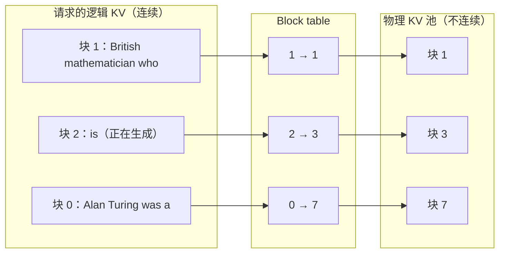
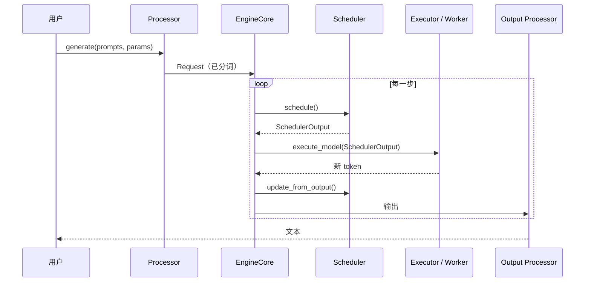

# 1.6 vLLM 架构与调度器

> 对应书中第 6 章 PagedAttention、第 8 章 vLLM

## 学习目标

- 解释 PagedAttention 解决了哪三种显存浪费，以及 block table 如何把逻辑上连续的 KV 映射到不连续的物理块。
- 画出 vLLM 的主要组件，并说出一个请求从进入到返回经过的路径。
- 读懂调度器的核心循环：先 RUNNING 后 WAITING、token 预算、`num_computed_tokens`、抢占。

## 1. PagedAttention

### 1.1 问题：KV Cache 的显存浪费

早期系统为每个请求预先分配一段**连续**的 KV 空间，大小按最大长度算。PagedAttention 论文分析了三种浪费：

| 浪费 | 原因 |
|---|---|
| 预留浪费（reservation） | 请求还没生成到那么长，但空间已经占住 |
| 内部碎片 | 实际输出比最大长度短，多出的部分永远用不上 |
| 外部碎片 | 不同大小的连续段之间留下的空隙，放不下新的请求 |

书中引用了论文的数据：在此前的系统中，**只有 20.4%–38.2% 的 KV 显存真正存放了 token 状态**。

### 1.2 方案：像操作系统一样分页

把 KV 空间切成固定大小的块（vLLM 默认每块 16 个 token），每个请求维护一张 **block table**，记录"第 $i$ 个逻辑块存放在哪个物理块"：



（书中图 6-13 的例子：每块 4 个 token，三个逻辑块分别放在物理块 7、1、3，最后一块只用了一部分。）

效果：

- 只在需要时分配新块，没有预留浪费。
- 内部碎片最多是最后一块中未用的部分（小于一个块）。
- 所有块大小相同，没有外部碎片。

论文称这样做可以达到"接近零浪费"。省下的显存可以放更多并发请求，这是 vLLM 吞吐优势的主要来源之一。

**附带的好处是共享。** 由于 KV 通过 block table 间接访问，多个请求可以指向同一个物理块（配合引用计数和写时复制）。并行采样多个回答、beam search、前缀缓存（1.7 节）都建立在这个机制之上。

**代价**：注意力 kernel 不能再假设 K、V 在显存中是连续的，需要按 block table 间接寻址。这就是"PagedAttention"这个名字指的那个 kernel。

### 1.3 对照实现

MiniServe 的实现把块和块内偏移展平为"槽位"（`slot = block × block_size + offset`），这样写入新 token 和读取上下文都可以用一次索引完成：

```python
# 写入：本步新 token 的 K、V
k_cache[meta.slot_mapping] = k
# 读取：某个请求从位置 0 到当前的全部 K
bt = torch.tensor(seq.block_table)
slots = (bt[:, None] * block_size + torch.arange(block_size)).reshape(-1)[:ctx_len]
ks = k_cache[slots]
```

真正的 PagedAttention kernel 不会先把 K、V 拷贝出来，而是在 kernel 内部按 block table 直接读取，省掉一次显存往返。

## 2. vLLM 的架构

### 2.1 两种使用方式

| 方式 | 用法 | 适合 |
|---|---|---|
| `LLM` 类 | 进程内调用 `llm.generate(prompts, params)` | 离线批量推理、嵌入到自己的服务中 |
| API Server | `vllm serve <model>`，OpenAI 兼容接口 | 在线服务 |

### 2.2 主要组件（书中图 8-1）

| 组件 | 职责 |
|---|---|
| LLMEngine | 对外入口，管理请求生命周期 |
| Processor | 输入校验、分词，把原始输入变成内部的 Request 对象 |
| EngineCore | 内层循环："调度 → 执行 → 处理输出"，串起下面三者 |
| Scheduler | 决定每一步处理哪些请求、各处理多少 token，管理 KV 块 |
| ModelExecutor | 管理一个或多个 Worker 进程 |
| GPUWorker | 每个 GPU 一个进程，初始化设备、加载模型 |
| GPUModelRunner | 准备输入张量，执行前向 |
| Output Processor | 反分词、组装返回结果 |

### 2.3 初始化流程（以 4 卡张量并行为例）

```python
llm = LLM(model="Qwen/Qwen2.5-7B-Instruct", tensor_parallel_size=4, distributed_executor_backend="mp")
```

1. 主进程创建 LLMEngine、Scheduler、KV Cache 管理器和 MultiProcessExecutor。
2. Executor 启动 4 个 Worker 进程，并建立用于广播命令的消息队列。
3. 每个 Worker 设置 CUDA 设备、建立通信、加载自己那一份权重。
4. GPUModelRunner 在 vLLM 的模型注册表里按 `architectures` 字段找到对应的模型实现，加载权重。

之后还有一步书中没有展开、但在启动日志里能看到的：**显存测算**。vLLM 用最大规模的输入做一次试运行，测出激活峰值，再把 `gpu_memory_utilization` 范围内剩余的显存全部分配为 KV 块（0.3 节的实验 2 就是在验证这一步）。MiniServe 的 `_profile_num_blocks` 是同样思路的简化版。

> [!WARNING]
> 书中这一段写的是加载 Qwen2.5-7B 时会选中 `Qwen3NextForCausalLM`，这应是笔误。Qwen2.5 的 `config.json` 中 `architectures` 为 `Qwen2ForCausalLM`，vLLM 据此选择实现。书中第 8 章的示例代码使用的 `Qwen/Qwen3-7B-Instruct` 在 Hugging Face 上也不存在，Qwen3 稠密模型的规格是 0.6B / 1.7B / 4B / 8B / 14B / 32B。

### 2.4 请求执行流程



书中的总结：模型相关的执行与优化在 Worker 中完成；与模型无关的规划与优化由 Scheduler 统一负责。

### 2.5 V1 引擎的几个工程设计（书外补充）

书中描述的是 vLLM V1 引擎（2025 年起的默认引擎）。读源码时还会遇到以下设计，它们主要是为了降低 CPU 开销：

| 设计 | 作用 |
|---|---|
| EngineCore 独立进程 | API Server（分词、反分词、HTTP）与调度、执行分在不同进程，通过 ZMQ 通信，互不阻塞 |
| 持久化批（persistent batch） | 两步之间批的变化通常很小，只增量更新输入张量，而不是每步重建 |
| 分段 CUDA Graph | 把 decode 的前向录成 CUDA Graph，消除大量小 kernel 的启动开销；注意力等动态部分单独处理 |
| 异步调度（可选） | 在 GPU 执行当前步时提前调度下一步（6.8 节） |

小模型、高并发时，这些 CPU 侧开销往往比 GPU 计算本身更显著。MiniServe 与 vLLM 的差距很大一部分来自这里。

## 3. 调度器

### 3.1 设计要点（书中）

- **请求生命周期**：请求在 WAITING 和 RUNNING 两个队列之间流转，直到完成。支持 FCFS 和优先级两种排序策略。
- **以 token 为单位调度**：调度器不区分 prefill 和 decode，只决定"这一步给每个请求算几个 token"。decode 的请求得到 1 个，prefill 的请求得到剩余 prompt（受预算限制），投机解码的请求得到 1 + 草稿 token 数。
- **优化的集成点**：chunked prefill、前缀缓存、投机解码、KV 传输都在调度器里接入。
- **抢占**：KV 块不够时，暂停低优先级的请求，释放它的块。

### 3.2 核心循环

调度器每一步：

1. **先处理 RUNNING**：它们已经占着 KV 块，有正在进行的生成。为每个请求计算本步要处理的 token 数，检查 KV 块是否够用；不够就抢占队尾（最低优先级）的请求。
2. **再处理 WAITING**：用剩余的 token 预算和 KV 块接纳新请求。新请求先查询前缀缓存，命中的部分不必重算。
3. **收尾**：处理 LoRA、多模态输入、投机解码草稿等。
4. **输出** `SchedulerOutput`：每个请求的 token 数、新分配的块等。

要算多少 token 由一个简单的差值决定：

```python
while req_index < len(self.running) and token_budget > 0:
    request = self.running[req_index]
    num_new_tokens = (request.num_tokens_with_spec + request.num_output_placeholders
                      - request.num_computed_tokens)
```

`num_computed_tokens` 是已经写入 KV 的 token 数，`num_tokens_with_spec` 是包括 prompt、已生成 token 和投机草稿在内的总数。调度的目标就是缩小这个差。

这个设计统一了几种情况：

| 情况 | 差值 |
|---|---|
| 新请求，无前缀命中 | prompt 长度（超出预算则切块） |
| 新请求，前缀命中 $c$ 个 token | prompt 长度 − $c$ |
| decode | 1 |
| 投机解码 | 1 + 草稿数 |
| 被抢占后恢复 | 全部 token（重算） |

两个配置在这里生效：

```python
if 0 < self.scheduler_config.long_prefill_token_threshold < num_new_tokens:
    num_new_tokens = self.scheduler_config.long_prefill_token_threshold   # 限制单个请求的 prefill 块大小
```

```python
if request.num_computed_tokens == 0:
    new_computed_blocks, num_new_local_computed_tokens = \
        self.kv_cache_manager.get_computed_blocks(request)                 # 本地前缀缓存
    if self.connector is not None:
        num_external_computed_tokens, load_kv_async = \
            self.connector.get_num_new_matched_tokens(request, num_new_local_computed_tokens)  # 外部 KV（如 LMCache）
```

### 3.3 抢占

V1 引擎采用重算式抢占：被抢占的请求释放全部 KV 块，`num_computed_tokens` 归零，回到等待队列；恢复时把 prompt 和已生成的 token 一起重新 prefill。早期版本还支持把 KV 换出到 CPU 内存（swap），V1 中已不再使用。

抢占是显存不足的信号。如果监控中抢占频繁发生，说明 `max_num_seqs` 相对 KV 容量设得过大，或者应该加卡、量化 KV。

## 4. 分层优化

书中总结了 vLLM 的一个设计原则：**优化要放在合适的层次**。

| 层次 | 负责的优化 | 例子 |
|---|---|---|
| Scheduler | 系统级、与模型无关 | 连续批处理、chunked prefill、前缀缓存、抢占 |
| ModelExecutor | 与模型结构相关 | 不同结构的执行方式、多模态编码器 |
| 模型层 | 针对具体组件 | 注意力后端选择、算子融合 |
| CustomOp | 与硬件相关 | CUDA kernel、量化算子、Tensor Core 指令 |

新的模型结构或新硬件出现时，只需要在对应层增加实现，不必改动调度逻辑。

## 动手实验

**实验 1：带着问题读源码。** 在 vLLM 仓库中阅读以下文件（路径以当前版本为准），回答表中问题：

| 文件 | 问题 |
|---|---|
| `vllm/v1/core/sched/scheduler.py` | `schedule()` 中，RUNNING 和 WAITING 各自在什么条件下停止接纳？抢占选择哪个请求？ |
| `vllm/v1/core/kv_cache_manager.py` | `allocate_slots` 在块不足时返回什么？ |
| `vllm/v1/core/block_pool.py` | 空闲块如何组织？引用计数在哪里维护？ |
| `vllm/v1/worker/gpu_model_runner.py` | `_prepare_inputs` 构造了哪些张量？与 MiniServe 的同名函数对照 |

**实验 2：观察抢占。** 用较小的 `--gpu-memory-utilization`（例如 0.5）和较大的 `--max-num-seqs`（例如 256）启动 Qwen3-8B，用 `bench.py` 发送长输出请求（输出 2048），同时抓取 Prometheus 指标：

```bash
curl -s localhost:8000/metrics | grep -E "num_preemptions|cache_usage|num_requests_(running|waiting)"
```

记录抢占次数与 TPOT P99 的关系；再把 `max_num_seqs` 调小，观察抢占消失后吞吐与延迟的变化。

## 自测题

1. 块大小设为 1 或设为 256，分别有什么问题？
2. 为什么调度器先处理 RUNNING 请求，再处理 WAITING 请求？
3. 以 token 为单位调度，相比以请求为单位，带来了什么好处？
4. 重算式抢占和换出式抢占各有什么代价？

<details>
<summary>参考答案</summary>

1. 块为 1 时没有碎片，但 block table 很长，注意力 kernel 的间接寻址开销大，访存不连续；块为 256 时最后一块的平均浪费达到约 128 个 token，短请求浪费严重，前缀缓存的命中粒度也变粗。
2. RUNNING 请求已经占用了 KV 块、用户正在等待后续 token；先保证它们继续生成，可以避免已开始的请求饥饿，也让 TPOT 稳定。新请求只用剩余资源。
3. prefill 与 decode、切块、前缀命中、投机解码、抢占恢复都可以用"还差多少 token"统一表达，调度逻辑与具体优化解耦；token 预算也更准确地反映每一步的真实工作量。
4. 重算的代价是额外的 prefill 计算，长上下文时可能很贵；换出的代价是 PCIe 传输和 CPU 内存占用，并且实现复杂。短上下文时重算通常更快。

</details>

## 延伸阅读

- Kwon et al., *Efficient Memory Management for Large Language Model Serving with PagedAttention*, SOSP 2023
- Aleksa Gordić, *Inside vLLM: Anatomy of a High-Throughput LLM Inference System*（书中推荐）
- vLLM 文档中关于 V1 引擎与调度器的设计说明
