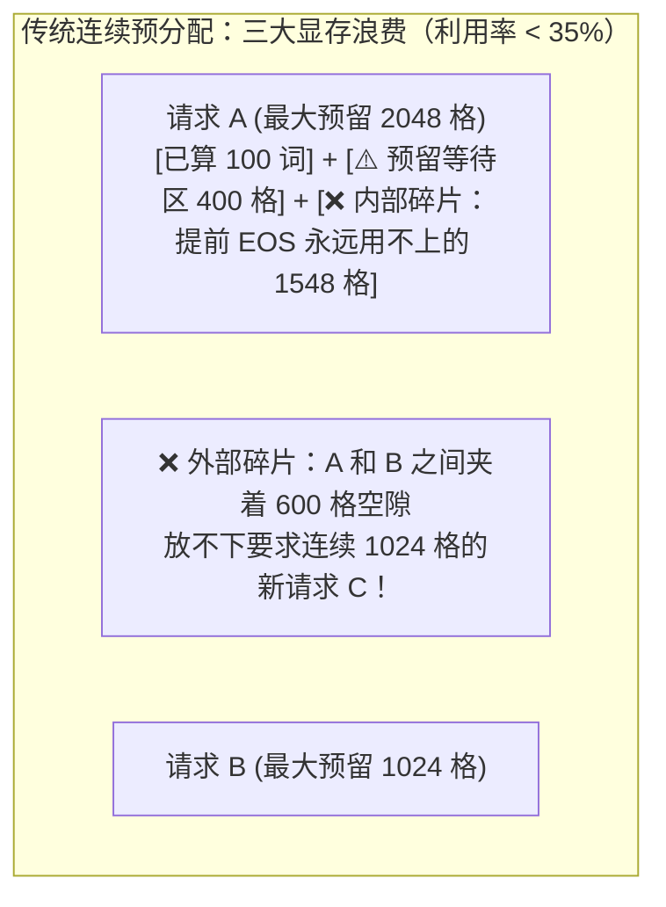
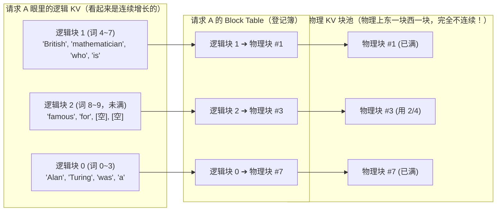
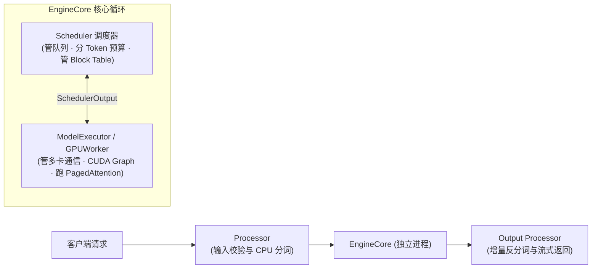

# 1.6 vLLM 架构与调度器：PagedAttention 与统一 Token 调度

## 学习目标

完成本节学习后，你将能够：
- **说清楚传统连续 KV Cache 预分配造成的三种显存浪费**（预留浪费、内部碎片、外部碎片），明白为什么早期系统有超过 60% 的显存被白白浪费。
- **用操作系统“虚拟内存分页”的思想手绘出 PagedAttention 的映射过程**：掌握逻辑块、`block_table`、物理块池与槽位映射（`slot_mapping`）的精确关系。
- **读懂 vLLM V1 引擎的极简统一调度公式**：理解 `num_new_tokens = num_tokens - num_computed_tokens` 如何用一行减法统一处理 Prefill、Chunked Prefill、Decode、前缀缓存与抢占恢复。

---

## 1. 为什么在 PagedAttention 发明之前，GPU 里有 60% 以上的显存都在装空气？

在 `1.3` 节我们学会了用 KV Cache 给自回归生成加速，但在早期推理系统中，要把一个请求的 KV Cache 存进显存，面临一个极其棘手的难题：
- 底层深度学习框架（如 PyTorch）要求一个张量在物理显存上必须是**一块连续的内存地址**。
- 可是当一个用户发来请求时，**没人知道它最后会生成 10 个词还是 4096 个词**！

于是，早期系统只能采取最笨的办法：**只要一个请求进来，不管三七二十一，先在显存里按最大可能长度（如 `max_len = 2048`）给它圈一块连续的领地！**

这种做法立刻导致了三种触目惊心的显存浪费（vLLM 论文实测表明，当时系统中**真正存了有效数据的 KV 显存只有 20.4%–38.2%**，其余超过 60% 全在装空气！）：



| 浪费类型 | 它是怎么产生的？ | 形象比喻 |
|---|---|---|
| **① 预留浪费（Reservation Waste）** | 请求未来可能会用到，但当前这一步还没生成到那儿，空间却已经提前霸占住了 | 客人说“我最多可能吃 20 盘菜”，餐厅一进门就先给他摆满 20 个空盘子占住桌子 |
| **② 内部碎片（Internal Fragmentation）** | 按最大长度 2048 预留了空间，结果模型生成了 50 个词就吐出 `EOS` 结束了，剩下 1998 个格子的预留彻底浪费 | 客人吃饱走了，那 19 个从来没盛过菜的盘子白占了整场 |
| **③ 外部碎片（External Fragmentation）** | 不同长度的连续内存块频繁分配和释放后，显存里到处是东一块 300 MB、西一块 500 MB 的零碎空隙，拼不出新请求要求的连续 1 GB | 停车场里到处是半个车位的空隙，加起来能停 5 辆车，但偏偏塞不进任何 1 辆完整的车 |

---

## 2. 核心心智模型：向操作系统偷师——PagedAttention（分页注意力）

怎么在不事先知道长度的情况下，彻底消灭上面三种浪费？
vLLM 的作者向诞生了半个世纪的**操作系统虚拟内存分页（Virtual Memory Paging）**借了一招：

> **核心思想**：不再要求一个请求的 KV Cache 在物理显存里连续存放！而是把整个 GPU 的 KV 显存池切成一格一格大小完全相同的**物理块（Physical Blocks，比如每块固定存 $B = 16$ 个 Token）**。请求每生成几个新词，需要用多少块，就当场从空闲池里领一块，用一张**块表（`block_table`）**记住映射关系即可！



看看这一下解决了多少问题：
1. **零预留浪费**：按需领块，写满第 0 块（第 0~3 个词）后，第 4 个词生成时才去领第 1 块。
2. **内部碎片最多不到 1 个块**：就算请求随时结束，最多也只浪费**最后那 1 个物理块里没填满的几个槽位**（比如块大小为 16 时，平均只浪费 7.5 个 Token，占几千长文的不到 0.2%！）。
3. **零外部碎片**：因为所有物理块大小一模一样（都是 $B=16$），任何释放出来的物理块都能立刻分给任何其他请求使用，永远不会出现“空隙塞不进”的情况！
4. **顺手白送“跨请求共享”能力**：如果两个请求有相同的开头（如公共 System Prompt），只需要让它们各自 `block_table` 的第 0 项同时指向同一个物理块 `#7` 即可！这就是下一节（`1.7 Prefix Caching`）的地基。

---

## 3. 交互式沙盒：亲手体验物理块分配与显存耗尽时的抢占（Preemption）

点击下方模拟器的三个状态标签，观察多个请求如何从同一个物理块池里按需领块，以及当所有物理块被领光时，调度器是如何通过**抢占（Preemption）**自救的：

<div class="llm-widget" data-widget="paged-attention-sim"></div>

### 动手试一试 & 算清槽位寻址公式（项目 1 必考！）
在上面的沙盒中，假设每块大小 `block_size` $B = 4$，请求 A 的 `block_table = [1, 4, 7]`。
请问：当请求 A 生成到它的第 **6** 个词（从 0 开始数，即位置 `pos = 5`）时，这个词的 $K, V$ 应该写到物理池的第几个具体槽位（`slot`）里？
- **第 1 步（算逻辑块号）**：`logical_block = pos // B = 5 // 4 = 1`（属于逻辑第 1 块）。
- **第 2 步（查表得物理块号）**：`physical_block = block_table[1] = 4`（对应物理块 `#4`）。
- **第 3 步（算块内偏移）**：`offset = pos % B = 5 % 4 = 1`（物理块 `#4` 里的第 1 个格子）。
- **合并成一行公式**：
  $$\text{slot} = \text{block\_table}[\text{pos} \mathbin{//} B] \times B + (\text{pos} \bmod B) = 4 \times 4 + 1 = \mathbf{17}$$
这行公式就是你在 **项目 1 MiniServe 的 `_prepare_inputs()`** 里要亲手写出来的核心寻址代码！

---

## 4. 深入剖析 vLLM V1 架构与统一调度循环

理解了 PagedAttention，我们再来看看工业界标杆 **vLLM（以当前默认的 V1 架构为准）** 是如何把各个模块组织起来的。

### 4.1 vLLM 的核心组件与启动时的“显存实测（Profiling）”



在 `0.3` 节你做实验时可能注意到了：vLLM 启动时并不是用公式去“猜”激活值占多少显存，而是做了一次真实的 **显存测算（Memory Profiling）**：
1. Worker 进程先把模型权重加载进 GPU。
2. 构造一个达到 `max_num_batched_tokens` 上限的假输入（Dummy Batch），**真刀真枪跑一次前向传播**，实测出峰值中间激活张量吃掉了多少显存。
3. 把 `总显存 × gpu_memory_utilization - 权重显存 - 实测激活峰值` 算出来的剩余空间，除以单块大小，**一次性全部切分成 `num_gpu_blocks` 个物理 KV 块**交由 `BlockPool` 管理！（MiniServe 的 `_profile_num_blocks` 同样复刻了这一经典机制。）

> [!NOTE]
> **教材版本勘误提醒**：原书第 8 章在介绍模型加载时提到 `Qwen2.5-7B` 会匹配到 `Qwen3NextForCausalLM`，且示例代码里写了 `Qwen/Qwen3-7B-Instruct`。实际上 `Qwen2.5` 的 `config.json` 中 `architectures` 为 `Qwen2ForCausalLM`；而官方 Qwen3 稠密模型家族的尺寸规格为 `0.6B / 1.7B / 4B / 8B / 14B / 32B`（并无 7B 版本）。阅读源码或跑实验时以模型仓库实际的 `config.json` 为准。

---

### 4.2 调度器的灵魂：用一行减法统一所有阶段！

很多初学者以为调度器里要写无数个 `if is_prefill: ... elif is_chunked: ... elif is_decode: ...`。
翻开 vLLM V1 调度器源码（以及我们的 MiniServe `scheduler.py`），你会惊讶地发现：**调度器根本不区分什么 Prefill 还是 Decode！它只为每个请求维护两个整数，并用一行减法统管全局**：

- **`seq.num_tokens`**：这个请求到目前为止**已知的全部 Token 总数**（= 初始 Prompt 词数 + 已经生成出来的词数）。
- **`seq.num_computed_tokens`**：这个请求到目前为止**已经算完并存进 KV Cache 里的 Token 个数**。

那么，在当前这一步，这个请求**还需要算多少个新 Token**？就是两者的差值（再和当前剩余的单步预算 `token_budget` 取个最小值）：

$$
\text{num\_new\_tokens} = \min\!\Big(\text{token\_budget},\ \text{seq.num\_tokens} - \text{seq.num\_computed\_tokens}\Big)
$$

让我们看看这一个减法式子是如何神奇地统一五种场景的：

| 场景 | `num_tokens` | `num_computed_tokens` | 差值（本步要算的词数） | 算完本步后发生了什么？ |
|---|---|---|---|---|
| **① 全新短请求到达（Prompt=100 词，预算=512）** | $100$ | $0$ | $\min(512, 100 - 0) = \mathbf{100}$ | 一次算完 100 词，`computed` 变为 $100$，并采样出第 1 个新词（`num_tokens` 变为 $101$）！ |
| **② 超长请求切块 Prefill（Prompt=1000 词，预算=512）** | $1000$ | $0$ | $\min(512, 1000 - 0) = \mathbf{512}$ | 本步只算前 512 词，`computed` 变为 $512$（还没追上 $1000$，所以本步不采样，留着下步继续算剩下的 $488$ 词）！ |
| **③ 正常 Decode 步（昨天已算完 100 词并采样出第 101 词）** | $101$ | $100$ | $\min(512, 101 - 100) = \mathbf{1}$ | 自然而然算出差值为 **1**！本步只算最新那 1 个词！ |
| **④ 前缀缓存命中 80 词的新请求（Prompt=100 词）** | $100$ | 直接设为 $\mathbf{80}$ | $\min(512, 100 - 80) = \mathbf{20}$ | 自动跳过已命中的前 80 词，只算末尾新增的 20 词！ |
| **⑤ 被抢占（Preempt）后重新恢复的请求** | $150$ | 被清零为 $\mathbf{0}$ | $\min(512, 150 - 0) = \mathbf{150}$ | 把原来的 Prompt 连同已生成的词一起当成 150 词重新做一次 Prefill！ |

### 4.3 调度每一步的固定顺序：为什么必须“先保老员工（RUNNING），再招新员工（WAITING）”？

在每一步 `schedule()` 中，调度器严格遵守两阶段顺序：
1. **第一阶段：遍历 `running` 队列（已经在跑的老请求）**：
   - 它们已经占着物理 KV 块，屏幕前的用户正在盯着它吐字。
   - 检查每个老请求本步新增 Token 后需不需要新领物理块；如果空闲块池空了，就从 `running` **队尾（最晚进来的最低优先级请求）触发抢占（`_preempt`）**：释放队尾请求的全部物理块、把它的 `num_computed_tokens` 清零塞回 `waiting` 队头，用腾出来的块保住排在前面的老请求继续生成！
2. **第二阶段：如果刚才没发生抢占，且预算和席位还有富余，再从 `waiting` 队列接纳新请求**。

---

## 5. 动手实验：带着问题阅读 vLLM V1 / MiniServe 调度器源码，并复现抢占

### 实验 1：对照阅读 MiniServe 的百行调度器
打开本仓库的 [`code/project1/solution/miniserve/scheduler.py`](https://github.com/zrpxx/hands-on-llm-serving-opt/blob/main/code/project1/solution/miniserve/scheduler.py)（总共只有 160 行，结构与 vLLM V1 的 `vllm/v1/core/sched/scheduler.py` 完全同构），亲眼看看 `_schedule_running`、`_preempt` 和 `_admit` 是怎么写的。

### 实验 2：在 GPU 上故意制造显存不足，观察抢占（Preemption）监控指标
启动 vLLM 时故意把 `--gpu-memory-utilization` 压低（只给很少的 KV 块），同时发一批长输出请求，在另一个终端实时抓取 `/metrics`：

```bash
curl -s http://localhost:8000/metrics | grep -E "num_preemptions|gpu_cache_usage|num_requests_(running|waiting)"
```

当你看到 `num_preemptions_total` 开始上涨时，立刻观察压测客户端报告的 **TPOT P99** 是否同步出现了明显的跳升！

---

## 6. 闯关自测

<div class="llm-widget" data-widget="quiz" data-title="1.6 vLLM 与 PagedAttention · 闯关自测" data-questions='[
  {
    "q": "在 PagedAttention 中，物理块大小（block_size，默认 16）如果设得极端小（比如设为 1）或者极端大（比如设为 512），分别会带来什么负面问题？",
    "options": [
      "没有任何区别，设多大性能都一样",
      "设为 1 时：虽然内部碎片为 0，但 block_table 会变得极长，且 GPU Kernel 在显存里每次只读 1 个 Token 就要跳一次地址，彻底丧失显存合并访问（Coalesced Memory Access）效率；设为 512 时：最后一个未填满块的平均内部碎片高达 256 个 Token，且块级前缀缓存的匹配粒度变得极粗",
      "设为 1 时会导致权重变大 16 倍",
      "设为 512 时会导致模型无法使用 RoPE 位置编码"
    ],
    "answer": 1,
    "explain": "块大小（Block Size）是“寻址/访存连续性”与“内部碎片率”之间的权衡。16 或 32 个 Token 刚好能让一个 GPU Warp 合并读取一整块连续显存，同时把末尾未满块的平均浪费控制在 8~16 个 Token 以内。"
  },
  {
    "q": "某个请求的初始 Prompt 有 600 个词，系统的单步预算 max_num_batched_tokens = 256。在第 1 步调度结束后，该请求的 num_tokens 和 num_computed_tokens 分别是多少？这一步结束时它会调用 LM Head 采样出新词吗？",
    "options": [
      "num_tokens = 601, num_computed_tokens = 600；会采样出新词",
      "num_tokens = 600, num_computed_tokens = 256；不会采样出新词！因为它的 Prompt 才算了前 256 个词，还没有算完已知的全部 600 个词，必须等第 3 步算完第 600 个词时才能采样出第 1 个生成词",
      "num_tokens = 256, num_computed_tokens = 0；会报错退出",
      "num_tokens = 600, num_computed_tokens = 600；直接无视预算"
    ],
    "answer": 1,
    "explain": "只有在 num_computed_tokens + num_new_tokens == num_tokens（即本步算完了该请求当前所有的已知 Token）时，最后一个位置的隐藏状态才代表整段序列的结尾，此时才可送入 LM Head 采样下一个 Token。"
  },
  {
    "q": "为什么调度器在每一步循环开始时，必须先给已经在 RUNNING 队列里的老请求分配 Token 预算和物理块，最后才用剩下的资源去接纳 WAITING 队列里的新请求？",
    "options": [
      "因为 RUNNING 队列里的请求全都是 VIP 付费用户",
      "因为 RUNNING 请求已经占用了大量物理 KV 块，且客户端已经在流式接收字符；如果先接纳新请求把物理块分光了，就会导致老请求全部卡死在半路（饥饿死锁），谁也无法完成并释放显存",
      "因为 Python 的 list 只能从前往后遍历",
      "为了故意让新请求的 TTFT 变慢"
    ],
    "answer": 1,
    "explain": "先跑完已经占了显存的老请求，它们才能尽快到达 EOS 结束并把整串物理块归还给块池（腾笼换鸟）。如果贪多先接纳新请求，所有请求都会因为差最后几个块而相互死锁。"
  }
]'></div>

---

## 延伸阅读与参考文献

- Woosuk Kwon et al., [*Efficient Memory Management for Large Language Model Serving with PagedAttention*](https://arxiv.org/abs/2309.06180), SOSP 2023
- Aleksa Gordić, [*Inside vLLM: Anatomy of a High-Throughput LLM Inference System*](https://www.aleksagordic.com/blog/vllm)
- Chi Wang & Peiheng Hu, *Hands-On LLM Serving and Optimization*, O'Reilly, Chapter 6 (*PagedAttention*) & Chapter 8 (*vLLM*)
