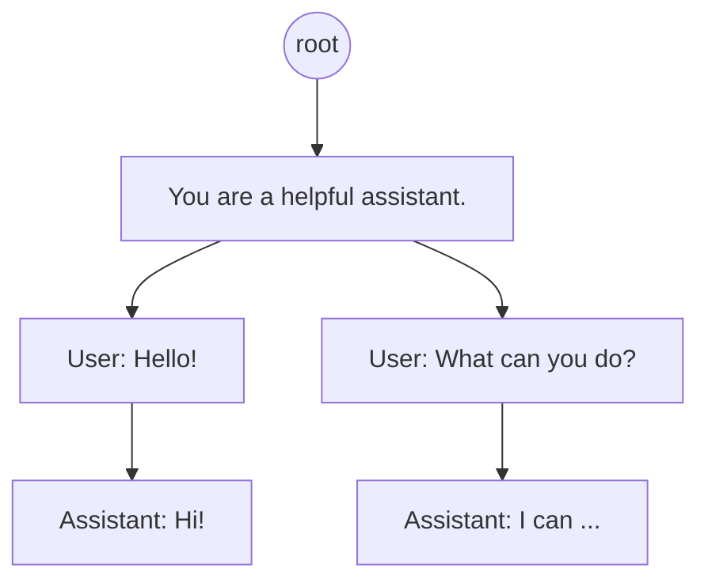

# 1.7 Prefix Caching 与 RadixAttention

> 对应书中第 6 章 Prefix Caching

## 学习目标

- 解释为什么整请求缓存对 LLM 命中率很低，而前缀缓存在多轮对话、长上下文场景中很有效。
- 比较 SGLang 的 RadixAttention（基数树）与 vLLM 的块哈希两种实现。
- 掌握提高命中率的 prompt 组织方式，以及多副本、多租户场景下的注意事项。

## 1. 从请求缓存到前缀缓存

传统服务常用请求缓存：对整个输入做哈希，命中就直接返回上次的输出。Triton Inference Server 就是这样做的。缓存有效的前提是存储比计算便宜。

但 LLM 的输入是自由文本，同一个问题可以有无数种问法，整请求命中率很低。**前缀缓存**换了一个粒度：不要求整个 prompt 相同，只要**开头一段**相同，那一段的 KV 就可以直接复用，不必重新 prefill。

| | 请求缓存 | 前缀缓存 |
|---|---|---|
| 缓存的内容 | 最终输出 | 前缀部分的 KV Cache |
| 命中条件 | 整个输入完全相同 | 开头的若干 token 相同 |
| 节省的部分 | 全部计算 | 前缀部分的 prefill |
| 主要改善 | 延迟与成本 | TTFT |

不开前缀缓存时，请求结束后它的 KV 立即释放；开启后，KV 在显存中保留到空间不足为止，按 LRU 淘汰。

## 2. 什么时候有效

书中的例子：

```text
Prompt 1: Hi, what is the weather like today?
Prompt 2: Hi, what is the weather like now?
Prompt 3: What is the weather like today?
```

Prompt 2 可以复用 Prompt 1 中 "Hi, what is the weather like" 的部分；Prompt 3 开头没有 "Hi"，必须完全重算，即使后面的内容一样。**只有前缀能复用。**

前缀缓存最有效的两类场景：

**多轮对话。** 每一轮请求都会带上之前所有的对话历史。没有前缀缓存时，第 $n$ 轮要把前 $n-1$ 轮全部重新 prefill，对话越长 TTFT 越长；有了前缀缓存，每轮只需 prefill 新增的部分。

**长上下文。** 把一份长文档放进 prompt 反复提问时，文档部分的 KV 只需算一次。这要求每次构造 prompt 时，文档部分逐字节一致。

书中提到，现代推理引擎的前缀缓存开销几乎为零，所以通常默认开启：即使命中率只有 5%，命中的那部分请求的 TTFT 也会大幅下降。

## 3. 两种实现

### 3.1 RadixAttention（SGLang）

用一棵基数树（压缩前缀树）索引所有缓存过的 token 序列。树放在 CPU 内存中，每个节点指向显存中对应的 KV。新请求到来时，从根开始沿树匹配最长前缀；空间不足时，从叶子节点开始按 LRU 递归淘汰。



SGLang 的调度器还会利用这棵树做**缓存感知调度**：等待队列中优先处理与已缓存内容共享前缀最长的请求，进一步提高命中率。

### 3.2 块哈希（vLLM）

vLLM 在 PagedAttention 的块上实现前缀缓存（书外补充）：

- 每个**填满的**块计算一个哈希值，由"父块的哈希 + 本块的 token"决定（如有 LoRA、多模态输入等，也会加入哈希）。因此哈希值相同就意味着从开头到这一块的全部内容都相同。
- 维护一张"哈希 → 物理块"的表。新请求按块依次查表，直到第一个未命中的块。
- 命中的块引用计数加一，多个请求共享同一个物理块。
- 引用计数为 0 的块不立即清空，而是留在空闲队列中，按 LRU 顺序被重新分配时才真正失效。

| | RadixAttention | vLLM 块哈希 |
|---|---|---|
| 索引结构 | 基数树 | 哈希表 |
| 匹配粒度 | token | 块（未填满的最后一块不缓存） |
| 淘汰 | 叶子节点 LRU | 空闲块 LRU |

两者效果相近。块粒度意味着前缀中最后不满一块的部分无法命中，块大小越大损失越多。

## 4. 提高命中率

**静态内容放前面，动态内容放后面。**

```text
<system>
You are a helpful assistant.
<context>
Document: {每次都相同的静态上下文}
<user>
{用户的动态问题}
```

**prompt 必须逐 token 一致。** 书中的例子：把 `Document` 写成 `Documents`，多一个字母就会导致后面全部未命中。所以 prompt 应该由程序统一拼装，不要手写模板的多个变体。

RAG 场景下命中率天然较低，但仍可以争取更长的命中：

| 写法 | 问题 |
|---|---|
| `Document 1: ...`、`Document 2: ...`，格式统一，按固定规则排序 | 推荐 |
| 部分行缺空格（`Document1:`、`Document 2:...`） | 格式不一致，从出错处开始未命中 |
| 同样的文档块但顺序不同 | 从第一个位置不同的块开始未命中 |

即使只有前两个检索结果相同，也能命中到 `Document 3:` 之前，仍有收益。稳定的排序和去重有助于更长的命中。

另外，一些常见的做法会无意间破坏前缀：在系统提示词里放当前时间、请求 ID、随机示例顺序等。这些内容应移到 prompt 末尾。

## 5. 扩展到多副本

前缀缓存保存在每个副本自己的显存中。多副本部署时，如果用轮询或最少连接这类负载均衡，同一个会话的请求可能落到不同副本，命中率随副本数增加而下降。

解决办法是**缓存感知路由**：类似一致性哈希，在前缀和副本之间建立亲和关系，把相同前缀的请求尽量发到已经缓存它的副本。这样每个副本只需缓存一部分前缀，减少了显存占用和反复淘汰。SGLang 的 router、vLLM 生态中的 llm-d、NVIDIA Dynamo 等都提供这类路由，4.6 节会讨论。

显存仍不够时，可以把 KV 卸载到 CPU 内存或 SSD（4.4 节）。

## 6. 多租户隔离

多个客户共享同一个模型实例时，前缀缓存可能泄露信息：客户 A 可以构造不同的 prompt，根据 TTFT 判断某个前缀是否被缓存过，从而推测其他客户输入过什么内容。

书中引用 NVIDIA 的做法：在系统提示词之后、上下文之前插入租户或会话 ID，使不同租户只能共享系统提示词这一段公共前缀：

```text
<system>
You are a helpful assistant.
<id> {user id 或 session id}
<context>
Document: {...}
<user>
{...}
```

一些推理引擎也提供了参数级的隔离手段，例如 vLLM 的请求参数 `cache_salt`，会把它加入第一个块的哈希中，效果相同（以所用版本的文档为准）。

## 动手实验

**实验 1：前缀缓存对 TTFT 的影响。** 用 `bench.py` 的 `--shared-prefix-len` 构造共享前缀的负载，分别在开启（默认）和关闭前缀缓存时压测：

```bash
vllm serve Qwen/Qwen3-8B --max-model-len 8192                                  # 默认开启
vllm serve Qwen/Qwen3-8B --max-model-len 8192 --no-enable-prefix-caching      # 关闭

python code/project1/bench.py --base-url http://localhost:8000 --model Qwen/Qwen3-8B \
  --num-prompts 200 --shared-prefix-len 2048 --input-len 128 --output-len 128 \
  --request-rate 4 --vocab-size 32000
```

| 共享前缀长度 | 开启：TTFT P50 / P99 | 关闭：TTFT P50 / P99 | 吞吐变化 |
|---|---|---|---|
| 0 | | | |
| 512 | | | |
| 2048 | | | |
| 6144 | | | |

从 vLLM 的 `/metrics` 中读取 `prefix_cache_queries` 和 `prefix_cache_hits`，计算命中率，与理论值（共享部分 / 总输入）比较。

**实验 2（可选，项目 1 的延伸）：** 在 MiniServe 中实现块哈希前缀缓存。需要修改的地方：`BlockAllocator` 增加引用计数与"哈希 → 块"表；`Scheduler._admit` 在分配前先查询已缓存的块并把 `num_computed_tokens` 设为命中长度；请求结束时只减引用计数，不立即释放。测试方法：同一个 prompt 连续发两次，第二次的 prefill token 数应只有最后不满一块的部分。

## 自测题

1. 多轮对话中，用户把第一轮的问题改了一个字后重新发送，前缀缓存还能命中多少？
2. 为什么 vLLM 只缓存填满的块？
3. 一个服务有 8 个副本，用轮询负载均衡，每个会话平均 10 轮。前缀缓存的命中率大约会怎样变化？
4. 在系统提示词的开头写入"当前时间：2026-10-26 19:30:12"，会带来什么问题？

<details>
<summary>参考答案</summary>

1. 只能命中修改位置之前的部分（例如系统提示词）。从修改处开始，后面所有轮次的内容都要重新计算。
2. 未填满的块还会继续写入新 token，内容未定，无法作为稳定的缓存项；而且块哈希包含块内全部 token，只有填满后才能确定。
3. 同一会话的下一轮只有 1/8 的概率落在同一个副本上，多轮对话的历史部分大多无法命中，命中率约下降为原来的 1/8 左右。需要按会话或前缀做亲和路由。
4. 时间每次都不同，而且位于最开头，整个 prompt 都无法命中前缀缓存。应把时间放到 prompt 末尾，或降低精度（例如只写日期）。

</details>

## 延伸阅读

- Zheng et al., *SGLang: Efficient Execution of Structured Language Model Programs*, NeurIPS 2024
- vLLM 文档中的 Automatic Prefix Caching 设计说明
- NVIDIA 技术博客中关于 KV Cache 复用与多租户隔离的文章（书中引用）
