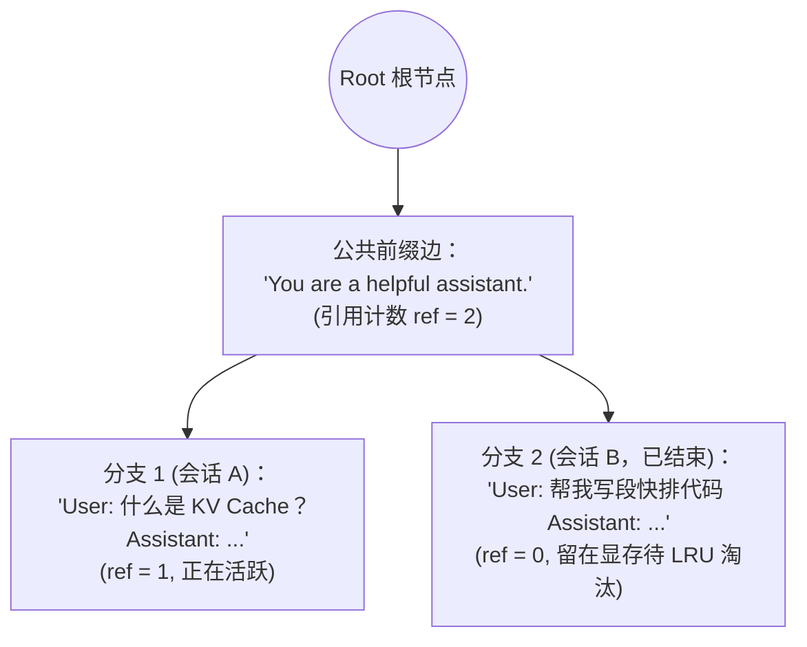
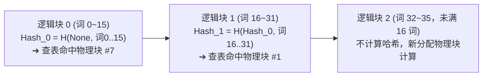

# 1.7 Prefix Caching 与 RadixAttention：不重复算同一个开头

## 学习目标

完成本节学习后，你将能够：
- **解释为什么只有“前缀（Prefix）”的 KV Cache 可以直接跨请求复用，而中间或末尾相同的文本不能直接复用**。
- **对比两大主流实现方案**：SGLang 的 **RadixAttention（基数树）** 与 vLLM 的 **块级链式哈希（Block Hashing）**。
- **写出缓存命中率最高的高性能 Prompt 模板**：避开“开头塞动态时间戳”等导致缓存 100% 崩溃的常见工程反模式。
- **解决多副本部署下的缓存分散问题与多租户侧信道隐私泄露风险**。

---

## 1. 为什么传统后端的“整请求缓存”在大模型下几乎没用？

在传统数据库或网页后端里，最常用的加速手段是把 `{完整请求参数: 返回结果}` 存进 Redis 缓存里。如果下一个人搜一模一样的关键词，直接返回缓存结果。

但在大模型应用里，哪怕两个用户问的是同一个意思（比如 `"帮我总结一下这份财报的亮点"` vs `"请概括一下这篇财报的核心数据"`），只要末尾差了一个标点符号，或者采样温度 `temperature > 0` 要求每次生成不同的回答，**整请求缓存的命中率几乎为 0%**！

然而，如果你仔细观察线上真实流量，会发现虽然每个请求的**结尾**不同，但它们的**开头（Prefix）往往大片大片地完全相同**：

1. **场景一：共享长 System Prompt 与 Few-shot 示例**：所有用户的请求最前面都拼着同一段 2,000 字的业务规则与工具定义（Function Calling Schemas）。
2. **场景二：多轮对话（Multi-turn Chat）**：用户和模型聊到第 10 轮时，客户端会把前 9 轮的全部历史对话连同第 10 轮的新问题一起发给服务端。其中**前 9 轮的内容在上一轮早就已经算过一遍了**！
3. **场景三：长文档问答（Document QA）**：用户上传了一份 3 万字的技术手册，连续针对这份手册提了 8 个不同的问题。

既然我们在 `1.1` 和 `1.3` 节已经证明了：**在因果注意力（Causal Attention）下，只看过去、不看未来——只要开头的 $k$ 个 Token 完全一模一样，这 $k$ 个 Token 在每一层算出来的 Key 和 Value 向量就 100% 恒定不变！**
那我们为什么不在请求结束后把这些物理 KV 块留在显存里，让下一个拥有相同开头的请求直接白嫖复用呢？这就是 **Prefix Caching（前缀缓存）**！

---

## 2. 核心心智模型：为什么只有“开头相同”能复用，“中间相同”却不行？

初学者最爱问的一个问题是：
- **Prompt 1**：`"Hi, what is the weather like today?"`
- **Prompt 2**：`"Hi, what is the weather like now?"`
- **Prompt 3**：`"What is the weather like today?"`（去掉了开头的 `"Hi, "`）

为什么 Prompt 2 可以直接复用 Prompt 1 中 `"Hi, what is the weather like"` 的 KV Cache，而 Prompt 3 明明后面整句话都和 Prompt 1 一模一样，却**一个词都不能复用，必须全部从头重算**？

有两个铁板钉钉的数学原因：
1. **因果注意力的上文依赖**：Prompt 1 里的 `"weather"` 在计算注意力时，看到了最开头的 `"Hi, "`；而 Prompt 3 里的 `"weather"` 没有看到 `"Hi, "`，所以它们算出来的隐藏状态和 $K, V$ 数值根本不相等！
2. **RoPE 旋转位置编码的位置偏移**：Prompt 1 里的 `"What"` 处于位置 `pos = 2`（旋转了 $2\theta$ 角）；而 Prompt 3 里的 `"What"` 处于位置 `pos = 0`（旋转了 $0\theta$ 角），编码进 $K$ 向量的绝对位置已经变了！

> **铁律**：在标准自回归模型中，**KV Cache 复用必须从第 0 个 Token 开始逐词严格连续匹配**；一旦在位置 $i$ 出现哪怕 1 个 Token 的差异，从位置 $i$ 往后的所有 KV Cache 全部失效！

---

## 3. 交互式沙盒：亲手测试 Prompt 结构如何决定前缀缓存生与死

请点击下方沙盒中的两个场景标签，对比“标准结构（静态在前、动态在后）”与“反面教材（开头放动态时间戳）”下的缓存命中情况：

<div class="llm-widget" data-widget="prefix-cache-matcher"></div>

---

## 4. 两大工业级实现对比：SGLang 的基数树 vs vLLM 的块级链式哈希

既然要复用前缀，推理引擎怎么在微秒级时间内判断“新来的 Prompt 和显存里哪几个物理块能匹配上”？目前工业界有两种最主流的实现架构：

### 4.1 SGLang：RadixAttention（基于压缩前缀树 / 基数树）

SGLang 在 CPU 内存中维护了一棵 **Radix Tree（基数树，即把单链节点压缩合并的前缀树）**，树上的每条边对应一段 Token 序列，指向 GPU 显存中对应的 KV 页：



- **怎么查？** 新请求进来时，从根节点顺着树往下比对 Token，能走多深就复用多少 KV。
- **怎么淘汰？** 请求结束后，并不立刻删掉它的树节点和显存，只是把引用计数 `ref` 减为 `0`。当显存不够分配新块时，才从**引用计数为 0 的叶子节点**开始，按 **LRU（最近最少使用）** 顺序往上回收物理块。

### 4.2 vLLM：Automatic Prefix Caching（基于 PagedAttention 块级链式哈希）

vLLM 没有建树，而是巧妙地直接复用 `1.6` 节的 **PagedAttention 物理块（Block）**，给每个**填满的块**算一个**链式哈希值（Chained Block Hash）**：

$$
\text{Hash}(\text{Block}_i) = \text{SHA256}\Big(\text{Hash}(\text{Block}_{i-1}) \mathbin{\Vert} \text{Tokens in Block}_i\Big)
$$



- **为什么要把“上一块的哈希 $\text{Hash}(\text{Block}_{i-1})$”也拼进去算？**
  因为刚才讲过：只有从第 0 个词起完全相同的块才能复用！把父块哈希串进去后，只要 `Hash_1` 相等，就从数学上保证了不仅当前块（词 16~31）相同，而且它前面的块 0（词 0~15）也一定完全相同！
- **两者对比**：

| 维度 | SGLang RadixAttention | vLLM 块级链式哈希（APC） |
|---|---|---|
| **核心数据结构** | 基数树（Radix Tree） | 全局哈希表 `Dict[BlockHash, PhysicalBlock]` |
| **匹配最小粒度** | 1 个 Token（或页粒度） | **1 个完整的物理块**（默认 16 个 Token；末尾不满 1 块的零头不缓存） |
| **与 PagedAttention 结合** | 树节点指向页池 | 天然一体，零额外树维护开销，命中后直接把物理块塞进 `block_table` 并将 `ref_count += 1` |

---

## 5. 工程实战守则：怎么写 Prompt 才能榨干 Prefix Caching？

在现代引擎中，开启前缀缓存几乎没有任何性能副作用（vLLM 默认已开启）。但能不能享受到 80% 的 TTFT 加速，完全取决于应用工程师怎么拼 Prompt：

### 守则 1：严格遵守「越静态越靠前，越动态越靠后」的金字塔顺序
```text
┌─────────────────────────────────────────────────────────┐
│ 1. 全局固定 System Prompt & 工具 Schema 定义（所有用户共享） │  <-- 命中率 ~100%
├─────────────────────────────────────────────────────────┤
│ 2. 静态长文档 / 知识库背景材料（同一文档多次提问共享）       │  <-- 命中率极高
├─────────────────────────────────────────────────────────┤
│ 3. 多轮对话历史 History（同一会话第 N 轮复用前 N-1 轮）      │  <-- 会话内命中
├─────────────────────────────────────────────────────────┤
│ 4. 本轮最新用户提问 & 当前时间戳 / 动态状态（放最末尾！）     │  <-- 每次僅需算这一小段！
└─────────────────────────────────────────────────────────┘
```
> **千万别犯的低级错误**：很多框架习惯在 System Prompt 的第一行写 `Current Time: 2026-10-27 12:30:05`。这会导致每秒钟第 0 个块都发生变化，后面几万字的长文档缓存 **100% 全部报废**！如果一定要传时间，请只传日期（`2026-10-27`）或者把精确时间挪到最末尾的用户消息里。

### 守则 2：多副本集群必须配“缓存感知路由（KV-aware Routing）”
假设你部署了 **8 个** vLLM 副本，前面挂了一个普通的轮询（Round-Robin）网关。
同一个用户的第 1 轮对话落在了 **副本 1**（KV 缓存在副本 1 的显存里）；结果第 2 轮对话被轮询分发到了 **副本 2**——副本 2 的显存里根本没有第一轮的缓存，命中率瞬间暴跌为 $1/8$！
因此在多副本生产环境中，网关必须按会话 ID 或 Prompt 前缀哈希做**亲和路由（Affinity / KV-aware Routing）**，把拥有相同前缀的请求始终导向同一台机器（第 4.6 节详解）。

### 守则 3：多租户场景下的侧信道隐私隔离（`cache_salt`）
如果一家公有云 API 让不同公司的客户共享同一个推理实例，恶意攻击者可以精心构造猜测的前缀（如 `"机密收购案目标公司是：A公司"`），通过测量返回的 **TTFT 是 50ms（命中了别的客户留下的缓存！）还是 800ms（未命中）**，反推出其他客户刚才向模型发送过什么机密文档！
- **防御手段**：在请求中传入租户专属的盐值（如 vLLM 的 `cache_salt="tenant_A"`），引擎会把该盐值混入第 0 个块的哈希计算中，确保不同租户之间绝不共享私有上下文的 KV 块。

---

## 6. 动手实验：实测开启 Prefix Caching 后 TTFT 暴降 80%

用本仓库的 `bench.py`（支持 `--shared-prefix-len` 生成带公共长前缀的测试流量），对比开启与关闭前缀缓存时的 TTFT 差距：

```bash
# 1. 默认开启前缀缓存启动 vLLM
vllm serve Qwen/Qwen3-8B --max-model-len 8192

# 2. 发送 200 个请求：每个请求包含 2048 tokens 的共享长前缀 + 128 tokens 的独立问题
python code/project1/bench.py --base-url http://localhost:8000 --model Qwen/Qwen3-8B \
  --num-prompts 200 --shared-prefix-len 2048 --input-len 128 --output-len 128 \
  --request-rate 4 --vocab-size 32000

# 3. 加上 --no-enable-prefix-caching 重启 vLLM 再跑一次上面命令，对比两者的 TTFT P50/P99！
```

---

## 7. 闯关自测

<div class="llm-widget" data-widget="quiz" data-title="1.7 Prefix Caching · 闯关自测" data-questions='[
  {
    "q": "用户在多轮对话进行到第 10 轮（累计已有 4,000 tokens 历史）时，突然点击网页上的“编辑第 1 轮提问”，把第 1 轮问题里的一个错别字改掉并重新发送。请问此时前缀缓存还能命中多少内容？",
    "options": [
      "能命中 99.9%，只有改掉的那 1 个字需要重算",
      "只能命中第 1 轮修改位置之前的内容（如最开头的 System Prompt）；从第 1 轮修改的那个字往后的全部 9 轮历史对话，因上文改变导致 KV 全部失效，必须全部重新 Prefill",
      "第 2 轮到第 10 轮可以全部命中",
      "会导致服务器崩溃"
    ],
    "answer": 1,
    "explain": "因果注意力中，位置 i 的 K、V 依赖于 0..i 的全部输入。修改第 1 轮的文字后，后面第 2~10 轮所有 Token 看到的上文都变了，链式块哈希从修改处起全部改变，无法复用。"
  },
  {
    "q": "为什么 vLLM 的块级前缀缓存（Block Hashing）只对已经填满（如满 16 个 Token）的物理块计算哈希并放入全局缓存表，而不缓存末尾尚未填满的块？",
    "options": [
      "因为 SHA256 算法只能对 16 的倍数进行哈希",
      "因为未填满的块后续还会继续追加写入新生成的 Token，内容尚未定型；且以完整块为单位建立哈希索引最简洁高效，末尾最多只损失不到 1 个块（<16 tokens）的复用",
      "因为未填满的块存放在 CPU 内存里",
      "因为 GPU 不允许读取未填满的块"
    ],
    "answer": 1,
    "explain": "块级哈希以固定的 block_size 为最小索引粒度。未满块仍在动态增长，不适合作为不可变的缓存键；即使不缓存最后不满 16 个词的零头，重算这十几个词的开销也微乎其微。"
  },
  {
    "q": "在多租户共享的 SaaS 推理服务中，为什么开启全局 Prefix Caching 可能引发安全隐患？该如何解决？",
    "options": [
      "因为不同租户的权重会混在一起",
      "存在计时侧信道攻击（Timing Side-channel）风险：攻击者可通过探测特定前缀的 TTFT 快慢，推断其他租户是否刚提交过某段敏感文本；可通过注入租户 ID 或使用 cache_salt 对不同租户的块哈希做命名空间隔离",
      "会导致用户的密码被打印在日志里",
      "没有任何安全隐患"
    ],
    "answer": 1,
    "explain": "缓存命中与未命中的 TTFT 差距可达数倍，构成了典型的时间侧信道。通过 cache_salt 将租户标识混入首个块的哈希计算，即可在不牺牲租户内部缓存复用的前提下实现跨租户隔离。"
  }
]'></div>

---

## 延伸阅读与参考文献

- Lianmin Zheng et al., [*SGLang: Efficient Execution of Structured Language Model Programs*](https://arxiv.org/abs/2312.07104), NeurIPS 2024（提出 RadixAttention 基数树前缀缓存）
- Chi Wang & Peiheng Hu, *Hands-On LLM Serving and Optimization*, O'Reilly, Chapter 6 (*Prefix Caching*)
