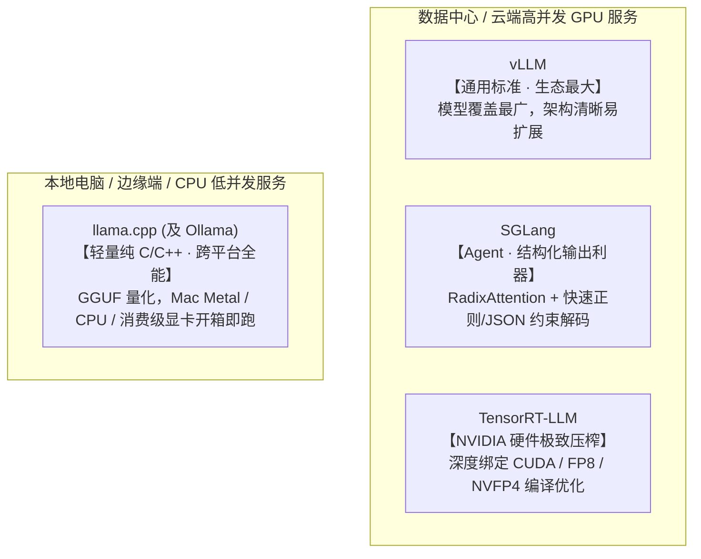

# 1.8 推理框架对比：vLLM、SGLang、TensorRT-LLM 与 llama.cpp

## 学习目标

完成本节学习后，你将能够：
- **总结为什么传统深度学习服务框架（如 TorchServe、TF Serving）无法胜任大模型推理**。
- **准确把握四大主流开源框架（vLLM、SGLang、TensorRT-LLM、llama.cpp）的架构侧重与选型边界**。
- **掌握企业级框架选型的六步评估法**，学会用 OpenAI 兼容接口构建可随时平替的抽象层。

---

## 1. 为什么传统模型服务框架（TorchServe / TF Serving）被淘汰了？

经过前 7 节的学习，你已经把现代大模型推理引擎的五脏六腑摸得一清二楚了。现在回头看传统的通用深度学习服务框架（如 TorchServe、TensorFlow Serving），你就明白为什么它们在大模型时代几乎无人问津：

| 大模型服务的独特挑战 | 传统通用服务框架的做法 | 专用大模型推理引擎（vLLM / SGLang / TRT-LLM）的做法 |
|---|---|---|
| **自回归多步循环（1.2）** | 把整个请求当成 1 次黑盒函数调用 | 拆解为**单步迭代（Step）**级别调度，每生成 1 个词重新编批 |
| **动态膨胀的 KV Cache（1.3 & 1.6）** | 每次分配连续大张量，碎片浪费 > 60% | **PagedAttention 分页块池**，消灭外部碎片，显存利用率接近 100% |
| **长短不一的输入输出（1.5）** | 静态或动态整批等待，产生大量空泡 | **Continuous Batching + Chunked Prefill**，随完随走、切块混跑 |
| **大量共享前缀（1.7）** | 每次从头重算整段 Prompt | **块哈希或 RadixAttention 前缀缓存**，自动跳过重复 Prefill |
| **严苛的显存带宽瓶颈（0.4）** | 标准 FP32/FP16 算子 | 深度定制 **W4A16 / FP8 / NVFP4 量化算子**、FlashAttention 与投机采样 |

---

## 2. 四大主流推理框架全景对比

目前工业界与开源社区最核心的四个推理框架，各自占据着非常清晰的生态位：



| 对比维度 | **vLLM** | **SGLang** | **TensorRT-LLM** | **llama.cpp** |
|---|---|---|---|---|
| **核心定位** | 最通用的高吞吐在线服务引擎 | 面向复杂 Agent、多轮分支与结构化输出 | 在 NVIDIA GPU 上压榨极致性能与最低成本 | 笔记本、CPU、边缘设备的低并发本地推理 |
| **实现语言** | Python 调度 + CUDA/Triton 算子 | Python 调度 + CUDA/Triton 算子 | C++ 核心运行时 + Python 封装 | 纯 C / C++（零重型依赖） |
| **前缀缓存机制** | 块级链式哈希（Block Hashing） | **RadixAttention（基数树）** + 缓存感知调度 | 块级 KV 复用 | 会话级 Prompt 缓存 |
| **杀手锏特性** | 新模型 Day-0 支持、社区插件最全、V1 架构极其稳健 | 极速 JSON/EBNF 约束解码、高效多模态与 DeepSeek 深度优化 | NVIDIA 官方算子库（FP4/FP8/通信）最快落地 | GGUF 格式 2~8 bit 量化、支持 CPU+GPU 混合卸载 |
| **支持的硬件** | NVIDIA、AMD、TPU、昇腾、CPU 等 | NVIDIA、AMD、TPU、昇腾、CPU 等 | **仅限 NVIDIA GPU** | 几乎所有硬件（Mac M系列、x86/ARM CPU、各家 GPU） |
| **上手与排障难度** | ★☆☆（极易上手） | ★☆☆（极易上手） | ★★☆（较重，需对齐驱动与编译环境） | ★☆☆（单二进制文件即跑） |

---

## 3. 交互式沙盒：你的业务场景最适合哪个推理框架？

点击下方选型器中的不同业务场景，查看推荐的推理框架、核心理由以及对应的启动命令：

<div class="llm-widget" data-widget="framework-advisor"></div>

### 代码写法对比：同一实验在四大框架中的调用方式

<!-- tabs:start -->
#### **vLLM**
```python
from vllm import LLM, SamplingParams

llm = LLM(model="Qwen/Qwen3-8B", dtype="bfloat16")
out = llm.generate(["The capital of France is"], SamplingParams(temperature=0.8, top_p=0.95, max_tokens=64))
print(out[0].outputs[0].text)
```
#### **SGLang**
```python
import sglang as sgl

llm = sgl.Engine(model_path="Qwen/Qwen3-8B", dtype="bfloat16")
out = llm.generate(["The capital of France is"], {"temperature": 0.8, "top_p": 0.95, "max_new_tokens": 64})
print(out[0]["text"])
```
#### **TensorRT-LLM**
```python
from tensorrt_llm import LLM, SamplingParams

llm = LLM(model="Qwen/Qwen3-8B")
for out in llm.generate(["The capital of France is"], SamplingParams(temperature=0.8, top_p=0.95, max_tokens=64)):
    print(out.outputs[0].text)
```
#### **llama.cpp (Python 绑定)**
```python
from llama_cpp import Llama

llm = Llama.from_pretrained(repo_id="Qwen/Qwen3-8B-GGUF", filename="*Q4_K_M.gguf", verbose=False)
print(llm("The capital of France is", max_tokens=64)["choices"][0]["text"])
```
<!-- tabs:end -->

---

## 4. 企业级框架选型的“六步铁律”（按负载选，不按热度选！）

不要因为网上某篇测评说“框架 X 比框架 Y 快 20%”就盲目跟风切换。大模型框架的性能对**硬件型号、模型架构（稠密 vs MoE、MHA vs GQA/MLA）、输入输出长度比、前缀重合度**极度敏感。科学的选型必须遵循以下六步：

1. **先写下硬性的 SLO 与质量约束**：比如 `TTFT P99 < 800ms`、`TPOT P99 < 40ms`、是否必须 100% 符合 JSON Schema。
2. **用自己的真实业务流量画像做测试集**：统计线上真实的 Prompt 长度分布、输出长度分布、以及多轮对话的前缀重合比例（千万别拿别人的合成短数据结论套自己的长文档业务）。
3. **对齐一切基准参数做苹果对苹果（Apples-to-Apples）对比**：统一模型权重、统一精度（BF16 或 FP8）、统一 `--max-model-len`、统一开启或关闭前缀缓存，用同一个外部压测客户端（如本仓库的 `code/project1/bench.py`）施压。
4. **考察生产可运维性**：冷启动要多久？崩溃报错好不好查？Prometheus 监控指标全不全？
5. **评估多硬件可移植性**：如果公司既有 NVIDIA 卡又有国产卡或 AMD 卡，优先选 vLLM / SGLang。
6. **用 OpenAI 兼容接口做抽象隔离**：业务代码永远只调标准的 `/v1/chat/completions` 接口。这样每隔半年框架格局变化时，只需改一行 Docker 镜像配置就能无缝切换后端！

---

## 5. 动手实验：用同一套压测脚本对 vLLM 与 SGLang 做公平对决

在 GPU 上分别用完全相同的参数启动 vLLM 和 SGLang，然后用 `code/project1/bench.py` 在两组典型负载下（**负载 A：短输入长输出聊天** vs **负载 B：4096 共享长前缀文档问答**）同台竞技：

```bash
# 分别启动（测试完一个关掉再启动另一个，确保独占同一张 GPU）
vllm serve Qwen/Qwen3-8B --max-model-len 8192 --port 8000
# 或
python -m sglang.launch_server --model-path Qwen/Qwen3-8B --context-length 8192 --port 8000

# 负载 A：聊天型（输入 256，输出 512，无共享前缀）
python code/project1/bench.py --base-url http://localhost:8000 --model Qwen/Qwen3-8B \
  --num-prompts 200 --input-len 256 --output-len 512 --request-rate 8 --vocab-size 32000

# 负载 B：长文档问答（共享前缀 4096，独立问题 128，输出 128）
python code/project1/bench.py --base-url http://localhost:8000 --model Qwen/Qwen3-8B \
  --num-prompts 200 --shared-prefix-len 4096 --input-len 128 --output-len 128 --request-rate 8 --vocab-size 32000
```

---

## 6. 闯关自测

<div class="llm-widget" data-widget="quiz" data-title="1.8 推理框架对比 · 闯关自测" data-questions='[
  {
    "q": "某企业内部需要在没有独立 GPU 的纯 CPU 服务器（或员工的 MacBook 笔记本）上，为 10 名法务人员私有部署一个低并发的 8B 合同问答工具。最适合选择哪个推理框架？",
    "options": [
      "TensorRT-LLM（它只支持 NVIDIA GPU）",
      "llama.cpp（或基于它封装的 Ollama），配合 GGUF 4-bit/8-bit 量化，纯 C/C++ 实现且针对 CPU SIMD 与 Apple Metal 做了深度优化",
      "必须买 8 张 H100 才能跑 8B 模型",
      "原生 PyTorch FP32 直接运行"
    ],
    "answer": 1,
    "explain": "llama.cpp 专为本地、边缘与低并发场景设计，无重型 Python/CUDA 依赖，配合 GGUF 量化可在普通 CPU 服务器或 Mac 上流畅运行 8B 模型。"
  },
  {
    "q": "为什么说“看到某篇博客评测框架 A 在 ShareGPT 数据集上比框架 B 快 15%，就立刻决定把公司所有线上服务换成框架 A”是错误的工程决策？",
    "options": [
      "因为博客里的数据一定是伪造的",
      "因为推理性能高度依赖具体的负载特征（输入输出长度比、前缀共享率、是否开启结构化输出）、模型结构（MHA/GQA/MoE）与硬件型号；别人的短对话测试集完全不代表你自己的长文档或 Agent 业务负载",
      "因为所有推理框架的速度在任何情况下都绝对相等",
      "因为换框架需要重训模型权重"
    ],
    "answer": 1,
    "explain": "选型的第一原则是“按自己的真实负载和 SLO 选”。必须在相同的硬件、精度、上下文长度下，用符合自身业务分布的流量实测 Goodput。"
  },
  {
    "q": "为了防止业务代码被某一个特定的推理框架绑定死（Vendor/Framework Lock-in），工程上最简单有效的架构解耦做法是什么？",
    "options": [
      "自己从零用汇编语言写一套推理引擎",
      "让上层业务代码与网关统一只调用标准的 OpenAI 兼容 HTTP/SSE 接口（/v1/chat/completions），将具体框架的启动参数封装在容器配置层，并维护一套与框架无关的自动化压测回归脚本",
      "同时在每台机器上启动四个框架",
      "不使用任何推理框架"
    ],
    "answer": 1,
    "explain": "vLLM、SGLang、TensorRT-LLM、llama.cpp 均原生提供 OpenAI 兼容接口。以此作为标准契约层，底层引擎即可随时灰度替换或混部。"
  }
]'></div>

---

## 延伸阅读与参考文献

- Chi Wang & Peiheng Hu, *Hands-On LLM Serving and Optimization*, O'Reilly, Chapter 8 (*LLM Serving Frameworks*)
- 下一站实战闯关：**[项目 1 · MiniServe：亲手从零实现一个迷你推理引擎](stage1/boss-miniserve.md)**！
