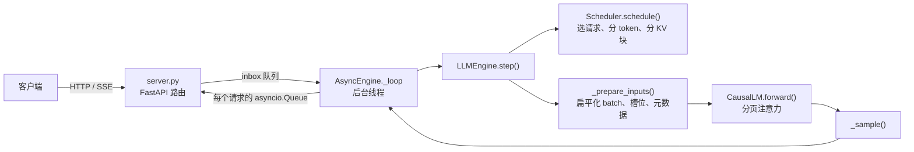

# 项目 1　MiniServe：实现一个最小推理引擎

> 前置：第 0、1 部分 ｜ 对应书中第 2、3、6、8 章 ｜ 代码：[`code/project1`](https://github.com/zrpxx/hands-on-llm-serving-opt/tree/main/code/project1)

## 目标

不使用 vLLM 等推理框架，用 PyTorch 和 FastAPI 实现一个能服务真实模型（Qwen3 / Qwen2 / Llama 系列稠密模型）的在线推理引擎，具备：

- 自己实现的模型前向（与 Hugging Face 输出逐位对齐）
- 分页 KV Cache、连续批处理、chunked prefill、抢占
- OpenAI 兼容的 HTTP 接口与 SSE 流式输出

然后用同一个压测工具，把它与 Hugging Face 逐请求基线、vLLM 放在一起比较，并解释差距。

## 交付物

1. 通过全部测试的 `starter/miniserve`（你自己的实现）。
2. 一份实验报告，包含第 5 节中的四组实验结果与分析。
3. 一段踩坑记录。

## 1. 代码结构

```text
code/project1/
├── starter/miniserve/      你要完成的部分（标有 TODO）
├── solution/miniserve/     参考实现（建议完成后再看）
├── baseline_hf.py          Hugging Face 逐请求基线
├── bench.py                压测客户端（适用于任何 OpenAI 兼容服务）
├── tools/make_tiny_model.py  生成随机初始化的微型 Qwen3，用于 CPU 开发
└── tests/                  正确性测试
```

`starter` 中已经写好的部分：配置读取、`Sequence` 数据结构、模型的线性层 / RMSNorm / RoPE / MLP、采样、停止判断、显存测算、HTTP 路由与 SSE 格式、增量反分词。需要你完成的是与本部分内容直接对应的核心逻辑：

| 文件 | 待完成 | 里程碑 |
|---|---|---|
| `scheduler.py` | `_schedule_running`、`_admit`、`_schedule_continuous` | 1-2 |
| `kv_cache.py` | `BlockAllocator.allocate / free` | 1-3 |
| `scheduler.py` | `_blocks_needed`、`_allocate`、`_preempt` | 1-3 |
| `engine.py` | `_prepare_inputs` | 1-3 |
| `model.py` | `Attention.forward` 中的分页注意力 | 1-3 |
| `server.py` | `AsyncEngine._loop`、`_dispatch` | 1-4 |

整体结构：



## 2. 环境准备

```bash
cd code/project1
pip install -r requirements.txt

# CPU 开发用的微型模型（随机权重，输出无意义，只用于验证正确性和流程）
python tools/make_tiny_model.py --out /tmp/tiny --layers 4 --hidden 128

# 运行测试：默认测试 starter；MINISERVE_IMPL=solution 测试参考实现
pytest -q tests
MINISERVE_IMPL=solution pytest -q tests
```

正确性测试以 Hugging Face 的贪心解码结果为参照，覆盖了 chunked prefill、抢占、不切块、静态批处理四种情况，并检查结束后所有 KV 块都已归还。

GPU 实验需要一个本地模型目录（含 `config.json`、`*.safetensors`、分词器文件），建议 Qwen3-0.6B 用于调试，Qwen3-8B 用于正式实验。

## 3. 里程碑

### 1-1　基线：逐请求服务与 KV Cache

不需要写代码。`baseline_hf.py` 用 Hugging Face 逐个处理请求，可以开关 KV Cache：

```bash
python baseline_hf.py --model $MODEL --port 8001                # 使用 KV Cache
python baseline_hf.py --model $MODEL --port 8001 --no-kv-cache  # 每步重算
```

用 `bench.py` 分别压测（输入 512、输出 128、并发 1），记录有无 KV Cache 时的 TPOT，并与 1.3 节的分析对照。这组数字也是后面"相对基线提升倍数"的分母。

### 1-2　连续批处理

阅读 `scheduler.py` 开头的说明，完成：

- `_schedule_running(budget)`：按顺序给 RUNNING 请求分配本步的 token 数。decode 的请求分 1 个，prefill 未完成的请求分剩余部分，总量不超过 `budget`。此时可以先不处理 KV 块不足的情况。
- `_admit(budget, allow_partial)`：从等待队列头部依次接纳请求，直到达到 `max_num_seqs`、预算用完或 KV 块不足。`allow_partial=True` 时允许只处理 prompt 的一部分，这就是 chunked prefill。
- `_schedule_continuous()`：先调度 RUNNING，再用剩余预算接纳 WAITING。

验收：`pytest tests/test_scheduler.py` 中与预算、并发上限、连续接纳、静态批处理相关的测试通过。

> [!TIP]
> 关键不变量：一个请求本步要处理的 token 数 = `seq.num_tokens - seq.num_computed_tokens`（再受预算限制）。新请求、切块中的 prefill、decode、被抢占后恢复，都可以用这一个式子表示（1.6 节）。

### 1-3　分页 KV Cache 与抢占

这是工作量最大的一步，建议按顺序完成。

**块管理。** 完成 `BlockAllocator` 与 `Scheduler._blocks_needed / _allocate`。请求处理到第 $n$ 个 token 时，需要 $\lceil n / \text{block\_size} \rceil$ 个块。

**抢占。** 在 `_schedule_running` 中，块不够时从 `running` 队尾选请求抢占（`_preempt`）：释放全部块、`num_computed_tokens` 清零、放回等待队列头部。如果被抢占的恰好是当前请求自己，就停止。刚发生过抢占的这一步不再接纳新请求。

**输入准备。** 完成 `engine.py` 的 `_prepare_inputs`，把调度结果展平成一次前向的输入：

| 输出 | 内容 |
|---|---|
| `input_ids`、`positions` | 本步所有请求新 token 的拼接，以及它们在各自序列中的位置 |
| `slot_mapping` | 每个新 token 写入 KV 池的槽位：`block_table[p // B] * B + p % B` |
| prefill 组 | 每个请求在扁平 batch 中的起点、新 token 数、完整上下文的槽位列表 |
| decode 组 | 行号、padding 到相同长度的槽位矩阵 [B, max_ctx]、对应的掩码 |
| `sample_seqs`、`sample_rows` | 本步算完全部已有 token 的请求，以及要取的 hidden 行（该请求最后一个新 token） |

**分页注意力。** 完成 `model.py` 中 `Attention.forward` 的后半部分：先用 `slot_mapping` 写入新 K、V；prefill 组逐请求取出上下文、构造因果掩码（第 $i$ 个新 token 的位置是 `ctx - n + i`）；decode 组一次批量计算。`F.scaled_dot_product_attention` 的 `enable_gqa=True` 可以省去手动展开 KV 头。

验收：`pytest tests/test_correctness.py` 全部通过；`test_scheduler.py` 中的抢占测试通过。

> [!ATTENTION]
> 最常见的错误：因果掩码的偏移算错（chunked prefill 的第二块开始时，新 token 的位置不是从 0 开始）；采样时取错 hidden 行；抢占后忘记清零 `num_computed_tokens`，导致恢复时跳过了 prefill。测试中的"抢占"和"切块"用例就是针对这些情况设计的。

### 1-4　HTTP 服务与流式输出

完成 `server.py` 中的 `AsyncEngine._loop` 与 `_dispatch`：

- 后台线程没有任务时阻塞在 `inbox.get()` 上，不要空转。
- 每轮先处理完 inbox 中所有命令（新增请求、中止请求），再执行一次 `engine.step()`。
- 把每个输出通过 `loop.call_soon_threadsafe` 投递到对应请求的 `asyncio.Queue`，请求结束后清理映射。

验收：`pytest tests/test_server.py` 通过（并发请求下流式与非流式结果一致、KV 块全部归还）。然后启动服务，用 `curl` 和 `bench.py` 手动验证：

```bash
PYTHONPATH=starter python -m miniserve.server --model $MODEL --port 8000
curl -sN localhost:8000/v1/chat/completions -H 'Content-Type: application/json' \
  -d '{"messages":[{"role":"user","content":"用一句话介绍 KV Cache"}],"max_tokens":64,"stream":true}'
```

### 1-5　可选扩展

完成主线后，可以任选以下方向，每一项都对应后面某一节的内容：

| 扩展 | 做法 | 预期效果 | 相关章节 |
|---|---|---|---|
| 前缀缓存 | 块哈希 + 引用计数 + LRU（见 1.7 节实验 2） | 共享前缀负载下 TTFT 大幅下降 | 1.7 |
| 用 FlashAttention 替换注意力 | `flash_attn_varlen_func` 处理 prefill，`flash_attn_with_kvcache(block_table=...)` 处理 decode，直接读取分页缓存而不拷贝 | 长上下文下 decode 明显加速，显存占用下降 | 3.2 |
| CUDA Graph | 对若干固定的 decode 批大小录制图，运行时 padding 到最近的大小 | 小模型下 TPOT 明显下降 | 1.6、6.8 |
| 优先级调度 | 请求带优先级，抢占时选优先级最低的 | 高优先级请求的 P99 稳定 | 1.6 |

## 4. 参考结果（CPU）

参考实现在 CPU、微型随机模型上的一组结果，仅用于确认实验方向是否正确（4 层、hidden 128，48 个请求，输入 128、输出 64，并发 16）：

| 服务 | 输出吞吐 | TTFT P50 | TPOT P50 |
|---|---|---|---|
| HF 逐请求基线 | 669 tok/s | 1418 ms | 1.4 ms |
| MiniServe | 2724 tok/s | 46 ms | 5.1 ms |

注意 TPOT 变大了：批处理以单请求的 TPOT 为代价换取吞吐，这正是 0.5 节讲的权衡。调度策略的对比结果见 1.5 节第 5 部分。

## 5. 实验与报告

所有实验都用 `bench.py`，保存 JSON 结果（`--save`），并记录 GPU 型号、模型、框架版本。

**实验 A：相对基线与 vLLM。** Qwen3-8B（或显存允许的最大 Qwen3 模型），输入 512、输出 128，闭环并发 32：

| 服务 | 输出吞吐 | TTFT P50 / P99 | TPOT P50 / P99 | 相对 HF 基线 | 相对 vLLM |
|---|---|---|---|---|---|
| HF 基线（无批处理） | | | | 1× | |
| MiniServe | | | | | |
| vLLM（默认参数） | | | | | 100% |

**实验 B：并发扫描。** 并发从 1 到 64（1、2、4、8、16、32、64），画出 MiniServe 与 vLLM 的吞吐、TTFT P50/P99、TPOT P50/P99 随并发变化的曲线。

**实验 C：调度策略。** 在 GPU 上重做 1.5 节第 5 部分的对比（静态 / 连续不切块 / 连续切块，不同 token 预算），使用长短混合的负载与泊松到达。

**实验 D：显存估算验证。** 用 0.3 节的公式（或 `estimate_memory.py`）预估 KV 容量与最大并发，与 MiniServe 启动日志中的 KV 块数对比；再逐步增加并发直到出现抢占（`/metrics` 中的 `preemptions`），与预估的并发上限对比。

**差距分析。** 用 `torch.profiler` 或 Nsight Systems 分别抓取 MiniServe 与 vLLM 的一次 decode step，比较：GPU 时间、CPU 准备输入的时间、kernel 数量、注意力部分的耗时。用数据说明 MiniServe 与 vLLM 的差距主要来自哪里。

## 6. 完成标准

- [ ] `pytest -q tests` 全部通过（starter 实现）
- [ ] 实验 A：MiniServe 的输出吞吐达到 HF 基线的 5 倍以上
- [ ] 实验 A：MiniServe 达到 vLLM 吞吐的 30% 以上；未达到时，差距分析能定量说明原因
- [ ] 实验 B：给出两组框架的并发扫描曲线，并指出 MiniServe 吞吐饱和的位置
- [ ] 实验 C：用数据说明 chunked prefill 对 TTFT 与 ITL 尾部的影响
- [ ] 实验 D：KV 容量估算与实测误差在 15% 以内
- [ ] 踩坑记录至少三条，每条写清楚现象、原因、解决办法

## 常见问题

**CPU 上可以完成吗？** 1-2 到 1-4 的全部开发和测试都可以在 CPU 上完成。只有第 5 节的性能实验需要 GPU。

**`bench.py` 的 `--vocab-size` 怎么设？** 随机 token id 的上界，应小于模型词表中第一个特殊 token 的 id。Qwen 系列用 32000 即可；微型模型的词表约 420，用 400。

**为什么 MiniServe 在小模型上远慢于 vLLM？** 小模型的单步 GPU 计算只有几毫秒，Python 准备输入、逐层启动几百个小 kernel 的开销与之相当。vLLM 用 CUDA Graph、持久化批、独立进程等手段消除了这些开销（1.6 节第 2.5 部分）。换成 8B 模型后，GPU 计算占比上升，差距会缩小。
