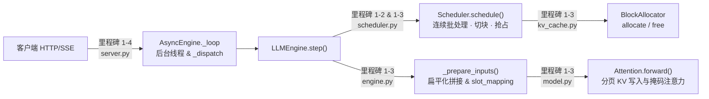

# 项目 1　MiniServe：手写一个迷你推理引擎

> **前置章节**：第 0 部分（显存与 Roofline）、第 1 部分（1.1 ~ 1.8）
> **项目代码目录**：[`code/project1`](https://github.com/zrpxx/hands-on-llm-serving-opt/tree/main/code/project1)（支持在 **纯 CPU** 上完成全部代码开发与单元测试，在 **GPU** 上完成性能压测）

---

## 1. 为什么要亲手写一个 MiniServe？

看懂十篇讲 PagedAttention 和 Continuous Batching 的文章，也不如亲手把那 200 行核心调度与寻址代码写出来、跑通测试来得透彻。

在这个实战项目中，我们将**不依赖 vLLM 或 SGLang**，只用原生 **PyTorch + FastAPI**，从零组装出一个真正能加载并服务 `Qwen3` / `Llama` 系列模型的在线推理引擎 **MiniServe**。虽小但五脏俱全，它完整拥有现代工业级引擎的四大支柱：
1. **纯手写 Transformer 前向传播**（`model.py`）：包含 RMSNorm、RoPE、GQA 与分页 KV Cache 读写，贪心解码输出与 Hugging Face 官方结果**逐位 100% 对齐**。
2. **统一 Token 预算调度器**（`scheduler.py`）：支持 Continuous Batching、Chunked Prefill 与显存不足时的队尾重算式抢占（Preemption）。
3. **分页物理块分配器**（`kv_cache.py`）与**扁平化批次拼接器**（`engine.py`）。
4. **异步流式 HTTP 服务**（`server.py`）：通过 `inbox` 队列与 `asyncio.Queue` 实现多请求合批推理与 OpenAI 兼容的 SSE 流式吐字。

---

## 2. 代码结构与任务

打开 `code/project1/` 目录，文件结构非常清爽：

```text
code/project1/
├── starter/miniserve/        【你的主战场】包含 12 处 TODO（11 个函数 + 注意力中的一段）
├── solution/miniserve/       完整参考实现（卡壳超过 30 分钟时可以随时对照查阅）
├── baseline_hf.py            Hugging Face 逐请求串行基线（用于对比提速倍数）
├── bench.py                  通用开环/闭环压测客户端（可压测 MiniServe / vLLM / SGLang）
├── tools/make_tiny_model.py  一键生成几 MB 的随机权重微型 Qwen3，供 CPU 秒级调试
└── tests/                    自动化单元测试套件（验证调度、分页、抢占与逐位正确性）
```

我们已经为你写好了所有繁琐的脚手架代码（如配置文件解析、权重加载、RoPE 旋转公式、Top-K/Top-P 采样、增量反分词等）。你只需要集中火力攻克**最核心的 4 个里程碑（共 12 处 TODO）**：



---

## 3. 环境准备

无论你现在用的是 Mac 还是没有显卡的轻薄本，都可以立刻跑通测试环境：

```bash
cd code/project1
pip install -r requirements.txt

# 1. 生成一个 4 层、hidden=128 的微型测试模型到 /tmp/tiny
python tools/make_tiny_model.py --out /tmp/tiny --layers 4 --hidden 128

# 2. 先用参考实现（solution）跑一遍测试，确认环境 100% 正常（应显示全部 passed）
MINISERVE_IMPL=solution pytest -q tests

# 3. 不加环境变量直接跑 pytest，默认测试你的 starter 目录（此时会因 TODO 未填而报 NotImplementedError）
pytest -q tests
```

---

## 4. 组件：<code>_prepare_inputs</code> 如何展平批次

在动手写代码前，我们先用交互组件把整个项目里最考验空间想象力的一个环节——**`engine.py` 中的 `_prepare_inputs()`** 彻底搞明白。

在传统批处理里，输入张量是二维的 `[batch_size, seq_len]`，所有序列必须补齐（Padding）到相同长度。但在开启了 Continuous Batching 和 Chunked Prefill 的现代引擎里，同一批里的请求有的本步要算 **2 个 Prefill 词**，有的本步只算 **1 个 Decode 词**。
为了不浪费哪怕 1 个 Padding 的计算，我们把所有请求本步要算的新词**首尾相接拍平成一条一维长向量 `input_ids`（形状 `[total_new_tokens]`）**送进模型。

请点击下方组件切换两个具体场景，观察 `input_ids`、`positions`、`slot_mapping` 和 `sample_rows` 是怎么构造出来的：

<div class="llm-widget" data-widget="miniserve-batch-sandbox"></div>

---

## 5. 里程碑

> [!TIP]
> 动手时请打开 **[项目 1 分步指南](stage1/project1-walkthrough.md)**。它把四个里程碑拆成 11 步，每一步只改一两个函数，并配有只针对这一步的测试（`pytest tests/test_steps.py -k stepNN`）、手算例子和三级提示。

| 里程碑 | 指南步骤 | 要完成的函数 | 验证 |
|---|---|---|---|
| 1-1 基线 | 第 0 步、第 11 步 | 无（运行 `baseline_hf.py`） | `bench.py` |
| 1-2 / 1-3 调度与块管理 | 第 1~6 步 | `BlockAllocator.allocate / free`，`Scheduler._blocks_needed / _allocate / _admit / _schedule_running / _schedule_continuous / _preempt` | `-k step01` ~ `-k step06`，`tests/test_scheduler.py` |
| 1-3 输入展平与分页注意力 | 第 7~9 步 | `LLMEngine._prepare_inputs`，`Attention.forward` 中的分页注意力 | `-k step07`、`-k step08`，`tests/test_correctness.py` |
| 1-4 HTTP 服务 | 第 10 步 | `AsyncEngine._dispatch / _loop` | `-k step10`，`tests/test_server.py` |

注意顺序：第 3 步的 `_admit` 会用到第 2 步的块分配，所以块管理要先于调度逻辑完成。

几个容易写错的接口约定（以 `starter/` 中的代码为准）：

- `BlockAllocator.allocate()` 每次只分一块、返回 `int`；没有空闲块时抛 `RuntimeError`。
- `_blocks_needed(seq, num_new)` 与 `_allocate(seq, num_new)` 的第二个参数是**本步新增**的 token 数，不是总数。
- `_schedule_running(budget)` 返回三元组 `(scheduled, 剩余预算, 抢占数)`。
- 配置直接存在调度器上：`self.block_size`、`self.chunked_prefill`、`self.max_num_seqs`；状态枚举是 `SeqStatus`；抢占计数是 `self.total_preemptions`。
- decode 组的槽位矩阵字段是 `meta.decode_slots`。

---

## 6. GPU 压测与交付报告

当你在 CPU 上通过全部正确性测试后，在 GPU 机器上加载 `Qwen/Qwen3-0.6B` 或 `Qwen/Qwen3-8B`，用 `bench.py` 完成以下四组对比实验（对应 `README.md` 中的完成标准）：

1. **实验 A（相对基线与 vLLM 吞吐对比）**：固定输入 512、输出 128、并发 32，对比 `baseline_hf.py`、`MiniServe` 与 `vLLM` 的输出吞吐（验证 MiniServe 达到 HF 基线 5 倍以上）。
2. **实验 B（并发扫描曲线）**：将 `--max-concurrency` 从 `1, 2, 4, 8, 16, 32, 64` 依次扫描，观察吞吐饱和点与 TPOT 的增长关系。
3. **实验 C（调度策略与切块预算对比）**：复现 `1.5 节` 的静态批处理 vs 连续批处理 vs Chunked Prefill 对比。
4. **实验 D（显存估算对账）**：用 `0.3 节` 的 `estimate_memory.py` 算出的 KV 块数，与 MiniServe 启动日志中的 `KV Cache：N 块 × 16 = … token` 进行核对（验证误差 < 15%）。

---

## 7. 自测

<div class="llm-widget" data-widget="quiz" data-questions='[{"q": "MiniServe 的 chunked prefill：某请求有 10 个 prompt token，第一步算了位置 0~3，第二步算位置 4~6（本步 n = 3，算完后上下文长度 ctx = 7）。构造形状为 [3, 7] 的掩码时，第 0 行可以看到哪些列？", "options": ["只有第 0 列", "第 0~4 列，即满足 &#36;j \\le (ctx - n) + i&#36; 的列", "全部 7 列", "第 0~3 列，即只看历史，不看自己"], "answer": 1, "explain": "本步第 &#36;i&#36; 行的绝对位置是 &#36;(ctx - n) + i&#36;，它能看到自己和之前的所有位置。直接用 <code>torch.tril(ones(3, 7))</code> 不加偏移，会把前 4 个历史 token 误屏蔽，这是实现 chunked prefill 时最常见的错误。"}, {"q": "<code>_preempt(seq)</code> 释放了序列的全部块之后，为什么还要把 <code>num_computed_tokens</code> 置为 0？", "options": ["为了让统计中的生成 token 数归零", "块已经回到空闲列表并可能被其他序列覆盖；不清零的话，重新调度时会以为 KV 还在，直接 decode，读到别人的数据", "<code>num_computed_tokens</code> 必须与 block_table 的长度相等，否则会抛出异常", "清零后序列会被放到 WAITING 队列尾部，避免饥饿"], "answer": 1, "explain": "重算式抢占的含义是丢掉 KV，恢复时把 prompt 和已生成的 token 一起重新 prefill。已生成的输出 token 要保留，否则会重复输出；被抢占的序列通常放回 WAITING 队首而不是队尾。"}, {"q": "在 0.6B 模型上，纯 Python 调度的 MiniServe 比 vLLM 慢得明显；换成 8B 模型后差距缩小。主要原因是：", "options": ["8B 模型使用了 GQA，MiniServe 对它做了专门优化", "0.6B 模型每步 GPU 计算只有一两毫秒，Python 准备输入、逐个启动 kernel 的开销占了大头；8B 模型每步计算更长，这些固定开销占比变小", "vLLM 在大模型上会自动关闭 CUDA Graph", "8B 模型的权重放不进 vLLM 的显存预算，vLLM 需要卸载到 CPU"], "answer": 1, "explain": "小模型的瓶颈在 CPU 侧：调度、张量拼接和 kernel 启动。vLLM 用 CUDA Graph、异步调度和融合算子压缩这部分开销。模型越大，GPU 时间占比越高，框架间的差距越接近算子效率本身的差距。"}]'></div>
