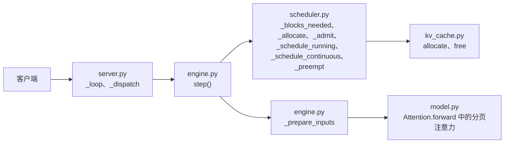

# 项目 1　MiniServe：手写一个迷你推理引擎

> 前置：第 0 部分，第 1 部分 1.1～1.4。代码在 [`code/project1`](https://github.com/zrpxx/hands-on-llm-serving-opt/tree/main/code/project1)。全部开发和正确性测试都可以在 CPU 上完成，性能实验需要 GPU。

读懂分页 KV Cache 和连续批处理是一回事，把它们写出来、让输出和 Hugging Face 逐 token 一致，是另一回事。这个项目不使用 vLLM 或 SGLang，只用 PyTorch 和 FastAPI，实现一个能加载 Qwen3 官方权重、提供 OpenAI 兼容接口的推理引擎。

它的规模很小，核心代码一千行左右，但包含了第 1 部分讲到的主要机制：

- **模型**（`model.py`）：RMSNorm、RoPE、GQA 注意力和 SwiGLU，KV Cache 按分页方式读写。支持 Llama、Qwen2、Qwen3 结构。贪心解码的输出与 Hugging Face 一致。
- **调度器**（`scheduler.py`）：连续批处理，chunked prefill，显存不足时的重算式抢占。为了做对比实验，也保留了静态批处理和不切块两种模式。
- **块管理与输入准备**（`kv_cache.py`、`engine.py`）：物理块的分配和释放，把一批序列展平成模型的输入。
- **HTTP 服务**（`server.py`）：1.1 节的结构，后台线程运行引擎循环，每个请求一个队列，支持 SSE 流式输出。

前缀缓存没有包含在必做部分，可以作为完成后的扩展练习（见第 6 节）。

## 1. 代码结构

```text
code/project1/
├── starter/miniserve/        要完成的代码，12 处 TODO
├── solution/miniserve/       参考实现
├── baseline_hf.py            Hugging Face 逐个处理请求的基线服务
├── bench.py                  压测工具，适用于任何 OpenAI 兼容的服务
├── tools/make_tiny_model.py  生成一个随机权重的 Qwen3 小模型，用于 CPU 上开发
├── tools/trace.py            逐步打印调度器和每个序列的状态
└── tests/                    分步测试和端到端测试
```

配置解析、权重加载、RoPE、采样、增量解码这些和主题关系不大的部分已经写好。要完成的是下面 12 个地方：



| 文件 | 要完成的部分 | 对应章节 |
|---|---|---|
| `kv_cache.py` | `BlockAllocator.allocate`、`free` | 1.3 |
| `scheduler.py` | `_blocks_needed`、`_allocate`、`_admit`、`_schedule_running`、`_schedule_continuous`、`_preempt` | 1.2、1.3 |
| `engine.py` | `_prepare_inputs` | 1.3 |
| `model.py` | `Attention.forward` 中的分页注意力 | 0.2、1.2 |
| `server.py` | `AsyncEngine._loop`、`_dispatch` | 1.1 |

## 2. 准备环境

```bash
cd code/project1
pip install -r requirements.txt

# 生成一个 4 层、hidden 128 的小模型
python tools/make_tiny_model.py --out /tmp/tiny --layers 4 --hidden 128

# 用参考实现跑一遍测试，确认环境正常，应该全部通过
MINISERVE_IMPL=solution pytest -q tests

# 不设环境变量时测试 starter，现在会因为 TODO 未完成而失败
pytest -q tests
```

## 3. 按步骤完成

[项目 1 分步指南](stage1/project1-walkthrough.md)把整个项目拆成 11 步。每一步只改一两个函数，有一组只针对这一步的测试，配有手算的例子和逐级展开的提示。建议按指南的顺序做，每一步测试通过再进入下一步：

| 指南步骤 | 内容 | 验证 |
|---|---|---|
| 第 0 步 | 准备环境，跟着一个请求读一遍代码 | 参考实现的测试全部通过 |
| 第 1～6 步 | 块分配、调度、抢占 | `pytest tests/test_steps.py -k step01` 到 `step06`，以及 `tests/test_scheduler.py` |
| 第 7～9 步 | 展平输入、分页注意力、端到端正确性 | `-k step07`、`-k step08`，以及 `tests/test_correctness.py` |
| 第 10 步 | 引擎循环与 token 分发 | `-k step10`，以及 `tests/test_server.py` |
| 第 11 步 | 在真实模型上运行并压测 | `bench.py` |

顺序上要注意一点：第 3 步的 `_admit` 会调用第 2 步的块分配函数，所以块管理要先完成。

几个容易弄错的接口约定，以 `starter/` 中的函数签名和注释为准：

- `BlockAllocator.allocate()` 一次只分配一块，返回块号（`int`）；没有空闲块时抛出 `RuntimeError`。
- `_blocks_needed(seq, num_new)` 和 `_allocate(seq, num_new)` 的第二个参数是**本步新增**的 token 数，不是总数。
- `_schedule_running(budget)` 返回三元组 `(scheduled, 剩余预算, 抢占数)`。
- 调度器的配置直接存在实例上：`self.block_size`、`self.chunked_prefill`、`self.max_num_seqs`。状态枚举是 `SeqStatus`，抢占计数是 `self.total_preemptions`。

## 4. 最难的一步：展平输入

整个项目里最需要想清楚的，是 `engine.py` 的 `_prepare_inputs`（指南第 7 步）。

普通的批处理把输入组织成 `[batch, seq_len]`，短的序列补齐到同样长度。连续批处理加 chunked prefill 之后，同一步里有的序列要处理一段 prompt，有的只处理一个 decode 的 token，补齐会浪费大量计算。所以 MiniServe 和 vLLM 一样，把所有序列这一步要处理的 token 首尾相接，拼成一个一维的 `input_ids`，形状是 `[本步 token 总数]`。线性层不关心 token 属于哪个序列，直接处理这个一维批；只有注意力需要知道每个 token 属于哪个序列、在序列中的什么位置、K 和 V 存在哪里。

`_prepare_inputs` 要算出四样东西：

- `input_ids`：这一步每一行的 token；
- `positions`：每一行在自己序列中的位置，用于 RoPE；
- `slot_mapping`：每一行的 K、V 写入哪个槽位（1.3 节的公式）；
- `sample_rows`：哪些行要送进输出头采样。只有这一步之后已算长度追上总长度的序列，才采样它的最后一行。

另外还要为注意力准备每个序列完整上下文的槽位，并区分 prefill 组和 decode 组，两组的注意力用不同的方式计算。

下面的组件可以改变每个序列的状态，看这些输出怎样变化：

<div class="llm-widget" data-widget="prepare-inputs"></div>

## 5. 完成标准与实验

**正确性**（CPU 即可）：`pytest -q tests` 全部通过。其中 `test_correctness.py` 在连续批处理、chunked prefill、抢占、静态批处理等多种模式下，比较 MiniServe 与 Hugging Face 贪心解码的输出，要求逐 token 一致。

**性能实验**（需要 GPU）：加载 Qwen3-0.6B 或 Qwen3-8B，用 `bench.py` 完成下面四组实验，把结果整理成一份简短的报告：

1. **与基线和 vLLM 比较。** 输入 512、输出 128、并发 32，比较 `baseline_hf.py`、MiniServe 和 vLLM 的输出吞吐。MiniServe 应该明显快于逐个处理请求的基线。
2. **并发扫描。** `--max-concurrency` 依次取 1、2、4、8、16、32、64，画出吞吐和 TPOT 随并发的变化，找到吞吐开始饱和的位置，并用 0.7 节的公式解释。
3. **调度策略。** 在 GPU 上重复 1.2 节第 5 节的实验：静态批处理、不切块的连续批处理、两种预算下的 chunked prefill。
4. **显存核对。** 用 0.6 节的 `estimate_memory.py` 估算 KV 块数，和 MiniServe 启动日志中的 `KV Cache：N 块 × 16 = … token` 对比，解释差异的来源。

指南的第 11 步给出了这些实验的具体命令。

和 vLLM 比较时，MiniServe 在 0.6B 这样的小模型上会慢得多，在 8B 上差距会缩小。原因在自测的第三题里。

## 6. 扩展练习

做完必做部分，可以选择下面的方向继续：

- **前缀缓存。** 按 1.4 节 vLLM 的方式，为写满的块计算链式哈希，维护哈希到物理块的映射和引用计数，命中时直接设置 `num_computed_tokens`。注意抢占和释放时引用计数的处理。
- **CUDA Graph。** 对 decode 的固定批大小录制 CUDA Graph，减少 kernel 启动的开销，观察小模型上单步时间的变化。
- **更好的抢占策略。** 现在总是抢占最晚加入的序列。试试按剩余输出长度、已等待时间等其他依据，比较 P99 延迟的变化。
- **用 FlashInfer 或 FlashAttention 的分页 kernel 替换注意力。** 现在的注意力在 Python 里按序列循环，长上下文时很慢。

## 自测

<div class="llm-widget" data-widget="quiz" data-questions='[{"q": "一个请求有 10 个 prompt token。第一步算了位置 0～3，第二步算位置 4～6（本步 n = 3，算完后上下文长度 ctx = 7）。第二步构造 [3, 7] 的注意力掩码时，第 0 行可以看到哪些列？", "options": ["只有第 0 列", "第 0～3 列", "第 0～4 列", "全部 7 列"], "answer": 2, "explain": "本步第 &#36;i&#36; 行的绝对位置是 &#36;(ctx - n) + i&#36;，第 0 行就是位置 4，它能看到位置 0～4。如果直接用 <code>torch.tril(ones(3, 7))</code>，不加 &#36;ctx - n&#36; 的偏移，第 0 行只能看到第 0 列，这是实现切块时最常见的错误。"}, {"q": "<code>_preempt(seq)</code> 释放了序列的全部块之后，为什么还要把 <code>num_computed_tokens</code> 置为 0？", "options": ["为了让统计中的输出 token 数归零", "块可能已被别的序列覆盖，不清零就会读到别人的 KV", "否则 block_table 和已算长度不一致，会抛出异常", "清零后序列会被放到等待队列末尾，避免饥饿"], "answer": 1, "explain": "重算式抢占丢掉了 KV。恢复时要把 prompt 和已生成的 token 一起重新 prefill，调度器靠已算长度为 0 来知道这一点。已生成的输出 token 要保留，否则会重复输出；被抢占的序列放回等待队列的队首。"}, {"q": "在 0.6B 模型上，MiniServe 比 vLLM 慢得多；换成 8B 模型后，差距明显缩小。主要原因是：", "options": ["8B 模型使用了 GQA，MiniServe 对它做了专门优化", "vLLM 在大模型上会关闭 CUDA Graph", "小模型每步的 GPU 计算很短，Python 和 kernel 启动的固定开销占了大头", "8B 模型放不进 vLLM 的显存预算，只能卸载到 CPU"], "answer": 2, "explain": "0.6B 模型每步的 GPU 计算只有一两毫秒，MiniServe 在 Python 里准备输入、逐层启动 kernel 的时间反而更长。vLLM 用 CUDA Graph、异步调度等手段消除了这部分开销。模型越大，GPU 计算的占比越高，两者的差距越接近算子本身的效率差异。"}]'></div>
