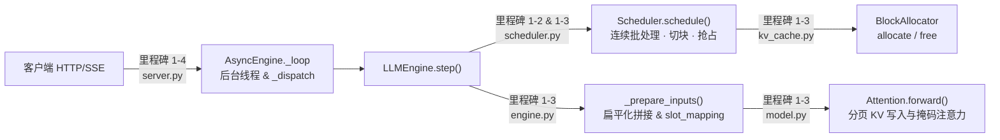

# 项目 1　MiniServe：从零手写一个迷你推理引擎

> **前置章节**：第 0 部分（显存与 Roofline）、第 1 部分（1.1 ~ 1.8）
> **项目代码目录**：[`code/project1`](https://github.com/zrpxx/hands-on-llm-serving-opt/tree/main/code/project1)（支持在 **纯 CPU** 上完成全部代码开发与单元测试，在 **GPU** 上完成性能压测）

---

## 1. 为什么要亲手写一个 MiniServe？

看懂十篇讲 PagedAttention 和 Continuous Batching 的文章，也不如亲手把那 200 行核心调度与寻址代码写出来、跑通测试来得透彻。

在这个实战项目中，我们将**不依赖 vLLM 或 SGLang**，只用原生 **PyTorch + FastAPI**，从零组装出一个真正能加载并服务 `Qwen3` / `Llama` 系列模型的在线推理引擎 **MiniServe**。虽小但五脏俱全，它完整拥有现代工业级引擎的四大支柱：
1. **纯手写 Transformer 前向传播**（`model.py`）：包含 RMSNorm、RoPE、GQA 与分页 KV Cache 读写，贪心解码输出与 Hugging Face 官方结果**逐位 100% 对齐**。
2. **统一 Token 预算调度器**（`scheduler.py`）：支持 Continuous Batching、Chunked Prefill 与显存不足时的队尾重算式抢占（Preemption）。
3. **分页物理块分配器**（`kv_cache.py`）与**扁平化批次拼接器**（`engine.py`）。
4. **异步流式 HTTP 服务**（`server.py`）：通过 `inbox` 队列与 `asyncio.Queue` 实现多请求合批推理与 OpenAI 兼容的 SSE 流式吐字。

---

## 2. 项目代码全景图与你的闯关任务

打开 `code/project1/` 目录，文件结构非常清爽：

```text
code/project1/
├── starter/miniserve/        👈 【你的主战场】包含 10 处精心设计的 TODO 填空
├── solution/miniserve/       💡 完整参考实现（卡壳超过 30 分钟时可以随时对照查阅）
├── baseline_hf.py            🐢 Hugging Face 逐请求串行基线（用于对比提速倍数）
├── bench.py                  🚀 通用开环/闭环压测客户端（可压测 MiniServe / vLLM / SGLang）
├── tools/make_tiny_model.py  🧪 一键生成几 MB 的随机权重微型 Qwen3，供 CPU 秒级调试
└── tests/                    ✅ 自动化单元测试套件（验证调度、分页、抢占与逐位正确性）
```

我们已经为你写好了所有繁琐的脚手架代码（如配置文件解析、权重加载、RoPE 旋转公式、Top-K/Top-P 采样、增量反分词等）。你只需要集中火力攻克**最核心的 4 个里程碑（共 10 个小函数填空）**：



---

## 3. 5 分钟环境就绪（纯 CPU 即可开干！）

无论你现在用的是 Mac 还是没有显卡的轻薄本，都可以立刻跑通测试环境：

```bash
cd code/project1
pip install -r requirements.txt

# 1. 生成一个 4 层、hidden=128 的微型测试模型到 /tmp/tiny
python tools/make_tiny_model.py --out /tmp/tiny --layers 4 --hidden 128

# 2. 先用参考实现（solution）跑一遍测试，确认环境 100% 正常（应显示全部 passed）
MINISERVE_IMPL=solution pytest -q tests

# 3. 不加环境变量直接跑 pytest，默认测试你的 starter 目录（此时会因 TODO 未填而报 NotImplementedError）
pytest -q tests
```

---

## 4. 交互式沙盒：攻克最难的 `_prepare_inputs` 扁平化批次拼接

在动手写代码前，我们先用交互沙盒把整个项目里最考验空间想象力的一个环节——**`engine.py` 中的 `_prepare_inputs()`** 彻底搞明白。

在传统批处理里，输入张量是二维的 `[batch_size, seq_len]`，所有序列必须补齐（Padding）到相同长度。但在开启了 Continuous Batching 和 Chunked Prefill 的现代引擎里，同一批里的请求有的本步要算 **2 个 Prefill 词**，有的本步只算 **1 个 Decode 词**。
为了不浪费哪怕 1 个 Padding 的计算，我们把所有请求本步要算的新词**首尾相接拍平成一条一维长向量 `input_ids`（形状 `[total_new_tokens]`）**送进模型！

请点击下方沙盒切换两个具体场景，观察 `input_ids`、`positions`、`slot_mapping` 和 `sample_rows` 是怎么构造出来的：

<div class="llm-widget" data-widget="miniserve-batch-sandbox"></div>

---

## 5. 四个里程碑手把手通关指南

### 里程碑 1-1：跑通 Hugging Face 逐请求基线（无需写代码）
在 GPU 或 CPU 上运行 `baseline_hf.py`，用 `bench.py` 感受一下“不合批 + 无 KV Cache”有多慢：

```bash
python baseline_hf.py --model /tmp/tiny --device cpu --port 8001
python bench.py --base-url http://localhost:8001 --model /tmp/tiny --num-prompts 16 --input-len 64 --output-len 32 --max-concurrency 4 --vocab-size 400
```

---

### 里程碑 1-2：实现连续批处理与 Chunked Prefill（`scheduler.py`）

打开 `starter/miniserve/scheduler.py`，先完成与调度预算相关的三个函数：
1. **`_schedule_running(self, budget: int)`**：
   - 遍历 `self.running` 中的每个请求 `seq`。
   - 还差多少词没算？回顾 `1.6` 节的黄金公式：`rem = seq.num_tokens - seq.num_computed_tokens`。
   - 如果配置开启了 `enable_chunked_prefill`，本步分配给它的词数就是 `n = min(rem, budget)`；如果没开启切块且 `rem > 1`（说明是 Prefill），则只有当 `rem <= budget` 时才分配 `n = rem`。
2. **`_admit(self, budget: int, allow_partial: bool)`**：
   - 当 `self.waiting` 队列不为空、`len(self.running) < max_num_seqs` 且 `budget > 0` 时，查看队头请求 `seq = self.waiting[0]`。
   - 如果 `allow_partial=True`（允许切块），本步给它分 `n = min(rem, budget)` 个词；否则必须 `rem <= budget` 才接纳。
   - 调用 `self._allocate(seq, seq.num_computed_tokens + n)` 为它分配物理块（里程碑 1-3 实现），若分配成功则从 `waiting` 弹出并加入 `running`。
3. **`_schedule_continuous(self)`**：
   - 先调用 `scheduled, budget = self._schedule_running(budget)` 喂饱老员工；
   - 如果刚才这一步**没有发生过抢占**且 `budget > 0`，再调用 `self._admit(budget, allow_partial=self.cfg.enable_chunked_prefill)` 招新员工！

---

### 里程碑 1-3：实现 PagedAttention 分页块管理、抢占与注意力计算

这是最有成就感的核心部分，建议按以下 4 小步逐个击破：

#### 第 1 小步：`kv_cache.py` 中的 `BlockAllocator`
- `allocate(n)`：如果 `len(self.free_ids) < n` 返回 `None`；否则从 `self.free_ids` 左侧弹出 `n` 个块 ID 返回（`[self.free_ids.popleft() for _ in range(n)]`）。
- `free(block_ids)`：把归还的 `block_ids` 追加回 `self.free_ids` 右侧，并清空传入的列表。

#### 第 2 小步：`scheduler.py` 中的块分配与队尾抢占
- `_blocks_needed(num_tokens)`：$n$ 个 Token 需要几个块？向上取整除法：`(num_tokens + B - 1) // B`（其中 `B = self.cfg.block_size`）。
- `_allocate(seq, target_tokens)`：还差几个块 = ` self._blocks_needed(target_tokens) - len(seq.block_table)`。如果需要新增块，调用 `self.allocator.allocate(need)` 并 `extend` 到 `seq.block_table`。
- `_preempt(seq)`：当 `_schedule_running` 中发现块不够时，从 `self.running.pop()` 弹出队尾请求执行抢占：① `self.allocator.free(seq.block_table)`；② **`seq.num_computed_tokens = 0`**（千万别忘清零！）；③ `seq.status = SequenceStatus.WAITING` 并 `self.waiting.appendleft(seq)` 放回等待队头；④ `self.num_preemptions += 1`。

此时运行 `pytest -q tests/test_scheduler.py`，所有调度器与抢占测试就应该全绿通过了！

#### 第 3 小步：`engine.py` 中的 `_prepare_inputs`
对照上面第 4 节的交互式沙盒，遍历本步调度的每个 `(seq, n)`：
- 本步要算的新词区间是 `start = seq.num_computed_tokens` 到 `end = start + n`。
- 取出新词 `seq.token_ids[start:end]` 追加到 `input_ids`，位置 `range(start, end)` 追加到 `positions`。
- 对区间里的每个位置 `p`，用公式 `seq.block_table[p // B] * B + (p % B)` 算出写入槽位追加到 `slot_mapping`。
- **关键判断**：如果 `end == seq.num_tokens`（说明本步算完了该请求当前所有的已知词），把 `seq` 加入 `sample_seqs`，并把它在扁平张量里的最后一行索引 `row_End - 1` 加入 `sample_rows`！

#### 第 4 小步：`model.py` 中的 `Attention.forward`
- **写入新 KV**：一行代码完成分页写入：`k_cache[meta.slot_mapping] = k` 和 `v_cache[meta.slot_mapping] = v`！
- **Prefill 组注意力**：取出完整上下文槽位 `ks = k_cache[ctx_slots]`（形状 `[ctx, n_kv, d]`），构造大小为 `[n, ctx]` 的布尔因果掩码：第 $i$ 个新词在原序列中的绝对位置是 `(ctx - n) + i`，它只能看到列号 $\le (ctx - n + i)$ 的 Key！然后调用 `F.scaled_dot_product_attention(..., attn_mask=mask, enable_gqa=True)`。
- **Decode 组批量注意力**：所有 Decode 请求本步都只有 `1` 个 Query 词，直接利用 `meta.decode_ctx_slots` 批量索引出 `[B, max_ctx, n_kv, d]`，传入 `meta.decode_mask` 一次性批量算完！

此时运行 `pytest -q tests/test_correctness.py`，验证你的引擎输出与 Hugging Face 官方贪心输出逐位完全一致！

---

### 里程碑 1-4：打通异步流式 HTTP 服务（`server.py`）

打开 `starter/miniserve/server.py`，参照我们在 `1.4 节第 4 部分` 已经详细展示过的代码，补全 `AsyncEngine._loop` 和 `_dispatch`。完成后运行全套测试：

```bash
pytest -q tests
```

看到 **全部测试通过 (100% Passed)** 的绿色提示时，恭喜你——你已经亲手造出了一台货真价实的现代大模型推理引擎！

---

## 6. GPU 压测实验与交付报告模板

当你在 CPU 上通过全部正确性测试后，在 GPU 机器上加载 `Qwen/Qwen3-0.6B` 或 `Qwen/Qwen3-8B`，用 `bench.py` 完成以下四组对比实验（对应 `README.md` 中的完成标准）：

1. **实验 A（相对基线与 vLLM 吞吐对比）**：固定输入 512、输出 128、并发 32，对比 `baseline_hf.py`、`MiniServe` 与 `vLLM` 的输出吞吐（验证 MiniServe 达到 HF 基线 5 倍以上）。
2. **实验 B（并发扫描曲线）**：将 `--max-concurrency` 从 `1, 2, 4, 8, 16, 32, 64` 依次扫描，观察吞吐饱和点与 TPOT 的增长关系。
3. **实验 C（调度策略与切块预算对比）**：复现 `1.5 节` 的静态批处理 vs 连续批处理 vs Chunked Prefill 对比。
4. **实验 D（显存估算对账）**：用 `0.3 节` 的 `estimate_memory.py` 算出的 KV 块数，与 MiniServe 启动日志打印的 `allocated N KV blocks` 进行核对（验证误差 < 15%）。

---

## 7. 闯关自测

<div class="llm-widget" data-widget="quiz" data-title="项目 1 MiniServe · 综合闯关自测" data-questions='[
  {
    "q": "在实现 MiniServe 的 Chunked Prefill 注意力计算时，假设某个请求共有 10 个 Prompt 词，第 1 步已经算了前 4 个词（位置 0,1,2,3），第 2 步正在算接下来的 3 个词（n=3，此时已入库的总上下文长度 ctx=7）。请问在第 2 步构造形状为 [3, 7] 的因果掩码时，本步第 0 行（对应原序列位置 4 的词）允许看到前几列的 Key？",
    "options": [
      "只能看到第 0 列（只看第 1 个词）",
      "允许看到第 0, 1, 2, 3, 4 共 5 列（即列索引 j <= (ctx - n) + i = (7 - 3) + 0 = 4）！如果直接用 torch.tril(ones(3, 7)) 而不加偏移量 (ctx - n)，就会把前 4 个历史词全部错误屏蔽掉！",
      "允许看到全部 7 列（包括未来的词 5 和词 6）",
      "不需要任何掩码"
    ],
    "answer": 1,
    "explain": "这是实现 Chunked Prefill 最容易踩的 Bug！在第 2 块及以后的 Prefill 步中，新 Token 的起始绝对位置不是 0，而是 ctx - n。因此第 i 个新 Token 的绝对位置是 (ctx - n) + i，掩码条件必须是 col_idx <= (ctx - n) + row_idx。"
  },
  {
    "q": "在 _preempt(seq) 抢占一个正在运行的请求时，除了调用 allocator.free(seq.block_table) 释放它的全部物理 KV 块并把它放回 waiting 队列头部外，为什么还必须把 seq.num_computed_tokens 重置为 0？",
    "options": [
      "为了清空它已经生成出来的文本",
      "因为它的物理 KV 块已经被回收并分给别人覆盖了！如果不把 num_computed_tokens 清零，下次它恢复运行时，调度器会误以为前面的词还在显存里，只算最后 1 个词并去空的 block_table 寻址，当场引发越界崩溃或算出乱码",
      "为了把它的 seq_id 改成 0",
      "其实不需要重置为 0"
    ],
    "answer": 1,
    "explain": "重算式抢占（Recomputation Preemption）丢弃了显存中的 KV 状态，但保留了 seq.token_ids（Prompt + 已生成词）。将 num_computed_tokens 归零后，恢复调度时 num_tokens - 0 就会自动把整条序列重新做一次 Prefill 恢复 KV 缓存。"
  },
  {
    "q": "为什么在 0.6B 这类极小模型上，用纯 Python 调度的 MiniServe 与生产级 vLLM 的单步耗时差距比较明显，而换成 8B 模型后两者的相对差距会明显缩小？",
    "options": [
      "因为 MiniServe 不支持 0.6B 模型",
      "因为 0.6B 模型的单步 GPU 矩阵乘只需约 1~2 ms，此时 Python 线程准备张量、逐层发射几百个小 CUDA Kernel 的 CPU 开销占比很大（vLLM 靠 CUDA Graph 和持久化 Batch 消除了这部分开销）；而换成 8B 模型后，GPU 硬件计算与访存耗时上升为主导，Python 调度开销占比就被稀释了",
      "因为 8B 模型的层数比 0.6B 少",
      "因为 vLLM 在 8B 模型上会自动关闭 KV Cache"
    ],
    "answer": 1,
    "explain": "这正是 1.6 节介绍 vLLM V1 工程设计（CUDA Graph 录制、Persistent Batch、多进程解耦）的意义所在：当模型很小或硬件极快时，CPU 发射 Kernel 的开销会浮出水面成为瓶颈。"
  }
]'></div>
