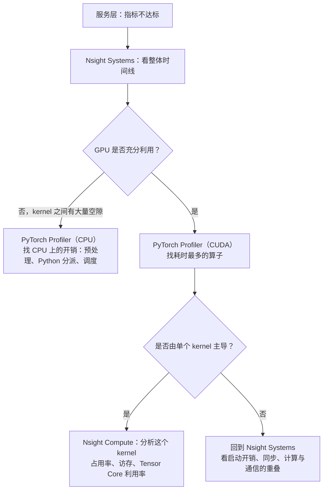

# 3.6 性能剖析

> 对应原书第 10 章 *Performance Profiling Strategies*。vLLM 内置的剖析接口、CUDA Graph 的原理是书外内容。

前面几节讲了很多优化手段，但在一个具体的服务里，哪一项最值得做，要靠测量来回答。原书说，服务的规模大了以后，一个百分点的性能提升就可能节省大量的成本，最后那几个百分点不再是可有可无的。这一节介绍怎样从"服务慢了"这样的现象，一层层找到具体的原因。

## 1. 三个层次

原书把性能剖析分为三层：

| 层次 | 看什么 | 工具 |
|---|---|---|
| 服务层 | 吞吐、TTFT、ITL、GPU 利用率、显存占用 | 压测工具（0.8 节）、vLLM 的 `/metrics` |
| 框架层 | 每个 PyTorch 算子的耗时，CPU 与 GPU 之间的数据传输，计算与 I/O 是否重叠 | PyTorch Profiler |
| 运行时层 | 每个 CUDA kernel 的执行情况，kernel 之间的空隙，kernel 内部的瓶颈 | Nsight Systems、Nsight Compute |

服务层的指标在第 0、1 部分已经用过很多次了。它们能告诉你"慢不慢"，但不能告诉你"为什么慢"。

## 2. 从现象到原因

原书图 10-3 给出了一个决策流程，大意如下：



一个常见的误区是：`nvidia-smi` 显示的 GPU 利用率很高，就以为 GPU 已经用满了。`nvidia-smi` 的利用率只表示采样周期内"有 kernel 在运行"的时间比例。原书指出，即使这个数字很高，kernel 之间仍然可能有大量的空隙，GPU 实际上在等 CPU 发射下一个 kernel。只有看时间线才能发现这一点。

## 3. CPU 开销与 CUDA Graph

decode 时最常见的瓶颈不在 GPU 上。每生成一个 token，模型要执行几百个 kernel，每个 kernel 都要经过 Python 解释器、PyTorch 的算子分派和 CUDA 的发射调用，在 CPU 上花费几微秒到十几微秒。模型小、batch 小的时候，每个 kernel 在 GPU 上只运行几微秒，CPU 发射的速度跟不上 GPU 执行的速度，GPU 大部分时间在空等。

<div class="llm-widget" data-widget="launch-timeline"></div>

可以切换模型和显卡对比：Qwen3-0.6B 在 H100 上逐个发射时，GPU 只有约四分之一的时间在工作；换成 Qwen3-32B，每个矩阵乘法要读几十 MB 的权重，GPU 的耗时超过了发射开销，空隙就基本消失了。这也是项目 1 的 MiniServe 在小模型上比 vLLM 慢得多、在大模型上差距缩小的原因。

**CUDA Graph** 是解决这个问题的主要手段。它把一段 GPU 操作录制成一张图，之后一次调用就能重放整张图，CPU 只需要发射一次。它的限制是：

- 图里的所有操作、张量的形状和地址在录制时就固定了。所以 vLLM 在启动时为一系列 batch 大小（1、2、4、8、16……）分别录制，运行时把实际的 batch 补齐到最近的一档。
- 录制要占用一些显存和启动时间。vLLM 启动日志里的 `Capturing CUDA graphs` 就是这一步。
- 图中不能有依赖 CPU 判断的分支。注意力的元数据每一步都在变，所以 vLLM 结合 `torch.compile` 使用分段的 CUDA Graph：注意力之外的部分录进图里，注意力单独执行，或者使用支持 CUDA Graph 的注意力后端。

用 `--enforce-eager` 启动 vLLM 可以关闭 CUDA Graph 和编译，在调试时很有用，也可以用来体会它的作用。

除了 CUDA Graph，降低 CPU 开销的手段还有：把调度、输入准备与 GPU 执行重叠起来（6.8 节的异步调度），以及把预处理、分词、反分词放到单独的进程中。原书提到，vLLM V1 把 API 服务、输入预处理与 GPU 执行拆到不同的进程，就是为了避免多模态预处理这类 CPU 密集的工作阻塞 kernel 的发射。

## 4. PyTorch Profiler

`code/stage3/profile_decode.py` 用 PyTorch Profiler 剖析 Hugging Face 模型的 decode。不指定模型时，它会生成一个 8 层的随机小模型，在 CPU 上就能运行：

```bash
python code/stage3/profile_decode.py
```

核心代码只有几行：

```python
from torch.profiler import ProfilerActivity, profile, record_function

with profile(activities=[ProfilerActivity.CPU, ProfilerActivity.CUDA], record_shapes=True) as prof:
    for _ in range(8):
        with record_function("decode_step"):          # 在时间线上标出每一步
            out = model(nxt, past_key_values=cache, use_cache=True)
            nxt = out.logits[:, -1:].argmax(-1)
print(prof.key_averages().table(sort_by="cuda_time_total", row_limit=12))
prof.export_chrome_trace("trace.json")                 # 用 ui.perfetto.dev 打开
```

在 CPU 上运行的部分输出：

```text
                     Name    Self CPU %   CPU total   # of Calls
              decode_step        23.96%    75.215ms            8
             aten::linear         0.68%    32.490ms          456
                 aten::mm        37.74%    28.483ms          456
                aten::cat         9.63%     8.215ms          264
               aten::mean         1.12%     4.074ms          264
aten::scaled_dot_product_attention  0.37%   3.184ms           64

平均每步 9.40 ms，每步约 2037 次 aten 算子调用
```

这张表里有几个值得追问的地方：

- **一个 8 层的模型，每一步有两千多次算子调用。** 平均每层两百多次，大部分是 `transpose`、`view`、`to` 这样的小操作。每一次都要经过 Python 和 PyTorch 的分派。
- **`decode_step` 自身占了 24% 的时间**，这是不在任何 aten 算子里的部分，主要是 Hugging Face 模型代码本身的 Python 开销。
- **`aten::cat` 有 264 次。** 一半来自 RoPE 的 `rotate_half`，另一半来自 `DynamicCache`：它每一步用 `torch.cat` 把新的 K、V 拼到旧的缓存后面，也就是把整个缓存复制一遍。上下文越长，这一步越慢。这正是 1.3 节分页 KV Cache 要避免的问题。

在 GPU 上运行时（`--model Qwen/Qwen3-0.6B --device cuda`），表里会多出 CUDA 时间一列。对比"CPU total"和"CUDA total"，如果后者远小于前者，就说明瓶颈在 CPU 上。

## 5. 剖析 vLLM

vLLM 内置了对 PyTorch Profiler 的支持。设置环境变量后启动服务，再用压测工具的 `--profile` 参数，在压测期间采集：

```bash
VLLM_TORCH_PROFILER_DIR=./vllm_profile vllm serve Qwen/Qwen3-0.6B
vllm bench serve --model Qwen/Qwen3-0.6B --dataset-name random --num-prompts 50 --profile
```

压测工具会在开始和结束时分别调用服务的 `/start_profile` 和 `/stop_profile` 接口，时间线保存在 `./vllm_profile` 下。剖析会明显拖慢服务，采集时请求数要少一些。不同版本的配置方式可能变化，以所用版本的文档为准。

## 6. Nsight Systems 与 Nsight Compute

**Nsight Systems**（`nsys`）给出整个系统的时间线：CPU 线程、CUDA API 调用、每个 kernel、内存拷贝、NCCL 通信。它是定位问题的起点：

```bash
nsys profile -o vllm_report --trace-fork-before-exec=true --cuda-graph-trace=node \
  vllm serve Qwen/Qwen3-0.6B
```

vLLM 会启动子进程，`--trace-fork-before-exec` 让 `nsys` 跟踪到这些子进程；`--cuda-graph-trace=node` 让 CUDA Graph 中的每个 kernel 单独显示，而不是合成一块。

在时间线上要找的典型问题：

| 现象 | 可能的原因 | 方向 |
|---|---|---|
| kernel 之间有规律的空隙 | CPU 发射跟不上 | CUDA Graph、减少小算子、异步调度 |
| 每一步开头有一段较长的空白 | 调度和输入准备在关键路径上 | 把准备工作与 GPU 执行重叠 |
| 大量很短的 kernel | 没有融合 | 融合算子（3.3 节）、`torch.compile` |
| 内存拷贝与计算串行 | 拷贝没有放到单独的 stream | 原书建议用多个 CUDA stream 让拷贝与计算重叠 |
| 多卡时 NCCL 的 kernel 很长 | 通信没有与计算重叠，或者链路带宽不够 | 第 4 部分 |

**Nsight Compute**（`ncu`）分析单个 kernel 的内部：达到了峰值带宽和算力的百分之多少（Speed of Light）、线程束的占用率、访存是否合并、在等什么。当一个 kernel 主导了耗时，就用它来判断该调参、替换还是融合。原书举的例子是：softmax kernel 反复从显存读取很大的中间张量，而不是放在共享内存里，这时应该换成融合的 kernel。

```bash
# 分析项目 3 中的 FlashAttention kernel，只采集名字匹配的 kernel
ncu --set full -k regex:_flash_fwd -c 3 -o flash_report python bench.py
```

对于带宽瓶颈的 kernel（RMSNorm、decode 注意力），首先看显存带宽利用率；对于计算瓶颈的 kernel（prefill 的矩阵乘和注意力），首先看 Tensor Core 的利用率。

## 7. 实验

- **CPU**：运行 `profile_decode.py`，把 `--prompt-len` 从 256 改成 2048，观察 `aten::cat` 的耗时变化，解释原因。
- **GPU**：用 Qwen3-0.6B 分别以默认配置和 `--enforce-eager` 启动 vLLM，在并发 1 下压测，比较 ITL。再换成 Qwen3-8B 重复一次。差距在哪个模型上更大？用本节的时间线组件解释。
- **GPU**：用 `nsys` 采集一次压测，在时间线上找到一步 decode，数一数它包含多少个 kernel，哪个 kernel 最耗时。

## 自测

<div class="llm-widget" data-widget="quiz" data-questions='[{"q": "nvidia-smi 显示 GPU 利用率 95%，但小模型的 decode 速度远低于预期。下一步最应该做什么？", "options": ["换一张更快的 GPU", "用 Nsight Systems 看时间线，检查 kernel 之间是否有大量空隙", "增大 max_num_seqs", "量化模型"], "answer": 1, "explain": "nvidia-smi 的利用率只表示采样周期内有 kernel 在运行的时间比例。kernel 之间的空隙只有在时间线上才能看到，空隙多说明 GPU 在等 CPU 发射。"}, {"q": "CUDA Graph 为什么能明显加快小模型的 decode？", "options": ["它让每个 kernel 本身运行得更快", "它把一整步的 kernel 录制下来一次重放，省掉了每个 kernel 在 CPU 上的分派和发射开销", "它减少了显存占用", "它自动融合了算子"], "answer": 1, "explain": "小模型每个 kernel 在 GPU 上只运行几微秒，CPU 发射一个 kernel 也要几微秒到十几微秒，GPU 大部分时间在空等。图重放让 CPU 只发射一次。"}, {"q": "vLLM 为什么要为 1、2、4、8 等多种 batch 大小分别录制 CUDA Graph？", "options": ["为了测试性能", "CUDA Graph 录制时形状就固定了，运行时把实际的 batch 补齐到最近的一档才能重放", "因为不同 batch 用不同的模型", "为了节省显存"], "answer": 1, "explain": "图中每个 kernel 的参数、张量的形状和地址都是录制时确定的。为每一档分别录制，再把 batch 补齐，是在灵活性和开销之间的折中。"}, {"q": "在 profile_decode.py 的结果中，aten::cat 的耗时随上下文变长而增加。原因是什么？", "options": ["RoPE 的计算量随长度增长", "Hugging Face 的 DynamicCache 每一步用 torch.cat 把新的 K、V 拼到旧缓存后面，每次都要复制整个缓存", "注意力的计算量随长度增长", "分词变慢了"], "answer": 1, "explain": "这正是连续存放的 KV Cache 的问题。分页 KV Cache 预先分配好块，新 token 的 K、V 直接写入槽位，不需要复制已有的内容。"}]'></div>

## 延伸阅读

- 原书第 10 章 *Performance Profiling Strategies*，图 10-3。
- [PyTorch Profiler 教程](https://docs.pytorch.org/tutorials/recipes/recipes/profiler_recipe.html)。
- [vLLM 文档：Profiling vLLM](https://docs.vllm.ai/en/latest/contributing/profiling.html)。
- [NVIDIA Nsight Systems 用户指南](https://docs.nvidia.com/nsight-systems/UserGuide/index.html)。
