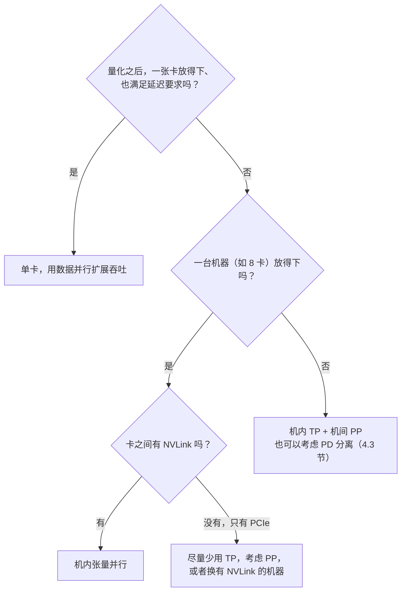

# 4.1 数据并行、张量并行与流水线并行

> 对应原书第 7 章 *Multi-GPU and Multi-Node Inferencing* 中的 *Data Parallelism* 与 *Tensor Parallelism and Pipeline Parallelism*。Megatron 式切分的细节是书外内容。

到目前为止，我们讨论的大多是一张卡上的事情。一张卡放不下模型，或者一张卡的速度、吞吐不够，就需要多张卡。原书把多卡推理的方式分为四种：

| 方式 | 解决什么问题 | 做法 |
|---|---|---|
| 数据并行（DP） | 吞吐不够 | 复制多个完整的模型实例，各自处理一部分请求 |
| 张量并行（TP） | 放不下，或者单卡太慢 | 把每一层的矩阵切开，分到多张卡上 |
| 流水线并行（PP） | 放不下 | 把不同的层放到不同的卡上，像流水线一样传递 |
| 专家并行（EP） | MoE 模型的专家太多 | 把不同的专家放到不同的卡上，4.2 节讨论 |

这一节讨论前三种。

## 1. 数据并行

数据并行就是水平扩展：同一个模型部署多份，前面放一个负载均衡器或者路由器，把请求分给各个实例。某个实例出了故障，路由器把请求转给其他实例。这是生产中最基本的扩展方式，所有的服务都会用到。

数据并行本身很简单，难点在路由：LLM 的请求长短差别很大，前缀缓存又是每个实例本地的，简单的轮询会造成负载不均、缓存命中率低。原书列出了轮询、最少连接、基于延迟、缓存感知等几种策略，4.6 节会详细讨论。

## 2. 张量并行

### 2.1 怎样切

张量并行把每一层的权重矩阵切开，分到多张卡上，每张卡只做一部分计算。最常用的是 Megatron-LM 提出的切法，以 FFN 为例：

- `gate_proj` 和 `up_proj` 按**输出**维度切（列并行）。每张卡算出中间层的一段，SwiGLU 是逐元素的，可以直接在这一段上算，不需要通信。
- `down_proj` 按**输入**维度切（行并行）。每张卡用自己的那一段中间结果，乘以对应的那几列权重，得到一个和完整输出形状相同的**部分和**。把所有卡的部分和加起来，就是最终结果。这一步是一次 **all-reduce**。

注意力同理：$q$、$k$、$v$ 的投影按头切开，每张卡负责一部分头，各自计算注意力；`o_proj` 按输入切开，最后一次 all-reduce。所以每一层有两次 all-reduce，每次传的数据是 $[\text{token 数}, \text{hidden}]$ 的激活。

`code/stage4/tp_demo.py` 在 CPU 上模拟了这个过程，验证切分前后的结果相同：

```bash
python code/stage4/tp_demo.py --tp 4
```

```text
tp = 4：与单卡结果的最大差 1.46e-10
每张卡存的 FFN 权重：4.5 MiB（单卡 18.0 MiB），BF16
一次 all-reduce 的数据：8 × 1024 × 2 字节 = 16 KiB；ring 算法下每张卡收发约 24 KiB
```

### 2.2 收益与代价

张量并行之后，每张卡只存 $1/\text{TP}$ 的权重。KV Cache 也按头切开，每张卡只存自己那部分头的 KV。所以：

- **放得下更大的模型**，而且每张卡多出来的显存都可以给 KV Cache，能容纳的 token 数按卡数增长；
- **每一步更快**。decode 时每张卡只读 $1/\text{TP}$ 的权重，带宽瓶颈下耗时也近似降为 $1/\text{TP}$；
- **代价是通信**。每层两次 all-reduce，一个 80 层的模型每一步就是 160 次。每次的数据量不大，但每次都有固定的延迟，而且所有卡都要等通信完成才能继续。

GQA 模型有一个限制：KV 头的数量少于 TP 时（比如 8 个 KV 头、TP = 16），KV 头没法再切，只能在几张卡上复制，KV Cache 的节省就打了折扣。

## 3. 流水线并行

流水线并行按层切：TP 是把模型横着切开，PP 是竖着切开。原书图 7-8 的例子中，一个 4 层的模型在 PP = 2 时，第 1、2 层在一张卡上，第 3、4 层在另一张卡上。数据从第一张卡流到第二张卡，只在交界处传一次激活。

所以 PP 的通信量比 TP 小得多。但它有自己的问题：

- **单个请求不会变快**。一个 token 仍然要依次经过所有的层，只是这些层分布在不同的卡上，还多了卡与卡之间的传输。
- **流水线气泡**。如果只有一批请求，第二张卡在第一张卡计算时是空闲的。要让所有卡都忙起来，需要同时有多个批次在流水线中流动。推理引擎用连续批处理把请求分成几个"虚拟"的批次，交替送入流水线。各段的负载不均衡时（原书的例子：某一层特别慢），后面的卡还是要等。

## 4. 怎样选择

原书图 7-10 给出了一个决策流程，大意如下：



这个流程背后有几个原则：

- **能用一张卡就用一张卡。** 显存的带宽（H100 约 3.35 TB/s）比卡间的连接快得多，多一张卡并不能让性能翻倍。一张显存更大的高端卡，常常比几张低端卡加并行更好。
- **先考虑量化。** FP8 让模型减半，W4A16 减到四分之一（第 2 部分），很可能就不需要多卡了。
- **TP 需要快速的卡间连接。** TP 每层都要通信，只适合在有 NVLink 的机器内部使用。没有 NVLink 时，PCIe 的带宽对 TP 来说通常太慢。
- **跨机用 PP。** 机器之间的网络比 NVLink 慢得多，PP 的通信少，适合跨机。常见的超大模型部署是机内 TP、机间 PP，比如 TP = 8、PP = 2。

下面的组件估算了不同 TP 下一步的耗时：

<div class="llm-widget" data-widget="tp-scaling"></div>

可以对比一下 Llama-3.1-70B 在 NVLink 和 PCIe 下的情况：有 NVLink 时，TP 从 4 增加到 8，每一步明显变快；只有 PCIe 时，通信的开销抵消了大部分收益。把 token 数调大，计算的比重增加，通信的占比会下降。

> [!NOTE]
> 原书说 H100 的 NVLink 带宽约 900 GB/s，大约是显存带宽的三分之一。900 GB/s 是双向的合计，每个方向是 450 GB/s。另外，原书提到 AWS 的一台 p5.48xlarge 与八台 p5.4xlarge 不等价，因为前者的 8 张卡之间有 NVLink，后者只能通过网络通信，这一点完全正确，也是 TP 只应该在机内使用的原因。

## 5. 在 vLLM 中使用

```bash
# 单机 8 卡：TP = 4，PP = 2
vllm serve Qwen/Qwen3-32B --tensor-parallel-size 4 --pipeline-parallel-size 2

# 单机 8 卡：8 个独立的副本（数据并行），由 vLLM 内置的负载均衡分配请求
vllm serve Qwen/Qwen3-8B --data-parallel-size 8
```

> [!NOTE]
> 原书的示例命令里定义了 `hf_model_id`，但 `vllm serve` 后面漏掉了模型名，直接运行会报错。

跨机运行时，vLLM 通常借助 Ray 来管理多台机器上的进程：先在各台机器上启动 Ray 集群，再在头节点上启动 vLLM，`--tensor-parallel-size` 与 `--pipeline-parallel-size` 的乘积等于总卡数。SGLang 使用 `--tp`、`--dp` 等参数，多机时用 `--nnodes` 和 `--node-rank`。

启动之后，可以在日志中看到每张卡的权重显存和 KV Cache 容量。TP = 2 时，每张卡的权重减半，KV Cache 能容纳的 token 数增加了不止一倍，因为每张卡省下的权重显存都给了 KV。

## 6. 实验

- **CPU**：运行 `tp_demo.py`，把 `--tp` 改成 3 会怎样？`--inter` 不能被整除时要怎么处理？
- **GPU（2 张卡）**：用 Qwen3-8B 分别以 `--tensor-parallel-size 1`、`2` 和 `--data-parallel-size 2` 启动，在并发 1 和并发 64 下压测，比较 ITL 和吞吐。TP 对哪个指标帮助更大？DP 呢？
- **GPU（2 张卡，没有 NVLink）**：重复上面的实验。可以用 `nvidia-smi topo -m` 查看两张卡之间的连接方式。

## 自测

<div class="llm-widget" data-widget="quiz" data-questions='[{"q": "Megatron 式的张量并行中，FFN 的哪一步需要 all-reduce？", "options": ["gate_proj 和 up_proj 之后", "SwiGLU 激活之后", "down_proj 之后：每张卡得到的是部分和，要相加才是最终结果", "不需要通信"], "answer": 2, "explain": "gate、up 按输出维度切，SwiGLU 逐元素计算，都在本卡完成；down 按输入维度切，各卡的结果要加起来。注意力的 o_proj 同理，所以每层两次 all-reduce。"}, {"q": "一个 80 层的模型 TP = 8。对 decode 的单个请求，张量并行主要带来什么收益和代价？", "options": ["没有收益，只有通信开销", "每张卡只读 1/8 的权重，每一步更快；代价是每一步 160 次 all-reduce 的延迟", "计算量减少到 1/8，没有代价", "KV Cache 变成原来的 8 倍"], "answer": 1, "explain": "decode 受限于读权重的带宽，每卡的读取量减少，耗时近似降为 1/TP。all-reduce 的数据量不大，但次数多、每次都有固定延迟，需要 NVLink 这样的快速连接。"}, {"q": "模型要跨两台 8 卡的机器部署，机器之间只有普通的网络。常见的做法是：", "options": ["TP = 16", "机内 TP = 8，机间 PP = 2", "PP = 16", "DP = 16"], "answer": 1, "explain": "TP 每层都要通信，只适合机内的 NVLink；PP 只在段与段之间传一次激活，适合跨机。放不下的模型才需要这样切，放得下就用数据并行。"}, {"q": "流水线并行为什么不能降低单个请求的延迟？", "options": ["因为每张卡的计算更慢", "一个 token 仍然要依次经过所有层，只是分布在不同的卡上，还多了卡间传输", "因为 KV Cache 无法切分", "因为它需要更多的显存"], "answer": 1, "explain": "PP 让多张卡同时处理不同批次的请求，提高的是吞吐和可容纳的模型大小。要降低单个请求的延迟，需要 TP 把每一层的计算分摊开。"}]'></div>

## 延伸阅读

- Shoeybi et al., [Megatron-LM: Training Multi-Billion Parameter Language Models Using Model Parallelism](https://arxiv.org/abs/1909.08053), 2019。
- [vLLM 文档：Parallelism and Scaling](https://docs.vllm.ai/en/latest/serving/parallelism_scaling.html)。
- 原书第 7 章图 7-8 到图 7-11。
