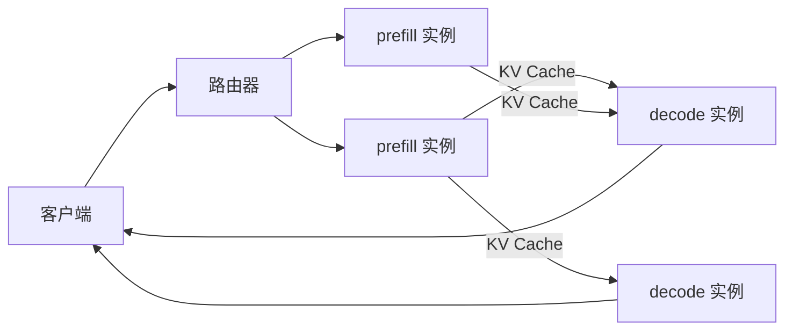

# 4.3 Prefill-Decode 分离

> 对应原书第 7 章 *Prefill-Decode Disaggregation*。goodput 的定义、Mooncake 和各引擎的具体用法是书外内容。

0.4 节说过，prefill 和 decode 是两种完全不同的负载：prefill 一次处理整个 prompt，受限于算力；decode 每步只处理一个 token，受限于显存带宽。1.2 节的 chunked prefill 把长 prompt 切成小块，和 decode 混在同一批里执行，缓解了两者的相互干扰。但只要它们在同一组 GPU 上运行，干扰就无法完全消除：一个 decode 步里混进了 2000 个 prefill token，这一步就从 10 毫秒变成了 50 毫秒，所有正在 decode 的请求都会卡一下。

PD 分离（Prefill-Decode Disaggregation）的做法是把两个阶段放到不同的 GPU 上：一组实例只做 prefill，一组只做 decode，prefill 算完后把 KV Cache 传给 decode 实例。

## 1. 为什么要分离

原书总结了四点好处：

- **TTFT 和 ITL 可以分别优化。** 不同的应用输入输出比例差别很大（原书图 7-14）。输入长、对首 token 敏感的应用，可以多配 prefill 实例；输出长、对流畅度敏感的应用，可以多配 decode 实例。decode 不再被 prefill 打断，ITL 更稳定。
- **两个阶段可以分别调参。** prefill 可以用足够大的 batch 让 Tensor Core 跑满；decode 可以把 batch 调到在满足 ITL 的前提下尽量大。两者甚至可以用不同的并行方式，比如 prefill 用 TP、decode 用更大的 EP（4.2 节）。
- **可以用不同的硬件。** prefill 需要算力，decode 需要显存容量和带宽。H100 和 H200 的算力相同，但 H200 的显存更大、带宽更高（141 GB、4.8 TB/s 对 80 GB、3.35 TB/s），原书认为 H100 适合 prefill、H200 适合 decode；对 decode 要求不高时，也可以用便宜得多的 L40S。
- **可以分别扩缩容。** prefill 直接面对新到的请求，负载波动大，可以更激进地扩缩；decode 的负载由正在生成的请求决定，相对平稳。

DistServe（OSDI 2024）把这个思路系统化，并提出用 **goodput** 衡量服务能力：在满足 TTFT 和 TPOT 目标的前提下，每秒能处理多少请求（0.8 节）。论文报告，与当时最好的聚合部署相比，同样的延迟目标下能多服务最多 7.4 倍的请求，或者在同样的请求量下满足严格 12.6 倍的延迟目标。

## 2. 架构

原书图 7-15 展示了 DistServe 的结构：请求先到控制器，由它分配给一个 prefill 实例；prefill 实例算完 prompt、产出第一个 token，把 KV Cache 传给一个 decode 实例；decode 实例接着生成后续的 token。



实际的系统还要处理很多细节：prefill 实例怎样选、decode 实例怎样选、KV 传到一半失败了怎么办、decode 实例的 KV 空间不够时怎么排队。项目 4 的模拟器实现了一个简化的版本。

## 3. KV 传输

PD 分离能不能带来收益，关键在于 KV 传输的开销能不能被收益抵消。

### 3.1 要传多少

原书的估算：一个 8B 模型，1024 个输入 token 的 KV 约 0.1 到 0.15 GB。输入是 10K token 时就是 1 到 1.5 GB。如果每秒处理 16 个这样的请求，就要传约 25 GB/s 的数据。

不同链路的带宽差别很大：

| 链路 | 每个方向的带宽 |
|---|---|
| 同一台机器内的 NVLink（H100） | 450 GB/s |
| 跨机 RDMA，每张卡一个 400 Gb/s 的网卡 | 约 50 GB/s 每卡 |
| 跨机，没有 RDMA，走 TCP | 约 10 GB/s 或更低 |

原书的结论是：25 GB/s 对 NVLink 完全不是问题，对 RDMA 也可以接受，但超出了没有 RDMA 的跨机网络的实际能力。这时应该把一个请求的 prefill 和 decode 安排在同一台机器的 GPU 上。

下面的组件可以估算不同模型、输入长度和请求速率下的带宽需求：

<div class="llm-widget" data-widget="pd-transfer"></div>

### 3.2 怎样隐藏传输

限制在同一台机器内并不理想：prefill 和 decode 只能用同一种卡，而且如果 prefill 本身就要 8 张卡做 TP，跨机就是必须的。原书列出了几种减少跨机传输开销的方法：

- **分块传输**：不等整个 KV 算完再传，而是像视频流一样分成小块传；
- **异步传输**：传输使用非阻塞的操作，与计算重叠；
- **逐层传输**：KV 是逐层产生的，每算完一层就开始传这一层，后面各层的计算与前面各层的传输重叠。prefill 结束时，只剩最后一层的 KV 还没传；
- **压缩 KV**：比如 FP8 KV Cache（2.5 节），或者 LMCache 的 CacheGen（4.4 节）。

原书引用的研究表明，做好这些优化之后，PD 分离的额外开销可以降到每个请求总延迟的 1% 以下（原书图 7-18）。

## 4. 实验：用模拟器比较

项目 4 的模拟器（第 4 步）模拟了 4 张 H100 上的 Qwen3-8B。负载是输入 2K 到 8K token、输出 128 到 512 token 的长文档问答，每秒 6 个请求。比较聚合部署（4 个实例都做 prefill 和 decode）与三种 PD 配比：

```bash
cd code/project4
CLUSTER_IMPL=solution python run.py pd --rate 6
```

| 配置 | TTFT P50 | TTFT P99 | ITL P50 | ITL P99 | 第 2 个 token 的 P99 | goodput |
|---|---|---|---|---|---|---|
| 聚合 ×4 | 155 ms | 245 ms | 8.8 ms | 59.5 ms | 59 ms | 1.00 |
| 1P3D | 460 ms | 1600 ms | 8.9 ms | 10.1 ms | 19 ms | 0.93 |
| 2P2D | 168 ms | 377 ms | 10.1 ms | 12.2 ms | 23 ms | 1.00 |
| 3P1D | 149 ms | 235 ms | 17.1 ms | 18.8 ms | 1056 ms | 0.89 |

goodput 的目标是 TTFT ≤ 1 秒、TPOT ≤ 20 毫秒。几点观察：

- **聚合部署的 ITL P99 很高。** 中位数只有 8.8 毫秒，P99 却有 59.5 毫秒：decode 不时被混进来的 prefill 拖慢。PD 分离后，ITL P99 降到 10 到 19 毫秒。
- **配比很关键。** 1P3D 的 prefill 不够，请求排队，TTFT 的长尾很长；3P1D 的 decode 不够，一个 decode 实例的 KV 空间放不下那么多请求，传过来的请求要排队等空间，第二个 token 要等一秒多。2P2D 在这个负载下最均衡。
- **分离的代价在 TTFT。** 同样是 4 张卡，PD 分离后只有一部分卡做 prefill，TTFT 一般会比聚合部署高。

再看网络的影响。把实例之间的带宽从 50 GB/s 降到 5 GB/s，并关闭逐层传输：

```bash
CLUSTER_IMPL=solution python run.py pd --rate 6 --link 5 --no-layerwise
```

2P2D 的第二个 token P99 从 23 毫秒增加到 277 毫秒，1P3D 增加到 1.2 秒：一个 prefill 实例的出口链路被占满，传输开始排队。打开逐层传输后（去掉 `--no-layerwise`），2P2D 降回 87 毫秒。

这些数字来自一个简化的模型（Roofline 估算的步长、固定的链路带宽、没有调度开销），绝对值不可当真，但趋势与原书和 DistServe 的结论一致。

## 5. 什么时候用

原书的回答很明确：不要默认使用 PD 分离。原书图 7-19 的决策流程可以简化为：只有**模型大、负载重、并且需要精细地调节 TTFT 和 ITL** 时才用；模型较小或者负载不大时，坚持更简单的聚合部署，配合 chunked prefill 就够了。

原因在于它的成本：

- 部署和运维复杂得多：两类实例、KV 传输、专门的路由器；
- 需要高速网络，否则传输会成为瓶颈；
- 配比要随负载调整，配错了反而更差（上面的 1P3D 和 3P1D）；
- 实例数少时不划算：只有两张卡，分成 1P1D，任何一边都没有冗余。

## 6. 在实际中使用

各主流引擎都支持 PD 分离，基本形式都是"分别启动 prefill 和 decode 实例，再启动一个代理或路由器"：

- **vLLM** 通过 KV connector 传输 KV，常用的有基于 NIXL 的 `NixlConnector`、`LMCacheConnectorV1`、`P2pNcclConnector` 等，用 `--kv-transfer-config` 指定，仓库的 `examples/` 下有完整的代理示例。
- **SGLang** 用 `--disaggregation-mode prefill` 或 `decode` 启动两类实例，传输后端可选 Mooncake 或 NIXL，再用 `sglang_router` 的 PD 模式把它们组织起来。
- **NVIDIA Dynamo** 和 **llm-d** 是建立在 vLLM、SGLang 等引擎之上的分布式推理框架，提供 PD 分离、KV 感知路由、自动扩缩容等功能。

Kimi 的 Mooncake 是另一个有代表性的设计：它以 KV Cache 为中心组织整个集群，把各节点的 CPU 内存和 SSD 汇集成一个分布式的 KV 池，prefill 和 decode 都围绕这个池调度。4.4 节会讨论 KV Cache 的分层存储。

## 7. 实验

- **CPU**：运行 `run.py ratio`，在每秒 2、4、6、8 个请求下比较各种配比，找出每个请求速率下 goodput 最高的配置。
- **CPU**：修改 `run.py`，让 prefill 实例用 H100、decode 实例用 L40S（`costmodel.py` 中已经定义），观察 ITL 的变化。这是原书提到的异构部署。
- **GPU（2 张卡）**：按 vLLM 文档中的 PD 分离示例，在两张卡上启动 1P1D，与两个聚合实例对比 ITL P99。

## 自测

<div class="llm-widget" data-widget="quiz" data-questions='[{"q": "聚合部署开启了 chunked prefill，ITL 的中位数只有 9 毫秒，P99 却有 60 毫秒。最可能的原因是：", "options": ["KV Cache 不够", "部分 decode 步里混进了 prefill 的 token，这些步变慢，正在 decode 的请求都被拖慢", "网络延迟", "采样太慢"], "answer": 1, "explain": "chunked prefill 限制了每步 prefill 的 token 数，但只要 prefill 与 decode 在同一组 GPU 上，就会有部分步变慢。PD 分离彻底消除了这种干扰。"}, {"q": "一个 8B 模型每秒处理 16 个输入约 10K token 的请求，PD 分离时大约需要多大的 KV 传输带宽？", "options": ["约 0.25 GB/s", "约 2.5 GB/s", "约 25 GB/s", "约 250 GB/s"], "answer": 2, "explain": "每个 token 的 KV 约 0.13 MB，10K token 约 1.3 GB，乘以每秒 16 个请求，约 20 到 25 GB/s。NVLink 和 RDMA 都能承受，没有 RDMA 的跨机网络就不够了。"}, {"q": "逐层传输 KV 为什么能减少 PD 分离的开销？", "options": ["它减少了要传的数据量", "每算完一层就开始传这一层的 KV，传输与后面各层的计算重叠，prefill 结束时只剩最后一层还没传", "它让 decode 不需要 KV", "它使用了更快的网络"], "answer": 1, "explain": "数据量不变，但大部分传输被藏在了 prefill 的计算后面。前提是链路有余量；链路被占满时，传输仍然要排队。"}, {"q": "关于什么时候使用 PD 分离，原书的建议是：", "options": ["所有部署都应该默认使用", "只在模型大、负载重、需要分别精细调节 TTFT 和 ITL 时使用，小模型和轻负载坚持聚合部署", "只在 CPU 上使用", "只在单卡上使用"], "answer": 1, "explain": "PD 分离增加了部署复杂度，需要高速网络，配比也要随负载调整。配比不当时，效果可能比聚合部署更差。"}]'></div>

## 延伸阅读

- Zhong et al., [DistServe: Disaggregating Prefill and Decoding for Goodput-optimized Large Language Model Serving](https://arxiv.org/abs/2401.09670), OSDI 2024。
- Patel et al., [Splitwise: Efficient Generative LLM Inference Using Phase Splitting](https://arxiv.org/abs/2311.18677), ISCA 2024。
- Qin et al., [Mooncake: A KVCache-centric Disaggregated Architecture for LLM Serving](https://arxiv.org/abs/2407.00079), FAST 2025。
- [vLLM 文档：Disaggregated Prefilling](https://docs.vllm.ai/en/latest/features/disagg_prefill.html)。
