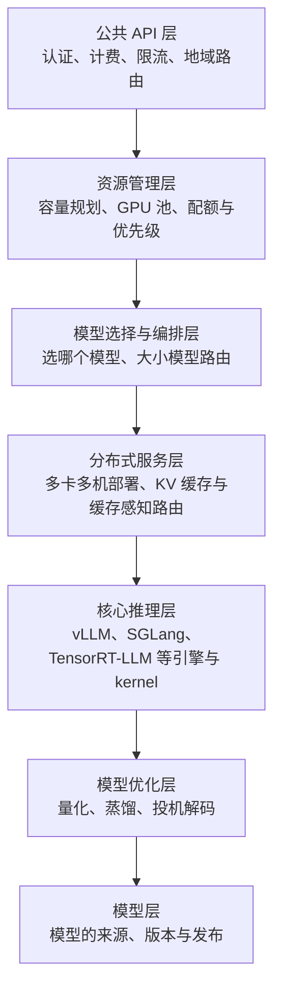

# 4.8 企业级部署架构

> 对应原书第 4 章 *LLM Serving in Enterprise Systems*、*Building with an Open Source Stack*、*Building with a Cloud Vendor*。推理服务的扩缩容指标和可观测性是书外内容。

前面各节讨论的都是推理系统的某一个部分。一个面向外部用户的 LLM 平台，比如 OpenAI、Anthropic、Together AI 的 API，远不止"把模型跑起来"：还要处理认证、计费、限流、多区域、容量规划、实验和监控。原书说，这样的系统需要成百上千名工程师共同维护，架构的关键是让不同的团队能各自迭代、互不阻塞。这一节按原书的分层，把前面的内容放到一个完整的系统中。

## 1. 七层架构

原书图 4-6 把企业级的模型服务系统分为七层，从外到内：

| 层 | 主要挑战 | 本教程中对应的内容 |
|---|---|---|
| 公共 API | 上百万并发连接；配额、防滥用、准确计费；就近接入；租户隔离与安全 | 1.1 节的流式接口，4.6 节的租户隔离 |
| 资源管理 | 预测需求又不过度采购；异构 GPU 池的利用率；关键业务的预留与低优先级任务的抢占 | 0.6 节的显存估算，0.8 节的 goodput |
| 模型选择与编排 | 不是每个请求都需要最大的模型；要理解请求才能选择；在模型池之间均衡负载 | 4.5 节 |
| 分布式服务 | 模型超出单卡；多卡多机的协调；按缓存内容路由，减少重复计算 | 4.1～4.4、4.6 节 |
| 核心推理 | 引擎与 kernel 的效率 | 第 1、3 部分 |
| 模型优化 | 不重新训练的前提下提升性能 | 第 2 部分，3.4、3.5 节 |
| 模型 | 把模型从训练流程或外部来源引入生产，按能力和用途组织，管理版本 | |

原书强调，模型和技术会不断变化，但这种分层的思路是稳定的：把 API、编排、推理、优化等关注点分开，让负责不同部分的团队独立创新，同时组成一个整体。

## 2. 用开源组件搭建

原书图 4-7 给出了一套基于开源组件的实现：

- **Kubernetes** 作为底座，负责资源管理、网络、流量路由、服务的部署和扩缩容、监控。原书指出，主要的云厂商和基础模型公司都以它为骨干。
- **FastAPI** 实现公共 API：一个兼容 OpenAI 格式的 `/v1/chat/completions` 接口，用依赖注入挂上认证逻辑（JWT 或 API key），认证时取出租户信息，供后面的配额、路由和模型选择使用。
- **Nginx 或 Envoy** 作为入口代理，做限流。
- **模型选择**写在 API 服务中，或者一个独立的中间件里，按模型名、别名、租户和灰度比例选择后端。
- **Ray Serve 加 vLLM** 托管模型。Ray Serve 负责副本的管理和扩缩，原书分别演示了单模型和多模型的托管。

原书的观点是：借助这些成熟的组件，再加上一些自己写的中间件，完全可以搭建出企业级的服务；AI 编程助手也能大大加快这个过程。

> [!NOTE]
> 原书的 API 层示例中，对长输出的请求在 API 服务里调用 `speculative_decode(req, endpoint_draft, endpoint_target)`，让草稿模型和目标模型分别作为两个远程服务。这只能作为示意：投机解码每一轮都要在草稿和目标之间交换 token 和概率分布（3.4 节），跨服务的网络往返会吞掉全部收益。实际中投机解码在推理引擎内部完成，API 层最多决定是否为某个请求开启它。

> [!NOTE]
> 原书说 HPA 配置会在 CPU 使用率超过 70% 时"再增加 3 到 15 个实例"。按配置中的 `minReplicas: 3`、`maxReplicas: 15`，含义是副本总数在 3 到 15 之间自动调整，而不是在现有基础上增加。

### 2.1 推理服务怎样扩缩容

原书用 CPU 使用率作为 API 服务扩缩容的依据，这对无状态的 API 服务是合适的。推理服务则不能这样做：GPU 实例的 CPU 使用率与负载几乎无关，GPU 利用率也会因为 3.6 节说的原因而误导。更合适的信号来自推理引擎本身：

| 信号 | vLLM 的指标（`/metrics`） | 含义 |
|---|---|---|
| 排队的请求数 | `vllm:num_requests_waiting` | 有请求在等，说明处理能力不够 |
| KV Cache 使用率 | `vllm:kv_cache_usage_perc` | 接近满时，新请求只能排队，或者触发抢占 |
| TTFT、ITL 的分布 | `vllm:time_to_first_token_seconds` 等直方图 | 直接对应 SLO |
| 抢占次数 | `vllm:num_preemptions_total` | KV 空间不够的信号 |

在 Kubernetes 中，可以用 KEDA 或自定义指标让 HPA 按这些信号扩缩；llm-d、KServe 等框架也内置了面向推理的扩缩容。另外要记住 4.5 节的冷启动：一个新的推理副本要一分钟左右才能开始服务，所以扩容的阈值要留出余量，或者根据流量的周期提前扩容。

## 3. 在云上搭建

原书以 AWS 为例，介绍了从全托管到完全自定义的六种方式。这里概括为三类：

| 方式 | 例子 | 你管理什么 | 适合 |
|---|---|---|---|
| 全托管的模型 API | Amazon Bedrock | 只管调用 API，按 token 付费 | 快速原型；只用平台提供的模型 |
| 一键部署 | SageMaker JumpStart | 选择实例类型和数量，按小时付费 | 部署模型库中已有的开源模型 |
| 自带模型或容器 | SageMaker 上部署自己的模型、自己的镜像 | 模型、推理代码、容器，云平台负责基础设施 | 自己微调的模型；需要定制推理逻辑 |

越往下越灵活，要承担的运维也越多。原书的建议是把这看作一个连续的光谱，而不是"自建"与"上云"二选一：常见的是组合使用，比如原型阶段用 Bedrock，流量稳定后把核心模型迁到自己部署的 vLLM 上，并且随着流量和成本结构的变化调整两者的比例。

## 4. 可靠性与可观测性

几个容易被忽略、但在生产中很重要的点：

- **健康检查与优雅下线**。推理实例要提供就绪探针（模型加载完、CUDA Graph 录制完才算就绪）；下线时先停止接收新请求，等进行中的请求生成完再退出，否则流式输出会被截断。
- **超时与重试**。LLM 的请求可能运行几分钟，网关的超时要相应调长；重试会让已经算了一半的请求重来，消耗双倍的资源，要谨慎设置。
- **优先级与抢占**。资源管理层的"关键业务预留、低优先级可抢占"需要引擎支持：vLLM 支持按优先级调度（`--scheduling-policy priority`），高优先级的请求可以抢占低优先级请求的资源。
- **按租户、按模型的度量**。计费、配额、容量规划都需要按租户和模型统计 token 数和延迟，这要在 API 层和引擎两边都打点。

## 5. 实验

- **CPU**：把项目 1 的 MiniServe 当作后端，用 FastAPI 写一个只有几十行的网关：校验 API key、按租户限流（令牌桶）、按模型名转发、把每个租户的 token 数记到内存里的计数器。
- **GPU 或 CPU**：启动一个 vLLM 实例（CPU 上可以用项目 1 代替），用 Prometheus 抓取 `/metrics`，在压测时观察排队的请求数和 KV Cache 使用率怎样变化，设计一个扩容规则。

## 自测

## 延伸阅读

- 原书第 4 章图 4-6、4-7。
- [Ray Serve 文档](https://docs.ray.io/en/latest/serve/index.html)。
- [vLLM 文档：Production Metrics](https://docs.vllm.ai/en/latest/usage/metrics.html)。
- [KServe](https://kserve.github.io/website/) 与 [llm-d](https://llm-d.ai/)：Kubernetes 上的推理服务框架。
